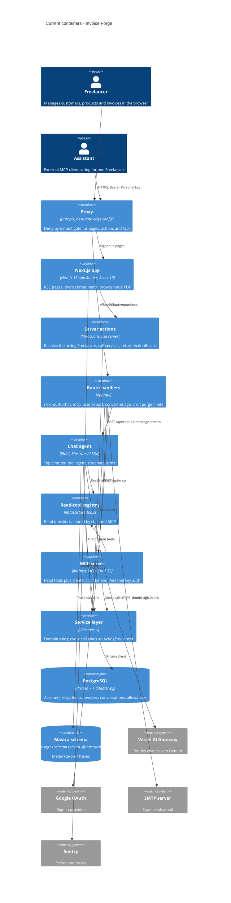

# Architecture map — Invoice Forge

> The **current** architecture (what exists today), produced by `survey` and read by
> specify / design / data-model / implement. Refresh with `survey` when the repo drifts past
> `reflects_commit`. This is generated; a hand-maintained `docs/architecture.md`, if present, is
> authoritative and reconciled below — not replaced.

## Stack

- Language / runtime: TypeScript 5 (strict, `tsconfig.json`) on Node `>=22.18 <23` (`package.json` engines, `.nvmrc` = 22), pnpm 10.25 (`packageManager` in `package.json`).
- Frameworks: Next.js 16.3.8 App Router and React 19.2.3 (both pinned exactly), Prisma 7.10 with `@prisma/adapter-pg` (`prisma.ts:11`), next-auth 5.0.0-beta.32 (pinned beta), zod 3.25, react-hook-form 7, zustand 5, TanStack Table 8, `@react-pdf/renderer` 4.3 (browser-only), Sentry `@sentry/nextjs` 10, `@modelcontextprotocol/sdk` 1.32.0 (pinned), recharts 2.15.4.
- AI runtime (all exact pins): Vercel AI SDK `ai` 7.0.137 + `@ai-sdk/react` 4.0.140 + `@ai-sdk/gateway` 4.0.110; Mastra `@mastra/core` 1.76.0, `@mastra/pg` 1.31.0, `@mastra/observability` 1.19.0, `@mastra/libsql` 1.24.0, CLI `mastra` 1.31.4; `@paralleldrive/cuid2` 3.3.0. `@mastra/core` and `@mastra/pg` are `serverExternalPackages` (`next.config.ts:83`). Default model `anthropic/claude-haiku-5.5` through the Vercel AI Gateway, overridable by `AI_CHAT_MODEL` (`lib/ai/model.ts:4`, `:13`).
- Build / test / lint (`package.json` scripts):
  - `pnpm build` = `scripts/check-required-settings.ts` → `prisma generate` → `next build`
  - `pnpm test:unit` = `vitest run -c vitest.config.ts` (unit + component + contract)
  - `pnpm test:integration` = `vitest run -c vitest.integration.config.ts` (throwaway Postgres via testcontainers)
  - `pnpm test:e2e` = `playwright test`
  - `pnpm lint` = eslint 9 flat config (`eslint.config.mjs`); typecheck = `pnpm exec tsc --noEmit` (CI only, no script)
  - `pnpm eval:assistant` = vitest over `evals/assistant/run.ts` with `ASSISTANT_EVAL=1` (model-quality evals, not part of `test:unit`)
  - `pnpm mastra:migrate` = `scripts/mastra-migrate.ts` (creates the Mastra tables in the `mastra` Postgres schema; run beside `prisma migrate deploy`); `pnpm studio` = Mastra Studio over `mastra/`
  - `pnpm check:pdf-chunks` (after a build), `pnpm format:check`, `pnpm docs:dev|build` (VitePress over `docs/`)
- CI: one workflow, `.github/workflows/test.yml`, on pull requests and pushes to main. It has two jobs:
  - **unit + component + contract:** audit → lint → tsc → next build → pdf-chunk check → unit tests;
  - **integration.**

  **e2e and format check do not run in CI.**
- Hosting: Vercel (`vercel.json`, region `fra1`; daily cron `/api/cron/purge-limits`, `vercel.json:6-8`).

## C4 — system as it is

## Module inventory

| Module | Path | Layers | Wired at | Responsibility |
|---|---|---|---|---|
| Routes (public) | `app/(public)/` | ui (RSC) | `app/(public)/page.tsx` | Landing, privacy, terms |
| Routes (auth) | `app/(auth)/` | ui | `app/(auth)/layout.tsx` | Sign-in, verify-request, auth error |
| Routes (protected) | `app/(protected)/` | ui (RSC pages + loading + error) | `app/(protected)/layout.tsx:29` (`requireLiveUser`) | App shell with sidebar: dashboard, invoices, ai (`ai/`, `ai/[conversationId]/`), customers, products, sender-profiles, settings (profile, privacy, assistants) |
| Routes (invoice editor) | `app/(invoice-editor)/` | ui | `app/(invoice-editor)/layout.tsx` | Full-screen editor without sidebar: `invoices/new`, `invoices/[id]/edit` |
| API route handlers | `app/api/` | http | `app/api/chat/route.ts:62`, `app/api/mcp/route.ts`, `app/api/user/export/route.ts` | next-auth + `clear-session`, `chat` (streamed AI turn, `runtime = 'nodejs'`), `mcp`, `user/export`, `convert-image`, `cron/purge-limits` (also purges conversations, turns, counters, repeat marks, traces) |
| AI runtime | `lib/ai/` | adapter (agent) | `lib/ai/agent.ts:31` (`chatAgent`), `lib/ai/run-turn.ts:135` (`runTurn`), `lib/ai/mastra.ts:23` | Topic router (`router.ts:54`), Mastra agent (`MAX_STEPS` 8) with per-turn tools (`agent.ts:20` `createChatTools`), model via AI Gateway (`model.ts`), `TurnContext` holding the actor (`turn-context.ts`), instructions, provider-fault and cost helpers, metadata-only span processor (`observability/`), e2e stub model |
| Read-tool registry | `lib/assistant-tools/` | adapter (shared) | `lib/assistant-tools/index.ts:25` (`READ_QUESTIONS`) | One definition + handler per read question (invoice, customers, debtors, expected-payments, overdue, search, summary), consumed by MCP and the chat (ai-assistant ADR-0010); moved here from `lib/mcp/tools/` |
| Mastra Studio entry | `mastra/` | dev tooling | `mastra/index.ts` | Local `pnpm studio` entry with request-context presets; excluded from lint and the actor-factory rule |
| Assistant evals | `evals/assistant/` | test (model quality) | `evals/assistant/run.ts` | JSONL datasets (no-guessing, topic-boundary) + scorer, run by `pnpm eval:assistant` |
| Service layer | `lib/services/` | domain/app | `lib/services/_shared/acting-freelancer.ts:7` (`ActingFreelancer`) | One folder per domain (account, assistant-drafts, assistant-usage, bank-accounts, conversations, custom-prices, customers, dashboard, invoices, personal-keys, products, profile, sender-profiles); every function takes the actor first. `assistant-drafts/` is the one deterministic draft resolver shared by chat and MCP (ai-assistant ADR-0006); `assistant-usage/` holds daily allowances, per-key draft counts, turn records and purges; `conversations/` stores and deletes chat history |
| Server actions | `lib/actions/` | adapter (`'use server'`) | `lib/actions/invoice-actions/invoice-actions.ts:27`, `lib/actions/assistant-actions.ts:13` | Thin wrappers: resolve actor from session → call service → `ActionResult` (incl. `createDraftFromCard`, conversation deletes) |
| MCP | `lib/mcp/` | adapter | `lib/mcp/server.ts:93-94` (`registerReadOnlyTool` over `READ_QUESTIONS`, `registerDraftTool`) | Server factory, Bearer auth pipeline (`authenticate.ts`), answer shaping (`answers.ts`), request context (`context.ts`), the `create_draft` write tool (`draft-tool.ts`) |
| Security | `lib/security/` | infra | `lib/security/limits/mcp.ts` | Rate limits over the `LimitEvent` log (`limits/`), logo-fetch limit, IP-pinned safe fetch |
| Auth | `auth.ts`, `auth.config.ts`, `proxy.ts`, `lib/auth/`, `lib/helpers/route-auth.ts`, `lib/helpers/session-actor.ts` | infra | `proxy.ts:126`, `lib/helpers/route-auth.ts:59` | next-auth (Google + email link), deny-by-default proxy, route/session guards, actor factories |
| Validation | `lib/validations/` | domain (schemas) | `lib/validations/invoice.ts` | Zod schemas per entity, shared by forms, actions and services |
| Helpers | `lib/helpers/` | util | `lib/helpers/index.ts` | Guards, invoice calculations, error scrubbing, client session redirect |
| Env | `lib/env/` | infra | `lib/env/required-settings.ts:3` | Required/optional settings list, checked at build time |
| Persistence | `prisma.ts`, `prisma/schema/`, `prisma/migrations/`, `scripts/mastra-migrate.ts` | infra | `prisma.ts:11` | Prisma client singleton, split schema (base, auth, invoice, ai), migrations; Mastra's own tables via `mastra:migrate` |
| Document / PDF / format | `lib/invoice-document/`, `lib/pdf/`, `lib/format/` | domain/ui | `lib/pdf/load-pdf-kit.ts:38` | One document model for preview and PDF; on-demand browser PDF kit; en-US money and date formatting |
| Components | `components/` | ui | `components/ui/` | 39 shadcn primitives plus feature folders: ai, invoices, invoice-editor, customers, products, sender-profiles, bank-accounts, dashboard, assistants, settings, modals, layout, landing, legal |
| Client state | `store/` | ui state | `store/use-modal-store.ts:18` | Global modal registry; one invoice-editor store per mounted editor |
| Hooks | `hooks/` | ui | `hooks/use-invoice-pdf.tsx` | PDF actions, unsaved-changes guard, editor handlers, filters, mobile detection |
| Config / constants / types | `config/`, `constants/`, `types/` | shared | `config/routes.config.ts:13`, `config/navigation-menu.config.ts:5` | Routes, sidebar sections, icons, PDF/JWT config; currency/unit options; `ActionResult`, assistant types (`types/assistant/types.ts`) and shared types |
| Tests | `tests/` | test | `vitest.config.ts`, `vitest.integration.config.ts`, `playwright.config.ts` | `unit/`, `component/`, `contract/`, `integration/`, `e2e/`, `support/` (incl. `support/ai-stub-model.ts`) |

## Conventions (cited — the rules a new feature must match)

- **Module wiring / registration:** domain rules live in `lib/services/<domain>/`, every function takes an `ActingFreelancer` first (`lib/services/invoices/invoices.ts:424` `createInvoice(actor, data)`). Callers obtain the actor only from trusted factories:
  - `actingFreelancerFromSession()` in server actions (`lib/helpers/session-actor.ts:31`);
  - `actingFreelancerForRoute()` in route handlers (`lib/helpers/session-actor.ts:49`);
  - `actingFreelancerFromPersonalKey()` for MCP (`lib/services/_shared/acting-freelancer.ts:23`).

  ESLint forbids building an actor anywhere else (`eslint.config.mjs:63-70`, exempting `session-actor.ts`, `tests/support/**` and `mastra/**`), and `lib/services` may not import `lib/actions` or Next/next-auth modules (`eslint.config.mjs:77-94`). The chat binds the route's actor into a `TurnContext` (`lib/ai/turn-context.ts`) that every tool closes over; the model never supplies an id.

  Import services by file path — `lib/services/index.ts` is an empty placeholder.
- **Server action shape:** resolve actor → `if (!actor.success) return actor` → call the service → return its `ActionResult` (`lib/actions/profile-actions.ts:11-18`).
- **Route handler guard:** session routes start with `actingFreelancerForRoute(...)` (wraps `requireSession()`, `lib/helpers/route-auth.ts:59`, which re-checks the User row). Example: `app/api/convert-image/route.ts:39`. `app/api/chat/route.ts:63` follows the same pattern. `/api/mcp` (Bearer key), `/api/cron/purge-limits` (`CRON_SECRET`) and `/api/auth/clear-session` are deliberate exceptions.
- **Proxy:** deny by default — every path, including `/api`, goes through `proxy.ts`. Anonymous `/api` and server-action requests get a 401 (`proxy.ts:98-107`). Public paths are an explicit allowlist in `config/routes.config.ts:114-132`. A new page route goes into `protectedRoutesBase` (`config/routes.config.ts:13`).
- **Error handling:** `ActionResult<T> = { success: true, data } | ActionFailure` with a typed `ActionErrorCode` (`types/result.ts:11`, `:68`), built with `fail(code, message)` (`types/result.ts:76`). Messages are plain language, never raw DB text. Pages unwrap results with `unwrapPageResult` (`components/layout/content-area/unwrap-page-result.ts:14-25`), and segment `error.tsx` renders `LoadError`. Prisma errors are scrubbed with `redactError` (`lib/helpers/prisma-error-scrub.ts`). Assistant failures add structured `ActionErrorDetails` kinds — `ALLOWANCE_USED_UP`, `DRAFT_ISSUES`, `DRAFT_LIMIT_REACHED`, `AMBIGUOUS_REFERENCE` (`types/result.ts:43-55`) — on top of the unchanged `ActionErrorCode` set.
- **Observability:** service hot paths are wrapped in `inOutcomeSpan` (`lib/services/invoices/invoices.ts:412`). The MCP and cron routes report to Sentry; elsewhere logging goes through `console.error` with redaction (`lib/helpers/route-auth.ts:69`). Sentry scrubs `/api/chat` bodies and cookies (`sentry.server.config.ts:74`, `:106`). AI traces are metadata-only: a span processor redacts content (`lib/ai/observability/metadata-only-processor.ts:8`) and spans are stored by `MastraStorageExporter` in the `mastra` schema, with no third-party exporter (`lib/ai/mastra.ts:11-17`, ai-assistant ADR-0004); `tests/contract/ai-spans-metadata-only.test.ts` guards it.
- **Rate limiting:** a sliding-window log in the `LimitEvent` table (`prisma/schema/auth.prisma:95`) behind `lib/security/limits/` (`mcp.ts` per-key and per-source; `scopes.ts`), purged daily by the cron route. Assistant calls fail closed when the counter fails (mcp-server ADR-0007). The in-app chat is capped by a per-local-day message allowance of 30, counted in `MessageAllowanceDay` rows (`lib/services/assistant-usage/allowance.ts:12`, `reserveMessageSlot` called at `app/api/chat/route.ts:103`; ai-assistant ADR-0009); MCP draft creation has its own per-key daily count (`PersonalKeyDraftDay`, `lib/services/assistant-usage/key-drafts.ts`).
- **IDs:** `String @id @default(cuid())` on every domain model (`prisma/schema/invoice.prisma:21`, `prisma/schema/auth.prisma:126`). Tenancy: every domain row carries `userId`, and services scope by owner (`lib/services/_shared/owner-scope.ts`).
- **Persistence / DB access:** one `prisma` singleton over `PrismaPg` (`prisma.ts:11`). Invoices keep issued details (sender/customer/bank snapshots) that freeze at issue (invoice-integrity ADR-0001). Numbers are allocated under a sender-profile row lock (architecture-hardening ADR-0005).
- **Migrations:** `prisma migrate`, split schema `prisma/schema/{base,auth,invoice}.prisma` (`prisma.config.ts`). Folders are named `YYYYMMDDHHMMSS_snake_case`, latest `prisma/migrations/20261010101000_add_mcp_draft_repeat_proposal/`. Deploy with `pnpm prisma migrate deploy` (`README.md:36`), then `pnpm mastra:migrate` for the separate `mastra` schema that Prisma never sees (`scripts/mastra-migrate.ts:1-2`). Features stage their SQL under `docs/features/<slug>/migrations/` first; those copies are not live migrations.
- **Tests:** vitest + Playwright, layout per `tests/README.md:9-22`. Naming is `*.test.ts(x)` for vitest and `*.spec.ts` for Playwright. Examples per tier:
  - unit: `tests/unit/invoice-calculations.test.ts`;
  - component: `tests/component/login-form.test.tsx`;
  - contract: `tests/contract/mcp-tools-list.test.ts`;
  - integration: `tests/integration/limit-event-table.test.ts`, on `postgres:16-alpine` via testcontainers (`tests/support/db/container.ts:11`);
  - e2e: `tests/e2e/smoke.spec.ts`; AI flows in `tests/e2e/ai-assistant.spec.ts` and `ai-assistant-flows.spec.ts` against a stub model (`lib/ai/e2e-stub-model.ts`, `tests/support/ai-stub-model.ts`);
  - evals (model quality, opt-in, not in CI): `pnpm eval:assistant` over `evals/assistant/*.jsonl`.

  Architecture rules are enforced as unit tests, for example `tests/unit/service-layer-boundary.test.ts` and `tests/unit/pdf-toolkit-import-lint.test.ts`.
- **Inter-module communication:** direct function calls (page/action/route/MCP/chat tool → service). HTTP only at `app/api/*` and the outbound AI Gateway call. No events or queues. The chat streams an AI SDK UI message stream (`createUIMessageStream`, `app/api/chat/route.ts:138`, `:250`) consumed by `useChat` in `components/ai/chat-island.tsx` (ai-assistant ADR-0002).
- **AI writes are human-confirmed:** the chat model has only read tools plus `propose_draft`, which parks a `DraftCard` and creates nothing (`lib/ai/tools/propose-draft.ts:85`). The invoice is created only when the Freelancer presses Create — server action `createDraftFromCard` (`lib/actions/assistant-actions.ts:13`) → `lib/services/assistant-drafts/cards.ts` (ai-assistant ADR-0007). MCP's `create_draft` (`lib/mcp/draft-tool.ts:23`) is listed to every key but refused without `PersonalKey.canCreateDrafts` (ADR-0011). Both paths use the same resolver (`lib/services/assistant-drafts/resolve.ts`, ADR-0006) and stamp write-once assistant-origin columns on the invoice (ADR-0013).
- **Env config:** `.env` per `env.example`. Required settings are listed in `lib/env/required-settings.ts:3-16` (now including `AI_GATEWAY_API_KEY`; optional `AI_CHAT_MODEL` at `:26`) and enforced at build by `scripts/check-required-settings.ts`. There is no runtime env schema; only `DATABASE_URL` is checked at import (`prisma.ts`).
- **UI / styling:** shadcn/ui (base-vega, neutral) + Tailwind 4 CSS variables + `cn()` — `components.json`, `lib/utils`. Detail is in §Frontend below, and the canon is `docs/design-system.md`.

## Datastores

| Store | Engine | Accessed via | Notes |
|---|---|---|---|
| Main DB | PostgreSQL (16 in tests) | Prisma 7 client (`prisma.ts`) | `auth.prisma`: User, Account, Session, VerificationToken, LogoFetchWindow, LimitEvent (+ enums LimitScope, LimitOutcome), EmailHistory, PersonalKey (sha-256 digest; `canCreateDrafts` set only at creation, `:139`), PersonalKeyUsageWeek (weekly counts), PersonalKeyDraftDay (`:167`), McpDraftRepeat (repeat keys, purged after 24 h, `:181`). `invoice.prisma`: SenderProfile, BankAccount, Customer, Product, CustomPrice, Invoice (+ write-once assistant-origin columns, enum AssistantOrigin `:11`), InvoiceItem + enums Currency (UAH/USD/EUR/GBP/PLN), InvoiceStatus (DRAFT/PENDING/PAID/OVERDUE/CANCELLED). `ai.prisma`: Conversation (`:29`, purged after 90 days), ConversationMessage (`:48`), DraftCard (`:63`), MessageAllowanceDay (`:90`), AssistantTurn (`:104`) + enums ConversationMessageRole, DraftCardState, AssistantTopic, AssistantTurnOutcome |
| Mastra store | PostgreSQL, schema `mastra` (same database) | `@mastra/pg` (`lib/ai/mastra.ts:9`) | Metadata-only trace spans; created by `pnpm mastra:migrate`, invisible to Prisma, purged by the cron route; integration test `tests/integration/mastra-storage.test.ts` |

## Frontend / UI foundation

- **Component library / design system:** shadcn/ui, style `base-vega`, base color `neutral`, lucide icons (`components.json`); 39 primitives in `components/ui/`. The design canon with registered reusable components (LoadError, ConfirmationModal, CopyButton, IssuedDetailsCard, AmountInput, PdfPreparingStatus, and the AI set: AiWorkspace, ConversationList, ChatIsland, StartPanel, Composer, MessageList/ChatLink, DraftCard, AllowanceNotice, AssistantMark, NewConversationProvider) is `docs/design-system.md`.
- **Design tokens:** OKLCH CSS variables in `:root` (`app/globals.css:51`) and `.dark` (`app/globals.css:86`), mapped into Tailwind via `@theme inline` (`app/globals.css:7`).
- **Styling approach:** Tailwind 4 utility classes + `cn()`; primitives carry `data-slot` attributes. Fonts come from `next/font/google` (`app/layout.tsx:2`).
- **Theming:** `next-themes` (`components/theme-provider.tsx`), class attribute, mounted in `app/layout.tsx`; `components/theme-toggle.tsx`.
- **Shared primitives:** Button, Card, Input, Field, InputGroup, Item, Select, Combobox, Command, Dialog, AlertDialog, Sheet, Tabs, Table, Sidebar, Skeleton, Empty, Spinner, Sonner, CopyButton (`components/ui/`).
- **State / data-fetching:** server data via RSC + server actions; no client cache library. Client state is zustand:
  - the global modal registry in `store/use-modal-store.ts:18`, with modal types in `components/modals/modal-types-registry.ts`;
  - one editor store per mounted editor, `store/invoice-editor-store/` (editor-ux ADR-0003), with every save going through `save-command.ts` (ADR-0005).
- **Forms / tables / PDF:**
  - forms: react-hook-form + zod (`components/products/product-form.tsx:67-69`);
  - tables: TanStack Table (`components/invoices/invoices-data-table.tsx`);
  - preview and PDF come from one document model (`lib/invoice-document/index.ts`, editor-ux ADR-0002);
  - **PDF rendering is browser-only:** `lib/pdf/invoice-pdf-kit.tsx` is `'use client'` and is loaded on demand by `lib/pdf/load-pdf-kit.ts:38` (ADR-0001). eslint restricts `@react-pdf/renderer` to `lib/pdf`.
- **Navigation:** sidebar sections are `main` (Dashboard, Invoices, AI → `/ai`, `config/navigation-menu.config.ts:19-23`), group `Management` (Customers, Sender Profiles, Products) and `secondary` (Privacy, Terms, Settings) in `config/navigation-menu.config.ts:5`, rendered by `components/layout/app-sidebar.tsx`. Settings sub-routes include `/settings/assistants` ("Connect your AI"). AI routes: `/ai`, `/ai?start=draft` (linked from the invoices layout, `app/(protected)/invoices/layout.tsx:20`) and `/ai/{id}` (`config/routes.config.ts:20`, `:29-30`).
- **Cross-cutting UI rules:**
  - load error state: `LoadError` (`components/layout/content-area/load-error.tsx`);
  - an async `ConfirmationModal` stays open until its caller closes it. It is mounted per layout container (`components/modals/settings/settings-modal-container.tsx`, `components/modals/invoice-editor/invoice-editor-modal-container.tsx`), so a new section needs its own container;
  - client session redirect: `lib/helpers/client-session-redirect.ts`;
  - back/forward cache guard: `components/session-restore-guard.tsx` (editor-ux ADR-0007);
  - unsaved-changes guard: `hooks/use-unsaved-changes-guard.ts`;
  - live-region and `aria-busy` patterns: `components/invoices/pdf-preparing-status.tsx`, `components/ui/copy-button.tsx`.
- **Closest UI precedent:**
  - list screen: `app/(protected)/products/page.tsx` → `components/products/products-list.tsx`;
  - CRUD form: `components/products/product-form.tsx`;
  - settings page: `app/(protected)/settings/assistants/page.tsx` → `components/assistants/assistant-keys.tsx`;
  - full-screen flow: `app/(invoice-editor)/invoices/[id]/edit/page.tsx`;
  - chat / two-pane workspace: `app/(protected)/ai/[conversationId]/page.tsx` → `components/ai/ai-workspace.tsx` + `components/ai/chat-island.tsx`.

## Where things live / closest precedents

- **A new domain capability** → a service in `lib/services/<domain>/` taking `ActingFreelancer`, a zod schema in `lib/validations/`, a thin server action in `lib/actions/`. Model it on invoices: `lib/actions/invoice-actions/invoice-actions.ts:27` → `lib/services/invoices/invoices.ts:424`.
- **A new read question for Assistants (MCP + chat)** → a file in `lib/assistant-tools/` that calls a service, added to `READ_QUESTIONS` (`lib/assistant-tools/index.ts:25`); MCP registers it via `registerReadOnlyTool` (`lib/mcp/server.ts:93`, `:190`) and the chat wraps it in `createReadTools` (`lib/ai/tools/read-tools.ts:31`). List it in `tests/contract/mcp-tools-list.test.ts`. Model it on `lib/assistant-tools/summary.ts`.
- **A new chat-only tool** → `lib/ai/tools/<name>.ts` taking the `TurnContext`, added to `createChatTools` (`lib/ai/agent.ts:20`). Model a read on `find-in-app.ts`; anything that writes must park a proposal for a human-confirmed server action, like `propose-draft.ts`.
- **A write tool for MCP** → model it on `lib/mcp/draft-tool.ts` (registered at `lib/mcp/server.ts:94`), gated by a per-key permission and a daily count.
- **A new HTTP endpoint** → `app/api/<name>/route.ts`, guarded first with `actingFreelancerForRoute` and mapping `RATE_LIMITED` to 429 + `Retry-After`. Model it on `app/api/user/export/route.ts`.
- **A rate-limited action** → a scope in `lib/security/limits/scopes.ts` over the `LimitEvent` log. Model it on `lib/security/limits/mcp.ts`.
- **A new protected page / nav section** → register it in `protectedRoutesBase` (`config/routes.config.ts:13`), add a sidebar item in `config/navigation-menu.config.ts:5`, then add `app/(protected)/<segment>/page.tsx` + `loading.tsx`.
- **A new screen / UI component** → compose it from `components/ui/` and the components registered in `docs/design-system.md`. Model it on `components/assistants/assistant-keys.tsx` (client island inside an RSC page).

## Constraints & known tech-debt

- **next-auth 5.0.0-beta.32** — a pinned beta; `auth.config.ts` must stay edge-safe.
- **Exact pins** — next 16.3.8, react 19.2.3, `@modelcontextprotocol/sdk` 1.32.0, recharts 2.15.4. Upgrades are deliberate.
- **PDF is browser-only** — any server-side PDF (for Assistants or email) is new work.
- **Personal keys carry one permission flag** — `canCreateDrafts`, set only at creation (`prisma/schema/auth.prisma:139`, ai-assistant ADR-0011). Any further write permission is another schema change.
- **AI cost surface** — model calls go through the AI Gateway on a free-tier Gemini key (ai-assistant ADR-0003); the only spend control is the 30-message daily allowance per Freelancer, and `/api/chat` has no `LimitEvent` rate limit of its own. AI pins (`ai`, `@ai-sdk/*`, `@mastra/*`) move fast; upgrades are deliberate.
- **Two migration steps per deploy** — `prisma migrate deploy` and `pnpm mastra:migrate`; forgetting the second breaks tracing storage.
- **Evals are opt-in** — `pnpm eval:assistant` calls the real model and is not run by CI or `test:unit`.
- **e2e is not in CI** — the full e2e suite runs locally before a ship; Playwright baselines are Linux-named.
- **Build-time-only env check** — missing settings fail the build, not a running server; `AUTH_URL` and the `SENTRY_*` settings are not in the required list.
- **Two zod majors in the lockfile** — 3.25 declared, 4.1 pulled in transitively.

## Review findings (code-review, 2026-09-26) — status at `735ab32`

| ID | Status | Evidence |
|---|---|---|
| F1 `convert-image` unauthenticated | Fixed | `app/api/convert-image/route.ts:39` guards with `actingFreelancerForRoute` |
| F2 no shared route guard | Fixed | `lib/helpers/route-auth.ts:59` `requireSession()`; proxy now deny-by-default including `/api` (`proxy.ts:98-107`) |
| F3 account/profile actions bypass guard | Fixed | `lib/actions/profile-actions.ts:11-18` uses `actingFreelancerFromSession` + `ActionResult` |
| F4 sdd marketplace undeclared | Fixed | `.claude/settings.json` declares `extraKnownMarketplaces.sdd` |
| F5 `settings.local.json` not ignored | Fixed | `.gitignore:51` |
| F6 empty `log-logout` folder | Fixed | folder removed |
| F7 no test harness | Fixed | vitest + Playwright + testcontainers (`tests/README.md`) |

New, low severity:

- the header comment of `lib/helpers/route-auth.ts:3` says every route calls `requireSession()`, which is no longer literally true (MCP, cron and clear-session are exempt; chat goes through `actingFreelancerForRoute`);
- the doc comment at `lib/mcp/server.ts:80` still says MCP is "read-only by construction", but `create_draft` is now registered at `:94`;
- `lib/services/index.ts` is an empty placeholder barrel.

## Reconciliation with the authored architecture doc

No authored architecture doc (`docs/architecture.md`, `ARCHITECTURE.md`, root `CLAUDE.md`) exists, so this map is the current reference. Feature-level decisions live in `docs/features/*/adr/` (the AI chat's in `docs/features/ai-assistant/adr/0001-0013`), and the domain glossary is `CONTEXT.md` (its terms, such as Assistant, Personal key and Draft invoice, are used verbatim above).
