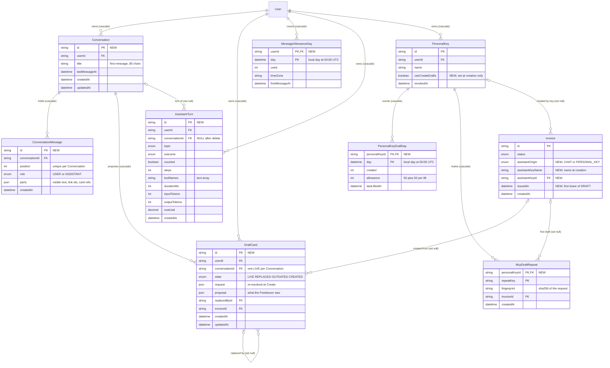

# Data model — ai-assistant

> **Mode:** brownfield delta.
> - **New tables:** five in a new `prisma/schema/ai.prisma` (`Conversation`, `ConversationMessage`, `DraftCard`, `MessageAllowanceDay`, `AssistantTurn`) and two in `auth.prisma` (`PersonalKeyDraftDay`, `McpDraftRepeat`).
> - **New columns on existing tables:** `PersonalKey.canCreateDrafts`, plus four on `Invoice` (`assistantOrigin`, `assistantKeyName`, `assistantKeyId`, `issuedAt`).
> - **New enums:** five.
>
> Nothing is renamed or dropped, and no existing column becomes `NOT NULL`.
>
> **Conventions followed (derived, not imposed):**
> - `prisma migrate` with the split schema `prisma/schema/*.prisma` (architecture-map §Migrations). SAD §5 places the chat models in a new `ai.prisma` and the key models in `auth.prisma`.
> - Quoted PascalCase table names and camelCase columns, with Prisma's default constraint and index names (`_pkey`, `_key`, `_idx`, `_fkey`).
> - `TEXT` ids from `cuid()` (SAD §8 IDs). `TEXT` for strings: the repo uses no `VARCHAR(N)`, and length limits live in zod.
> - `TIMESTAMP(3)` for timestamps. A calendar day is stored as that day at 00:00 UTC, as `Invoice.issueDate` (mcp-server data-model).
> - `createdAt` / `updatedAt` on domain models. Counter tables (`MessageAllowanceDay`, `PersonalKeyDraftDay`) have neither, as `LogoFetchWindow` and `PersonalKeyUsageWeek`, and use a composite `@@id`.
> - FKs are `ON UPDATE CASCADE`. User-owned rows are `ON DELETE CASCADE`. References that must outlive their target are `SET NULL`.
> - No `CHECK` constraints or triggers. One partial unique index through the `partialIndexes` preview, as `SenderProfile_userId_isDefault_key` (invoice-integrity ADR-0005).
> - JSON is `Json` (`JSONB`), as ADR-0008 Neutral states. It is the repo's first JSON column, flagged in the audit.
> - Idempotent DDL (`IF NOT EXISTS`, `DO $$ … IF NOT EXISTS` for enums and FKs). A `CONCURRENTLY` index on the existing `Invoice` table sits alone in its file, as `20261007100100_create_invoice_bank_account_id_index`.
>
> **Staged migrations:** `docs/features/ai-assistant/migrations/01_*` … `10_*` (`.up.sql` + `.down.sql`). They are **not** in the live `prisma/migrations/` tree. `implement` promotes them. The SQL body of every up matches `prisma migrate diff` for the schema in §Prisma schema edits, made idempotent.
>
> **Out of scope:** Mastra's own trace tables in the `mastra` schema (ADR-0004). Mastra creates and owns them with `pnpm mastra:migrate` (SAD §7). Prisma does not manage them, and they hold metadata only.

## ER diagram

New entities are marked NEW. Existing entities show only the columns this feature adds or relies on.



## Entities

**Aggregate roots (from the ACs, ADRs and the owner's 2026-10-11 answers):**
- **`User` (the Freelancer)** stays the account root. It owns `Conversation`, `MessageAllowanceDay` and `AssistantTurn` directly.
- **`Conversation`** is the root of the chat aggregate. `ConversationMessage` and `DraftCard` live and die with it (AC-37, AC-38).
  - `ConversationMessage` is reached only through its Conversation, as `InvoiceItem` through `Invoice`. It has no `userId`.
  - `DraftCard` also carries `userId`, because `createFromCard` locks the card by id and owner in one statement (SAD §6 flow 2).
  - This is a deliberate reading of SAD §8 "every new domain row carries `userId`": the message is a child row (owner decision, data-model 2026-10-11).
- **`AssistantTurn`** belongs to `User`, not to the Conversation. It survives Conversation deletion with a NULL reference, so the §7 KPIs stay whole.
- **`PersonalKey`** stays a child of `User`. It gains Draft permission and owns its per-day draft counters and repeat marks.
- **`Invoice`** stays its own root. It gains write-once origin columns (ADR-0013). Nothing about the chat references the invoice from the invoice side: cards and repeat marks point at the invoice, never the reverse, so deleting chat data never touches a draft (AC-37).

### `Conversation` ★ new (ADR-0008; AC-33, AC-35, AC-37, AC-38, AC-41)

| Column | Type | Constraints | Notes |
|---|---|---|---|
| `id` | TEXT | PK, `cuid()` | in the Conversation URL; a miss and another owner's id answer the same "not found" (AC-41) |
| `userId` | TEXT | NOT NULL, FK → `User(id)` ON DELETE CASCADE | indexed by the leading column of `Conversation_userId_lastMessageAt_idx` |
| `title` | TEXT | NOT NULL | the first message, trimmed to 80 characters by the service. It holds Customer names, so it is Confidential like the messages |
| `lastMessageAt` | TIMESTAMP(3) | NOT NULL | set at creation, moved by every saved turn. Drives the list order and the 90-day purge (AC-38) |
| `createdAt` / `updatedAt` | TIMESTAMP(3) | NOT NULL | repo convention for domain models |

**Access patterns:**
- **Create:** written with the first saved turn of a new Conversation (SAD §6 flows 1 and 5), never when the AI section is opened (flow 4).
- **List (flows 4 and 7):** `WHERE "userId" = $1 ORDER BY "lastMessageAt" DESC` → `Conversation_userId_lastMessageAt_idx`.
- **Open (flow 7):** `WHERE "id" = $1 AND "userId" = $actor` → PK. A NULL result is the AC-41 "not found".
- **Append a turn (flows 1, 5, 6), in one transaction:**
  1. `SELECT … FOR UPDATE` the Conversation by id and owner → PK. This row lock orders two parallel turns of one Conversation.
  2. Read `max(position)`.
  3. Insert the messages at the next positions.
  4. Set `lastMessageAt = $now`.
- **Delete one or all (flow 8):** `DELETE … WHERE "userId" = $actor [AND "id" = $1]` → PK or the index prefix. 0 rows affected = not found. Messages and cards cascade, and turns are set NULL.
- **Purge (flow 9):** `DELETE … WHERE "lastMessageAt" < $now − 90 days` → `Conversation_lastMessageAt_idx` (verified bitmap index scan). `$now` comes from the app clock, as in the security-patch purge.
- **Export (flow 12):** by `userId`, with messages ordered by position.

### `ConversationMessage` ★ new (ADR-0008; spec §6 "latest 40 messages")

| Column | Type | Constraints | Notes |
|---|---|---|---|
| `id` | TEXT | PK, `cuid()` | the UI-message id `useChat` keeps |
| `conversationId` | TEXT | NOT NULL, FK → `Conversation(id)` ON DELETE CASCADE | indexed by the unique pair |
| `position` | INTEGER | NOT NULL, UNIQUE with `conversationId` | 0, 1, 2, … written under the Conversation row lock (owner decision, data-model 2026-10-11). Two rows saved in one transaction have equal `createdAt`, so the order cannot rely on time |
| `role` | `ConversationMessageRole` | NOT NULL | `USER` or `ASSISTANT` |
| `parts` | JSONB | NOT NULL | AI SDK UI-message parts, visible content only: the Freelancer's text (≤ 2,000 characters, zod), the Assistant's final text, link parts as invoice ids, Customer-form or page keys, and Draft card references by card id. Never tool calls or tool answers (ADR-0008). A malformed shape is refused by the zod schema, not the database |
| `createdAt` | TIMESTAMP(3) | NOT NULL DEFAULT CURRENT_TIMESTAMP | messages are never edited, so there is no `updatedAt` |

**Access patterns:**
- **History for the model (flows 1 and 5):** `WHERE "conversationId" = $1 ORDER BY "position" DESC LIMIT 40`, reversed in code → `ConversationMessage_conversationId_position_key`.
- **Whole exchange (flow 7):** `ORDER BY "position"` → same index.
- **Link states (flow 7, AC-36):** the service collects the invoice ids from `parts` and reads their current status in one owner-scoped `findMany`. No state is stored in the message.

### `DraftCard` ★ new (ADR-0007; AC-12–AC-15, AC-18, AC-11c)

| Column | Type | Constraints | Notes |
|---|---|---|---|
| `id` | TEXT | PK, `cuid()` | the id the Create button sends |
| `userId` | TEXT | NOT NULL, FK → `User(id)` ON DELETE CASCADE | the owner, for the one-statement lock in `createFromCard` |
| `conversationId` | TEXT | NOT NULL, FK → `Conversation(id)` ON DELETE CASCADE | |
| `state` | `DraftCardState` | NOT NULL DEFAULT `LIVE` | `LIVE` → `REPLACED` (a newer card from a later message, AC-14b) / `OUTDATED` (rebuilt at Create with different content, AC-18) / `CREATED` (AC-13). Only `LIVE` can create |
| `request` | JSONB | NOT NULL | the structured `propose_draft` request: the request's own words, never resolved values. Re-resolved at every Create press (ADR-0006) |
| `proposal` | JSONB | NOT NULL | the resolved content shown on the card, every value with its source. Create compares the re-resolved content with it |
| `replacedById` | TEXT | NULL, FK → `DraftCard(id)` ON DELETE SET NULL | the newer card a replaced or outdated card points to (AC-14b, AC-18) |
| `invoiceId` | TEXT | NULL, FK → `Invoice(id)` ON DELETE SET NULL | set with `CREATED`. A later press answers with this link (AC-14). NULL on a `CREATED` card = the draft was deleted (AC-36) |
| `createdAt` / `updatedAt` | TIMESTAMP(3) | NOT NULL | |

**Constraints:**
- `DraftCard_conversationId_live_key`: a partial unique index on `conversationId WHERE state = 'LIVE'`, so there is at most one live card per Conversation (SAD §6 flow 6; owner decision, data-model 2026-10-11). Verified: a second `LIVE` insert fails with a unique violation.

**Access patterns:**
- **Propose (flow 6), in the turn's transaction:**
  1. `UPDATE … SET "state" = 'REPLACED' WHERE "conversationId" = $c AND "state" = 'LIVE'` → partial unique index.
  2. Insert the new `LIVE` card.
  3. Set `replacedById` on the old card.

  The order matters: inserting first would hit the partial unique index. If two turns race, the loser gets P2002. The Conversation row lock taken by the append (above) makes that rare.
- **Create press (flow 2), in one transaction:**
  0. `SELECT … FROM "Conversation"` of the card (by the card's id and owner) `FOR UPDATE`, the same first lock as the turn save, so a Create press that outdates a card and a turn that proposes one never run the LIVE-card swap at once.
  1. `SELECT … FROM "DraftCard" WHERE "id" = $1 AND "userId" = $actor FOR UPDATE` → PK.
  2. Then, by state:
     - `CREATED` → return the `invoiceId` link.
     - `REPLACED` or `OUTDATED` → return the `replacedById` card.
     - `LIVE` → re-resolve the stored `request`.
       - If the content differs, mark this card `OUTDATED` and insert the updated `LIVE` card, in the order above.
       - Otherwise create the invoice (origin `CHAT`) and set `CREATED` and `invoiceId`.

  The row lock makes a repeated or reconnected press wait and then see `CREATED` (AC-14).
- **Render cards (flow 7):** `WHERE "id" IN ($card ids from parts) AND "userId" = $actor` → PK.
- FK indexes `DraftCard_conversationId_idx`, `DraftCard_userId_idx`, `DraftCard_replacedById_idx`, `DraftCard_invoiceId_idx` serve the cascades and the SET NULLs (a Conversation delete, account deletion, a card delete, an invoice delete).

### `MessageAllowanceDay` ★ new (ADR-0009; AC-09, AC-10, AC-10b, AC-11, AC-34; spec §8 time-zone rule)

| Column | Type | Constraints | Notes |
|---|---|---|---|
| `userId` | TEXT | PK (1), FK → `User(id)` ON DELETE CASCADE | |
| `day` | TIMESTAMP(3) | PK (2) | the Freelancer's local calendar day at 00:00 UTC |
| `used` | INTEGER | NOT NULL DEFAULT 0 | reserved slots. 30 per day (spec §6, app constant) |
| `timeZone` | TEXT | NOT NULL | the IANA zone the day was opened with (`User.timeZone`, or `UTC` while unsaved) |
| `firstMessageAt` | TIMESTAMP(3) | NOT NULL | the first reservation of the day |

**Access patterns:**
- **Which day is "today" (flows 1, 4, 5):** read the latest row, `WHERE "userId" = $1 ORDER BY "day" DESC LIMIT 1` → backward scan of the PK (verified).
  - A new day starts when the local date in the current zone is after that row's `day`.
  - If the zone differs from the row's `timeZone`, a new day also needs `$now ≥ firstMessageAt + 24 h` (spec §8 rule, ADR-0009). Otherwise the latest row stays current.
- **Reserve, before any model call:**
  1. `INSERT … ON CONFLICT DO NOTHING` the day row.
  2. `UPDATE … SET "used" = "used" + 1 WHERE "userId" = $1 AND "day" = $d AND "used" < 30`.

  0 rows affected = used up (AC-10). Two tabs racing for the last slot get 1 and 0 rows (AC-10b; verified that the increment stops at 30). If the write itself fails, nothing is processed (fails closed, ADR-0009).
- **Release on a system-side failure (AC-11):** `UPDATE … SET "used" = "used" - 1 WHERE … AND "used" > 0`.
- **"N left today" (flows 1, 4, 5):** `30 − used` from the same read.
- **Purge (flow 9):** `WHERE "day" < $today − 400 days` → `MessageAllowanceDay_day_idx`.
- **Export (flow 12):** per-day counts by `userId` → PK prefix.

### `AssistantTurn` ★ new (ADR-0004; spec §7 KPIs; SAD §5, §7 Monitoring)

| Column | Type | Constraints | Notes |
|---|---|---|---|
| `id` | TEXT | PK, `cuid()` | |
| `userId` | TEXT | NOT NULL, FK → `User(id)` ON DELETE CASCADE | weekly active chat users, cost per active user |
| `conversationId` | TEXT | NULL, FK → `Conversation(id)` ON DELETE SET NULL | NULL once the Conversation is deleted (SAD §5) |
| `topic` | `AssistantTopic` | NULL | the router verdict (ADR-0005), for the off-topic share. NULL when the turn ended before the router |
| `outcome` | `AssistantTurnOutcome` | NOT NULL | `ANSWERED`, `CAPPED` (AC-11b), `FAILED` (AC-11; provider errors and rate limits included, as in SAD §8), `ALLOWANCE_USED_UP` (AC-10; for the allowance-exhaustion KPI) |
| `counted` | BOOLEAN | NOT NULL | whether the turn used a slot |
| `steps` | INTEGER | NOT NULL DEFAULT 0 | agent steps, ≤ 8 |
| `toolNames` | TEXT[] | NULL in the DDL (Prisma lists carry no `NOT NULL`); the service always writes an array | tool names in call order. Never arguments or answers |
| `durationMs` | INTEGER | NOT NULL | |
| `inputTokens` / `outputTokens` | INTEGER | NULL | from the gateway's usage report, when given |
| `costUsd` | DECIMAL(10,6) | NULL | per-message cost (0 on the free-tier key, ADR-0003). Six decimals, because a cent-scale `Decimal(10,2)` would round the ≤ USD 0.02 target to nothing |
| `createdAt` | TIMESTAMP(3) | NOT NULL DEFAULT CURRENT_TIMESTAMP | |

**Access patterns:**
- **Write:** one insert per turn, after the reply or the failure (flows 1 and 5).
- **KPIs (§7):** weekly windows over `createdAt` → `AssistantTurn_createdAt_idx`. These are reporting queries, not request paths.
- **Purge (flow 9):** `WHERE "createdAt" < $now − 400 days` → `AssistantTurn_createdAt_idx`.
- **FK indexes:** `AssistantTurn_userId_idx` (account deletion) and `AssistantTurn_conversationId_idx` (the SET NULL on every Conversation delete, flow 8). Without the second, each Conversation delete would scan the table.
- Not in the export: spec §6.1 lists Conversations, daily counts and key counts only. Removed with the account.

### `PersonalKey` (one new column) (ADR-0011; AC-25, AC-26, AC-29)

| Column | Type | Constraints | Notes |
|---|---|---|---|
| `canCreateDrafts` ★ | BOOLEAN | NOT NULL DEFAULT false | written only by the create-key service. No update path exists (AC-26). Every pre-release key is `false` (verified: an existing key reads `f` after the migration) |

**Access patterns:**
- **The draft tool (flow 3):** `canCreateDrafts` comes back with the authenticate row that already reads the key by `digest` (mcp-server data-model) → `PersonalKey_digest_key`. No new query.
- **The key list (flow 10):** returned with the existing list query.

### `PersonalKeyDraftDay` ★ new (ADR-0009; AC-27, AC-28)

| Column | Type | Constraints | Notes |
|---|---|---|---|
| `personalKeyId` | TEXT | PK (1), FK → `PersonalKey(id)` ON DELETE CASCADE | revoked keys keep their counts. They go with the account |
| `day` | TIMESTAMP(3) | PK (2) | the Freelancer's local calendar day at 00:00 UTC (the key owner's zone) |
| `created` | INTEGER | NOT NULL DEFAULT 0 | Assistant drafts created through the key that day |
| `allowance` | INTEGER | NOT NULL DEFAULT 50 | 50, plus 50 per lift that day (AC-28). Gone the next day with the row |
| `lastLiftedAt` | TIMESTAMP(3) | NULL | shown on the keys page |

**Access patterns:**
- **Take a draft slot (flow 3), inside the invoice's transaction:**
  1. Upsert the day row.
  2. `UPDATE … SET "created" = "created" + 1 WHERE "personalKeyId" = $k AND "day" = $d AND "created" < "allowance"`.

  0 rows affected = limit reached (AC-27), so the whole transaction rolls back and nothing is created.
- **Lift (flow 10):** `UPDATE … SET "allowance" = "allowance" + 50, "lastLiftedAt" = $now WHERE … AND "created" >= "allowance"`, joined to an owner check on the key. 0 rows = not reached or not the Freelancer's key. A double click lifts once (verified: a lift before the limit did nothing, and a lift at 50 gave 100).
- **Keys page (flow 10):** today's row per key by `(personalKeyId, day)` → PK. Last lift time: the latest row with `lastLiftedAt` set → PK prefix.
- **Purge (flow 9):** `WHERE "day" < $today − 400 days` → `PersonalKeyDraftDay_day_idx`.
- **Export (flow 12):** by the Freelancer's key ids → PK prefix.

### `McpDraftRepeat` ★ new (ADR-0012; AC-32)

| Column | Type | Constraints | Notes |
|---|---|---|---|
| `personalKeyId` | TEXT | PK (1), FK → `PersonalKey(id)` ON DELETE CASCADE | |
| `repeatKey` | TEXT | PK (2) | the client's optional repeat mark, ≤ 200 characters (zod) |
| `fingerprint` | TEXT | NOT NULL | lower-case hex SHA-256 of the canonical request. The same mark with another fingerprint is refused |
| `invoiceId` | TEXT | NULL, FK → `Invoice(id)` ON DELETE SET NULL | the first draft. NULL = "no longer available" (ADR-0012 Neutral) |
| `createdAt` | TIMESTAMP(3) | NOT NULL DEFAULT CURRENT_TIMESTAMP | starts the 24-hour window |

**Access patterns:**
- **Repeat check (flow 3):** read by `(personalKeyId, repeatKey)` → PK.
  - Found, younger than 24 h, same fingerprint → return the first draft.
  - Found, younger than 24 h, different fingerprint → refuse.
  - Found but older than 24 h and not yet purged → delete it in the same transaction and treat the request as new.
- **Write:** in the invoice's transaction. A racing repeat fails on the PK (verified). The service then re-reads the winner's row and returns its draft.
- **Purge (flow 9):** `WHERE "createdAt" < $now − 24 h` → `McpDraftRepeat_createdAt_idx`.
- `McpDraftRepeat_invoiceId_idx` serves the SET NULL on an invoice delete.

### `Invoice` (four new columns) (ADR-0013; AC-23; spec §7 north-star KPI)

| Column | Type | Constraints | Notes |
|---|---|---|---|
| `assistantOrigin` ★ | `AssistantOrigin` | NULL | `CHAT` or `PERSONAL_KEY`. NULL = made by hand. Written once at creation |
| `assistantKeyName` ★ | TEXT | NULL | the key's `name` at creation (`PERSONAL_KEY` only). Renaming or revoking the key does not touch it (AC-23) |
| `assistantKeyId` ★ | TEXT | NULL, FK → `PersonalKey(id)` ON DELETE SET NULL | for the per-key KPI. Keys are only deleted with the account |
| `issuedAt` ★ | TIMESTAMP(3) | NULL | when the invoice first left `DRAFT` |

**Write rules (app-side, no DB form, as in the repo):**
- The three origin columns are set only by `createFromCard` (chat) and `createForKey` (MCP). `updateInvoice` and the editor save never write them, and `duplicateInvoice` never copies them (ADR-0013 Negative; a unit test guards both).
- `issuedAt` is set with `"issuedAt" = $now WHERE "issuedAt" IS NULL` on every path that moves an invoice out of `DRAFT`. In `lib/services/invoices/invoices.ts` those paths are `createInvoice` with a non-draft status, `updateInvoice` with a status change, and `updateInvoiceStatus`. Nothing clears it (an issued invoice never returns to draft).
- **No backfill.** Existing invoices keep NULL. The KPI measures Assistant drafts created after the release (SAD §6 flow 11, accepted 2026-10-11).

**Access patterns:**
- **The mark (flow 11):** read with the list and editor queries that already load the invoice. Rendered only while `status = DRAFT`.
- **KPI:** `count(*) WHERE "assistantOrigin" IS NOT NULL AND "issuedAt" - "createdAt" <= 14 days`. A reporting query, so no index.
- `Invoice_assistantKeyId_idx` serves the SET NULL on a `PersonalKey` delete (account deletion).

## Indexes

| Index | Columns | Query it serves |
|---|---|---|
| `Conversation_userId_lastMessageAt_idx` | `userId`, `lastMessageAt DESC` | Conversation list, newest first (flows 4 and 7); prefix serves the `userId` FK |
| `Conversation_lastMessageAt_idx` | `lastMessageAt` | 90-day purge (flow 9, AC-38) |
| `ConversationMessage_conversationId_position_key` (unique) | `conversationId`, `position` | latest 40 messages (flows 1 and 5), whole exchange (flow 7), position uniqueness; prefix serves the FK cascade |
| `DraftCard_conversationId_live_key` (unique, partial `state = 'LIVE'`) | `conversationId` | one live card per Conversation; replace the live card (flow 6) |
| `DraftCard_conversationId_idx` | `conversationId` | cascade on Conversation delete (flow 8), cards of a reopened Conversation |
| `DraftCard_userId_idx` | `userId` | FK cascade on account deletion (flow 12) |
| `DraftCard_replacedById_idx` | `replacedById` | SET NULL when a card is deleted |
| `DraftCard_invoiceId_idx` | `invoiceId` | SET NULL on invoice delete (AC-36) |
| `MessageAllowanceDay_pkey` | `userId`, `day` | reserve, release and today's read (flows 1, 4, 5); latest row by backward scan |
| `MessageAllowanceDay_day_idx` | `day` | 400-day purge (flow 9) |
| `AssistantTurn_userId_idx` | `userId` | FK cascade on account deletion; weekly active users |
| `AssistantTurn_conversationId_idx` | `conversationId` | SET NULL on every Conversation delete (flow 8) |
| `AssistantTurn_createdAt_idx` | `createdAt` | 400-day purge (flow 9); weekly KPI windows |
| `PersonalKeyDraftDay_pkey` | `personalKeyId`, `day` | take a slot (flow 3), lift and keys page (flow 10); prefix serves the FK and the export |
| `PersonalKeyDraftDay_day_idx` | `day` | 400-day purge (flow 9) |
| `McpDraftRepeat_pkey` | `personalKeyId`, `repeatKey` | repeat check and race backstop (flow 3) |
| `McpDraftRepeat_invoiceId_idx` | `invoiceId` | SET NULL on invoice delete |
| `McpDraftRepeat_createdAt_idx` | `createdAt` | 24-hour purge (flow 9) |
| `Invoice_assistantKeyId_idx` | `assistantKeyId` | SET NULL on `PersonalKey` delete (account deletion, flow 12) |

No index is added for the KPI queries: they are reporting queries over small tables. Plans were checked on PostgreSQL 16 with sequential scans disabled. The list, the history, the 90-day purge and the latest allowance row each use the index named here.

## Prisma schema edits

These must land with the promotion of the matching ordinal. `prisma migrate diff --from-schema prisma/schema --to-schema <this>` gives exactly the staged SQL, before it was made idempotent.

**New file `prisma/schema/ai.prisma`** (01–04):

```prisma
// ai-assistant: in-app chat models (SAD §5, ADR-0007, ADR-0008, ADR-0009). Visible content only, never raw tool answers.

enum ConversationMessageRole {
    USER
    ASSISTANT
}

enum DraftCardState {
    LIVE // the only card in its Conversation that Create may use
    REPLACED // a newer card from a later message took its place (AC-14b)
    OUTDATED // rebuilt at a Create press with different content; the updated card replaced it (AC-18)
    CREATED // a Draft invoice was created from it (AC-13, AC-14)
}

enum AssistantTopic {
    IN_SCOPE
    MIXED
    OFF_TOPIC
}

enum AssistantTurnOutcome {
    ANSWERED // a full reply
    CAPPED // the 8-step cap ended the turn with a partial answer (AC-11b), counted
    FAILED // a system-side failure, provider errors and rate limits included (AC-11), not counted
    ALLOWANCE_USED_UP // refused before any model call (AC-10), not counted
}

// One chat thread; deleted 90 days after its last message (AC-38) or on request (AC-37).
model Conversation {
    id            String   @id @default(cuid())
    userId        String
    title         String // the first message, trimmed to 80 characters
    lastMessageAt DateTime // moved by every saved turn; drives the list order and the 90-day purge

    user       User                  @relation(fields: [userId], references: [id], onDelete: Cascade)
    messages   ConversationMessage[]
    draftCards DraftCard[]
    turns      AssistantTurn[]

    createdAt DateTime @default(now())
    updatedAt DateTime @updatedAt

    @@index([userId, lastMessageAt(sort: Desc)])
    @@index([lastMessageAt])
}

// One visible message: the Freelancer's text, or the Assistant's final text with link and card parts (ADR-0008).
model ConversationMessage {
    id             String                  @id @default(cuid())
    conversationId String
    position       Int // 0, 1, 2, … within the Conversation, written under the Conversation row lock
    role           ConversationMessageRole
    parts          Json // UI-message parts: text, links as ids or page keys, Draft card references

    conversation Conversation @relation(fields: [conversationId], references: [id], onDelete: Cascade)

    createdAt DateTime @default(now())

    @@unique([conversationId, position])
}

// A proposed draft stored server-side; only the Freelancer's Create press turns it into an invoice (ADR-0007).
model DraftCard {
    id             String         @id @default(cuid())
    userId         String
    conversationId String
    state          DraftCardState @default(LIVE)
    request        Json // the structured request from propose_draft, re-resolved at every Create press
    proposal       Json // the resolved content the Freelancer saw, every value with its source
    replacedById   String? // the newer card that took this one's place (REPLACED or OUTDATED)
    invoiceId      String? // the Draft invoice created from it (CREATED); NULL again if that invoice is deleted

    user         User         @relation(fields: [userId], references: [id], onDelete: Cascade)
    conversation Conversation @relation(fields: [conversationId], references: [id], onDelete: Cascade)
    replacedBy   DraftCard?   @relation("DraftCardReplacement", fields: [replacedById], references: [id], onDelete: SetNull)
    replaces     DraftCard[]  @relation("DraftCardReplacement")
    invoice      Invoice?     @relation(fields: [invoiceId], references: [id], onDelete: SetNull)

    createdAt DateTime @default(now())
    updatedAt DateTime @updatedAt

    @@unique([conversationId], map: "DraftCard_conversationId_live_key", where: { state: "LIVE" }) // one live card per Conversation (SAD §6 flow 6)
    @@index([conversationId])
    @@index([userId])
    @@index([replacedById])
    @@index([invoiceId])
}

// Daily message allowance: one row per Freelancer per local day (ADR-0009). Counts only.
model MessageAllowanceDay {
    userId         String
    day            DateTime // the Freelancer's local calendar day, stored as that day at 00:00 UTC
    used           Int      @default(0) // reserved slots; a system-side failure gives its slot back
    timeZone       String // the zone the day was opened with (spec §8 time-zone rule)
    firstMessageAt DateTime // the first reservation of the day (spec §8 time-zone rule)

    user User @relation(fields: [userId], references: [id], onDelete: Cascade)

    @@id([userId, day])
    @@index([day])
}

// Per-turn metadata for the spec §7 KPIs; never text (ADR-0004). Survives Conversation deletion.
model AssistantTurn {
    id             String               @id @default(cuid())
    userId         String
    conversationId String?
    topic          AssistantTopic? // the router verdict; NULL when the turn ended before the router
    outcome        AssistantTurnOutcome
    counted        Boolean // whether the turn used a slot of the Daily message allowance
    steps          Int                  @default(0)
    toolNames      String[] // tools called, in order; names only
    durationMs     Int
    inputTokens    Int?
    outputTokens   Int?
    costUsd        Decimal?             @db.Decimal(10, 6)

    user         User          @relation(fields: [userId], references: [id], onDelete: Cascade)
    conversation Conversation? @relation(fields: [conversationId], references: [id], onDelete: SetNull)

    createdAt DateTime @default(now())

    @@index([userId])
    @@index([conversationId])
    @@index([createdAt])
}
```

**`prisma/schema/auth.prisma`:**

```prisma
// model User: add the back-relations (01–04)
    conversations        Conversation[]
    draftCards           DraftCard[]
    messageAllowanceDays MessageAllowanceDay[]
    assistantTurns       AssistantTurn[]

// model PersonalKey: add after revokedAt (05) and the back-relations (06–08)
    canCreateDrafts Boolean @default(false) // Draft permission, set only at creation (ADR-0011)

    draftDays       PersonalKeyDraftDay[]
    draftRepeats    McpDraftRepeat[]
    assistantDrafts Invoice[]

// Per-key daily draft limit: one row per key per local day (ADR-0009). Counts only. (06)
model PersonalKeyDraftDay {
    personalKeyId String
    day           DateTime // the Freelancer's local calendar day, stored as that day at 00:00 UTC
    created       Int       @default(0) // Assistant drafts created through the key that day
    allowance     Int       @default(50) // 50, plus 50 per lift (AC-28)
    lastLiftedAt  DateTime?

    personalKey PersonalKey @relation(fields: [personalKeyId], references: [id], onDelete: Cascade)

    @@id([personalKeyId, day])
    @@index([day])
}

// MCP repeat marks (ADR-0012): honoured for 24 hours, purged daily after that. (07)
model McpDraftRepeat {
    personalKeyId String
    repeatKey     String
    fingerprint   String // sha256 hex of the canonical request; the same mark with other content is refused
    invoiceId     String? // the first draft; NULL once that invoice is deleted

    personalKey PersonalKey @relation(fields: [personalKeyId], references: [id], onDelete: Cascade)
    invoice     Invoice?    @relation(fields: [invoiceId], references: [id], onDelete: SetNull)

    createdAt DateTime @default(now())

    @@id([personalKeyId, repeatKey])
    @@index([invoiceId])
    @@index([createdAt])
}
```

**`prisma/schema/invoice.prisma`:**

```prisma
enum AssistantOrigin { // (08)
    CHAT
    PERSONAL_KEY
}

// model Invoice: add after paidAt
    // Issue tracking (ADR-0013): written once, when the invoice first leaves DRAFT (09)
    issuedAt DateTime?

    // Assistant origin (ADR-0013): written once at creation, never copied or rewritten (08)
    assistantOrigin  AssistantOrigin?
    assistantKeyName String? // the key's name at creation (PERSONAL_KEY only)
    assistantKeyId   String? // NULL for CHAT, or once the key row is deleted

// model Invoice: relations (02, 07, 08) and the index (10)
    assistantKey PersonalKey?     @relation(fields: [assistantKeyId], references: [id], onDelete: SetNull)
    draftCards   DraftCard[]
    draftRepeats McpDraftRepeat[]

    @@index([assistantKeyId])
```

The account-deletion transaction (`lib/services/account/account.ts`) needs no new statement. It deletes invoices first (SET NULL on cards, repeat marks and nothing else), then the user, and every new row cascades from `User` or `PersonalKey`. Verified: 0 AI rows left after running the same two deletes. The integration test for account deletion should still assert it.

## Test fixtures

Not generated here, for the same reason as mcp-server and invoice-integrity: the Prisma types do not exist until `implement` promotes the migrations, so factories written now would not type-check. The `tasks` stage should put these in the DoD of the `layer: migration` tasks, in `tests/support/factories/`, following `limit-event.ts` and `personal-key.ts`:

- `createConversation(prisma, { userId, messages?, lastMessageAt? })`. Messages get positions 0…n. The default `title` is `'Test conversation <n>'`, and `lastMessageAt` defaults to the test clock's now. AC-38 fixtures pass `lastMessageAt` = 90 days + 1 hour ago.
- `createDraftCard(prisma, { userId, conversationId, state?, request?, proposal?, invoiceId? })`. The default is a `LIVE` card for a 20 × 50.00 USD line. `request` and `proposal` are built by the same zod schemas as production, so a fixture can never drift from the real shape.
- `createMessageAllowanceDay(prisma, { userId, day?, used?, timeZone? })`. The AC-09 and AC-10b fixtures use `used: 18` and `used: 29`.
- `createAssistantTurn(prisma, overrides)`. It has metadata only by construction.
- `createPersonalKeyDraftDay(prisma, { personalKeyId, created?, allowance? })`. AC-27 and AC-28 use `created: 50`.
- `createPersonalKey` (existing) accepts `canCreateDrafts`. `createInvoice` (existing) accepts `assistantOrigin`, `assistantKeyName`, `assistantKeyId` and `issuedAt`.
- Add `'McpDraftRepeat'`, `'PersonalKeyDraftDay'`, `'AssistantTurn'`, `'DraftCard'`, `'ConversationMessage'`, `'Conversation'` and `'MessageAllowanceDay'` to `APP_TABLES` in `tests/support/db/truncate.ts`, before `'Invoice'`, `'PersonalKey'` and `'User'`.
- **PII guard:** users stay `user-<n>@example.test`, Customers `Acme Corp` / `Acme GmbH` / `Test Customer`, keys `Test key <n>`. Message text in fixtures is the spec's own example wording, never copied from real data.

No seeds: the feature adds no bootstrap or lookup data. The allowance (30), the key limit (50, +50 per lift), the 90-day, 24-hour and 400-day retention, and the 40-message history cap are app constants (spec §6), not rows.
