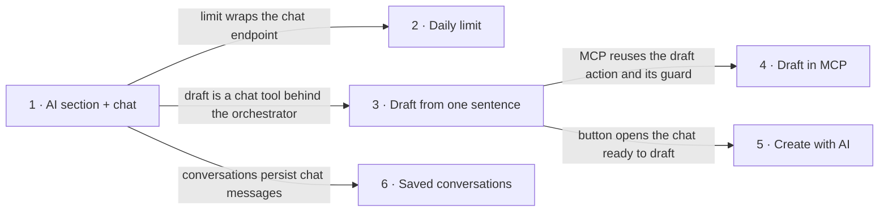

# Roadmap — ai-assistant

> **A decomposition, not a promise.** The overall idea broken into incremental steps: what each
> step is, where it comes from, how big it is — or that nobody has looked at it yet — and in which
> order, and parallel lanes, we walk them. **No dates** (except shipped history), **no scores** —
> order is the prioritization. The *solution* for any step lives in its `docs/features/<slug>/`
> spec, not here.

## Destination

A freelancer with no AI client of their own opens the AI section, asks about their invoices, and turns one sentence into a Draft invoice they only have to review — and MCP users who opt in to write access can do the same from their own assistant.

## Steps

| # | Step | Source | Size | Status |
|---|---|---|:---:|---|
| 1 | AI section with a read-only chat — a new nav section holding the chat and a link to MCP settings; the chat answers questions through the existing read tools, an orchestrator refuses anything outside invoiceFlow's data and actions and picks the right tool, and every conversation is traced for debugging | `idea-brief.md §7 Recommendation` | M | idea |
| 2 | Per-user daily limit — the chat counts usage per user, states the limit honestly when it runs out and points to MCP; usage statistics are visible | `idea-brief.md §6 Risks` | S | idea |
| 3 | Draft from one sentence in the chat — a new action creates a real Draft invoice through the existing server-side rules, asks back when the client is ambiguous or the rate or currency is missing, never invents a value, and answers with a link to the draft | `idea-brief.md §2 Problem` | M | idea |
| 4 | Draft action in MCP behind a write permission — keys gain an opt-in write permission set on the MCP settings page, existing keys stay read-only, and the same draft action with the same no-guessing guard is offered to external assistants | `idea-brief.md §7 Recommendation` | M | idea |
| 5 | «Create with AI» next to «New invoice» — opens the chat ready to draft | `idea-brief.md §6 Risks` | XS | idea |
| 6 | Saved conversations — a list of past chats the user can reopen | `idea-brief.md §7 Recommendation` | M | idea |

## Not yet specified

Nothing is in fog: every step's open question can be stated precisely today, and the ones that need the owner's call sit in `## Open decisions`.

| Area | What we'd have to learn | Blocks | How it gets sharpened |
|---|---|:---:|---|
| — | — | — | — |

## Out of scope

- Server-side PDF rendering — the draft action answers with a link; the PDF keeps rendering in the browser from the draft, so external assistants receive the link, not a file.
- AI issuing or sending invoices — the AI only creates Drafts; a human reviews and issues every one.
- Off-topic conversation, including general invoicing, tax and legal advice — the orchestrator refuses anything outside invoiceFlow's own data and actions.
- Bring-your-own model key — the primary users are the ones without an AI client, and they rarely hold a key.
- Silent write access for existing MCP keys — write is opt-in per key; nothing already issued gains it.

## Open decisions

| # | Question | Type | Owner | Blocks |
|---|---|:---:|:---:|:---:|
| D1 | Which read tools does the chat expose on day one — all seven MCP read tools or a curated subset? | grilling | human | 1 |
| D2 | What is the daily limit (messages or tokens, and how many), and what exactly does the user see when it runs out? | grilling | human | 2 |
| D3 | When the named client does not exist, does the draft action only refuse and ask, or may it offer to create the client in the same flow? | grilling | human | 3 |
| D4 | How long are saved conversations kept, and can a user delete one or all of them? | grilling | human | 6 |
| D5 | How is success measured — share of AI drafts issued without edits, turns per draft, or something else? | grilling | human | — |

## Decisions so far

- The chat serves people without their own AI client; MCP stays for those who have one → [`idea-brief.md` §3 Users](idea-brief.md#_3-users)
- The draft action creates a real Draft invoice through the existing rules, and a human always issues it → [`idea-brief.md` §5 Out of scope](idea-brief.md#_5-out-of-scope)
- The draft action answers with a link to the draft, not a PDF file; the brief's «Draft with its PDF» is narrowed accordingly → [this file, Out of scope](#out-of-scope)
- Write access through MCP is a separate opt-in permission — the «read and drafts» level the MCP spec deferred → [`docs/features/mcp-server/spec.md`](../mcp-server/spec.md)
- Spend is capped by a per-user daily limit → [`idea-brief.md` §7 Recommendation](idea-brief.md#_7-recommendation)

## Dependency graph

## Execution path

| Wave | Steps | Zone per step (why parallel-safe) | Unlocks |
|:---:|---|---|---|
| 1 | 1 | `app/(protected)/ai/` (new) · `app/api/chat/` (new) · `lib/ai/` (new) · `config/navigation-menu.config.ts` | 2, 3, 6 |
| 2 | 2 ∥ 3 | 2: `app/api/chat/` (new) + `lib/security/limits/` (a new scope over the existing limit log) · 3: `lib/ai/tools/` (new) + `lib/services/invoices/` (disjoint) | 4, 5 |
| 3 | 4 ∥ 5 ∥ 6 | 4: `lib/mcp/` + `prisma/schema/auth.prisma` + `app/(protected)/settings/assistants/` · 5: `app/(protected)/invoices/layout.tsx` · 6: `components/ai/` (new) + `prisma/schema/ai.prisma` (new) (disjoint; 6 waits for wave 3 only because saving messages touches the chat endpoint that 2 changes in wave 2) | — |

## Shipped

| Step | Shipped | Link |
|---|---|---|
| — | — | — |
