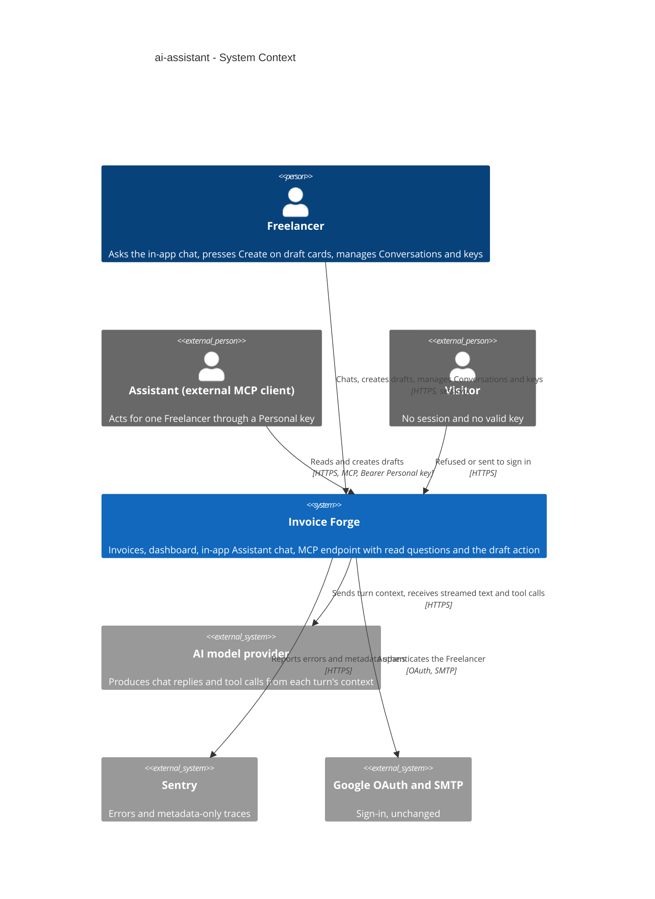
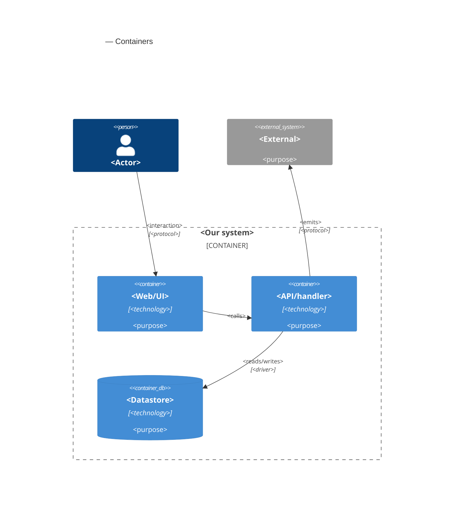

# Software Architecture Document — ai-assistant

<!-- 12 Arc42 sections. Empty section → <!-- N/A: <one-line reason> -->. -->
<!-- C4 Context (L1) lives inline in §3. C4 Container (L2) lives inline in §5. -->
<!-- Numbers in §10 come VERBATIM from spec.md §6 NFR — no inventing, no rounding. -->

## 1. Introduction and goals

**Intent.** An in-app AI chat inside Invoice Forge for Freelancers who have no AI client of their own: a new **AI section** in the navigation, a **"Create with AI"** entry next to "New invoice", answers about the Freelancer's own invoices through the seven existing read questions, short "where is this in the app" help, and the headline action, a **real Draft invoice from one sentence** that exists only after the Freelancer presses Create on the card the chat proposed. The same draft action ships at once to external Assistants over MCP, behind a new **Draft permission** that can be chosen only when a Personal key is created, capped at 50 drafts per key per day. Both channels share one no-guessing rule that lives inside the action itself: every value on an Assistant draft comes from the request or the editor's own new-invoice defaults, and anything else is asked (chat) or refused (MCP). Spend is bounded by an honest **Daily message allowance** and a per-message work cap; Conversations are saved, listed, deletable and removed 90 days after their last message (spec §1, §2).

**Top-4 quality goals (1-liners; full scenarios in §10):**

1. **Write safety without guessing** — no Assistant draft carries a value from neither the request nor the editor defaults, the chat never creates a draft without the Freelancer's Create press, and no press or retry ever creates a second draft.
2. **Bounded, honest cost** — the Daily message allowance holds exactly under concurrency, one message can never consume a day's budget, and model cost stays within the spec's per-message p95.
3. **Trustworthy answers** — every figure equals the dashboard to the cent, one Freelancer's data never reaches another, and the topic boundary refuses off-topic requests without refusing in-scope ones.
4. **Responsiveness under a third-party dependency** — first visible words and full replies inside the spec's p95 budgets, and a model-provider outage shown within seconds while the rest of the app keeps working.

**Stakeholders.**

| Role | Interest | Sign-off owner? |
|---|---|---|
| Freelancer | Uses the AI section and chat, presses Create on draft cards, manages Conversations, creates keys with Draft permission and lifts their daily draft limit | No |
| Assistant | Either the in-app chat acting inside the Freelancer's signed-in session, or an external MCP client acting through a Personal key; reads, and with Draft permission creates Draft invoices | No |
| Visitor | Any caller without a session or valid key; must be sent to sign in or refused, with nothing processed or counted | No |
| Security Lead | First AI write path, new key capability, new processor of personal data, new store of financial conversation text (spec §6.1 "Security review: Required") | Yes |
| Tech Lead | SAD approval | Yes |

<!-- Decision overrides (¶4) — populated by the critic resolution loop, empty otherwise. -->

## 2. Constraints

**Technical.**
- TypeScript 5 (strict) on Node.js `>=22.18 <23`, pnpm 10.25.
- Next.js 16.3.8 App Router and React 19.2.3, both pinned exactly; route handlers on the Node.js runtime; next-auth 5.0.0-beta.32 (pinned beta, edge-safe `auth.config.ts`); zod 3.25 (a 4.x copy is also pulled in transitively).
- PostgreSQL via Prisma 7.10 + `@prisma/adapter-pg`; split schema `prisma/schema/{base,auth,invoice}.prisma`; migrations by `prisma migrate`.
- `@modelcontextprotocol/sdk` 1.32.0 (pinned); the MCP server registers its tools through `lib/mcp/server.ts`, read-only by construction today (`registerReadOnlyTool`).
- **No AI runtime is installed.** Every new AI package (SDK, provider, UI hook) is added with an exact version pin, like the other upgrade-sensitive dependencies, and must accept zod 3.25 schemas.
- Hosted on Vercel, region `fra1`, one daily cron (`/api/cron/purge-limits`, `vercel.json`).
- Business logic only through `lib/services/*`, every function taking an `ActingFreelancer` first (service-layer ADR-0001), behind `server-only` + lint rules (service-layer ADR-0006); aggregates are parameterized raw SQL (service-layer ADR-0004); lists return the shared page envelope (service-layer ADR-0005).
- PDF rendering is browser-only (editor-ux ADR-0001); this feature adds no server-side PDF (spec §3).
- Tests: vitest (unit / component / contract), an integration config on throwaway Postgres 16 containers, Playwright e2e run locally (not in CI).

**Organisational.**
- No external deadline; the motivation is product direction (spec §1).
- Size L (`.size`), route `full`; implementation follows the roadmap's three waves (`roadmap.md` §Execution path).
- Team: one developer (Dmytro Hopko) working with AI agents through the SDD pipeline.
- The product pays for every model token (no bring-your-own key, no paid plans — spec §3); the monthly budget per weekly active chat user is open until the 14-day review (spec §8).

**Conventions.**
- `docs/architecture-map.md` §Conventions and the feature ADRs it cites; the mcp-server SAD §2 for the Assistant-side conventions.
- Results: `ActionResult<T>` with typed codes `UNAUTHORIZED | NOT_FOUND | VALIDATION | CONFLICT | FAILED | RATE_LIMITED` (`types/result.ts`); plain-language messages, Prisma errors scrubbed by `redactError`; writes scoped by owner in the `WHERE` clause (service-layer ADR-0003).
- Actor factories only: `actingFreelancerFromSession()` (server actions), `actingFreelancerForRoute()` (route handlers), `actingFreelancerFromPersonalKey()` (MCP).
- Proxy deny-by-default including `/api`, public paths an explicit allowlist (architecture-hardening ADR-0001); a new page route goes into `protectedRoutesBase`.
- Limits: exact sliding windows over the Postgres `LimitEvent` log under an advisory lock (security-patch ADR-0002), purged daily (security-patch ADR-0007); Assistant calls fail closed when counting fails (mcp-server ADR-0007).
- Dates: invoice dates are calendar days (mcp-server ADR-0009); "today" comes from the Freelancer time zone saved on the account (mcp-server ADR-0006); overdue is computed at read time by one rule module (mcp-server ADR-0005).
- Invoice numbers allocated under a sender-profile row lock (architecture-hardening ADR-0005); account deletion in one explicit transaction (architecture-hardening ADR-0007).
- IDs: `cuid()` strings; every domain row carries `userId`.
- UI: shadcn/ui (base-vega) + Tailwind 4 tokens; reusable components registered in `docs/design-system.md`.

**Regulatory / external.**
- **New processor of personal data.** Message text and tool answers go to an external model provider; the Privacy page must name it (category, retention, no training on the data) before ship (spec §6.1, §8).
- **Retention.** Conversations are deleted within 24 h after 90 days from their last message, on Freelancer request (one or all), and with the account; they are included in the data export (spec §6.1, AC-37–AC-39).
- **Traces hold metadata only** — tools called, steps, duration, cost, outcome; never message text or tool answers, so deleting a Conversation deletes the only copy of its content (spec §1, §6.1).
- **Aggregates kept:** per-day message counts, per-key draft counts and lift times, and the origin of each Assistant draft (kept after issuing, never shown) — listed in the export and removed with the account or invoice (spec §6.1).
- Security review required before ship (`/security-review`, spec §6.1).

## 3. Context and scope

Invoice Forge is a web app where a Freelancer manages sender profiles, Customers, products and invoices. This feature adds an in-app Assistant (the chat) that answers questions about the Freelancer's own data and proposes Draft invoices, and extends the existing MCP endpoint with a draft action for external Assistants holding a key with Draft permission. The trust boundary gains one new outbound edge: the content of each chat turn, including Customer names and amounts from tool answers, leaves the system for an external model provider, and what comes back is untrusted text that may only propose, never write.

<!-- brownfield: docs/architecture-map.md (reflects 2064466; only docs changed since) — Next.js 16 monolith on Vercel, service layer with ActingFreelancer, read-only MCP server at /api/mcp behind Personal keys, Postgres via Prisma, no AI runtime installed. -->

**External systems (in / out):**

| Actor or system | Type | Interaction |
|---|---|---|
| Freelancer | Person | Signs in, uses the AI section and chat, presses Create on draft cards, manages Conversations and Personal keys |
| Assistant (external MCP client) | Person (external program acting for one Freelancer) | Calls the seven read tools and, with Draft permission, the draft action over MCP with a Personal key |
| Visitor | Person | Reaches pages or endpoints without a session or key; sent to sign in or refused |
| AI model provider (new) | System (external) | Receives each chat turn's context and tool schemas, streams back text and tool calls; the concrete provider and access path are decided in §4 |
| Sentry | System (external, existing) | Receives errors and metadata-only traces and spans |
| Google OAuth / SMTP | System (external, existing, unchanged) | Sign-in provider and sign-in link email |

**C4 Context (L1):**



## 4. Solution strategy

<!-- 🎯 Why: the 3–4 STRATEGIC PILLARS every ADR grows from. Without §4 each ADR looks random —
     there's no umbrella. ⭐ The densest section — the blast-radius gate fires almost always here
     (decisions are irreversible + multi-module).
     📋 Write: 3–4 choices; each a heading + 2–3 sentences of rationale.
     📌 «Store content as a table of typed blocks» is a pillar — ADR-0001 grows from it. -->

**Top strategic choices (the seeds for ADRs):**

1. **<e.g. Module isolation through events>** — <2–3 sentences citing quality goals + constraints>.
2. **<e.g. Single-store persistence>** — <2–3 sentences>.
3. **<e.g. Server-rendered read side>** — <2–3 sentences>.

Each tactical decision in later sections should trace to one of these seeds. Tactical decisions that *contradict* a strategic choice are red flags — surface them in §11.

## 5. Building block view

<!-- 🎯 Why: INTERNAL DECOMPOSITION — modules, containers, datastores. The static topology: who
     may talk to whom. Without §5, §6 (the flows) has no vocabulary of participants.
     📋 Write: 1 ¶ on the style (layered / hexagonal / clean / event-driven) + a folder tree + a
     C4Container block.
     📌 Draw ONE Container per declared `target_surface` (frontmatter): a fullstack
     [backend-service, web-frontend] = a backend-API container + a web/SPA container; a
     [backend-service, mobile-app] = the API + the mobile app. The Container(web, …) line below is
     just one surface's container — swap/add per what was declared in §4. → _shared/surfaces.md
     📌 e.g. «web app, content API, media worker, datastore, object store, CDN». -->

<One paragraph: layered / hexagonal / clean / event-driven, and why.>

**Internal decomposition:**

```
<e.g. modules/<feature>/>
├── domain/       <entities + sentinel errors>
├── app/          <use cases / services>
├── infra/        <repository + integration impl>
├── ports/        <handlers, DTOs, error mapping>
└── wiring        <self-wiring entry point>
```

**C4 Container (L2):** <!-- syntax → references/c4-mermaid-syntax.md. Real names, no <placeholder> stubs. ONE Container per declared target_surface (frontmatter); the web container below is one example surface. -->



## 6. Runtime view

<!-- 🎯 Why: the RUNTIME FLOW of 1–2 critical scenarios — who talks to whom, when, in what order.
     Without §6, §5 is just boxes with no life.
     📋 Write: a Mermaid sequenceDiagram. Participants are names from §5 (don't invent new ones).
     Messages are semantic («saves a draft»), NO HTTP verbs / paths / status codes — endpoint-level
     sequences arrive at the `api` stage.
     📌 e.g. «author → web: composes draft → web → content API: save». Seed the primary flow(s) here;
     the `sequences` stage then covers every §5 AC (no cap). Never N/A for M+; XS/S keeps ≥1 happy-path flow. -->

**Critical flow 1: <flow name>**

```mermaid
sequenceDiagram
    actor Actor
    participant Web
    participant Service
    participant Store
    Actor->>Web: <action>
    Web->>Service: <call>
    Service->>Store: <write>
    Store-->>Service: ok
    Service-->>Web: result
    Web-->>Actor: confirmation
```

**Critical flow 2: <e.g. async event propagation>** — <if applicable, otherwise N/A>.

## 7. Deployment view

<!-- 🎯 Why: the TOPOLOGY DevOps must know without reading the deploy charts — how many replicas,
     where the background worker lives, AT WHAT NUMBERS we scale.
     📋 Write: 2–3 sentences on topology + monitoring + concrete threshold numbers.
     📌 e.g. «500 authors → partition by quarter» (not «we'll think about scale later»).
     🎯 N/A allowed for XS/S that reuses an existing deployment unit with no change.
     Deployment-diagram scaffold → templates/deployment.md. -->

<Topology in 2–3 sentences. Where it runs, replicas, scaling thresholds.>

**Monitoring:**
- <Metrics — e.g. `<metric_name>`>
- <Alerts — e.g. «worker lag > 10 min → page on-call»>
- <Tracing — e.g. spans on the request boundary>

**Scaling thresholds:**
- <e.g. comfortable in one table up to N rows/year>
- <e.g. partition by quarter above N rows/year>

<!-- For XS/S with no deployment change: <!-- N/A: reuses existing deployment unit, no infra change --> -->

## 8. Crosscutting concepts

<!-- 🎯 Why: CROSS-CUTTING PATTERNS spanning several modules: logging, errors, authorization, ID
     strategy, events, caching. ⭐ The second-densest section. A pattern inside one module is NOT
     here; a project-wide convention belongs in the convention file.
     📋 Write: a table — concept / convention / where defined. One row per concept.
     📌 e.g. «sortable time-based IDs generated in the app layer» as a default from the convention file. -->

| Concept | Convention | Where defined |
|---|---|---|
| Logging | <e.g. structured, fields `module=<name>`> | <convention file §X or here> |
| Authentication | <e.g. token-based via middleware> | <convention file §X> |
| Error handling | <e.g. domain sentinel → ports error mapping → JSON> | <convention file §X> |
| ID strategy | <e.g. sortable time-based ID in the app layer> | <convention file §X> |
| Internationalisation | <e.g. N/A, single language> | — |
| Observability | <e.g. tracing on the request boundary> | — |
| Events | <module-specific patterns, if any> | <here> |

## 9. Architecture decisions

<!-- 🎯 Why: the REVERSE INDEX onto the adr/ folder. `ls adr/` gives the files; §9 gives the
     semantics — why they exist, which SAD section they attach to, what status.
     📋 Write: a 4-column table, one row per ADR. Mixed status is fine.
     📌 e.g. «0001 | Store content as a table of typed blocks | Accepted | §4». -->

| # | Title | Status | Section |
|---|---|---|---|
| <NNNN> | <imperative — e.g. "Use a sliding-window counter for rate limiting"> | Accepted | §<N> |
| <NNNN> | <imperative — e.g. "Co-locate the worker in the API process"> | Accepted | §<N> |

ADR files live under `docs/features/<slug>/adr/NNNN-<title>.md`.

## 10. Quality requirements

<!-- 🎯 Why: the QUALITY TREE — take a goal from §1 and break it into concrete leaves: tests,
     metrics, configs, drills. ⭐ Without §10, §1 is a manifesto. With §10 each declaration maps
     to something PROVABLE.
     📋 Write: per §1 goal — When / Then / How-verify. Numbers from spec §6 NFR VERBATIM (don't
     round ≤250ms to ≤300ms — that's a critic F6 hit).
     📌 e.g. «p95 ≤ 500 ms on a block update, verified by a 100 req/s load test». -->

Each top-3 goal from §1 expanded into a full scenario:

**QG-1. <quality attribute>**
- **When:** <trigger condition>
- **Then:** <expected behaviour with numbers from spec §6 NFR>
- **How verify:** <test / chaos drill / load test / metric>

**QG-2. <quality attribute>**
- **When:** <trigger>
- **Then:** <expected>
- **How verify:** <how>

**QG-3. <quality attribute>**
- **When:** <trigger>
- **Then:** <expected>
- **How verify:** <how>

## 11. Risks and technical debt

<!-- 🎯 Why: ⭐ collects EVERYTHING that can break — not only the technical. Without §11 risks get
     discussed at standups and lost; debt lives only in the head of whoever accepted it.
     📋 Write: a risk/debt table — severity — mitigation — owner. Accepted debt in its own block.
     📌 The first risk is often a product risk, not a technical one. That's normal. -->

<!-- Severity literals: Low / Medium / High for regular risks; "Open question" for rows created by
     a Save-as-OQ resolution during the Socratic walk (see references/socratic.md). -->

| Risk / debt | Severity | Mitigation | Owner |
|---|---|---|---|
| <e.g. Worker lag may reach hours during a downstream outage> | Medium | <alert >10 min, on-call playbook, retry backoff> | <DevOps> |
| <e.g. No event-schema versioning in v1> | Medium | <ADR-NNNN planned for v2, tolerate unknown fields> | <Backend> |
| Open architectural decision: <decision-headline> | Open question | Resolve before <stage trigger or YYYY-MM-DD>; <inline rationale from the Save-as-OQ> | <owner> |

**Accepted debt (acceptable in v1, plan to fix later):**
- <e.g. the entity is immutable / unversioned — OK for v1, may need audit versioning in v2>

## 12. Glossary

<!-- 🎯 Why: ⭐ the DOMAIN GLOSSARY that ends arguments a year later («checkpoint — weekly or
     biweekly? quarter — calendar or fiscal?»).
     📋 Write: a term / meaning table. Business + technical terms mixed.
     📌 e.g. «Lesson | a unit inside a course made of blocks (text, video)». -->

| Term | Meaning |
|---|---|
| <e.g. domain object A> | <its meaning in this domain> |
| <e.g. domain object B> | <its meaning> |
| <e.g. domain invariant name> | <the rule, in plain language> |
