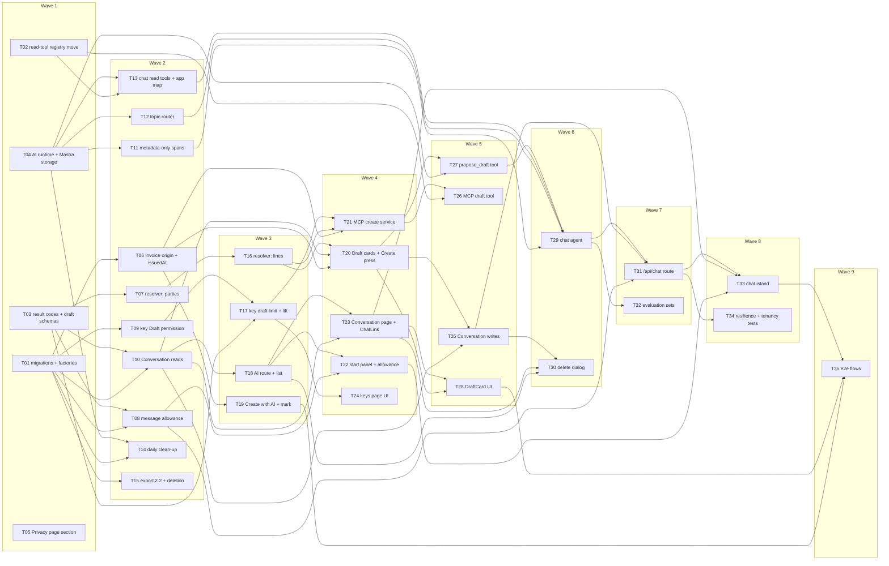

# Epic — ai-assistant

> **Spec:** [spec.md](../spec.md) · **Design:** [sad.md](../sad.md) · **Data model:** [data-model.md](../data-model.md) · **API:** [openapi.yaml](../contracts/openapi.yaml) · [server-actions.md](../contracts/server-actions.md) · **Screens:** [screens.md](../screens.md) · **ADRs:** [adr/](../adr/)

## Goal

Give every Freelancer an in-app AI chat that works right after sign-in: answers about their own invoices that match the dashboard, short "where is this" help, and a real Draft invoice from one sentence that exists only after they press Create on the proposed card (spec §2 goals 1–2). Ship the same draft action to external Assistants over MCP behind a Draft permission chosen only at key creation, capped at 50 drafts per key per day, with one no-guessing resolver shared by both channels (spec §2 goal 2). Keep the Freelancer in control of cost and history — an honest Daily message allowance, Conversations they can delete, removed 90 days after their last message — and make Assistant drafts measurable as issued invoices (spec §2 goals 3–4).

## Scope

- **In:** ten staged migrations (`Conversation`, `ConversationMessage`, `DraftCard`, `MessageAllowanceDay`, `AssistantTurn`, `PersonalKey.canCreateDrafts`, `PersonalKeyDraftDay`, `McpDraftRepeat`, `Invoice` origin columns + `issuedAt`); `lib/assistant-tools` (read-question registry moved from `lib/mcp/tools`); `lib/services/{assistant-drafts,conversations,assistant-usage}` (new) and `{invoices,personal-keys,account}` (extended); `lib/ai` (AI SDK + gateway + Mastra, topic router, agent, tools, metadata-only spans); `app/api/chat`; `lib/mcp` (`create_draft_invoice`); the daily cron; export 2.2; UI SCR-01–SCR-08 and SCR-12 (AI section, Conversation, Draft card, delete dialog, invoice list/editor mark, Connect your AI); the Privacy page section; evaluation sets and e2e.
- **Out (spec §3):** an Assistant issuing, sending, editing or deleting an invoice; creating Customers or products through the AI; a standalone PDF from the AI; advice outside the Freelancer's own data and the app; bring-your-own model key, paid plans or a bigger allowance; Draft permission on an existing key; attachments, voice or images in the chat.

## Task map

**Waves** (what `implement` can run in parallel): W1 T01 · T02 · T03 · T04 · T05 → W2 T06 · T07 · T08 · T09 · T10 · T11 · T12 · T13 · T14 · T15 → W3 T16 · T17 · T18 · T19 → W4 T20 · T21 · T22 · T23 · T24 → W5 T25 · T26 · T27 · T28 → W6 T29 · T30 → W7 T31 · T32 → W8 T33 · T34 → W9 T35.

**Serialized lanes** (overlapping `files_hint`): `lib/mcp/tools/` — T02 → T26 · `tests/contract/mcp-tools-list.test.ts` — T02 → T26 · `lib/mcp/server.ts` — T02 → T26 · `lib/ai/mastra.ts` — T04 → T11 → T29 · `package.json` — T04 → T32 · `lib/ai/model.ts` — T04 → T35 · `types/personal-key/types.ts` — T09 → T17 · `lib/actions/personal-key-actions.ts` — T09 → T17 · `lib/services/personal-keys/personal-keys.ts` — T09 → T17 · `lib/ai/turn-context.ts` — T13 → T27 · `app/(protected)/ai/page.tsx` — T18 → T22 → T33 · `components/ai/conversation-list.tsx` — T18 → T30 · `tests/unit/proxy.test.ts` — T18 → T31 · `docs/design-system.md` — T19 → T22 → T23 → T28 · `lib/actions/assistant-actions.ts` — T20 → T25 · `components/ai/conversation-header.tsx` — T23 → T30 · `app/(protected)/ai/[conversationId]/page.tsx` — T23 → T33 · `components/ai/message-list.tsx` — T23 → T28 · `app/api/chat/route.ts` — T31 → T34. `layer: migration` (T01) is serialized by `implement` regardless.

## Tasks

See [tracker.md](./tracker.md) for status. Machine contract: [tasks.json](../tasks.json).

| # | Task | Layer | Blocked by | ACs |
|---|---|---|---|---|
| T01 | [Promote the ten staged migrations, add the Prisma models and extend the test factories for the AI tables](./t01-promote-migrations-and-test-support.md) | migration | — | AC-26, AC-39 |
| T02 | [Move the seven read-question definitions from lib/mcp/tools into the shared lib/assistant-tools registry, behaviour unchanged](./t02-move-read-tool-registry.md) | ports | — | AC-02 |
| T03 | [Add the FORBIDDEN code, the three new error-detail kinds, the shared assistant types and the zod draft schemas](./t03-shared-assistant-types-and-draft-schemas.md) | domain | — | AC-10, AC-29, AC-31 |
| T04 | [Install the pinned AI SDK, gateway and Mastra packages, add the model settings and the Mastra instance on its own mastra schema](./t04-ai-runtime-and-mastra-storage.md) | infra | — | NFR |
| T05 | [Name the AI model provider, the gateway and the chat retention on the public Privacy page](./t05-privacy-page-model-provider.md) | docs | — | NFR |
| T06 | [Write the Assistant origin once at creation, set issuedAt when an invoice first leaves DRAFT, and expose assistantMark on invoice reads](./t06-invoice-assistant-origin-and-issued-at.md) | app | T01 | AC-23 |
| T07 | [Resolve the Customer, sender profile, bank account, currency and dates of a draft request with no guessing](./t07-draft-resolver-parties-and-defaults.md) | app | T03 | AC-17, AC-19, AC-20, AC-21 |
| T08 | [Count the Daily message allowance in per-local-day rows: read, reserve with a conditional increment, release on failure](./t08-daily-message-allowance.md) | app | T01, T03 | AC-09, AC-10, AC-10b, AC-11 |
| T09 | [Set Draft permission only when a Personal key is created and return it from the key list and the key check](./t09-personal-key-draft-permission.md) | app | T01 | AC-25, AC-26 |
| T10 | [List and open Conversations owner-scoped, with Draft card views and the current state of every linked invoice](./t10-conversation-reads.md) | app | T01, T03 | AC-35, AC-36, AC-41 |
| T11 | [Strip every text-bearing attribute from Mastra spans before export and pin it with a span contract test](./t11-metadata-only-span-processor.md) | infra | T04 | NFR |
| T12 | [Classify every chat message as in_scope, mixed or off_topic before the agent and end off-topic turns with the fixed refusal](./t12-topic-router.md) | app | T04 | AC-06, AC-06b |
| T13 | [Wrap the shared read questions as chat tools bound to the acting Freelancer and add find_in_app over a fixed app map](./t13-chat-read-tools-and-app-map.md) | app | T02, T04 | AC-02, AC-03, AC-04, AC-05, AC-07, AC-08, AC-40 |
| T14 | [Add the four independent AI retention steps to the daily purge cron](./t14-daily-clean-up-steps.md) | wiring | T01, T04 | AC-38 |
| T15 | [Add Conversations and the AI counters to the data export 2.2 and prove account deletion leaves no AI row](./t15-data-export-and-account-deletion.md) | ports | T01 | AC-39 |
| T16 | [Resolve draft lines against the catalogue and custom prices, apply the quantity and unit defaults and finish resolveDraftRequest](./t16-draft-resolver-lines-and-proposal.md) | app | T07 | AC-12, AC-16, AC-16b, AC-22 |
| T17 | [Count Assistant drafts per key per local day, take a slot inside the create transaction and lift the limit by 50 once reached](./t17-key-daily-draft-limit-and-lift.md) | app | T03, T09 | AC-27, AC-28 |
| T18 | [Add the AI section route and sidebar entry and render the Conversation list with paging, empty state and the retention notice](./t18-ai-section-route-and-conversation-list.md) | ui | T10 | AC-35, AC-38, AC-42 |
| T19 | [Add "Create with AI" to the invoice list header and the AssistantMark to draft rows and the editor header](./t19-create-with-ai-entry-and-assistant-mark.md) | ui | T06 | AC-23, AC-33 |
| T20 | [Store Draft cards with one live card per Conversation and create the Draft invoice only from the Create press](./t20-draft-cards-and-create-press.md) | app | T06, T10, T16 | AC-11c, AC-13, AC-14, AC-14b, AC-18 |
| T21 | [Create a Draft invoice for a Personal key: permission, repeat mark, resolver, key slot, invoice and repeat row in one transaction](./t21-create-draft-for-key.md) | app | T06, T16, T17 | AC-27, AC-30, AC-31, AC-32 |
| T22 | [Build the AI start panel with example prompts, the start=draft variant and the AllowanceNotice counter and used-up modes](./t22-ai-start-panel-and-allowance-notice.md) | ui | T08, T18 | AC-01, AC-10, AC-33, AC-34 |
| T23 | [Render a saved Conversation with ChatLink invoice states, the not-found page and the loading skeleton](./t23-conversation-page-and-chat-links.md) | ui | T10, T18 | AC-36, AC-41 |
| T24 | [Add the Draft permission choice, the permission badges, the read-only explanation and the lift action to Connect your AI](./t24-connect-your-ai-draft-permission-ui.md) | ui | T17 | AC-25, AC-26, AC-28 |
| T25 | [Save each turn under the Conversation row lock with its card and metadata, and delete one or all Conversations](./t25-conversation-writes-and-deletes.md) | app | T10, T20 | AC-35, AC-37 |
| T26 | [Register create_draft_invoice through registerDraftTool for every key and map its results to the MCP tool answer](./t26-mcp-create-draft-tool.md) | ports | T02, T21 | AC-17, AC-29 |
| T27 | [Add the propose_draft tool that resolves the Freelancer's own words into a pending Draft card or into questions](./t27-propose-draft-tool.md) | app | T04, T20 | AC-12, AC-15, AC-19, AC-20, AC-21, AC-22 |
| T28 | [Build the DraftCard component in every SCR-03 state and wire Create to createDraftFromCard](./t28-draft-card-component.md) | ui | T20, T23 | AC-11c, AC-12, AC-13, AC-14, AC-14b, AC-16, AC-16b, AC-18, AC-19 |
| T29 | [Define the chat agent: instructions, tool set, 8-step cap, 40-message history and the turn runner the route calls](./t29-chat-agent.md) | app | T11, T12, T13, T27 | AC-11b, AC-24 |
| T30 | [Mount the AI-section modal container and confirm deleting one or all Conversations from the list and the Conversation header](./t30-delete-conversations-dialog.md) | ui | T18, T23, T25 | AC-37 |
| T31 | [Serve POST /api/chat: validate, check the Conversation, reserve a slot, stream the turn, save it, release on failure](./t31-chat-route.md) | ports | T08, T25, T29 | AC-06, AC-09, AC-10, AC-10b, AC-11, AC-42 |
| T32 | [Add the labelled topic-boundary set and the no-guessing set as a Mastra evaluation run that blocks a failing change](./t32-evaluation-sets.md) | tests | T29 | AC-06, AC-06b |
| T33 | [Build the useChat island: send only the new message, show waiting, streaming and every outcome, and keep the allowance live](./t33-chat-island.md) | ui | T22, T23, T31 | AC-09, AC-10b, AC-11, AC-11b |
| T34 | [Prove provider-fault handling, the stored-text injection guard and cross-tenant silence through the chat route](./t34-chat-resilience-injection-and-tenancy.md) | tests | T31 | AC-11, AC-15, AC-40, AC-41 |
| T35 | [Add Playwright flows: open the AI section, draft and create from a card, Create with AI, and the Assistant mark](./t35-e2e-ai-flows.md) | tests | T19, T28, T33 | AC-01, AC-13, AC-23, AC-33 |

## Risks / Hard rules

- **No draft without the Create press (chat).** The model has no create tool in the chat; `propose_draft` only proposes a card, and only `createDraftFromCard` creates (sad §8 Write safety, ADR-0007). T20, T27, T34.
- **No guessing, one resolver.** Every draft value comes from the request or the editor's new-invoice defaults; anything else is a `DraftIssue` (ADR-0006). T07, T16, T21, T32.
- **Tenancy.** Every read and write goes through a service as the `ActingFreelancer`; tools get the actor from the route, never from the model; another Freelancer's records answer exactly like missing ones (sad §8, AC-40/AC-41). T10, T13, T34.
- **Metadata-only traces.** No message text, tool argument or tool answer leaves in a span; exact pins for every Mastra package (ADR-0004, sad §11 risk 4). T04, T11.
- **Allowance fails closed and never overshoots.** Conditional increment per local day; a reservation that cannot be written processes nothing (ADR-0009). T08, T31.
- **Draft permission only at creation.** No update path for `canCreateDrafts` (ADR-0011, spec §3). T09, T24.
- **Origin is write-once and never copied** by the editor save or `duplicateInvoice` (ADR-0013, sad §11 risk 10). T06.
- **Ship blockers outside code (sad §11 High):** the free-tier key's terms vs the spec's privacy promise and the Privacy page wording (T05 + owner decision before `/sdd:ship`); `/security-review` is required (spec §6.1).
- **No turn deadlines** (sad §1 override): the hanging-provider test in T34 decides whether a first-token timeout lands.
- **Open upstream items carried into tasks:** OQ-A1 (`NEEDS_ANSWERS` has no sad §6 flow-2 branch — built per contract in T20/T28); OQ-S1 (`getConversation.invoiceLinks` — added in T10 per screens.md); **OQ-T1** (new here — the new Conversation's id and the proposed card are pre-generated during the turn and persisted by `saveTurn` in one transaction, two additive `saveTurn` inputs — T25, T27, T31).
