# UX flows — ai-assistant

> User flows for every UI-touching §4 user story of [`spec.md`](./spec.md), produced by `ux-flows` (after `clarify`, before `design`) and read by `design` (evidence for the target-surface + UI-architecture decisions), `sequences` (UI-driven flows align on SCR ids), `screens` (details every inventory row) and `plan-tests` (the e2e-through-UI paths). Flow altitude only: no components, layout or styling.

## Platform decisions

- **Posture:** responsive-both. `docs/design-system.md` names no posture, so this follows the rest of the app, which already adapts to phone widths. On a wide screen the Conversation list and the open Conversation share one view. On a phone the list is its own step before the Conversation. The flows below are the same on both. Only the arrangement differs, and `screens` decides it.
- **Navigation shape:** the AI section is a new top-level navigation entry. "Create with AI" on the invoice list is a second way into the same section, opening a fresh Conversation and not a separate surface.
- **Draft card is inline, not a page:** the proposed draft lives inside the Conversation as a card with one Create action. Creating never leaves the chat. The answer carries a link that opens the draft in the existing editor.
- **Confirmations are dialogs:** deleting one or all Conversations goes through a confirmation dialog over the AI section. The Draft permission choice lives in the existing new-key dialog on the Connect your AI page.
- **Allowance is always visible:** the remaining Daily message allowance shows wherever a message can be sent (AI section start and every Conversation). The used-up state replaces the message box and does not block reading.
- **Links out are to existing pages only:** the chat links to the editor, sender profiles, the Customer form and the Connect your AI page. It introduces no new destination pages.
- **Design input (not decided here):** replies must appear progressively (first words ≤ 3 s, §6). Whether that is streamed and how is a `design` decision.

## Screen inventory

| ID | Screen | Purpose | Entry | Exit |
|---|---|---|---|---|
| SCR-01 | AI section | Start a new Conversation (example questions, messages left today, link to connect an AI client) and list past Conversations newest first, with the 90-day retention notice | Navigation "AI"; "Create with AI" (SCR-05); back from SCR-02 | SCR-02 (send a first message or open a past one), SCR-04, SCR-07 |
| SCR-02 | Conversation | The exchange with the in-app Assistant: messages, answers with links, follow-up questions, refusals, messages left today, used-up and unavailable states | SCR-01 | SCR-03 (card shown inline), SCR-06, SCR-09, SCR-10, SCR-07, SCR-01 |
| SCR-03 | Draft card (inline in SCR-02) | The proposed draft: Customer, lines, sender profile and bank account, dates, defaults used and their sources, Create; states live / replaced / outdated / created | A drafting answer in SCR-02 | Create → link to SCR-06; replaced → newer card |
| SCR-04 | Delete Conversations dialog | Confirm deleting one Conversation or all of them; drafts are untouched | SCR-01 or SCR-02 delete action | SCR-01 |
| SCR-05 | Invoice list (existing) | Adds "Create with AI" next to "New invoice" and the Assistant mark on Assistant drafts | Navigation | SCR-01 (Create with AI), SCR-06 |
| SCR-06 | Invoice editor (existing) | Opens a created draft, shows the Assistant mark until it is issued; also the hand-made fallback when the allowance is used up | Link in SCR-02, SCR-05 | SCR-05 |
| SCR-07 | Connect your AI page (existing, settings) | Key list with "can create drafts" marks, each key's daily draft count and lift action, last-lifted time, and the "drafting needs a new key" explanation on read-only keys | SCR-01 link, SCR-02 link, settings navigation | SCR-08 |
| SCR-08 | New key dialog (existing, extended) | Name the key, choose Draft permission (only here), then the one-time key reveal | SCR-07 | SCR-07 |
| SCR-09 | Sender profiles (existing) | Where the logo is set and bank accounts are added | Chat links (AC-07, AC-17, AC-19) | — |
| SCR-10 | Customer form (existing) | Add a Customer the chat could not find | Chat link (AC-21) | — |
| SCR-11 | Sign-in (existing) | Where a Visitor is sent | Any AI section or chat attempt while signed out | SCR-01 after sign-in |
| SCR-12 | Not found (existing) | A Conversation that does not exist or belongs to someone else | A Conversation link | — |
| SCR-13 | Privacy settings (existing) | Data export (now including Conversations) and account deletion (now removing them) | Settings navigation | — |

## Flows

### Flow: US-01 — Open the AI section

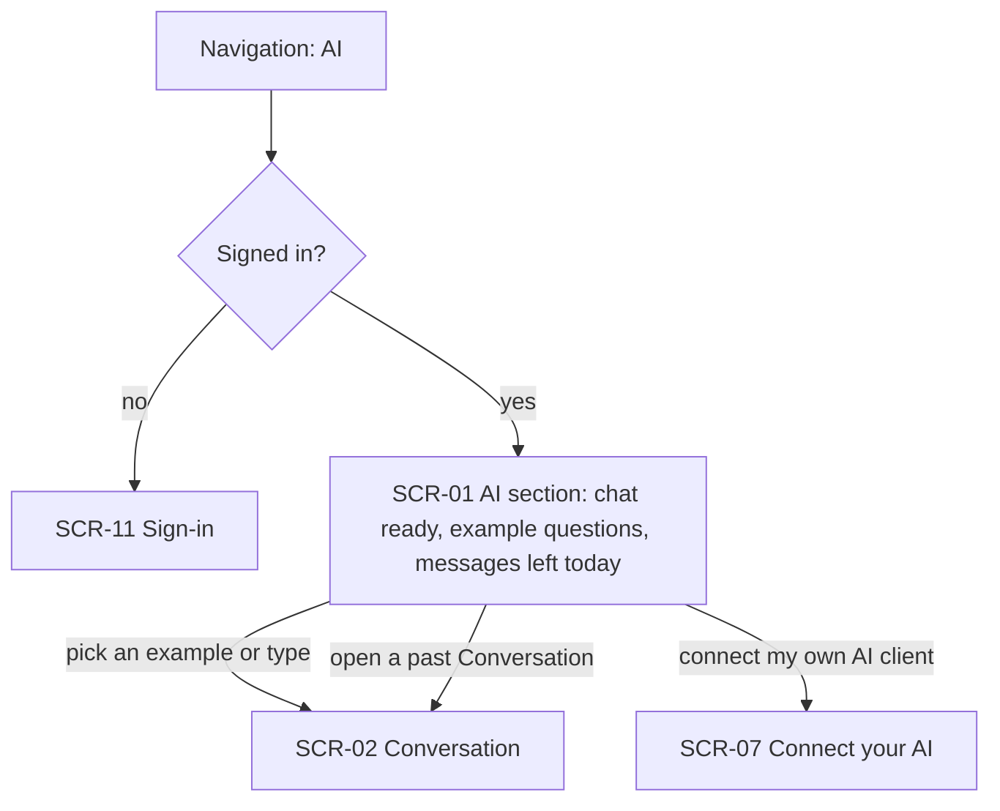

A Freelancer chooses AI in the navigation. Signed out, they go to sign-in. Signed in, the AI section opens with nothing to set up: a chat ready for a question, a few example questions, how many messages are left today and a link to the Connect your AI page. Picking an example or typing a question starts a Conversation. The link goes to the existing key page, and a past Conversation can be opened from the list (detailed in US-11).

### Flow: US-02 — Ask about my invoices

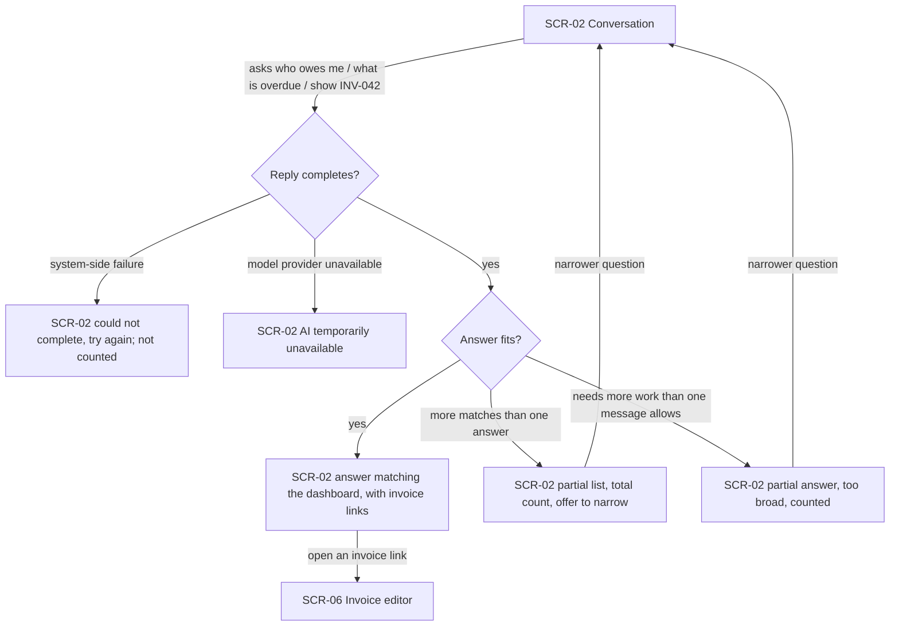

The Freelancer asks about Debtors, overdue invoices, expected payments, summary figures, Customers or one invoice. If the reply fails on the system's side, the chat says so and invites a retry, and the message is not counted. If the model provider is down, the chat says AI is temporarily unavailable. Otherwise the answer matches the dashboard and links to invoices, which open in the editor. When more invoices match than fit, the answer says it is partial, gives the total count and offers to narrow. When the question needs more work than one message may use, the chat gives what it found, says it was too broad and counts the message. Both lead back to a narrower question.

### Flow: US-03 — Stay on topic

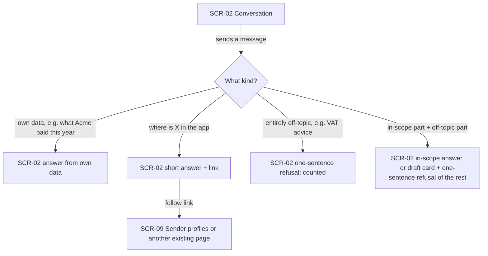

Every message is sorted into a kind. A question about the Freelancer's own data is answered from it, even when it mentions money. A "where is this" question gets a short answer and a link to an existing page, such as sender profiles for the logo. An entirely off-topic message gets a one-sentence refusal and still counts. A mixed message gets the in-scope answer or draft card, plus a one-sentence refusal of the off-topic part, and is not counted as an Off-topic request.

### Flow: US-04 — Know my daily allowance

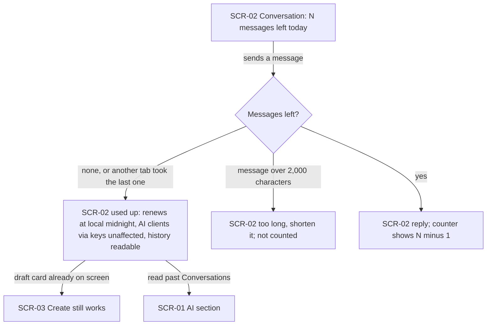

The messages left today show in every Conversation. Sending a message lowers the counter by one. When none are left, or a second tab took the last one at the same moment, the message is not processed. The chat then says the allowance is used up, when it renews in local time, and that AI clients connected through keys are unaffected, and earlier Conversations stay readable. A message longer than 2,000 characters is turned back before processing and not counted. A draft card already on screen can still be created at zero, because Create is not a message.

### Flow: US-05 — Draft an invoice from one sentence

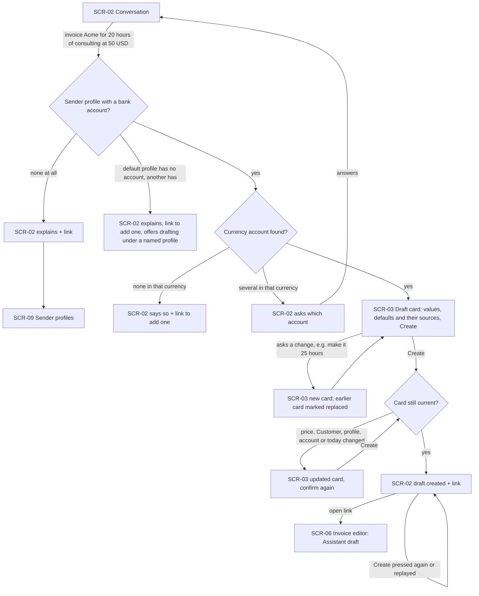

The Freelancer describes an invoice in one sentence. With no sender profile or no bank account at all, the chat explains and links to sender profiles. If only the default profile lacks an account, the chat says so, links to adding one, and offers to draft under another profile the Freelancer names. If the request names a currency with no matching account, the chat says so and links to adding one. With several accounts in that currency, it asks which. Otherwise a draft card appears showing every value, which defaults were used and where prices came from. Asking for a change produces a new card and marks the earlier one replaced, so only the newest can be created. On Create the card is checked against current data. If anything changed, including the day, an updated card asks for confirmation again. Once current, the draft is created and the chat links to it in the editor. Pressing Create again, or a replayed press, shows the same link and creates nothing.

### Flow: US-06 — Be asked, never guessed

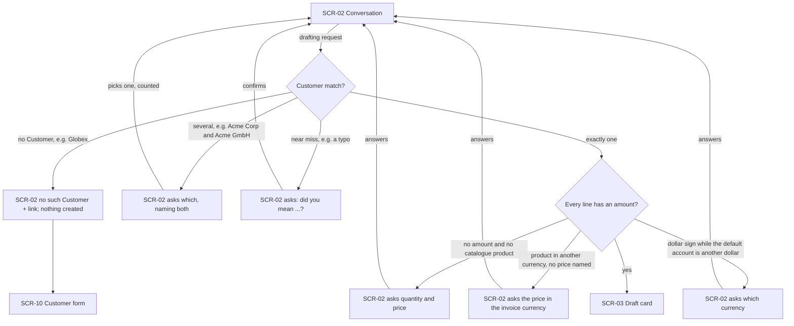

Before any card appears, the request must name exactly one Customer and an amount for every line. If no Customer matches, the chat says so and links to the Customer form, and it creates nothing. If several match, it asks which one and names them all. A near miss is offered back as a question and never filled in. A line with no amount and no catalogue product, or a product in another currency with no price named, gets a question for the missing amount. A "$" while the default account is in another dollar currency gets a currency question. Each answer is a new, counted message that goes back through the same checks. Only a complete request reaches the draft card.

### Flow: US-07 — Recognise an Assistant draft

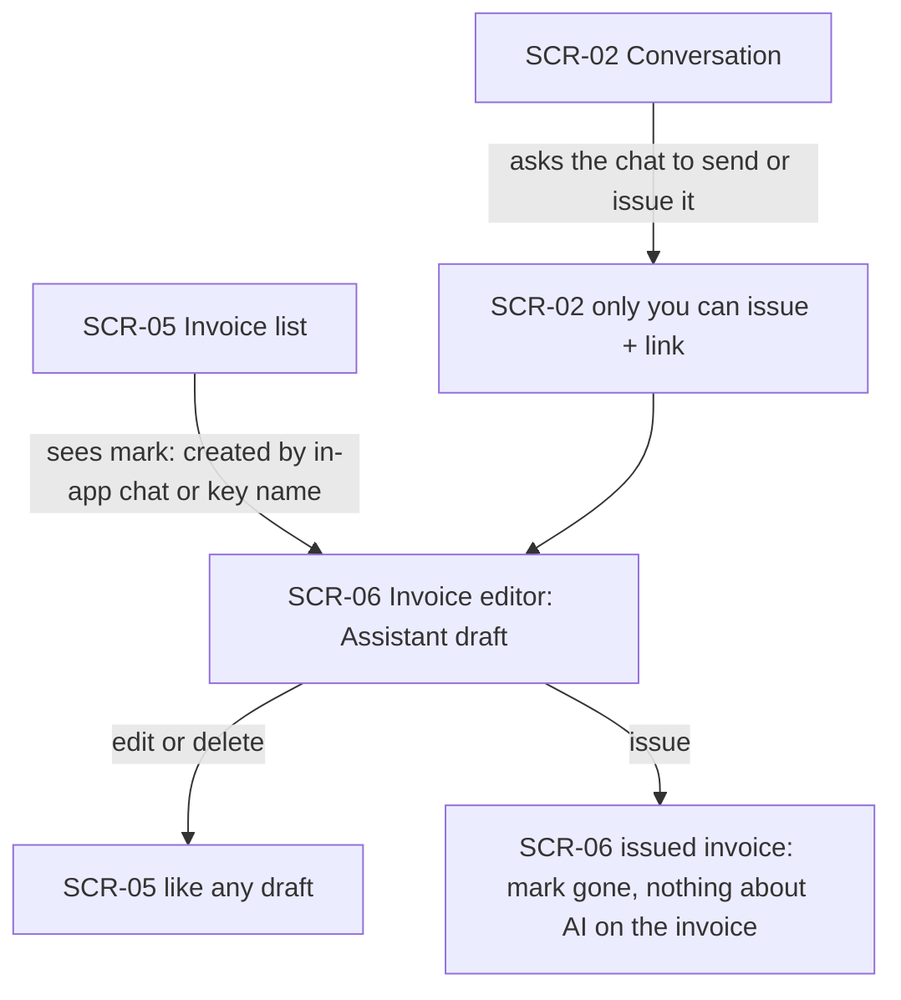

Assistant drafts carry a mark in the invoice list and the editor. The mark names the in-app chat, or the key's name as it was when the draft was created. The Freelancer can edit or delete the draft like any other. Issuing it removes the mark, and the invoice the Customer gets says nothing about AI. Asking the chat to send or issue a draft gets a reply that only the Freelancer can issue, with a link to the draft.

### Flow: US-08 — Give my own AI client draft access

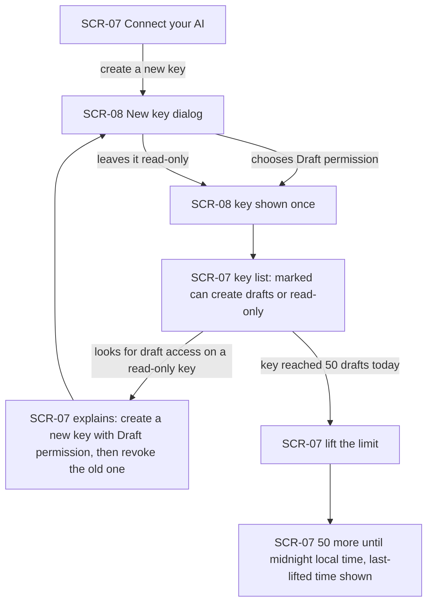

On the Connect your AI page the Freelancer creates a new key and decides in the dialog whether it gets Draft permission. The key is shown once, as before. The key list marks each key as able to create drafts or read-only. A read-only key, including every key from before this release, offers no way to add the permission. The page explains that drafting needs a new key and that the old one can be revoked afterwards. When a key has reached its 50 drafts for the day, the Freelancer can lift the limit. That gives 50 more until local midnight, and the page shows when the limit was last lifted.

### Flow: US-10 — Start drafting from the invoice list

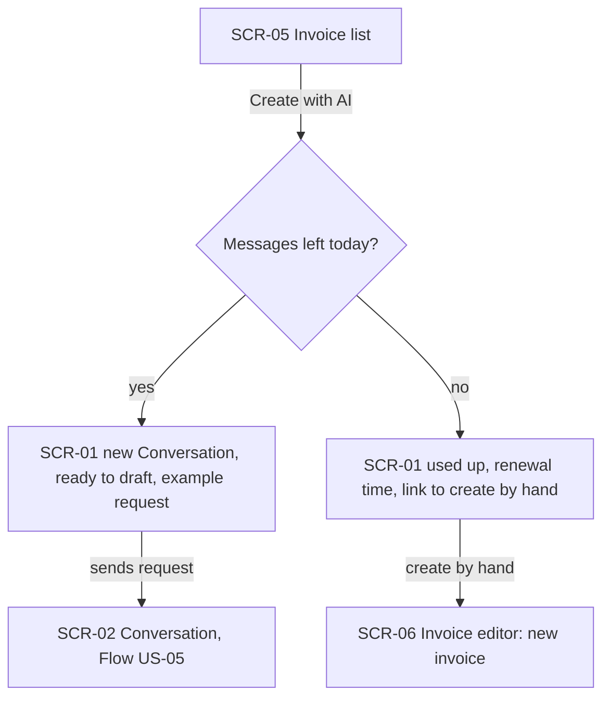

"Create with AI" sits next to "New invoice". With messages left, it opens a new Conversation that is ready to draft, with an example request, and the drafting flow (US-05) follows. With none left, the Freelancer learns before typing that today's allowance is used up and when it renews, and gets a link to create the invoice by hand in the editor.

### Flow: US-11 — Return to a past conversation

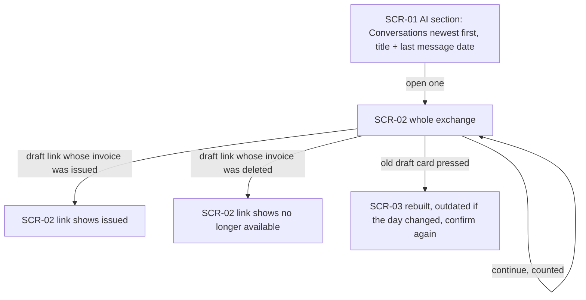

The AI section lists past Conversations, newest first, each with a title and the date of its last message. Opening one shows the whole exchange, and new messages continue it and count. A link to a draft that has since been issued shows it as issued, and one whose draft was deleted shows it as no longer available. A card left over from an earlier day is rebuilt on Create and asks for confirmation again (US-05).

### Flow: US-12 — Control my conversation history

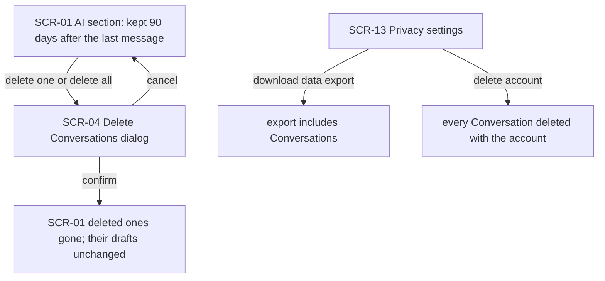

The Conversation list says that Conversations are kept for 90 days after their last message. The automatic deletion itself happens out of sight. The Freelancer can delete one Conversation or all of them through a confirmation dialog. Confirming removes them from the list for good, and any drafts they created stay as they were. From privacy settings, the data export now includes Conversations, and deleting the account deletes them with everything else.

### Flow: US-13 — Only my data, only when signed in

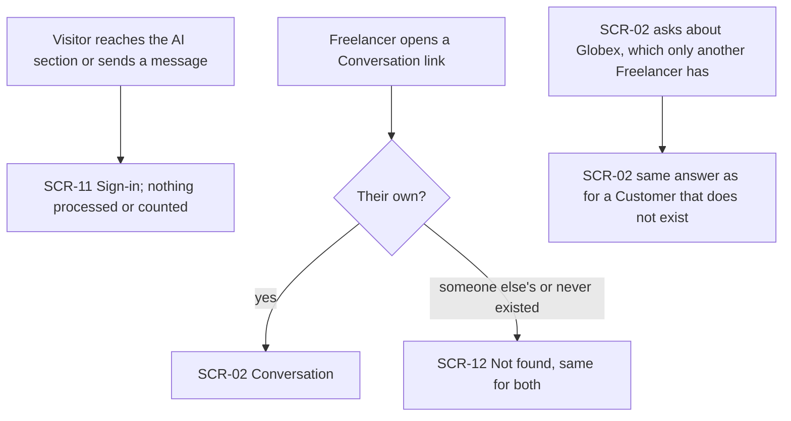

A signed-out Visitor who reaches the AI section or tries to send a message goes to sign-in, and nothing is processed or counted. A Conversation link opens only for its owner. Anyone else sees the same not-found page as for a Conversation that never existed. Asking about a Customer that only another Freelancer has gets exactly the answer for a Customer that does not exist.

### Out of scope

- **US-09 — Create a draft from an external client.** The actor is an external Assistant talking to MCP and has no screen in Invoice Forge. Its visible results show up in Flow US-07 (the Assistant mark) and Flow US-08 (key list, draft limit and lift).

## AC coverage

| AC | Shown by | Notes |
|---|---|---|
| AC-01 | Flow US-01 → SCR-01 | Nothing to set up; allowance + Connect link |
| AC-02 | Flow US-02 → answer matching the dashboard | Per-currency Debtors |
| AC-03 | Flow US-02 → answer with invoice link → SCR-06 | |
| AC-04 | Flow US-02 → partial list branch | |
| AC-05 | Flow US-02 → answer matching the dashboard | Overdue rule is data, not flow; plan-tests covers it |
| AC-06 | Flow US-03 → entirely off-topic branch | |
| AC-06b | Flow US-03 → mixed branch | |
| AC-07 | Flow US-03 → where-is-X branch → SCR-09 | |
| AC-08 | Flow US-03 → own-data branch | |
| AC-09 | Flow US-04 → counter N minus 1 | |
| AC-10 | Flow US-04 → used-up branch | |
| AC-10b | Flow US-04 → "another tab took the last one" | |
| AC-11 | Flow US-02 → system-side failure branch | |
| AC-11b | Flow US-02 → too-broad branch | |
| AC-11c | Flow US-04 → Create still works at zero | |
| AC-12 | Flow US-05 → SCR-03 Draft card | |
| AC-13 | Flow US-05 → draft created + link → SCR-06 | |
| AC-14 | Flow US-05 → Create pressed again or replayed | |
| AC-14b | Flow US-05 → new card, earlier marked replaced | |
| AC-15 | N/A: no flow branch | No card ever appears from stored text; the rule is behavioral, covered by plan-tests injection fixtures |
| AC-16 | Flow US-05 → SCR-03 (price sources on the card) | |
| AC-16b | Flow US-06 → product in another currency branch; SCR-03 price sources | Named price beside the custom price is card content (screens) |
| AC-17 | Flow US-05 → no profile/account branches → SCR-09 | |
| AC-18 | Flow US-05 → card still current? → updated card | |
| AC-19 | Flow US-05 → currency account branches | |
| AC-20 | Flow US-06 → several Customers branch | |
| AC-21 | Flow US-06 → no Customer branch → SCR-10 | |
| AC-22 | Flow US-06 → no amount branch | |
| AC-23 | Flow US-07 → mark in SCR-05/SCR-06, gone on issue | |
| AC-24 | Flow US-07 → asks the chat to send or issue | |
| AC-25 | Flow US-08 → SCR-08 Draft permission → key list | |
| AC-26 | Flow US-08 → read-only key explanation | |
| AC-27 | N/A: MCP-only refusal | The UI side (count + lift) is AC-28 |
| AC-28 | Flow US-08 → lift the limit | |
| AC-29 | N/A: MCP-only (US-09) | |
| AC-30 | N/A: MCP-only (US-09) | Its draft's mark is AC-23 |
| AC-31 | N/A: MCP-only (US-09) | |
| AC-32 | N/A: MCP-only (US-09) | |
| AC-33 | Flow US-10 → new Conversation ready to draft | |
| AC-34 | Flow US-10 → used-up branch → SCR-06 | |
| AC-35 | Flow US-11 → list + whole exchange + continue | |
| AC-36 | Flow US-11 → issued / no longer available links | |
| AC-37 | Flow US-12 → SCR-04 confirm | |
| AC-38 | Flow US-12 → retention notice on SCR-01 | The deletion itself is a background job, no flow |
| AC-39 | Flow US-12 → SCR-13 export / account deletion | |
| AC-40 | Flow US-13 → Globex answer | |
| AC-41 | Flow US-13 → SCR-12 Not found | |
| AC-42 | Flow US-13 → SCR-11 Sign-in | |
