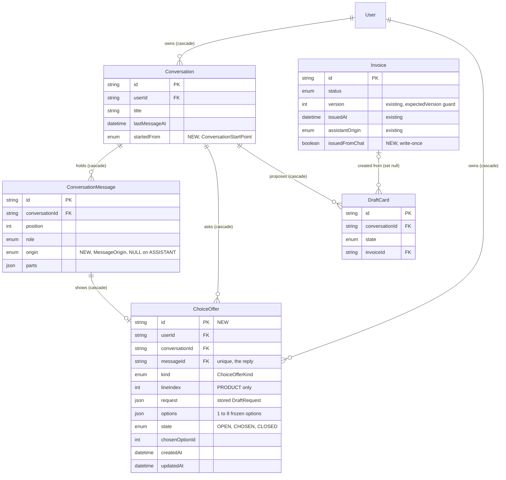

# Data model — ai-chat-v2

> **Mode:** brownfield delta over the ai-assistant chat model ([`ai-assistant/data-model.md`](../ai-assistant/data-model.md)), which stays in force.
> - **New table:** `ChoiceOffer` in `prisma/schema/ai.prisma` (ADR-0001).
> - **New columns on existing tables:** `ConversationMessage.origin` (nullable), `Conversation.startedFrom` (`NOT NULL DEFAULT 'AI_SECTION'`), `Invoice.issuedFromChat` (`NOT NULL DEFAULT false`).
> - **New enums:** `ChoiceOfferKind`, `ChoiceOfferState`, `MessageOrigin`, `ConversationStartPoint`.
> - **Unchanged and relied on:** `Invoice.version` already exists (`20261007100000_add_invoice_version`, invoice-integrity ADR-0004). It is the column ADR-0007's `expectedVersion` is compared against, so the issue-from-preview guard needs **no** schema change.
>
> Nothing is renamed or dropped, and no existing column becomes `NOT NULL` without a constant default.
>
> **Conventions followed (derived from architecture-map §Migrations, SAD §5/§7/§8 and the ai-assistant precedent, not imposed):**
> - `prisma migrate`, split schema `prisma/schema/*.prisma`; the chat models live in `ai.prisma` (SAD §5 file tree).
> - Quoted PascalCase tables, camelCase columns, Prisma's default constraint and index names (`_pkey`, `_key`, `_idx`, `_fkey`).
> - `TEXT` ids from `cuid()` (SAD §8 IDs). `TEXT`/`Json` (JSONB) for strings and structured payloads; length limits live in zod.
> - `createdAt` / `updatedAt` on domain models (`ChoiceOffer` is stateful, like `DraftCard`).
> - FKs `ON UPDATE CASCADE`; user- and Conversation-owned rows `ON DELETE CASCADE`.
> - Enums as Postgres enums. No `CHECK` constraints or triggers: rules such as "origin is NULL on ASSISTANT rows" and "issuedFromChat is write-once" are service rules, as `issuedAt` and `assistantOrigin` are.
> - One partial unique index through the `partialIndexes` preview, written `where: { state: "OPEN" }`, as `DraftCard_conversationId_live_key`.
> - Idempotent DDL (`IF NOT EXISTS`, `DO $$ … IF NOT EXISTS` for enums and FKs).
>
> **Staged migrations:** `docs/features/ai-chat-v2/migrations/01_*` … `05_*` (`.up.sql` + `.down.sql`). They are **not** in the live `prisma/migrations/` tree; `implement` promotes them. SAD §7 says "one Prisma migration"; it is split into five ordinals here so each change rolls back on its own (see the audit). The up bodies match `prisma migrate diff` for §Prisma schema edits, made idempotent.

## ER diagram

New entities and columns are marked NEW. Existing entities show only the columns this feature adds or relies on.



## Entities

**Aggregate roots.**
- **`User` (the Freelancer)** stays the account root; `ChoiceOffer.userId` is the owner column every offer read and claim filters by (SAD §8 tenancy), and the account-deletion cascade.
- **`Conversation`** stays the root of the chat aggregate. `ChoiceOffer` joins `ConversationMessage` and `DraftCard` inside it: it is created, closed, claimed and released only under the Conversation's turn, and it dies with the Conversation (90-day purge, delete on request, account deletion) with no new step (SAD §7 Retention).
- **`Invoice`** stays its own root (invoices services). The chat only reads it through the Draft card and writes it through `updateInvoiceStatus` (ADR-0007).

### `ChoiceOffer` ★ new (ADR-0001, ADR-0002, ADR-0003; AC-08–AC-14, AC-34)

| Column | Type | Constraints | Notes |
|---|---|---|---|
| `id` | TEXT | PK, `cuid()` | the `offerId` a press sends; the `data-offer` message part holds only this id (ADR-0001 Neutral) |
| `userId` | TEXT | NOT NULL, FK → `User(id)` ON DELETE CASCADE | owner; every read and claim is `WHERE "userId" = $actor` (AC-12b) |
| `conversationId` | TEXT | NOT NULL, FK → `Conversation(id)` ON DELETE CASCADE | |
| `messageId` | TEXT | NOT NULL, UNIQUE, FK → `ConversationMessage(id)` ON DELETE CASCADE | the ASSISTANT reply that shows the buttons. One offer per reply at most (SAD §5 "One choice per reply"). The service pre-generates the reply's `cuid` (as it already does for the Draft card id) and inserts the offer after the messages in the same `saveTurn` transaction |
| `kind` | `ChoiceOfferKind` | NOT NULL | `CUSTOMER` / `SENDER_PROFILE` / `CURRENCY` / `BANK_ACCOUNT` / `PRODUCT`, mapped from the resolver issue (ADR-0002 table) |
| `lineIndex` | INTEGER | NULL | the slot the choice fills when it is per line (`PRODUCT`); NULL for the other kinds, whose slot is the kind itself |
| `request` | JSONB | NOT NULL | the stored `DraftRequest` the offer continues. A press pins the chosen record id into a copy of it and re-resolves in code (ADR-0003). Shape owned by the `assistant-drafts` zod schema |
| `options` | JSONB | NOT NULL | 1…8 frozen options `{ optionId, label, ref }`: `optionId` is the option's position (SAD §8 IDs), `label` is built from the stored record per spec §1 "What a button shows" (email or "no email" for look-alike Customers), `ref` is the record reference (`customerId` / `senderProfileId` / `bankAccountId` / `productId` / currency code). Never model text (ADR-0002). The 1…8 bound is the builder's rule (no offer above 8, AC-14; a single option is a valid offer, for example the near-miss Customer or the one other sender profile of spec §1), validated by zod, not the DB |
| `state` | `ChoiceOfferState` | NOT NULL DEFAULT `'OPEN'` | `OPEN` → `CHOSEN` on a press claim; `CHOSEN` → `OPEN` on a non-counted failure (release; `CLOSED` when a newer offer is already OPEN); `OPEN` → `CLOSED` when a newer typed or dashboard message is saved (AC-12). `CHOSEN` and `CLOSED` are final otherwise |
| `chosenOptionId` | INTEGER | NULL | set together with `CHOSEN`, cleared on release; NULL while `OPEN` or `CLOSED`. Shown as the chosen mark on reopen (AC-13) and exported (AC-34) |
| `createdAt` | TIMESTAMP(3) | NOT NULL DEFAULT CURRENT_TIMESTAMP | |
| `updatedAt` | TIMESTAMP(3) | NOT NULL, `@updatedAt` | the claim, release or close time |

**Constraints:** PK; UNIQUE `messageId`; partial UNIQUE `conversationId` WHERE `state = 'OPEN'` (one open offer per Conversation); three FKs, all cascade.

**Access patterns (from SAD §5 and §6):**
- **Press check (Critical flow 1, AC-12b):** `SELECT … WHERE "id" = $offerId AND "userId" = $actor AND "state" = 'OPEN'` → PK. "Latest" holds by construction: the only `OPEN` row in the Conversation is the latest offering reply's, because any newer typed or dashboard message closed it. Not found, foreign, not open or option missing → one `CHOICE_UNAVAILABLE` outcome, nothing written.
- **Claim (Critical flow 1, step 3):** `UPDATE … SET "state" = 'CHOSEN', "chosenOptionId" = $n WHERE "id" = $offerId AND "userId" = $actor AND "state" = 'OPEN'`, 1 row = claimed, 0 rows = lost the race → unavailable (the slot is released). Same transaction as the allowance slot reservation, and nothing else: the pressed message is saved by `saveTurn` at the end of the turn (parent rule), and a failed turn saves only its metadata and releases the claim together with the slot.
- **Release (Critical flow 1, system-side failure):** lock the Conversation row (`FOR UPDATE`, the lock `saveTurn` takes), then `UPDATE … SET "state" = 'OPEN', "chosenOptionId" = NULL WHERE "id" = $offerId AND "state" = 'CHOSEN'`. The turn's own next offer is stored only on success, but a typed turn in another tab can have saved its OPEN offer meanwhile; then the released offer becomes `CLOSED` (unmarked) instead of `OPEN`, so the partial index holds and the slot is still given back (review 2026-10-13 R1-B2).
- **Close on a typed or dashboard message (Flows 4, 6, Critical flow 3):** `UPDATE … SET "state" = 'CLOSED' WHERE "conversationId" = $c AND "state" = 'OPEN'` → `ChoiceOffer_conversationId_open_key`. Runs inside `saveTurn` at the end of the turn, before the turn's own offer is inserted; a failed turn closes nothing (SAD §6 Flags: "the partial unique index never sees two open rows").
- **Store the next offer (Flow 6):** `INSERT` in `saveTurn` after the messages; the partial unique index is the backstop for two concurrent turns in one Conversation (those are already serialized by the Conversation row lock).
- **Reopen (Flow 7, AC-13):** `WHERE "conversationId" = $c` (owner-checked via the Conversation) → `ChoiceOffer_conversationId_idx`; joined to messages by `messageId`.
- **Export (Flow 11, AC-34):** by Conversation, as above. **Account deletion / purge / Conversation delete:** FK cascades via `ChoiceOffer_userId_idx`, `ChoiceOffer_conversationId_idx`, `ChoiceOffer_messageId_key`.
- **KPI "choices answered by a button" (spec §7):** `state` counts over the table; reporting query, no index.

### `ConversationMessage` (one new column) (spec §1 "Where a message came from is saved", AC-34)

| Column | Type | Constraints | Notes |
|---|---|---|---|
| `origin` | `MessageOrigin` | NULL | `TYPED` / `PRESSED` / `DASHBOARD` on `USER` rows, set by the server: `PRESSED` only from a valid choice (ADR-0003), `DASHBOARD` only from the request's validated `origin` on a Conversation's first message (ADR-0009). NULL on `ASSISTANT` rows. Existing `USER` rows are backfilled to `TYPED` (03); readers also treat a NULL on a `USER` row as `TYPED` (covers rows the previous build writes during the deploy window) |

**Why nullable, not `NOT NULL DEFAULT 'TYPED'`:** an origin on an Assistant reply has no meaning, and a default would silently label every reply `TYPED` in the export (AC-34). No `CHECK` ties it to `role`, because the repo uses none; the service writes it.

**Access patterns:** none new. Messages are still read by `("conversationId", "position")`; `origin` is a projected column for the reopen view, the export and the KPIs (turns per draft, choices answered by a button), which are reporting queries.

### `Conversation` (one new column) (spec §1, §7 "Conversations started from the dashboard", AC-30, AC-34)

| Column | Type | Constraints | Notes |
|---|---|---|---|
| `startedFrom` | `ConversationStartPoint` | NOT NULL DEFAULT `'AI_SECTION'` | `AI_SECTION` (New chat, the AI chat entry), `INVOICE_LIST` (the existing "Create with AI" on the invoice list), `DASHBOARD_PROMPT` (the dashboard prompt box), `DASHBOARD_CREATE` (the dashboard's "Create invoice with AI"). Set from the request's validated `startedFrom` when the Conversation is created with its first message, never changed. Existing Conversations read `AI_SECTION` (SAD §7 assumption) |

**Access patterns:** none new. The full summary list, the dashboard's 3 latest and the 90-day purge keep `Conversation_userId_lastMessageAt_idx` and `Conversation_lastMessageAt_idx`. The dashboard-start KPI is a reporting query.

### `Invoice` (one new column) (ADR-0007; SAD §6 Critical flow 2, §7 Monitoring)

| Column | Type | Constraints | Notes |
|---|---|---|---|
| `issuedFromChat` | BOOLEAN | NOT NULL DEFAULT `false` | set to `true` by `issueFromPreview` in the same locked write that leaves `DRAFT`, sets `issuedAt` once and bumps `version`. Write-once by service rule: never cleared, not copied by duplicate. Read with `assistantOrigin = 'CHAT'` for the "drafts issued from the chat" KPI |
| `version` | INTEGER | NOT NULL DEFAULT 0 | **existing**, unchanged. `updateInvoiceStatus(…, { expectedVersion })` compares it on the locked row after the "still a draft?" check → `CHANGED_ELSEWHERE` (AC-26b) |

**Access patterns:** the issue write locks the invoice by PK and owner (existing path). No index for `issuedFromChat` (SAD §6 Flags: KPI reads only).

## Indexes

| Index | Columns | Query it serves |
|---|---|---|
| `ChoiceOffer_conversationId_open_key` (unique, partial `state = 'OPEN'`) | `conversationId` | one open offer per Conversation; close the open offer when a typed or dashboard message is saved (Flows 4, 6, Critical flow 3); race backstop for the claim and the next-offer insert (Critical flow 1) |
| `ChoiceOffer_conversationId_idx` | `conversationId` | offers of a reopened Conversation (Flow 7) and the export (Flow 11); FK cascade on Conversation delete and the 90-day purge. The partial index cannot serve these (it holds only `OPEN` rows) |
| `ChoiceOffer_messageId_key` (unique) | `messageId` | one offer per reply; join offer ↔ reply on reopen (Flow 7); FK cascade on message delete |
| `ChoiceOffer_userId_idx` | `userId` | FK cascade on account deletion (Flow 11) |

The press check and the claim use the PK. No index is added for `ConversationMessage.origin`, `Conversation.startedFrom` or `Invoice.issuedFromChat`: they are read only by the reopen projection, the export and KPI reporting queries (SAD §6 Flags). Name matching stays in the app with no name index (ADR-0004).

## Prisma schema edits

These land with the promotion of the matching ordinal. `prisma migrate diff --from-schema prisma/schema --to-schema <edited copy> --script` (offline) emits exactly the statements of 01, 02, 04 and 05 before they were made idempotent (03 is a data backfill).

**`prisma/schema/ai.prisma`** — new enums (after `DraftCardState`):

```prisma
// ai-chat-v2: who or what sent a Freelancer message (spec §1, AC-34). NULL on ASSISTANT messages.
enum MessageOrigin {
    TYPED // typed into the message box
    PRESSED // an Offered choice was pressed; set by the server only from a valid choice (ADR-0003)
    DASHBOARD // the dashboard prompt box (ADR-0009)
}

// ai-chat-v2: where a Conversation was started (spec §1, §7). Set with the first message, never changed.
enum ConversationStartPoint {
    AI_SECTION // New chat or the AI chat entry; also every Conversation saved before ai-chat-v2
    INVOICE_LIST // the existing "Create with AI" on the invoice list
    DASHBOARD_PROMPT // the dashboard prompt box
    DASHBOARD_CREATE // the dashboard's "Create invoice with AI"
}

// ai-chat-v2 (ADR-0002): which draft slot an offer fills.
enum ChoiceOfferKind {
    CUSTOMER
    SENDER_PROFILE
    CURRENCY
    BANK_ACCOUNT
    PRODUCT
}

// ai-chat-v2 (ADR-0001): one offer's life.
enum ChoiceOfferState {
    OPEN // the latest reply's buttons; at most one per Conversation
    CHOSEN // a press claimed it (released back to OPEN on a non-counted failure)
    CLOSED // a newer typed or dashboard message was saved; no choice
}
```

`Conversation` — add the column and the relation:

```prisma
    startedFrom   ConversationStartPoint @default(AI_SECTION) // ai-chat-v2: set with the first message, never changed
    …
    offers     ChoiceOffer[]
```

`ConversationMessage` — add the column and the back-relation:

```prisma
    origin         MessageOrigin? // ai-chat-v2: set on USER messages by the server; NULL on ASSISTANT messages
    …
    offer        ChoiceOffer? // the Offered choices this ASSISTANT reply carries, if any
```

New model (before `MessageAllowanceDay`):

```prisma
// ai-chat-v2 (ADR-0001, ADR-0002, ADR-0003): one set of Offered choices, built in code from a resolver issue and tied to
// the reply that shows it. A press claims it OPEN -> CHOSEN; a non-counted failure releases it; a newer typed or
// dashboard message closes it. Deleted with its Conversation.
model ChoiceOffer {
    id             String           @id @default(cuid())
    userId         String
    conversationId String
    messageId      String           @unique // the ASSISTANT reply that shows the buttons; one offer per reply at most
    kind           ChoiceOfferKind
    lineIndex      Int? // the invoice line the choice fills (PRODUCT only); NULL for the other kinds
    request        Json // the stored DraftRequest the offer continues; the chosen record is pinned into it (ADR-0003)
    options        Json // 1..8 frozen options: { optionId (position), label, ref }; never model text (ADR-0002)
    state          ChoiceOfferState @default(OPEN)
    chosenOptionId Int? // set with CHOSEN, cleared on release; NULL while OPEN or CLOSED

    user         User                @relation(fields: [userId], references: [id], onDelete: Cascade)
    conversation Conversation        @relation(fields: [conversationId], references: [id], onDelete: Cascade)
    message      ConversationMessage @relation(fields: [messageId], references: [id], onDelete: Cascade)

    createdAt DateTime @default(now())
    updatedAt DateTime @updatedAt

    @@unique([conversationId], map: "ChoiceOffer_conversationId_open_key", where: { state: "OPEN" }) // one open offer per Conversation (SAD §6 Flags)
    @@index([conversationId])
    @@index([userId])
}
```

**`prisma/schema/auth.prisma`** — `User` gains `choiceOffers ChoiceOffer[]` after `assistantTurns`.

**`prisma/schema/invoice.prisma`** — `Invoice`, after `issuedAt`:

```prisma
    // ai-chat-v2 (SAD §7 Monitoring): set once by issueFromPreview, never cleared or copied
    issuedFromChat Boolean @default(false)
```

## Test fixtures

Not generated here, following the ai-assistant precedent: the Prisma types do not exist until `implement` promotes the migrations, so factories written now would not type-check. The `tasks` stage should put these into the DoD of the `layer: migration` tasks, in `tests/support/factories/`:

- **New `choice-offer.ts`:** `createChoiceOffer(prisma, { userId, conversationId, messageId, kind?, lineIndex?, request?, options?, state?, chosenOptionId? })`. Defaults: `CUSTOMER`, `OPEN`, two options `Acme Corp (billing@acme.example.test)` / `Acme GmbH (no email)` referencing fixture Customers. `request` and `options` are built by the production zod schemas so a fixture cannot drift from the real shape.
- **`conversation.ts` (existing):** accepts `startedFrom`, and per message `origin` (default `TYPED` on `USER`, NULL on `ASSISTANT`) and an explicit `id` so an offer can reference the reply.
- **`invoice.ts` (existing):** accepts `issuedFromChat`.
- Add `'ChoiceOffer'` to `APP_TABLES` in `tests/support/db/truncate.ts`, before `'ConversationMessage'`.
- **PII guard:** users `user-<n>@example.test`, Customers `Acme Corp` / `Acme GmbH` / `Test Customer`, emails under `example.test`, labels built from those fixtures only.

No seeds: the feature adds no bootstrap or lookup data. The 8-option cap, the 2,000-character limit and the allowance are app constants.
