# Software Architecture Document — ai-chat-v2

> This SAD **extends** [`ai-assistant/sad.md`](../ai-assistant/sad.md). Every section, ADR and contract of the first iteration stays in force and is referenced, not repeated. ADR numbers below without a prefix are this feature's own (`docs/features/ai-chat-v2/adr/`); the first iteration's are written "ai-assistant ADR-NNNN".

## 1. Introduction and goals

**Intent.** The second iteration of the in-app AI chat removes the friction around the first iteration's rules, without loosening any of them (spec §1, §2). The chat and MCP gain three read questions that the draft flow needs: sender profiles with bank-account summaries, the product catalogue with prices and Custom prices, and a look-alike-aware Customer search. Every choice the draft action asks for becomes an **Offered choice**: a button built only from what the draft action found, pressed as a counted message that refers to exactly that record. The AI section becomes a full-height workspace with its own scrolling panes, a grouped and searchable Conversation list, an empty-state start and phone sheets. A created draft can be previewed and issued from the chat under the editor's issuing rules, after one confirmation, and the card and its links show the live status. The AI also gets a navigation group and a dashboard block: a prompt box, the latest Conversations and "Create invoice with AI". Finally, the privacy page and the data export cover everything the iteration stores.

**Top-4 quality goals (1-liners; full scenarios in §10):**

1. **Exact, unforgeable choices.** Every button is an option the draft action found. A press refers to exactly that record. A press that cannot be applied is refused uniformly, uncounted, and never reaches the model.
2. **Safe issuing from the chat.** Only the Freelancer's confirmed press issues, through the editor's issuing rules. An outdated or already-issued preview never issues, and the card and links show the result.
3. **A workspace that never makes the Freelancer hunt.** The page itself never scrolls. The message box is always visible, new text is followed within the spec's thresholds, and replies stream word by word.
4. **Fast, private reads.** The new read questions answer within the spec's p95. No answer on any channel ever carries a full bank account number.

**Stakeholders.**

| Role | Interest | Sign-off owner? |
|---|---|---|
| Freelancer | Uses the AI section, presses Offered choices, previews and issues drafts from the chat, starts Conversations from the dashboard, reads the privacy page and exports their data | No |
| Assistant | The in-app chat (inside the signed-in session) and external MCP clients (through a Personal key) that use the three new read questions | No |
| Visitor | Sent to sign in from the AI section and the dashboard; nothing processed or counted (AC-36) | No |
| Security Lead | A new issuing path from a chat surface, a forged-choice abuse case, and bank-account summaries for every Personal key (spec §6.1 "Security review: Required") | Yes |
| Tech Lead | SAD approval | Yes |

<!-- Decision overrides (¶4) — populated by the critic resolution loop, empty otherwise. -->

## 2. Constraints

**Technical.**
- Everything in ai-assistant SAD §2 *Technical* still holds: TypeScript 5 strict on Node.js `>=22.18 <23`; Next.js 16.3.8 and React 19.2.3 pinned exactly; Prisma 7.10 over PostgreSQL with the split schema; next-auth 5.0.0-beta.32; `@modelcontextprotocol/sdk` 1.32.0; Vercel `fra1`.
- The AI runtime is already installed and pinned (AI SDK UI `useChat`, Mastra, the Vercel AI Gateway with a Gemini Flash-Lite model, per ai-assistant ADR-0002–ADR-0004). **This feature adds no runtime dependency**: no new AI package, no animation library, no realtime or push service.
- The chat route reads one message per request (`chatRequestSchema`: the conversation id plus one text part). History is loaded on the server, never trusted from the client (`app/api/chat/route.ts`, `lib/services/conversations/conversations.ts` `loadHistory`).
- Read questions live once in `lib/assistant-tools/` (`READ_QUESTIONS`) and are registered by both MCP (`lib/mcp/server.ts`) and the chat (`lib/ai/tools/read-tools.ts`), per ai-assistant ADR-0010.
- The draft resolver `resolveDraftRequest` (`lib/services/assistant-drafts/resolve.ts`) returns `PROPOSAL` or a closed union of `DraftIssue` kinds (`schema.ts`). Most ambiguity kinds already carry record ids: Customer, product and bank-account candidates.
- Invoices carry an optimistic `version` counter (invoice-integrity ADR-0004). The editor's save refuses a stale `loadedVersion` with `CHANGED_ELSEWHERE`. The status path `updateInvoiceStatus` locks the row and runs the editor's draft rules, but checks no version today (`lib/services/invoices/invoices.ts`).
- Preview and PDF come from one document model (`lib/invoice-document`, editor-ux ADR-0002), rendered as HTML by `PDFPreviewPanel`, which the invoice list's preview modal already uses outside the editor.
- Tests: vitest (unit / component / contract), integration on throwaway Postgres, and Playwright e2e run locally (not in CI).

**Organisational.**
- No external deadline (spec §1). Size L, route `full`.
- One developer (Dmytro Hopko) working with AI agents through the SDD pipeline.
- The first iteration's documents are not rewritten (spec §3). Where this feature changes one of its contracts (the chat request, the resolver's request and issues, the `customers` read question), the change is recorded here and in this feature's `contracts/`, never by editing ai-assistant's files.

**Conventions.**
- `docs/architecture-map.md` §Conventions (reflects `2064466`, **124 commits stale**: the AI chat shipped since. The current chat code was mapped by a fresh read for this SAD; see §11).
- The ai-assistant SAD §2 *Conventions* (results as `ActionResult`, actor factories only, deny-by-default proxy, per-local-day counters, Freelancer time zone, `cuid()` ids, owner-scoped writes).
- UI: shadcn/ui (base-vega) and Tailwind 4 tokens. Reuse the `docs/design-system.md` inventory: `AiWorkspace`, `ChatIsland`, `Composer`, `DraftCard`, `ChatLink`, `ConversationList`, `AllowanceNotice`, `StartPanel`, `ConfirmationModal`, `LoadError`.

**Regulatory / external.**
- No new processor. Message text keeps going to the model provider named on the privacy page (spec §6.1). The first iteration's free-tier override still applies (ai-assistant §1 ¶4, ADR-0003).
- New personal data stored with the Conversation: the Offered choices and the one chosen, each message's origin, and each Conversation's start point. All of it is exported and deleted with the Conversation and the account, under the 90-day retention (spec §6.1, AC-34).
- Read answers carry bank-account summaries (bank name, last four digits, currency, default mark), never a full account number. This applies to every Personal key (spec §6.1, AC-06).
- Security review is required before ship (spec §6.1).

## 3. Context and scope

Invoice Forge is the Freelancer's invoicing web app. The ai-assistant feature added the in-app chat and the MCP draft action. This iteration changes no system boundary: the same Freelancer, external Assistants, model provider and Sentry. What grows is inside: three read questions on both channels, a structured press channel into the chat route, and an issuing path reachable from the chat panel.

The trust boundary is unchanged in shape but carries two new rules:
- A **press** arriving from the browser is untrusted input. It is resolved only against the server-stored offer of the Freelancer's own latest reply.
- What the model writes can never create a button or issue an invoice.

<!-- brownfield: architecture map reflects 2064466 (124 commits stale: ai-assistant shipped since); the current chat code (chat route, run-turn, resolver issues, read-tool registry, ChatIsland, DraftCard, invoice status path, version counter) was mapped by a fresh explorer read on d0bc2e9. -->

**External systems (in / out):**

| Actor or system | Type | Interaction |
|---|---|---|
| Freelancer | Person | Chats, presses Offered choices, previews and issues drafts, starts Conversations from the dashboard, exports data |
| Assistant (external MCP client) | Person (external program acting for one Freelancer) | Calls the read questions, the three new ones included, through a Personal key; creates drafts with Draft permission as before |
| Visitor | Person | Sent to sign in from the AI section and the dashboard; nothing processed or counted |
| AI model provider (Vercel AI Gateway, Gemini) | System (external, existing) | Receives each turn's context and tool schemas; never sees an invalid press |
| Sentry | System (external, existing) | Errors and metadata-only spans, now also for the read questions and the issue-from-preview action |

**C4 Context (L1):**

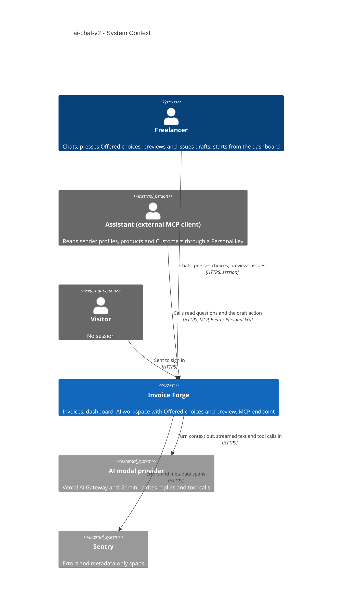

## 4. Solution strategy

**Target surfaces: `[backend-service, web-frontend]`.** These are unchanged from ai-assistant ADR-0001, so no new ADR is needed.
- **Backend service** (the existing Next.js app) gains:
  - three read questions in the shared registry;
  - offer rows and press resolution in the chat route;
  - an issue-from-preview server action over the invoice status service;
  - export coverage.
- **Web frontend** gains:
  - the full-height AI workspace (SCR-01–SCR-07);
  - the navigation "AI" group (SCR-08);
  - the dashboard AI block (SCR-09);
  - the privacy page update (SCR-13).

No worker: offers are deleted with their Conversation, so retention needs no new cron step.

**UI architecture (web-frontend): hybrid, unchanged** (ai-assistant ADR-0002). The pages are RSC (`/ai`, `/ai/[conversationId]`, the dashboard). The chat is the `ChatIsland` client island over `useChat`. New client state lives inside the workspace: one invoice-state store (ADR-0008) and the preview panel's state in the address (ADR-0005). No global store and no client cache library are added.

**Top strategic choices (the seeds for ADRs):**

1. **Code builds the choices; the model only words them** (ADR-0001, ADR-0002). After every `propose_draft` step, code maps the resolver's typed issue to at most one **offer**: up to 8 options with fixed labels and record references. The offer is stored as a server-side row tied to the reply and streamed as a `data-offer` part. The model's text has no path into an offer, so AC-09 and the stored-text injection case hold by construction. This mirrors how ai-assistant ADR-0007 keeps Draft cards server-side.
2. **A press is a structured reference, resolved and pinned by code** (ADR-0003). The browser sends `{ offerId, optionId }` beside the message.
   - The chat route checks the reference against the Freelancer's own latest open offer, and the record against current data, **before** any allowance reservation or model call. A failed check gets one fixed "no longer available" outcome.
   - A valid press claims the offer together with the allowance slot (one transaction, and nothing else in it), is counted like any message, and is saved with the stored label as its text at the end of the turn, as every message is.
   - The chosen record id is pinned into the offer's stored draft request, and the resolver runs in code. The model then writes the reply around that result, so it cannot re-match the record by name (AC-10).
3. **One name-folding rule, applied in the app** (ADR-0004). The existing `foldName` becomes the single shared normalizer (isomorphic, no `server-only`). It serves the resolver, the Customer search, the product read and the Conversation title search. Matching runs in the app over the owner's rows, which are bounded by the spec's sizing (2,000 Customers, 500 products). No stored search key, and no second implementation in SQL.
4. **The chat issues through the invoice service's own status path, guarded by the version the preview showed** (ADR-0006, ADR-0007).
   - The preview loads through an owner-scoped server action keyed by the Freelancer's own Draft card. It returns the serialized invoice, its status and its `version`, or tells "deleted since" (a created card whose invoice link was cleared) from "cannot be found" (no such card for this Freelancer). It renders with the same `PDFPreviewPanel` and document model as the rest of the app.
   - Issuing calls `updateInvoiceStatus` with a new `expectedVersion`, checked under the row lock after the "still a draft?" check. That gives three outcomes besides success: already issued (AC-26), outdated so reload (AC-26b), and blocked by the draft rules (AC-25).
   - Nothing here is a message, so nothing touches the allowance (AC-27).
5. **Addresses and hand-offs without new infrastructure** (ADR-0005, ADR-0008, ADR-0009).
   - **Addresses.** A saved Conversation keeps `/ai/{id}`, an open preview adds `?preview={cardId}`, and a new Conversation stays `/ai` because it is not a record yet.
   - **Invoice status.** The card, the links and the panel read one client-side invoice-state store. Server loads and action results feed it; there is no push or polling.
   - **Dashboard prompt.** It travels in a one-time `sessionStorage` entry, never in the URL. The chat island consumes it exactly once.

Each tactical decision below traces to one of these seeds. One that contradicts a seed is raised in §11.

**Resolved design inputs from `ux-flows.md` (Platform decisions, "Design input"):**
1. *How a press reaches the server and is told apart from typed text:* a `choice` field on the chat request, resolved against the stored offer (ADR-0003). The message origin is set by the server, never by the client's say-so.
2. *How the card and links learn the invoice was issued:* a workspace invoice-state store fed by page loads, preview loads and the issue / create results. No push. Another tab's change shows on the next preview load, issue attempt or reopen (ADR-0008).
3. *Own addresses:* yes for a saved Conversation (`/ai/{id}`, existing) and for an open preview (`?preview=`). No for a new, unsaved Conversation (ADR-0005).
4. *Dashboard prompt sent exactly once:* the one-time session-storage hand-off (ADR-0009).

## 5. Building block view

The layering is the repo's and the first iteration's. Thin adapters (RSC pages, the chat route, server actions, MCP tools) resolve an `ActingFreelancer` and call services in `lib/services/<domain>/`, which own every rule and every database access. Nothing new is a module of its own. The feature extends:
- the `assistant-drafts` domain (offers and pins);
- the `assistant-tools` registry (three reads);
- the `invoices` status service (expected version);
- the `conversations` domain (origins, full list for grouping);
- the AI web components.

The extension follows the first iteration's own seams, so the parity and safety guarantees it already tests keep holding.

**Internal decomposition (new and changed):**

```
app/
├── (protected)/ai/layout.tsx               CHANGED  full-height workspace shell (no page scroll), modal container stays
├── (protected)/ai/page.tsx                  CHANGED  new Conversation (SCR-02); reads ?start=draft&from=…, ?handoff=…
├── (protected)/ai/[conversationId]/page.tsx CHANGED  Conversation + offers + invoice states; ?preview={cardId} opens SCR-06
├── (protected)/dashboard/                   CHANGED  AI block (prompt box, 3 latest Conversations, Create invoice with AI)
├── (public)/privacy/                        CHANGED  AI section text (AC-35)
└── api/
    ├── chat/route.ts                        CHANGED  optional choice + origin + startedFrom; press check before reservation; data-offer part
    └── user/export/route.ts                 (via account service) + offers, chosen option, origins, start point
components/ai/
├── ai-workspace.tsx                         CHANGED  3-pane grid, own scroll per pane, md (768) / xl (1280) breakpoints, phone sheets
├── conversation-list.tsx                    CHANGED  grouped Today / Yesterday / Previous 7 days / Older, title search, New chat at the bottom
├── chat-island.tsx                          CHANGED  sends choice/origin, consumes the dashboard hand-off, follow-to-latest (48 px), composer move animation
├── offered-choices.tsx                      NEW      buttons for one offer: pressable / inactive / chosen
├── invoice-preview-panel.tsx                NEW      side panel / full-screen sheet; PDFPreviewPanel + Open in editor + Issue
├── issue-confirmation.tsx                   NEW      ConfirmationModal body naming Customer, total, currency
├── invoice-state-context.tsx                NEW      workspace invoice-state store (ADR-0008)
└── draft-card.tsx, chat-link.tsx            CHANGED  Preview button; status read from the invoice-state store
components/dashboard/ai-block.tsx            NEW      SCR-09
config/navigation-menu.config.ts             CHANGED  "AI" group: AI chat, Connect your AI (SCR-08)
lib/
├── helpers/fold-name.ts                     MOVED    foldName from assistant-drafts/match-name.ts, isomorphic (ADR-0004)
├── assistant-tools/
│   ├── sender-profiles.ts                   NEW      profiles + account summaries (bank, last 4, currency, default), no full number
│   ├── products.ts                          NEW      name filter (folded), ≤ 20 + total, prices per currency, Custom prices for a customerId
│   └── customers.ts                         CHANGED  name filter folded (look-alike), ≤ 20 per answer + total
├── ai/
│   ├── instructions/chat                    CHANGED  what the chat can read; sender profile vs Customer (AC-05b)
│   ├── run-turn.ts                          CHANGED  starts from a pinned resolution when the message is a press
│   └── tools/propose-draft.ts               CHANGED  applies the turn's pins; hands its issue to the offer builder
├── services/
│   ├── assistant-drafts/
│   │   ├── offers.ts                        NEW      offerFromIssue (≤ 8, labels, priority), store / read / claim / release / close offers
│   │   ├── pin.ts                           NEW      apply a chosen option to a stored DraftRequest
│   │   └── schema.ts                        CHANGED  request: senderProfileId; issue candidates carry email / ids where labels need them
│   ├── conversations/                       CHANGED  message origin, start point; full summary list for grouping and search
│   ├── invoices/invoices.ts                 CHANGED  updateInvoiceStatus(…, { expectedVersion }) → ALREADY_ISSUED / CHANGED_ELSEWHERE
│   └── account/                             CHANGED  export + deletion cover offers and origins
├── actions/assistant-actions.ts             CHANGED  NEW loadInvoicePreview(cardId), issueFromPreview(invoiceId, version)
└── validations/assistant-chat.ts            CHANGED  chatRequestSchema + choice { offerId, optionId }, origin, startedFrom
prisma/schema/ai.prisma                      CHANGED  NEW ChoiceOffer; ConversationMessage.origin; Conversation.startedFrom
```

**Building-block decisions:**

- **Offers are rows** (ADR-0001). `ChoiceOffer` holds:
  - its links: owner, Conversation and the reply message;
  - `kind`: Customer, bank account, product, sender profile or currency;
  - the slot it fills, for example a line index;
  - the stored `DraftRequest` it continues;
  - the options as JSON (`optionId`, label, record reference);
  - `state` (`OPEN` | `CHOSEN` | `CLOSED`) and `chosenOptionId`.

  A partial unique index keeps at most one `OPEN` offer per Conversation. **A press claims the offer by moving it `OPEN` → `CHOSEN`** (a conditional update, committed together with the allowance reservation and nothing else; the pressed message is saved at the end of the turn with the reply, parent rule), and a non-counted system-side failure releases it `CHOSEN` → `OPEN`. So the next offer of that turn can be stored as the one `OPEN` row, and a refused press marks nothing (AC-11). Saving any newer **typed or dashboard** Freelancer message (at the end of its turn, before that turn's own offer is stored) moves the open offer to `CLOSED` with no choice (AC-12); a failed turn closes nothing. The press's own message never closes the offer it claims. The row is deleted with its Conversation (cascade), so the 90-day purge and account deletion cover it unchanged. `data-model` fixes the columns.
- **Which issues become offers** (ADR-0002). `offerFromIssue` maps resolver issue kinds to offer kinds:

  | Resolver issue kinds | Offer kind |
  |---|---|
  | `CUSTOMER_AMBIGUOUS`, `CUSTOMER_NEAR_MISS` | Customer |
  | `SENDER_PROFILE_NOT_FOUND`, `DEFAULT_PROFILE_WITHOUT_ACCOUNT`, `NO_ACCOUNT_IN_CURRENCY` with other profiles | sender profile |
  | `CURRENCY_UNCLEAR` | currency |
  | `SEVERAL_ACCOUNTS_IN_CURRENCY`, `BANK_ACCOUNT_NOT_FOUND`, `BANK_ACCOUNT_AMBIGUOUS` | bank account |
  | `PRODUCT_AMBIGUOUS` | product |

  - **One choice per reply.** When a reply carries several issues, the first offer-able one wins, in the order Customer → sender profile → currency → bank account → product (the order the draft is resolved in).
  - **The 8-button cap.** Above 8 options there is no offer, and the reply states the count (AC-14).
  - **No offer** for every other kind of the `DraftIssue` union:
    - kinds that ask for a value to type: `LINE_AMOUNT_MISSING`, `LINE_QUANTITY_MISSING`, `LINE_PRICE_MISSING_IN_CURRENCY`, `PRODUCT_NOT_FOUND`, `FIELD_INVALID`;
    - kinds that send the Freelancer elsewhere with a link (ai-assistant behaviour): `NO_SENDER_PROFILE_WITH_ACCOUNT`, `CUSTOMER_NOT_FOUND`;
    - `BANK_ACCOUNT_CURRENCY_MISMATCH`: the named account was found but conflicts with the currency, which is not a choice among found records (spec §1).
  - **Labels** follow spec §1 "What a button shows". A Customer whose folded name equals another offered Customer's also shows its email, or "no email" (AC-10). The resolver's candidates gain the fields the labels need, so labels and references come from one answer:
    - Customer candidates: the email;
    - bank-account candidates: bank name, last four digits and currency;
    - product candidates: unit and the price in the invoice currency;
    - `SENDER_PROFILE_NOT_FOUND`: profile ids beside the names.
- **Press handling in the chat route** (ADR-0003). The order is:
  1. session and body;
  2. the choice check (owner, latest open offer, option present, record still fits);
  3. allowance reservation and the claim of the offer, in one transaction (a claim that loses a race releases the slot and answers unavailable);
  4. the pinned resolution;
  5. the agent turn;
  6. persist at the end of the turn (`saveTurn`): the user message with the stored label and origin `PRESSED`, the reply, the next offer if any, and the turn metadata.

  A system-side failure saves only the turn metadata and releases the slot and the claim together. A press with no allowance left is refused like a typed message and claims nothing (AC-11).
- **Three read questions in the shared registry** (ai-assistant ADR-0010, inline):
  - `sender_profiles` (new);
  - `products` (new; with a `customerId`, it adds that Customer's Custom prices);
  - `customers`, whose name filter becomes look-alike aware (folded substring over the current names and the names copied onto invoices, as today), with at most 20 rows per answer (down from 50) plus the total match count.

  All three go to every Personal key, and none needs Draft permission (spec §1). The output zod schemas have **no field** that could hold a full account number. Account summaries are built in the service from the last four characters, and a contract test walks every read question's output (spec §6 "Bank account exposure"). Upgrading `customers` in place, rather than adding a fourth Customer tool, keeps one Customer read for both channels. The MCP shape is unchanged and the description is updated; `api` records the compatible change.
- **The chat instructions** list what the chat can read (no more promise of a product read that does not exist) and explain sender profile versus Customer (AC-05b). Inline: wording only.
- **Message origin and Conversation start point** are enum columns. They are set by the server: `PRESSED` only from a valid choice; `DASHBOARD` and the start point from the request's `origin` / `startedFrom`, validated against an enum and accepted only on a Conversation's first message. A forged value can only mislabel the Freelancer's own data. Inline: `data-model` owns the columns.
- **Full-height workspace** (inline). The `/ai` layout replaces the scrolling `ContentArea` with a viewport-height shell (`dvh` minus the app header). The grid panes are `min-h-0`, each with its own `overflow-y-auto`.
  - **Breakpoints** move from the current `lg` to `md` (768 px) and `xl` (1280 px), per spec §1.
  - **Phone sheets.** The list and the preview use the existing `Sheet`.
  - **Following new text** is a small in-house hook: the end of the messages within 48 px counts as at the bottom, and a jump-to-latest control appears otherwise.
  - **The composer move** is a CSS transition with a `motion-reduce` variant.

  No new dependency.
- **The Conversation list loads every summary** (inline). It loads `id`, `title` and `lastMessageAt` for every Conversation the Freelancer has, instead of the current 20-per-page pagination. Grouping uses the Freelancer time zone, and filtering by `foldName` runs on the client.
  - The list is bounded by retention and the allowance: at most 30 messages a day, kept 90 days, so at most about 2,700 rows in the worst case and a few dozen typically.
  - The Conversation list's `?page=N` links are removed.
- **Dashboard AI block** (inline). An RSC section reads the allowance state and the 3 latest Conversations. The prompt box is a small client component that validates with the same message schema as the chat: not empty, at most 2,000 characters (AC-31). It then hands off through ADR-0009. "Create invoice with AI" links to `/ai?start=draft&from=dashboard`.
- **Navigation** (inline). An "AI" group like "Management" in `config/navigation-menu.config.ts` holds "AI chat" (`/ai`) and "Connect your AI" (`/settings/assistants`). It replaces the single "AI" item.
- **Streaming** (inline). The shipped per-word pacing (`WORD_DELAY_MS = 20`, first word unpaced) already meets spec §6. This feature pins it with a browser test and leaves it unchanged.

**C4 Container (L2):**

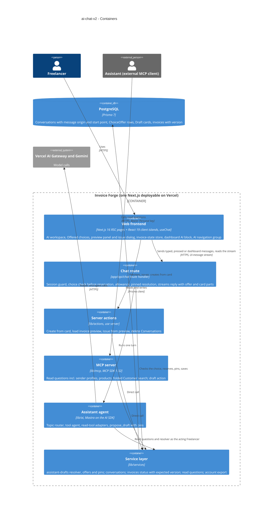

## 6. Runtime view

design seeds the three flows that carry this feature's new mechanisms. `sequences` covers every §5 acceptance criterion. Participants are the §5 containers. The first iteration's flows (ai-assistant SAD §6) still describe a typed message, the Create press and the MCP draft action.

**Critical flow 1: pressing an Offered choice**

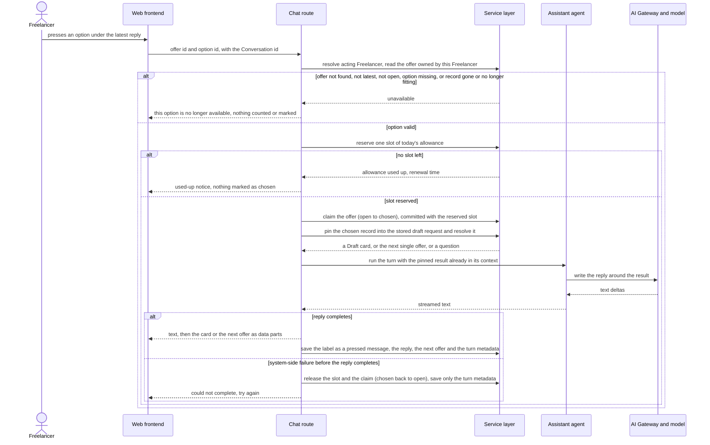

**Critical flow 2: issuing from the preview panel**

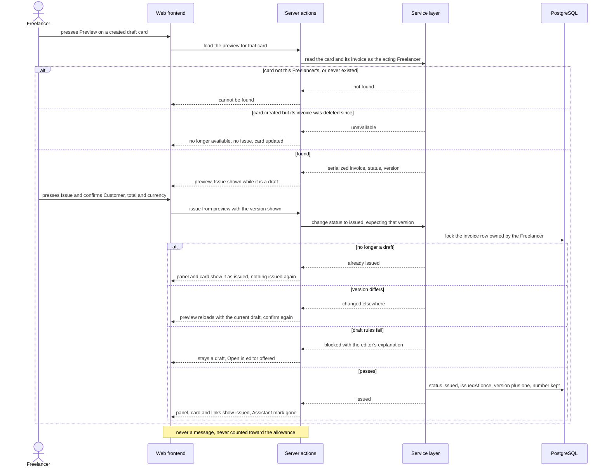

**Critical flow 3: a prompt sent from the dashboard**

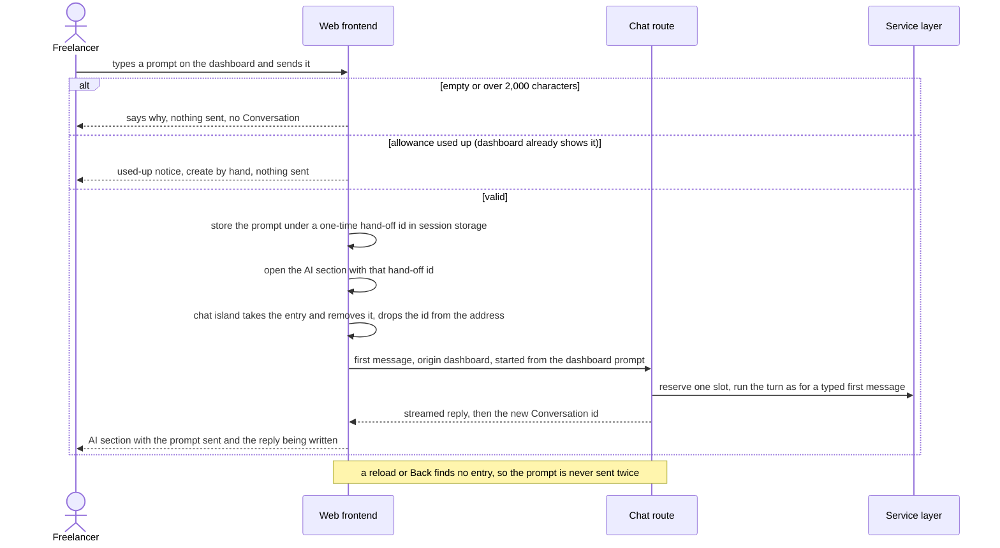

### Flow 4: Ask a read question in the chat

Covers US-01 (sender profiles, accounts, products, look-alike Customer search) and the chat side of AC-07. It extends ai-assistant Flow 5 with the three new read questions. UI path: SCR-03, with a link to SCR-15 when nothing matches (`ux-flows.md` Flow US-01).


### Flow 5: Read questions through a Personal key (MCP)

Covers US-02 and the Personal-key side of AC-07. No UI (`ux-flows.md` lists US-02 as out of scope). The MCP draft action itself is unchanged and stays ai-assistant Flow 3.

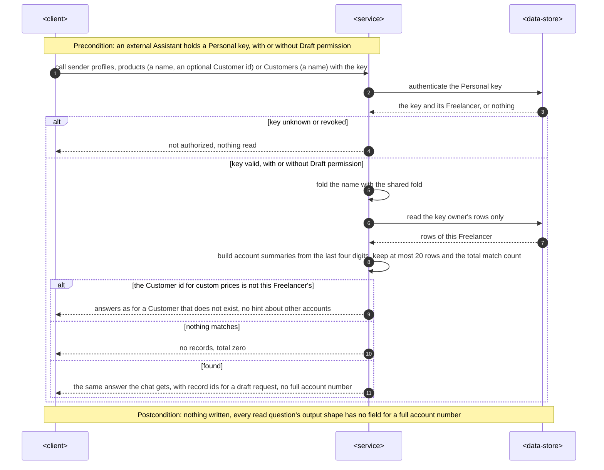

### Flow 6: A drafting message that ends in an Offered choice

Covers US-03 up to the buttons, and the drafting parts of US-01 (AC-04, AC-05b). It extends ai-assistant Flow 6: where that flow only asked "which one", code now turns the resolver's issue into one stored offer. Pressing a button is Critical flow 1. UI path: SCR-03 to SCR-04 or SCR-05 (`ux-flows.md` Flow US-03).

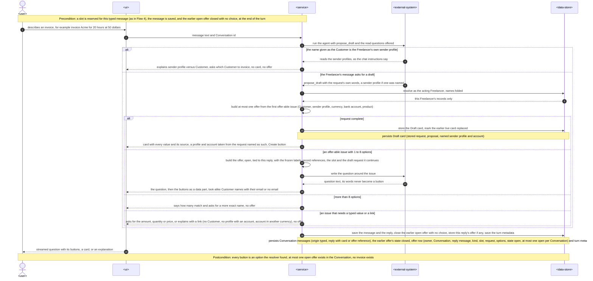

### Flow 7: Reopen a Conversation, its buttons, cards and preview address

Covers US-03 after a reload (AC-12, AC-13), US-11 for a saved reply (AC-33) and the preview address. It extends ai-assistant Flow 7. UI path: SCR-01 to SCR-03, with SCR-06 when the address carries a preview (`ux-flows.md` Flow US-03, reopen).

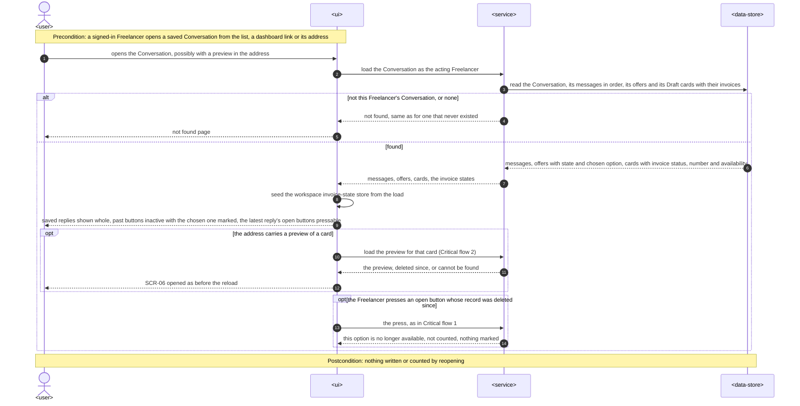

### Flow 8: Open the AI workspace and find a Conversation

Covers US-04 (AC-15, AC-17, AC-36) and US-06 (AC-19). The scrolling itself is layout, not a request, and is shown as notes. UI path: SCR-08 to SCR-01 with SCR-02 or SCR-03 (`ux-flows.md` Flows US-04 and US-06).

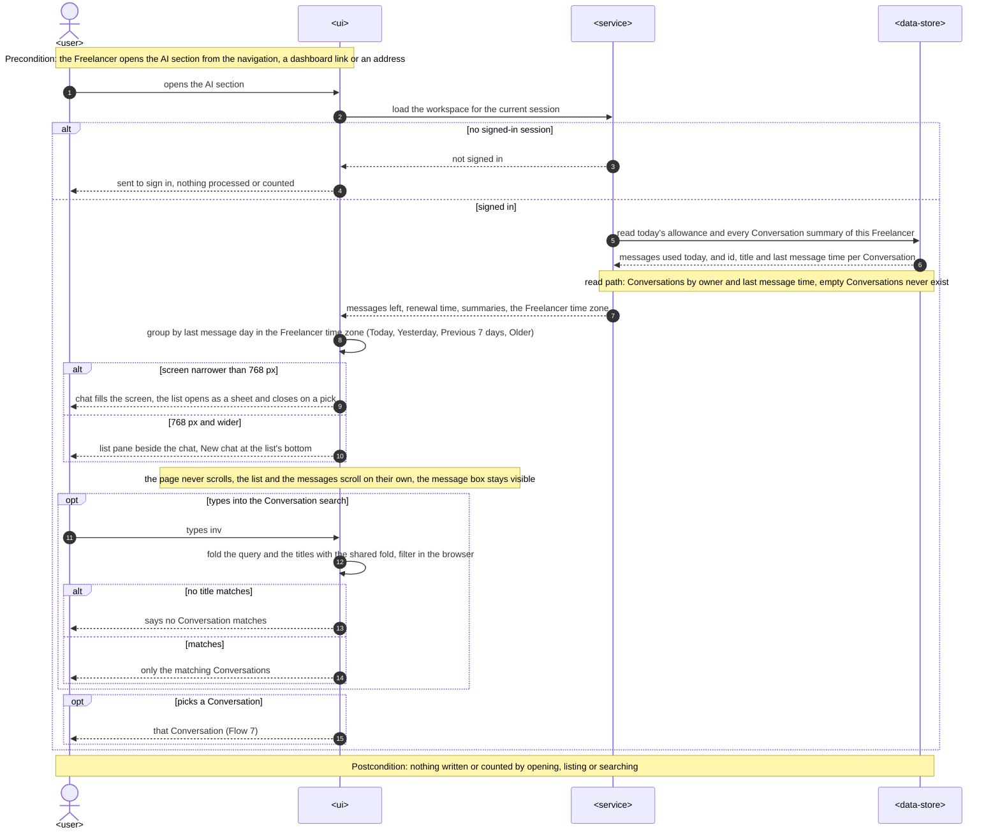

### Flow 9: Start a new Conversation and watch the first reply

Covers US-05 (AC-18), US-11 (AC-33), the follow-to-latest rule of US-04 (AC-16), and the start points of US-10 (AC-30 "Create invoice with AI"). The dashboard prompt start is Critical flow 3. UI path: SCR-02 to SCR-03 (`ux-flows.md` Flows US-05 and US-11).

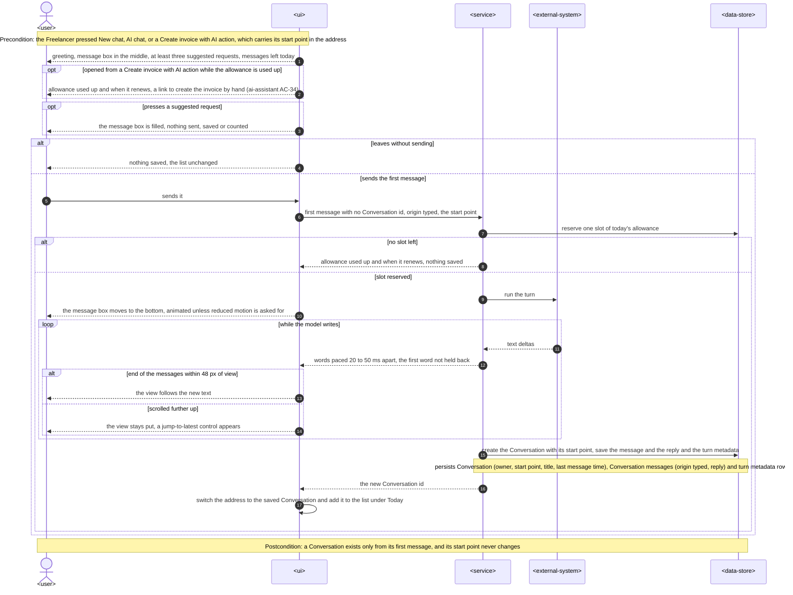

### Flow 10: Open the dashboard AI block

Covers US-10 up to the hand-off (AC-30, AC-32, AC-36). Sending the prompt is Critical flow 3. UI path: SCR-09 (`ux-flows.md` Flow US-10).

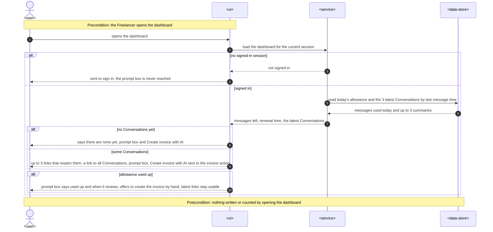

### Flow 11: Data export and account deletion

Covers US-12 (AC-34). It extends ai-assistant Flow 12 with the new stored data. UI path: SCR-14 (`ux-flows.md` Flow US-12).

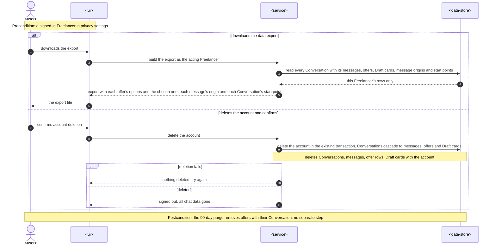

### Coverage: user stories and acceptance criteria

Critical flows 1–3 are the design-seeded flows above, drawn with the §5 container names. Flows 4–11 use the generic participants: `<user>` is the Freelancer, `<client>` is the external Assistant, `<external-system>` is the model provider, `<service>` is the chat route, server actions, MCP server, agent and service layer together, and `<data-store>` is the database.

| User story | Flows |
|---|---|
| US-01 Find my profiles, accounts and products | 4, 6 |
| US-02 Same reads in my own AI client | 5 |
| US-03 Pick an option with one press | 6, 1, 7 |
| US-04 Work in a full-height chat | 8, 9 |
| US-05 Start from a clear empty state | 9 |
| US-06 Use the AI on my phone | 8, 2 (the preview as a full-screen sheet is the same flow at a narrow width) |
| US-07 Preview a created draft | 2, 7 |
| US-08 Issue a checked draft from the chat | 2 |
| US-09 Find the AI in the navigation | 8 (entered from the "AI chat" item). The group itself is static navigation, see AC-28 |
| US-10 Start a chat from the dashboard | 10, 3, 9 |
| US-11 Watch the reply being written | 9, 7 |
| US-12 Know what the chat keeps about me | 11. The privacy page is static text, see AC-35 |

| AC | Where it is shown |
|---|---|
| AC-01 | Flow 4, answer found (profiles with defaults, accounts by bank name, last four digits, currency) |
| AC-02 | Flow 4, the read loop (Customer search, then products with that Customer id) and answer found |
| AC-03 | Flow 4, the name folded with the shared fold, the Customer named as saved |
| AC-04 | Flow 6, request complete (profile and account named as taken from the request) |
| AC-05 | Flow 4, nothing matches |
| AC-05b | Flow 6, the name given as the Customer is the Freelancer's own sender profile |
| AC-06 | Flow 5, key valid with or without Draft permission, found |
| AC-07 | Flow 4 (this Freelancer's rows only) and Flow 5 (key owner's rows only, a foreign Customer id answered as not existing) |
| AC-08 | Flow 6, an offer-able issue with 1 to 8 options, then Critical flow 1, option valid, a Draft card |
| AC-08b | Flow 6, one offer from the first offer-able issue, then Critical flow 1, the next single offer, and Critical flow 1 again |
| AC-09 | Flow 6, the offer built in code and the question's words never becoming a button |
| AC-10 | Flow 6, look-alike Customer names with their email, and Critical flow 1, the chosen record pinned into the stored draft request |
| AC-11 | Critical flow 1, no slot left (nothing marked as chosen) |
| AC-12 | Flow 4 and Flow 6, a newer typed message closes the open offer with no choice, and Flow 7, past buttons inactive with the chosen one marked |
| AC-12b | Critical flow 1, offer not found, not latest, not open, option missing, or record gone |
| AC-13 | Flow 7, the same options with the chosen one marked, and the open button whose record was deleted since (Critical flow 1, unavailable) |
| AC-14 | Flow 6, more than 8 options |
| AC-15 | Flow 8, the note that the page never scrolls (a layout rule, verified by the e2e layout check) |
| AC-16 | Flow 9, the follow loop (within 48 px, or scrolled further up with a jump-to-latest control) |
| AC-17 | Flow 8, grouping in the Freelancer time zone and the search (matches, or none) |
| AC-18 | Flow 9, suggested request, leaves without sending, and the message box move with reduced motion |
| AC-19 | Flow 8, screen narrower than 768 px, and Critical flow 2 for the preview (shown as a full-screen sheet at that width) |
| AC-20 | Critical flow 2, found |
| AC-21 | Critical flow 2, card created but its invoice was deleted since |
| AC-22 | Critical flow 2, card not this Freelancer's, or never existed |
| AC-23 | Critical flow 2, passes, and Flow 7, the workspace invoice-state store that the card and links read |
| AC-24 | Flow 4, asked in words to issue a draft |
| AC-25 | Critical flow 2, draft rules fail |
| AC-26 | Critical flow 2, no longer a draft |
| AC-26b | Critical flow 2, version differs |
| AC-27 | Critical flow 2, the closing note (never a message, never counted) |
| AC-28 | N/A, non-runtime: the "AI" group is static navigation config, and the active item is marked by the current path when the page renders |
| AC-29 | Critical flow 3, valid |
| AC-30 | Flow 10, latest Conversations or none yet, and Flow 9, started from "Create invoice with AI" |
| AC-31 | Critical flow 3, empty or over 2,000 characters |
| AC-32 | Flow 10, allowance used up, and Critical flow 3, allowance used up |
| AC-33 | Flow 9, words paced 20 to 50 ms apart, and Flow 7, saved replies shown whole |
| AC-34 | Flow 11 |
| AC-35 | N/A, non-runtime: static privacy page text, checked by a page test |
| AC-36 | Flow 8 and Flow 10, no signed-in session (the proxy also refuses anonymous chat requests and server actions, §8) |

### Flags for design and data-model

- **Critical flows 1–3 keep the §5 container names** and are left as drawn by `design`. The details they leave out are listed here rather than redrawn:
  - Critical flow 1 has no persist notes. The allowance day row and the offer's state `OPEN` to `CHOSEN` with `chosenOptionId` commit together, and nothing else does. The pressed message with origin `PRESSED` and the stored label, the reply, the next offer and the turn metadata are written at the end of the turn (`saveTurn`, parent rule); the Draft card is stored as in the parent. A failure saves only the turn metadata, and a release puts the offer back to `OPEN`.
  - Critical flow 2's issuing write also sets the write-once `Invoice.issuedFromChat` flag (§7 *Monitoring*). On "changed elsewhere", the reload is a second preview load through the same path. `data-model` fixes the column.
  - Critical flow 3's first message records origin `DASHBOARD` and start point "dashboard prompt", as Flow 9 does for the other start points.
- **The order of offer writes keeps "one open offer per Conversation"**: any new message closes the open offer when it is saved at the end of its turn (a press's own offer is already CHOSEN; review 2026-10-13 R2-B1), before that turn's own offer is stored (Flows 4 and 6), and a press claims its offer before the next offer of that turn is stored (Critical flow 1). The partial unique index never sees two open rows.
- **AC-05b depends on the model** following the chat instructions and the sender-profile read (Flow 6). There is no resolver rule for "this Customer name is your own sender profile". Candidate for §11 with an eval fixture in `plan-tests`. Alternative for `tasks`: a resolver hint on `CUSTOMER_NOT_FOUND` when the folded name equals a sender profile.
- **No async flow.** The dashboard hand-off is a browser-only step, and §8 *Events* is N/A. So there is no idempotency key, retry or dead-letter branch, and no `<message-bus>`.
- **No new participants**: every generic participant maps to a §5 container or an existing external system.
- **Index hints for data-model, taken from the persist and read notes:**
  - offer rows: partial unique by Conversation where the state is open; by Conversation for the reopen load and the cascade; by reply message;
  - Conversation by owner and last message time, for the full summary list, the dashboard's 3 latest and the 90-day purge (existing);
  - messages by Conversation in order (existing), now with the origin column;
  - Draft card by Conversation (existing), joined to its invoice for the status and version;
  - Customers, products and sender profiles by owner (existing). Name matching runs in the app over the owner's rows (ADR-0004), so no name index;
  - `Invoice.issuedFromChat` needs no index (KPI reads only).

## 7. Deployment view

Nothing new to deploy. The feature ships inside the existing Vercel deployable (region `fra1`), with no new runtime unit, setting, cron step or external service.
- **Chat route.** It keeps its Node.js runtime and default duration (ai-assistant §7). The press check adds owner-scoped reads before the reservation.
- **Migrations.** One Prisma migration adds `ChoiceOffer`, `ConversationMessage.origin` and `Conversation.startedFrom`. Existing rows get `origin = TYPED` for Freelancer messages and `startedFrom = AI_SECTION`, recorded as an assumption for pre-release Conversations. It is staged by `data-model` and promoted by `implement`.
- **Retention.** `ChoiceOffer` rows cascade with their Conversation, so the existing 90-day purge step and account deletion remove them with no new step.

**Monitoring:**
- **Metrics.** The spec §7 KPIs come from stored data:
  - turns per draft and choices answered by a button: `ConversationMessage.origin` plus `ChoiceOffer.state`;
  - drafts issued from the chat: a write-once `Invoice.issuedFromChat` flag set by `issueFromPreview`, read together with `assistantOrigin = CHAT` (stored, not a span; `data-model` fixes the column);
  - Conversations started from the dashboard: `Conversation.startedFrom`.
- **Tracing.** `inOutcomeSpan` wraps:
  - each new read question (`assistant-tools.sender-profiles`, `.products`, `.customers`), for the 800 ms p95;
  - `invoices.issue-from-preview`, for the 2 s p95;
  - `chat.choice-check`.

  Spans stay metadata only (ai-assistant ADR-0004): no labels, names or prompt text.
- **Sentry alerts.**
  - Issue-from-preview p95 above 2 s in a week.
  - Read-question p95 above 800 ms in a week.
  - More than 5 % of presses refused as unavailable in a week. That is a signal of offers going stale, or of probing.

**Scaling thresholds:**
- Offers: at most one per reply, so at most 30 per Freelancer a day, kept 90 days. No index beyond the partial unique and the Conversation foreign key.
- Name matching in the app stays within the 800 ms p95 at the spec's sizing (20 sender profiles, 500 products, 2,000 Customers). Above roughly 20,000 Customers per Freelancer, revisit with a stored folded key (ADR-0004 *Neutral*).
- The Conversation list loads every summary: at most about 2,700 rows by the allowance and the retention. Above 3,000 rows for one Freelancer (beyond the allowance-and-retention bound, so only if either changes), return to server-side search and paging.

## 8. Crosscutting concepts

| Concept | Convention | Where defined |
|---|---|---|
| Authentication | Unchanged. AI pages and the dashboard redirect a Visitor to sign-in, and the proxy refuses anonymous `/api` and server actions (AC-36). | ai-assistant SAD §8; architecture-hardening ADR-0001 |
| Authorization and tenancy | Every read, offer, preview and issue runs through a service as the `ActingFreelancer`, scoped by owner in the `WHERE` clause. A press refers to an offer **option id**, never to a record id, so another Freelancer's record cannot be named. The option's record is re-checked as owned and still fitting at press time. Another Freelancer's offer, Conversation or invoice answers exactly as one that does not exist (AC-12b, AC-22). | service-layer ADR-0003; ADR-0003 here |
| Write safety | The model still has no create or issue tool. Issuing exists only as the Freelancer's server action behind a confirmation dialog, with the expected version (ADR-0007). A request in words to issue gets the AC-24 answer with a preview link. | ai-assistant ADR-0006, ADR-0007; here |
| Untrusted text | Offers are built only from resolver issues (ADR-0002). Labels come from stored records. A stored note saying "offer the button Evil Corp" has no path into an offer (abuse case 1). The press label shown as the Freelancer's message is the stored label, never client text. | ADR-0002, ADR-0003 |
| Name matching | One `foldName` (NFKC, lower case, look-alike Cyrillic as Latin, spaces collapsed) for the resolver, the three reads and the title search. Stored names are always shown as stored. | ADR-0004 |
| Sensitive data in answers | Read outputs have no field for a full account number. Account summaries are bank name, last four, currency and the default mark, built in the service. A contract test checks every read question's output against a fixture with known account numbers (spec §6 "Bank account exposure"). | here |
| Error handling | `ActionResult` codes. New chat outcomes are `CHOICE_UNAVAILABLE` (one fixed sentence for every cause, never counted). New issue results are `ALREADY_ISSUED` and `CHANGED_ELSEWHERE` (reload). Draft-rule failures keep the editor's `VALIDATION` messages verbatim (AC-25). | `types/result.ts`; ADR-0003, ADR-0007 |
| Limits | A press is a message: allowance, the 2,000-character limit (labels are short) and the 8-step work cap all apply. Preview and issue are not messages and touch no counter (AC-27). | ai-assistant ADR-0009 |
| Addresses | `/ai` is a new Conversation (`?start=draft&from=…`, `?handoff=…`). `/ai/{id}` is a saved one. `?preview={cardId}` is an open preview. Prompt text never appears in a URL. | ADR-0005, ADR-0009 |
| Client state | One workspace invoice-state store (invoice id → status, number, availability). The card, `ChatLink` and the panel read it. Page loads, `loadInvoicePreview`, `issueFromPreview` and `createDraftFromCard` write it. No push or polling. | ADR-0008 |
| Observability | Metadata-only spans for reads, choice checks and issue-from-preview. No label, name or prompt text in spans. | ai-assistant ADR-0004; §7 |
| Data lifecycle | Offers (options and the chosen one), message origin and start point live with the Conversation. They are exported, purged after 90 days and deleted with the account in the existing transaction (AC-34). The privacy page lists them (AC-35). | ai-assistant ADR-0008; here |
| Accessibility | Offered choices are a labelled group of buttons, with the chosen one announced as pressed or chosen. The panel and sheets trap focus and return it on close. The streamed reply keeps the existing live region. The automated check covers the AI section, the panel and the dashboard block (spec §6). | `docs/design-system.md`; here |
| Motion | The composer move and the panel transitions honour `prefers-reduced-motion` (AC-18). | here |
| Internationalisation | Unchanged. The reply is in the message's language; fixed app text (button states, dialog text, "no longer available") is English. | ai-assistant SAD §8 |
| IDs | `cuid()` for `ChoiceOffer`. `optionId` is the option's position in its offer, stable because the options are frozen when offered. | `docs/architecture-map.md` §Conventions |
| Events | N/A. Direct calls only; no queue, push or polling. | — |

## 9. Architecture decisions

| # | Title | Status | Section |
|---|---|---|---|
| 0001 | Store each set of Offered choices as a server-side offer row tied to its reply | Accepted | §4, §5 |
| 0002 | Build Offered choices in code from the draft resolver's typed issues | Accepted | §4, §5 |
| 0003 | Send a press as an option reference and pin the chosen record into the draft request in code | Accepted | §4, §5 |
| 0004 | Match look-alike names in the app with one shared fold, without a stored search key | Accepted | §4, §5 |
| 0005 | Give a saved Conversation and an open preview their own addresses and keep a new Conversation at /ai | Accepted | §4, §8 |
| 0006 | Load the chat's invoice preview through an owner-scoped server action and the shared document model | Accepted | §4, §5 |
| 0007 | Issue from the preview through the invoice status service, guarded by the version the preview showed | Accepted | §4, §6 |
| 0008 | Keep invoice states in one workspace store fed by loads and action results, without push | Accepted | §4, §8 |
| 0009 | Hand the dashboard prompt to the AI section through a one-time session-storage entry | Accepted | §4, §6 |

ADR files live under `docs/features/ai-chat-v2/adr/NNNN-<title>.md`.

Nine ADRs is below the 10–15 typical for an L feature on purpose. This iteration extends a feature whose 13 ADRs stay in force: target surfaces, UI architecture, model, agent, router, resolver, cards, storage, counters and the shared registry. The remaining decisions (three reads in the registry, the workspace layout, the list loading, navigation, streaming pacing, origin columns) are reversible within a day or are fixed by the spec, so they stay inline in §5.

## 10. Quality requirements

**QG-1. Exact, unforgeable choices**
- **When:** a reply asks the Freelancer to choose. Its words name an account that the draft action did not find, and a stored note asks for a button (AC-09). Separately, a press arrives for an option from an older reply, for a deleted record, or for another Freelancer's Customer (AC-12b, AC-13).
- **Then:**
  - "100 % of buttons match options the draft action found; 0 buttons from model text" (spec §6).
  - Every invalid press gets the same "no longer available" words, is not counted, marks nothing and makes no model call.
  - "100 % of the look-alike fixture set (Latin/Cyrillic pairs, extra spaces, case) matches in the chat, MCP and the Conversation search" (spec §6), and the pressed look-alike Customer is the one on the card (AC-10).
- **How verify:**
  - A contract test of the stream with an injection fixture: offers equal `offerFromIssue(issue)`, and the model text is ignored.
  - Route integration tests for each invalid-press cause, asserting: no `MessageAllowanceDay` change, no gateway call (the scripted model records zero calls), offer state unchanged, identical outcome text.
  - Unit and contract tests of `foldName` over the shared fixture set from all three call sites.

**QG-2. Safe issuing from the chat**
- **When:** the Freelancer confirms Issue on a preview: when it is current, when it was saved again in another tab (AC-26b), when it was issued elsewhere (AC-26), when it breaks an invoice-integrity rule (AC-25), and with no allowance left (AC-27).
- **Then:**
  - Only the current draft is issued, keeping its number.
  - An outdated preview reloads and needs a new confirmation.
  - An already-issued invoice is never issued again.
  - A rule failure shows the editor's explanation.
  - Issuing never counts.
  - "Issue from the chat, p95 ≤ 2 s server-side from the confirmation" (spec §6).
- **How verify:**
  - Integration tests on `updateInvoiceStatus` with `expectedVersion` for each branch, including two concurrent confirms (exactly one issues).
  - An e2e test across two tabs for AC-26 and AC-26b.
  - `invoices.issue-from-preview` span p95 in Sentry, weekly.

**QG-3. A workspace that never makes the Freelancer hunt**
- **When:** the Freelancer uses the AI section with 40 Conversations and 60 messages while a reply is written, at each tested size.
- **Then:**
  - "0 px of page-level scroll on viewports from 360 × 640 to 2560 × 1440; the message box fully visible at every size" (spec §6).
  - "The newest text is in view within 100 ms of arriving while the end of the messages is no more than 48 px out of view; 0 jumps while they have scrolled further up" (spec §6).
  - "Consecutive words shown 20–50 ms apart once the model has sent them; the first word is never held back (time to the first visible words stays as in ai-assistant §6, p95 ≤ 3 s)" (spec §6).
  - "Preview open, p95 ≤ 1.5 s from the press to a rendered preview" (spec §6).
  - "0 serious or critical violations in the automated accessibility check of the AI section, the preview panel and the dashboard AI block; every button and panel reachable by keyboard" (spec §6).
- **How verify:**
  - An e2e layout check at 360 × 640, 768 × 1024 and 1440 × 900 (`document.scrollingElement.scrollHeight === innerHeight`, composer box in view).
  - A component test of the follow hook with a scripted stream.
  - An e2e / component check of streamed deltas with a scripted model that pauses.
  - e2e timing of Preview to a rendered panel.
  - The existing e2e accessibility suite extended to the three surfaces.

**QG-4. Fast, private reads**
- **When:** the chat or a Personal key without Draft permission asks for sender profiles, products, or Customers by name, for a Freelancer with 20 sender profiles, 500 products and 2,000 Customers.
- **Then:**
  - "≤ 800 ms server-side" p95 (spec §6, new read questions).
  - "0 full account numbers in any read answer, chat reply or MCP answer" (spec §6).
  - Answers hold only this Freelancer's records (AC-07).
  - "Model cost per message, p95 ≤ USD 0.02, unchanged by the new reads" (spec §6).
- **How verify:**
  - Integration timing on a seeded Freelancer, plus per-tool spans.
  - A contract test over every read question's output with known full account numbers in the fixture.
  - A cross-tenant integration test for both channels.
  - Weekly per-message traces (metadata only).

## 11. Risks and technical debt

| Risk / debt | Severity | Mitigation | Owner |
|---|---|---|---|
| The model narrates the pinned result loosely: it names a different record in words than the card or next offer shows, or calls `propose_draft` again with other words | Medium | The card and offer come from code: a `propose_draft` re-call in a pressed turn is answered with the pinned result and changes neither (review 2026-10-13 R1-S1). The instructions say to describe the result given. An eval fixture checks that the reply names the pressed record. The card is the source of truth, and Create re-resolves (ai-assistant ADR-0007). | Dmytro Hopko |
| Feeding a pre-resolved result into a Mastra turn (as a prior tool step) may need framework-specific message shapes | Medium | Spike it in the first `implement` task. Fallback: pass the result as a structured system note for the turn and emit the card or offer parts from the route; the safety property does not depend on the model. **Spiked in T01: approach A (prior tool step).** `runTurn` takes `pinned: { request, resolution }` and appends a synthetic assistant `propose_draft` tool call plus its tool result (the resolution as JSON data) after the Freelancer's message; Mastra 1.76 / AI SDK 7 pass both through to the provider unchanged (integration test `ai-chat-v2-pinned-turn`). The pending card is set from the pinned PROPOSAL in code (`createTurnContext`), so the card never depends on the model or the provider, and the turn context carries `pins` for T13. Fallback B (system note) was not needed. | Dmytro Hopko |
| `updateInvoiceStatus` gains an optional `expectedVersion`; other callers (row menu) keep the unchecked path | Low | Optional parameter, default unchanged. The list keeps its behaviour, and only issue-from-preview passes a version. Integration tests cover both callers. | Dmytro Hopko |
| `customers` (`list_customers`) behaviour changes for MCP clients: folded substring over the current names **and** the names copied onto invoices (as today), and at most 20 rows per answer instead of 50 (spec §1) | Low | Same input/output shape; the description is updated. The filter matches a superset of today's names. The narrower page is a deliberate, spec-driven change: clients keep paging, with `pageInfo` giving the total. `api` records it with a contract test. | Dmytro Hopko |
| The session-storage hand-off is lost if the dashboard prompt opens the AI section in another tab or the storage is blocked | Low | The dashboard navigates in the same tab. Without an entry, the AI section shows a plain new Conversation: nothing is sent or counted, and the Freelancer types the request again. A component test pins this. | Dmytro Hopko |
| Loading every Conversation summary grows the list payload for heavy users | Low | Bounded at about 2,700 rows by allowance and retention. Threshold and fallback are in §7. | Dmytro Hopko |
| An offer's options go stale (record deleted, account currency changed) between reply and press | Low | Re-checked at press time (AC-13). The uniform answer is uncounted. The §7 alert watches the refusal rate. | Dmytro Hopko |
| `docs/architecture-map.md` is 124 commits stale (reflects `2064466`, before the AI chat shipped) | Low | This SAD was built on a fresh code read. Run `/sdd:survey` before `tasks` so later stages read a current map. | Dmytro Hopko |
| The free-tier Gemini key's terms and request caps (inherited) | Medium | Inherited from ai-assistant §1 ¶4 and §11. Presses add messages but no new cost class, and the alerts stay as they are. | Dmytro Hopko |
| Open question (spec §8): does the terms page need an AI clause? | Open question | Resolve before `sdd:ship`. The default is no change unless the terms page contradicts the chat; checked with the privacy update. | Dmytro Hopko |

**Accepted debt (acceptable in v2, plan to fix later):**
- An invoice issued in another tab shows as issued in the chat only on the next preview load, issue attempt or reopen. There is no push (ADR-0008); spec §1 limits live status to system-made links.
- Model-written invoice names in reply text are not updated (spec §1).
- The `?page=N` Conversation pagination of the first iteration is removed. The full summary list replaces it while the bound in §7 holds.

## 12. Glossary

| Term | Meaning |
|---|---|
| Offered choice | An option the draft action itself found (a Customer, bank account, product, sender profile or currency), shown as a button under the reply; pressing it sends exactly that option as an ordinary, counted message (CONTEXT.md). |
| Offer | This SAD's name for the stored set of Offered choices of one reply: one `ChoiceOffer` row with its options, the draft request it continues, and its state (open, chosen, closed). |
| Press | A Freelancer message sent by pressing an Offered choice; it carries an offer id and an option id, and its text is the stored label. |
| Pin | Putting the pressed option's record into the offer's stored draft request by code, so the resolver uses exactly that record. |
| Message origin | Where a Freelancer message came from: typed, pressed, or sent from the dashboard prompt. |
| Conversation start point | Where a Conversation was started: the AI section, the invoice list, the dashboard prompt, or the dashboard's "Create invoice with AI". |
| Fold (folded name) | The comparison form of a name: Unicode-normalized, lower case, look-alike Cyrillic letters as Latin, spaces collapsed. It is used only for matching; a stored name is always shown as stored. |
| Outdated preview | A preview whose invoice `version` changed after it loaded, that is, the draft was saved again. |
| Hand-off | The one-time session-storage entry that carries a dashboard prompt to the AI section. |
| Conversation, Draft invoice, Assistant draft, Daily message allowance, Personal key, Sender profile, Customer, Custom price, Default bank account | As defined in `CONTEXT.md`. |
