# Software Architecture Document — ai-chat-v2

> This SAD **extends** [`ai-assistant/sad.md`](../ai-assistant/sad.md). Every section, ADR and contract of the first iteration stays in force and is referenced, not repeated. ADR numbers below without a prefix are this feature's own (`docs/features/ai-chat-v2/adr/`); the first iteration's are written "ai-assistant ADR-NNNN".

## 1. Introduction and goals

**Intent.** The second iteration of the in-app AI chat removes the friction around the first iteration's rules, without loosening any of them (spec §1, §2). The chat and MCP gain three read questions that the draft flow needs: sender profiles with bank-account summaries, the product catalogue with prices and Custom prices, and a look-alike-aware Customer search. Every open question of a drafting reply is asked in one **Question form**: its options are the Freelancer's own records, supported currencies or computed dates, checked and labelled by the server; the Freelancer answers one question at a time, and the last answer sends all answers as one counted message whose choices are pinned into the draft by code. The AI section becomes a full-height workspace with its own scrolling panes, a grouped and searchable Conversation list, an empty-state start and phone sheets. A created draft can be previewed and issued from the chat under the editor's issuing rules, after one confirmation, and the card and its links show the live status. The AI also gets a navigation group and a "Create invoice with AI" action in the dashboard header. Finally, the privacy page and the data export cover everything the iteration stores.

**Top-4 quality goals (1-liners; full scenarios in §10):**

1. **Exact, unforgeable choices.** Every option in a Question form is a record, currency or date the server checked and labelled. An answer refers to exactly that option. An answer that cannot be applied is refused uniformly, uncounted, and never reaches the model.
2. **Safe issuing from the chat.** Only the Freelancer's confirmed Issue press issues, through the editor's issuing rules. An outdated or already-issued preview never issues, and the card and links show the result.
3. **A workspace that never makes the Freelancer hunt.** The page itself never scrolls. The message box is always visible, new text is followed within the spec's thresholds, and replies stream word by word.
4. **Fast, private reads.** The new read questions answer within the spec's p95. No answer on any channel ever carries a full bank account number.

**Stakeholders.**

| Role | Interest | Sign-off owner? |
|---|---|---|
| Freelancer | Uses the AI section, answers Question forms, previews and issues drafts from the chat, starts a draft from the dashboard's "Create invoice with AI", reads the privacy page and exports their data | No |
| Assistant | The in-app chat (inside the signed-in session) and external MCP clients (through a Personal key) that use the three new read questions | No |
| Visitor | Sent to sign in from the AI section and the dashboard; nothing processed or counted (AC-36) | No |
| Security Lead | A new issuing path from a chat surface, a forged-answer abuse case, and bank-account summaries for every Personal key (spec §6.1 "Security review: Required") | Yes |
| Tech Lead | SAD approval | Yes |

<!-- Decision overrides (¶4) — populated by the critic resolution loop, empty otherwise. -->

## 2. Constraints

**Technical.**
- Everything in ai-assistant SAD §2 *Technical* still holds: TypeScript 5 strict on Node.js `>=22.18 <23`; Next.js 16.3.8 and React 19.2.3 pinned exactly; Prisma 7.10 over PostgreSQL with the split schema; next-auth 5.0.0-beta.32; `@modelcontextprotocol/sdk` 1.32.0; Vercel `fra1`.
- The AI runtime is already installed and pinned (AI SDK UI `useChat`, Mastra, the Vercel AI Gateway, per ai-assistant ADR-0002–ADR-0004). *Revision 2026-10-15 (ADR-0014):* the default model is Claude Haiku 5.5 (`anthropic/claude-haiku-5.5`) on paid terms, replacing ai-assistant ADR-0003's Gemini Flash-Lite on a free-tier key; `@ai-sdk/google` and `GOOGLE_GENERATIVE_AI_API_KEY` are removed. **This feature adds no AI runtime dependency**: no new AI package, no animation library, no realtime or push service. *Revision 2026-10-13 (ADR-0012):* two rendering dependencies are added for safe Markdown, pinned exactly: `react-markdown@10.1.0` (2025-03-07) and `remark-gfm@4.0.1` (2025-02-10).
- The chat route reads one message per request (`chatRequestSchema`: the conversation id plus one text part). History is loaded on the server, never trusted from the client (`app/api/chat/route.ts`, `lib/services/conversations/conversations.ts` `loadHistory`).
- Read questions live once in `lib/assistant-tools/` (`READ_QUESTIONS`) and are registered by both MCP (`lib/mcp/server.ts`) and the chat (`lib/ai/tools/read-tools.ts`), per ai-assistant ADR-0010.
- The draft resolver `resolveDraftRequest` (`lib/services/assistant-drafts/resolve.ts`) returns `PROPOSAL` or a closed union of `DraftIssue` kinds (`schema.ts`). Most ambiguity kinds already carry record ids: Customer, product and bank-account candidates.
- Invoices carry an optimistic `version` counter (invoice-integrity ADR-0004). The editor's save refuses a stale `loadedVersion` with `CHANGED_ELSEWHERE`. The status path `updateInvoiceStatus` locks the row and runs the editor's draft rules, but checks no version today (`lib/services/invoices/invoices.ts`).
- Preview and PDF come from one document model (`lib/invoice-document`, editor-ux ADR-0002), rendered as HTML by `PDFPreviewPanel`, which the invoice list's preview modal already uses outside the editor.
- Tests: vitest (unit / component / contract), integration on throwaway Postgres, and Playwright e2e run locally (not in CI).

**Organisational.**
- No external deadline (spec §1). Size L, route `full`.
- One developer (Dmytro Hopko) working with AI agents through the SDD pipeline.
- The first iteration's documents are not rewritten (spec §3). Where this feature changes one of its contracts (the chat request, the resolver's request and issues, the `customers` read question), the change is recorded here and in this feature's `contracts/`, never by editing ai-assistant's files.

**Conventions.**
- `docs/architecture-map.md` §Conventions (reflects `2064466`, **124 commits stale**: the AI chat shipped since. The current chat code was mapped by a fresh read for this SAD; see §11).
- The ai-assistant SAD §2 *Conventions* (results as `ActionResult`, actor factories only, deny-by-default proxy, per-local-day counters, Freelancer time zone, `cuid()` ids, owner-scoped writes).
- UI: shadcn/ui (base-vega, `@base-ui/react`) and Tailwind 4 tokens. Reuse the `docs/design-system.md` inventory: `AiWorkspace`, `ChatIsland`, `Composer`, `DraftCard`, `ChatLink`, `ConversationList`, `AllowanceNotice`, `StartPanel`, `ConfirmationModal`, `LoadError`. The chat surface is composed from our own chat elements in `components/ai-elements/` (Conversation, Message, PromptInput, Suggestion, Loader), ported from Vercel AI Elements onto Base UI (ADR-0010). No Radix primitives.

**Regulatory / external.**
- The model provider changes (Google → Anthropic); no other processor is added. Message text keeps going to the model provider named on the privacy page (spec §6.1). *Revision 2026-10-15 (ADR-0014):* Anthropic (Claude Haiku 5.5 on paid API terms) replaces Google; Vercel stays the gateway. The privacy page and the terms sub-processor table name Anthropic (T90). The 2026-10-14 security review (`_ship/security-review-2026-10-14.md`) predates the switch; its addendum does not yet cover it. The first iteration's free-tier override (ai-assistant §1 ¶4, ADR-0003) no longer applies: the model runs on paid API terms. *Revision 2026-10-15 (ADR-0014, option A):* the app runs in the EU (Vercel `fra1`, Neon `eu-central-1`, Frankfurt); the model provider is Anthropic, a US company; the `anthropic` endpoint at the Gateway offers no EU region; processing is outside the EU, mainly in the USA (the +10 % US-zone pin was considered, not taken); the EU routes via Bedrock or Vertex are rejected for now: another processor and a bring-your-own-key setup. Transfers rely on SCCs, and Gateway calls require zero data retention (`zeroDataRetention: true`, T109).
- New personal data stored with the Conversation: the Question forms with their options and the answers sent (and the Offered choices of Conversations saved before the 2026-10-13 revision), each message's origin, and each Conversation's start point. All of it is exported and deleted with the Conversation and the account, under the 90-day retention (spec §6.1, AC-34).
- Read answers carry bank-account summaries (bank name, last four digits, currency, default mark), never a full account number. This applies to every Personal key (spec §6.1, AC-06).
- Security review is required before ship (spec §6.1).

## 3. Context and scope

Invoice Forge is the Freelancer's invoicing web app. The ai-assistant feature added the in-app chat and the MCP draft action. This iteration changes no system boundary: the same Freelancer, external Assistants, model provider and Sentry. What grows is inside: three read questions on both channels, a structured form-answer channel into the chat route, and an issuing path reachable from the chat panel.

The trust boundary is unchanged in shape but carries two new rules:
- A **form answer** arriving from the browser is untrusted input. It is resolved only against the server-stored Question form of the Freelancer's own latest reply.
- What the model writes can never create an option or issue an invoice.

<!-- brownfield: architecture map reflects 2064466 (124 commits stale: ai-assistant shipped since); the current chat code (chat route, run-turn, resolver issues, read-tool registry, ChatIsland, DraftCard, invoice status path, version counter) was mapped by a fresh explorer read on d0bc2e9. -->

**External systems (in / out):**

| Actor or system | Type | Interaction |
|---|---|---|
| Freelancer | Person | Chats, answers Question forms, previews and issues drafts, exports data |
| Assistant (external MCP client) | Person (external program acting for one Freelancer) | Calls the read questions, the three new ones included, through a Personal key; creates drafts with Draft permission as before |
| Visitor | Person | Sent to sign in from the AI section and the dashboard; nothing processed or counted |
| AI model provider (Vercel AI Gateway, Anthropic Claude Haiku 5.5 — ADR-0014) | System (external, existing) | Receives each turn's context and tool schemas; never sees a refused form answer |
| Sentry | System (external, existing, EU region) | Errors, session replays on error (text masked), logs and metadata-only spans, now also for the read questions and the issue-from-preview action |

**C4 Context (L1):**

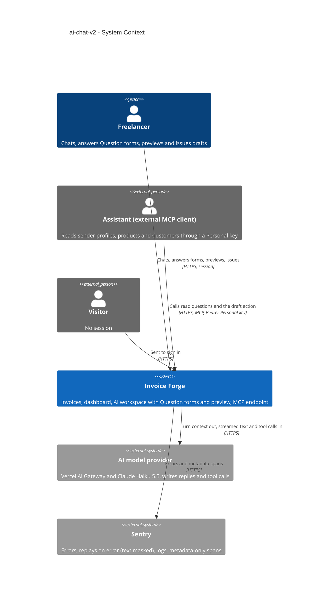

## 4. Solution strategy

**Target surfaces: `[backend-service, web-frontend]`.** These are unchanged from ai-assistant ADR-0001, so no new ADR is needed.
- **Backend service** (the existing Next.js app) gains:
  - three read questions in the shared registry;
  - Question form rows and the form-answer check in the chat route;
  - an issue-from-preview server action over the invoice status service;
  - export coverage.
- **Web frontend** gains:
  - the full-height AI workspace (SCR-01–SCR-07);
  - the navigation "AI" group (SCR-08);
  - the dashboard's "Create invoice with AI" action (SCR-09);
  - the privacy page update (SCR-13).

No worker: forms are deleted with their Conversation, so retention needs no new cron step.

**UI architecture (web-frontend): hybrid, unchanged** (ai-assistant ADR-0002). The pages are RSC (`/ai`, `/ai/[conversationId]`, the dashboard). The chat is the `ChatIsland` client island over `useChat`. New client state lives inside the workspace: one invoice-state store (ADR-0008) and the preview panel's state in the address (ADR-0005). No global store and no client cache library are added.

**Top strategic choices (the seeds for ADRs):**

1. **Code builds the choices; the model only words them** (ADR-0001, amended by ADR-0011). Every option the Freelancer can pick is built by the server from records it loaded for this Freelancer, supported currencies or computed dates, with fixed labels and references. The choices are stored as a server-side row tied to the reply and streamed as a `data-offer` part that carries the row's id. The model's text has no path into an option, so AC-09 and the stored-text injection case hold by construction. This mirrors how ai-assistant ADR-0007 keeps Draft cards server-side. (The first design, one offer per reply from the first resolver issue, ADR-0002, is superseded by seed 6.)
2. **An answer is a structured reference, checked and pinned by code** (ADR-0003, superseded in its mechanism by ADR-0011). The browser sends option ids, never record ids.
   - The chat route checks the answers against the Freelancer's own latest open form, and every chosen record against current data, **before** any allowance reservation or model call. A failed check gets one fixed "no longer available" outcome.
   - A valid send claims the form together with the allowance slot (one transaction, and nothing else in it), is counted like any message, and is saved with the composed answer text at the end of the turn, as every message is.
   - The chosen records are pinned into the form's stored draft request, and the resolver runs in code. The model then writes the reply around that result, so it cannot re-match a record by name (AC-10).
3. **One name-folding rule, applied in the app** (ADR-0004). The existing `foldName` becomes the single shared normalizer (isomorphic, no `server-only`). It serves the resolver, the Customer search, the product read and the Conversation title search. Matching runs in the app over the owner's rows, which are bounded by the spec's sizing (2,000 Customers, 500 products). No stored search key, and no second implementation in SQL.
4. **The chat issues through the invoice service's own status path, guarded by the version the preview showed** (ADR-0006, ADR-0007).
   - The preview loads through an owner-scoped server action keyed by the Freelancer's own Draft card. It returns the serialized invoice, its status and its `version`, or tells "deleted since" (a created card whose invoice link was cleared) from "cannot be found" (no such card for this Freelancer). It renders with the same `PDFPreviewPanel` and document model as the rest of the app.
   - Issuing calls `updateInvoiceStatus` with a new `expectedVersion`, checked under the row lock after the "still a draft?" check. That gives three outcomes besides success: already issued (AC-26), outdated so reload (AC-26b), and blocked by the draft rules (AC-25).
   - Nothing here is a message, so nothing touches the allowance (AC-27).
5. **Addresses and invoice status without new infrastructure** (ADR-0005, ADR-0008).
   - **Addresses.** A saved Conversation keeps `/ai/{id}`, an open preview adds `?preview={cardId}`, and a new Conversation stays `/ai` because it is not a record yet.
   - **Invoice status.** The card, the links and the panel read one client-side invoice-state store. Server loads and action results feed it; there is no push or polling.
   - The dashboard prompt hand-off of ADR-0009 was removed with the dashboard AI block on 2026-10-14 (ADR-0009 Superseded).

**Seeds added by the owner feedback revision (2026-10-13):**

6. **One Question form per reply, checked and labelled by the server** (ADR-0011). Resolver issues and a chat-only `ask_user` tool both feed one stored form; the model may name record ids, the server loads them owner-scoped, builds every label and computes date options; a record question with no options is filled by the server from the Freelancer's own records (AC-54). The form docks above the composer one question at a time; the last answer sends all answers as one counted message with origin `FORM`, checked before any reservation, pinned into the stored request by code.
7. **Safe Markdown with an in-app link allowlist** (ADR-0012). Replies render as React elements from Markdown, never HTML; links only to route patterns of this app.
8. **A list that lives in the layout** (ADR-0013). Switching Conversations is a page navigation under a persistent `ai/layout.tsx` that owns the list; the list changes only on its own events.
9. **The model is told the date** (inline): a per-turn note with today, weekday and time zone; the frozen instructions stay a stable prefix.

Each tactical decision below traces to one of these seeds. One that contradicts a seed is raised in §11.

**Resolved design inputs from `ux-flows.md` (Platform decisions, "Design input"):**
1. *How a choice reaches the server and is told apart from typed text:* a `form` field (`{ formId, answers[] }`) on the chat request, checked against the stored form (ADR-0011; first designed as a `choice` field, ADR-0003). The message origin is set by the server, never by the client's say-so.
2. *How the card and links learn the invoice was issued:* a workspace invoice-state store fed by page loads, preview loads and the issue / create results. No push. Another tab's change shows on the next preview load, issue attempt or reopen (ADR-0008).
3. *Own addresses:* yes for a saved Conversation (`/ai/{id}`, existing) and for an open preview (`?preview=`). No for a new, unsaved Conversation (ADR-0005).
4. *Dashboard prompt sent exactly once:* no longer applies; the dashboard prompt box was removed on 2026-10-14 (ADR-0009 Superseded).

## 5. Building block view

The layering is the repo's and the first iteration's. Thin adapters (RSC pages, the chat route, server actions, MCP tools) resolve an `ActingFreelancer` and call services in `lib/services/<domain>/`, which own every rule and every database access. Nothing new is a module of its own. The feature extends:
- the `assistant-drafts` domain (Question forms and pins);
- the `assistant-tools` registry (three reads);
- the `invoices` status service (expected version);
- the `conversations` domain (origins, full list for grouping);
- the AI web components.

The extension follows the first iteration's own seams, so the parity and safety guarantees it already tests keep holding.

**Internal decomposition (new and changed):**

```
app/
├── (protected)/ai/layout.tsx               CHANGED  full-height workspace shell (no page scroll), modal container stays
├── (protected)/ai/page.tsx                  CHANGED  new Conversation (SCR-02); reads ?start=draft&from=…
├── (protected)/ai/[conversationId]/page.tsx CHANGED  Conversation + Question forms + invoice states; ?preview={cardId} opens SCR-06
├── (protected)/dashboard/                   CHANGED  "Create invoice with AI" in the dashboard header (components/dashboard/header)
├── (public)/privacy/                        CHANGED  AI section text (AC-35)
└── api/
    ├── chat/route.ts                        CHANGED  optional form + origin + startedFrom; form check before reservation; data-offer part (carries the form id)
    └── user/export/route.ts                 (via account service) + forms with answers, legacy offers, origins, start point
components/ai-elements/                      NEW      own chat elements ported from Vercel AI Elements onto Base UI (ADR-0010):
│                                                     conversation, message, prompt-input, suggestion, loader; LICENSE + NOTICE (Apache-2.0)
components/ai/
├── ai-workspace.tsx                         CHANGED  bordered rounded container in the content area, 3-pane grid, own scroll per pane, md (768) / xl (1280) breakpoints, phone sheets
├── conversation-list.tsx                    CHANGED  grouped Today / Yesterday / Previous 7 days / Older, title search, plain rows, delete in a row "…" menu, New chat at the bottom
├── chat-island.tsx                          CHANGED  sends form answers/origin, docks the Question form above the composer, follow-to-latest (48 px), composer move animation; composes Conversation / Message / PromptInput, a centred max-w-3xl column; could-not-complete as an assistant Message with an inline alert + Retry
├── question-form.tsx                        NEW      the docked Question form (see "Question form" below)
├── invoice-preview-panel.tsx                NEW      side panel / full-screen sheet; PDFPreviewPanel + Open in editor + Issue
├── issue-confirmation.tsx                   NEW      ConfirmationModal body naming Customer, total, currency
├── invoice-state-context.tsx                NEW      workspace invoice-state store (ADR-0008)
└── draft-card.tsx, chat-link.tsx            CHANGED  Preview button; status read from the invoice-state store
config/navigation-menu.config.ts             CHANGED  "AI" group: AI chat, Connect your AI (SCR-08)
lib/
├── helpers/fold-name.ts                     MOVED    foldName from assistant-drafts/match-name.ts, isomorphic (ADR-0004)
├── assistant-tools/
│   ├── sender-profiles.ts                   NEW      profiles + account summaries (bank, last 4, currency, default), no full number
│   ├── products.ts                          NEW      name filter (folded), ≤ 20 + total, prices per currency, Custom prices for a customerId
│   └── customers.ts                         CHANGED  name filter folded (look-alike), ≤ 20 per answer + total
├── ai/
│   ├── instructions/chat                    CHANGED  what the chat can read; sender profile vs Customer (AC-05b)
│   ├── run-turn.ts                          CHANGED  starts from a pinned resolution when the message answers a form
│   └── tools/propose-draft.ts               CHANGED  applies the turn's pins; hands its issues to the form builder
├── services/
│   ├── assistant-drafts/
│   │   ├── forms.ts, form-pin.ts            NEW      Question forms and pins (see "Question form" below)
│   │   └── schema.ts                        CHANGED  request: senderProfileId; issue candidates carry email / ids where labels need them
│   ├── conversations/                       CHANGED  message origin, start point; full summary list for grouping and search
│   ├── invoices/invoices.ts                 CHANGED  updateInvoiceStatus(…, { expectedVersion }) → ALREADY_ISSUED / CHANGED_ELSEWHERE
│   └── account/                             CHANGED  export + deletion cover forms, legacy offers and origins
├── actions/assistant-actions.ts             CHANGED  NEW loadInvoicePreview(cardId, conversationId), issueFromPreview(invoiceId, version)
└── validations/assistant-chat.ts            CHANGED  chatRequestSchema + form { formId, answers[] }, origin (TYPED only), startedFrom
prisma/schema/ai.prisma                      CHANGED  NEW ChoiceOffer (holds a Question form); ConversationMessage.origin; Conversation.startedFrom
```

**Building-block decisions:**

- **Forms are rows** (ADR-0001, amended by ADR-0011). The choices of one reply live in one `ChoiceOffer` row: its owner, Conversation and reply message; the stored `DraftRequest` it continues (or none); the frozen questions with their options; `state` (`OPEN` | `CHOSEN` | `CLOSED`); and, once answered, the answers. The columns are under "Question form" below.

  A partial unique index keeps at most one `OPEN` form per Conversation. **A send claims the form by moving it `OPEN` → `CHOSEN`** (a conditional update, committed together with the allowance reservation and nothing else; the answer message is saved at the end of the turn with the reply, parent rule), and a non-counted system-side failure releases it `CHOSEN` → `OPEN` (or `CLOSED` when a newer message was saved meanwhile; review 2026-10-13 R2-B1). So the next form of that turn can be stored as the one `OPEN` row, and a refused send marks nothing (AC-11). Saving any newer Freelancer message (typed, or a form answer whose own form is already `CHOSEN`) at the end of its turn, before that turn's own form is stored, moves the open form to `CLOSED` with no answer (AC-12, AC-40); a failed turn closes nothing. The answer message never closes the form it claims. The row is deleted with its Conversation (cascade), so the 90-day purge and account deletion cover it unchanged. `data-model` fixes the columns.
- **Which resolver issues become questions** (ADR-0011, superseding ADR-0002). `formFromIssues` turns every resolver issue into a question of the reply's one form:

  | Resolver issue kinds | Question field |
  |---|---|
  | `CUSTOMER_AMBIGUOUS`, `CUSTOMER_NEAR_MISS`, `CUSTOMER_NOT_FOUND` | Customer |
  | `SENDER_PROFILE_NOT_FOUND`, `DEFAULT_PROFILE_WITHOUT_ACCOUNT`, `NO_ACCOUNT_IN_CURRENCY` with other profiles | sender profile |
  | `CURRENCY_UNCLEAR`, `NO_ACCOUNT_IN_CURRENCY` without other profiles | currency |
  | `SEVERAL_ACCOUNTS_IN_CURRENCY`, `BANK_ACCOUNT_NOT_FOUND`, `BANK_ACCOUNT_AMBIGUOUS`, `BANK_ACCOUNT_CURRENCY_MISMATCH` | bank account |
  | `PRODUCT_AMBIGUOUS`, `PRODUCT_NOT_FOUND` | product (per line) |
  | `LINE_AMOUNT_MISSING`, `LINE_PRICE_MISSING_IN_CURRENCY`, `LINE_QUANTITY_MISSING` | price or quantity (per line, typed) |
  | `FIELD_INVALID` on a form field | that field (dates get computed date options) |

  - **The 8-option cap.** Above 8 candidates a question is input-only with the match count (AC-14).
  - **No question** for `NO_SENDER_PROFILE_WITH_ACCOUNT` (the reply explains with a link, ai-assistant behaviour) or a `FIELD_INVALID` on a field no form asks.
  - **Record questions without candidates** (for example `CUSTOMER_NOT_FOUND`) are filled by the server from the Freelancer's own records (AC-54, "Question form" below).
  - **Labels** follow spec §1 "What a button shows". A Customer whose folded name equals another listed Customer's also shows its email, or "no email" (AC-10). The resolver's candidates carry the fields the labels need, so labels and references come from one answer:
    - Customer candidates: the email;
    - bank-account candidates: bank name, last four digits and currency;
    - product candidates: unit and the price in the invoice currency;
    - `SENDER_PROFILE_NOT_FOUND`: profile ids beside the names.
- **Form answers in the chat route** (ADR-0011, superseding ADR-0003). The order is:
  1. session and body;
  2. the form check (owner, latest open form, every question and option held, required answers present, every chosen record still fitting);
  3. allowance reservation and the claim of the form, in one transaction (a claim that loses a race releases the slot and answers unavailable);
  4. the pinned resolution;
  5. the agent turn;
  6. persist at the end of the turn (`saveTurn`): the answer message with origin `FORM`, the reply, the next form if any, and the turn metadata.

  A system-side failure saves only the turn metadata and releases the slot and the claim together. A send with no allowance left is refused like a typed message and claims nothing (AC-11). The full order is in "Question form" below and Critical flow 4.
- **Three read questions in the shared registry** (ai-assistant ADR-0010, inline):
  - `sender_profiles` (new);
  - `products` (new; with a `customerId`, it adds that Customer's Custom prices);
  - `customers`, whose name filter becomes look-alike aware (folded substring over the current names and the names copied onto invoices, as today), with at most 20 rows per answer (down from 50) plus the total match count.

  All three go to every Personal key, and none needs Draft permission (spec §1). The output zod schemas have **no field** that could hold a full account number. Account summaries are built in the service from the last four characters, and a contract test walks every read question's output (spec §6 "Bank account exposure"). Upgrading `customers` in place, rather than adding a fourth Customer tool, keeps one Customer read for both channels. The MCP shape is unchanged and the description is updated; `api` records the compatible change.
- **The chat instructions** list what the chat can read (no more promise of a product read that does not exist) and explain sender profile versus Customer (AC-05b). Inline: wording only.
- **Message origin and Conversation start point** are enum columns. They are set by the server: `FORM` only from a valid form send (`PRESSED` only on pre-revision messages); the start point from the request's `startedFrom` (`AI_SECTION`, `INVOICE_LIST`, `DASHBOARD_CREATE`), validated against an enum and accepted only on a Conversation's first message; a request's `origin` may only be `TYPED`. `DASHBOARD` and `DASHBOARD_PROMPT` stay stored, readable and exported for history, but a request carrying them is refused (400, T85). A forged value can only mislabel the Freelancer's own data. Inline: `data-model` owns the columns.
- **Full-height workspace** (inline). The `/ai` layout replaces the scrolling `ContentArea` with a viewport-height shell (`dvh` minus the app header). The grid panes are `min-h-0`, each with its own `overflow-y-auto`.
  - **Breakpoints** move from the current `lg` to `md` (768 px) and `xl` (1280 px), per spec §1.
  - **Phone sheets.** The list and the preview use the existing `Sheet`.
  - **Following new text** is a small in-house hook: the end of the messages within 48 px counts as at the bottom, and a jump-to-latest control appears otherwise.
  - **The composer move** is a CSS transition with a `motion-reduce` variant.
  - **Presentation** (ADR-0010). The workspace is a bordered, rounded container filling the content area (the app shell and sidebar stay). The messages column and the docked composer are centred with a max width of 768 px (`max-w-3xl`). The chat surface uses the ported elements in `components/ai-elements/`. The `Conversation` element is driven by the hook above, not by `use-stick-to-bottom` (its 70 px threshold is fixed). `MessageResponse` renders safe Markdown with an in-app link allowlist, not `streamdown` (ADR-0012; "Safe Markdown" below).

  No new dependency.
- **The Conversation list loads every summary** (inline). It loads `id`, `title` and `lastMessageAt` for every Conversation the Freelancer has, instead of the current 20-per-page pagination. Grouping uses the Freelancer time zone, and filtering by `foldName` runs on the client.
  - The list is bounded by retention and the allowance: at most 30 messages a day, kept 90 days, so at most about 2,700 rows in the worst case and a few dozen typically.
  - The Conversation list's `?page=N` links are removed.
- **Dashboard** (inline). The dashboard header carries "Create invoice with AI", a link to `/ai?start=draft&from=dashboard` (start point `DASHBOARD_CREATE`, AC-30). The owner removed the dashboard AI block (prompt box, latest Conversations, allowance line) and its prompt hand-off on 2026-10-14 (fix 2026-10-14-question-form-ux, T80; ADR-0009 Superseded).
- **Navigation** (inline). An "AI" group like "Management" in `config/navigation-menu.config.ts` holds "AI chat" (`/ai`) and "Connect your AI" (`/settings/assistants`). It replaces the single "AI" item.
- **Streaming** (inline). The shipped per-word pacing (`WORD_DELAY_MS = 20`, first word unpaced) already meets spec §6. This feature pins it with a browser test and leaves it unchanged.

### Revision 2026-10-13 (owner feedback, spec §1 F1–F13)

The owner's feedback changes four building blocks; the decisions above already reflect it, and this block gives the detail (with the owner's question-form feedback of 2026-10-14, fix 2026-10-14-question-form-ux).

**Question form (ADR-0011; supersedes ADR-0002/0003, amends ADR-0001).**

```
lib/
├── ai/tools/ask-user.ts                     NEW      chat-only tool: { draft?, questions[1..6] }; checks every recordId owner-scoped and by kind; builds labels; date options
├── ai/tools/propose-draft.ts                CHANGED  ISSUES → formFromIssues (every issue becomes a question); card wins
├── ai/turn-context.ts                       CHANGED  pending.form (replaces pending.offer); turn note with today, weekday, time zone (F11)
├── ai/run-turn.ts                           CHANGED  composes the turn's one form (resolver questions, then ask_user questions, cap 6, F1 order, fallback form), then fillRecordOptions; prior ask_user step for applied free answers (a picked record carried as its id under the propose_draft field, plus the partially pinned request, as data - T71)
├── ai/instructions/chat.ts                  CHANGED  forms instead of prose; search before "add one"; links with tool paths in Markdown; dates; created-date search (F10–F12)
├── services/assistant-drafts/
│   ├── forms.ts                             NEW      FormQuestion / FormAnswer schemas, formFromIssues, composeForm, fillRecordOptions, checkForm, toFormView, claim/release/close (generalises offers.ts)
│   ├── form-pin.ts                          NEW      apply answers to a stored partial DraftRequest (record ids, "Something else" names, dates, values, Skip)
│   └── offers.ts                            CHANGED  legacy reader only: maps a pre-revision offer row to a one-question form view
├── services/invoices/assistant-search.ts    CHANGED  createdFrom / createdTo filters, sort by createdAt, createdAt + path per row
├── assistant-tools/search.ts                CHANGED  search_invoices input + output as above (also MCP, compatible)
└── validations/assistant-chat.ts            CHANGED  chatRequestSchema: `form { formId, answers[] }` replaces `choice`
components/ai/
├── question-form.tsx                        NEW      SCR-04: dock above the composer, one question at a time (pager, numbered radio rows with detail, Something else, Skip), per-question errors, no Send button
└── offered-choices.tsx                      REMOVED  replaced by question-form.tsx
prisma/schema/ai.prisma                      CHANGED  ChoiceOffer.questions / answers (JSONB), kind FORM, request nullable, MessageOrigin FORM
```

- **The row.** `ChoiceOffer` keeps its owner, Conversation, reply, `state` (`OPEN` → `CHOSEN` = answered → or `CLOSED`), its partial unique index and its cascade. New rows have `kind = FORM`, `questions` (1–6 frozen questions with their options and labels), `request` (the stored draft request, or NULL for a free-question form) and, once answered, `answers`. Pre-revision rows are backfilled into one-question forms (`data-model`), so one reader serves both.
- **Questions.** Each frozen question holds `questionId` (position), `field` (closed enum), `lineIndex`, `prompt` (the model's plain text, ≤ 140, else a default English question written by the server; no per-field heading, a legacy stored `heading` stays readable), `options` (0–8 `{ optionId, label, ref, detail }`, `detail` being an optional server-written second line), `input` (`NONE` | `TEXT` | `AMOUNT` | `DISCOUNT` | `RATE` | `DATE`), `required`, `skippable`, `matchCount` and `source` (`RESOLVER` | `CHAT` | `FALLBACK`). A `ref` is a record id, a currency code, an absolute `date`, or `daysAfterIssue` (7, 14, 30). Labels and dates use the app's formatters ("Today · Oct 14, 2026").
- **Server-filled record options** (`fillRecordOptions` in `lib/services/assistant-drafts/forms.ts`, AC-54). At the end of the turn, a Customer, sender profile, bank account or product question with no options and no `matchCount` — from `ask_user` without `recordIds`, a resolver issue without candidates, or the fallback form — gets up to 8 of the Freelancer's own records, most recently updated first: products active and in the request's currency when known, bank accounts of the request's sender profile and currency when known. `detail`: Customer email, else country; sender profile country, else email; product price in the app format; bank account "CUR ••last4". With no records the question stays input-only; a failed fill is logged and the form is stored unfilled, so the turn never fails on it. Owner-scoped, never another Freelancer's records.
- **Form check before the model** (`checkForm`, span `chat.form-check`, ≤ 300 ms p95). Refused uniformly (`CHOICE_UNAVAILABLE`, the F7 sentence): row not found for the actor, not `OPEN`, a `questionId` or `optionId` it does not hold, a required question missing, a chosen record that no longer exists for the actor or no longer fits its stored ref (a bank account whose currency changed, a profile removed). Format errors of typed answers (spec F6 per-kind checks) are a `VALIDATION` with per-question field errors; both are uncounted and make no model call.
- **Submit order in the chat route** (Critical flow 4): body → `checkForm` → reserve the slot and claim the row with `answers` (one transaction) → compose the message text (one line per answer, "<question> — <answer>", from stored prompts, labels and typed texts) → `form-pin` into the stored request → if it passes `draftRequestSchema`, resolve in code and give the turn the prior `propose_draft` step (T01 seam); otherwise give the turn a prior `ask_user` step holding the answers as data → agent turn → `saveTurn` (origin `FORM`; closes another tab's open form; stores the next form). A system-side failure releases the slot and the claim (answers cleared), as in ADR-0001.
- **Origin.** `MessageOrigin.FORM` for every sent form. `PRESSED` is no longer written; it remains for pre-revision messages.
- **The dock (browser, `QuestionForm` in `components/ai/question-form.tsx`).** The open latest form is docked directly above the composer in the same `max-w-3xl` column, never inside a message, and shows one question at a time: header = the question's `prompt`, a pager "‹ n of total ›" (none for one question) and a close ×; body = a radiogroup of numbered rows (number, label, muted `detail`), ↑/↓ move, Enter or 1–9 picks; a last row "Something else" becomes an inline input (Enter confirms; a price or discount shows the invoice currency as a suffix, a tax rate "%"); Skip for optional questions. Picking advances; answering the last question sends all answers once; there is no Send button. The list scrolls inside at most 40dvh below `md`, 50dvh from `md`. While the answers are in flight the dock is hidden (only the answer message shows); any refused or failed send brings it back with the picks kept: a per-question 400 shows under its question, a 409 or 429 as a notice, and a network failure, AI unavailable or could-not-complete with "Try again", which re-sends the same form. Focus moves to the Message box (when the allowance notice has not replaced it) when the reply ends, a send fails, or × is pressed. × hides the dock for this page view only (the form stays `OPEN`, so a reload or reopening docks it again; picks are not kept across a reload); a typed message closes it (AC-40). If loading a newly arrived form fails, the dock shows "Couldn't load the question." with "Try again". Sent, closed and older forms render nothing in the stream: the answer message is the history. A legacy offer in history renders nothing, a `PRESSED` message is a plain Freelancer bubble with its stored label, and a latest open legacy offer docks as a one-question, options-only form.

**Safe Markdown (ADR-0012).** `components/ai-elements/message.tsx` `MessageResponse` renders `react-markdown` + `remark-gfm` with `skipHtml`, an element allowlist, `urlTransform` + a custom `a` (via `next/link`) gated by `lib/ai/in-app-links.ts` (NEW: route-pattern allowlist from `config/routes.config.ts`), and `closeUnfinished` for the streaming tail. Typography: `components/ai-elements/markdown.css` or Tailwind classes on the mapped elements (lists, tables with horizontal scroll inside the column, code). The question `prompt`, every form label and `detail` stay plain text.

**Chat behaviour (spec F11, F12).**
- `run-turn` adds a per-turn system note (not in the frozen instructions, so the cached prefix stays stable): "Today is {weekday}, {YYYY-MM-DD} in {timeZone}". The resolver already takes `today`.
- The router's `draft` intent also covers "issue", "виставити", "create … invoice"; with intent `draft` the instructions require `propose_draft` or `ask_user` before replying, and forbid listing questions in prose.
- The instructions require a `list_customers` / `list_products` search before saying a record is missing (AC-47), and say the chat may and should link invoices with the `path` its tools returned, in Markdown (AC-48).
- `search_invoices` gains `createdFrom`, `createdTo`, `sort: issueDate | createdAt` (newest first), and returns `createdAt` and `path` per row (AC-49).

**Workspace (ADR-0013, spec F13).**
- `app/(protected)/ai/layout.tsx` renders `AiWorkspace` + `ConversationListProvider` (NEW, `components/ai/conversation-list-context.tsx`) and loads the summaries once; the pages render only the chat pane; `loading.tsx` of `/ai` and `/ai/[id]` draws only the chat pane. Events update the list: created, touched (move to top), renamed, deleted. The active row follows the selected layout segment.
- **One header height.** The list's search row and the chat header share one token, `h-12` (48 px) with `border-b` and the search input `h-8`, so both bottom borders sit at 48 px (AC-50). On `/ai` before the first save the chat header is still not rendered (screens.md), so only the list's border shows there.
- **Skeletons** are built from the same layout primitives as the content (same row height `h-9`, group label `h-7`, header `h-12`, composer min height), so a skeleton is the content's box (AC-51).
- **Avatar.** `Message` (assistant) uses `items-start`; the avatar box is the first line's height (`h-6` for `text-sm leading-6`) with the 24 px avatar centred in it (AC-53).

**C4 Container (L2):**

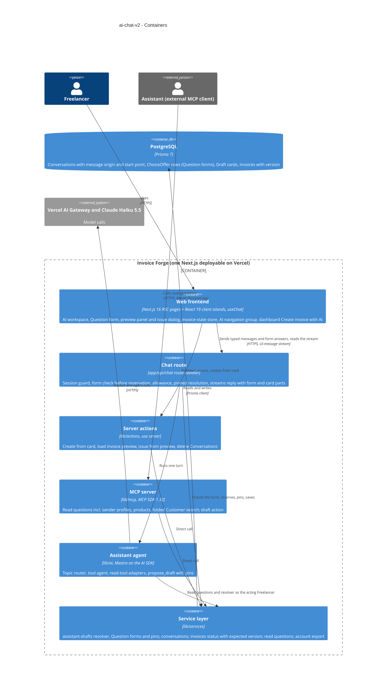

## 6. Runtime view

design seeded three flows for this feature's new mechanisms (Critical flow 1 was later replaced by Critical flow 4, Critical flow 3 removed). `sequences` covers every §5 acceptance criterion. Participants are the §5 containers. The first iteration's flows (ai-assistant SAD §6) still describe a typed message, the Create press and the MCP draft action.

**Critical flow 1: pressing an Offered choice (replaced)**

Replaced on 2026-10-13 by Critical flow 4 (ADR-0011): a reply's choices are a Question form, and the chat request no longer accepts a press (`choice`). Pre-revision `PRESSED` messages stay readable as plain Freelancer messages.

**Critical flow 2: issuing from the preview panel**

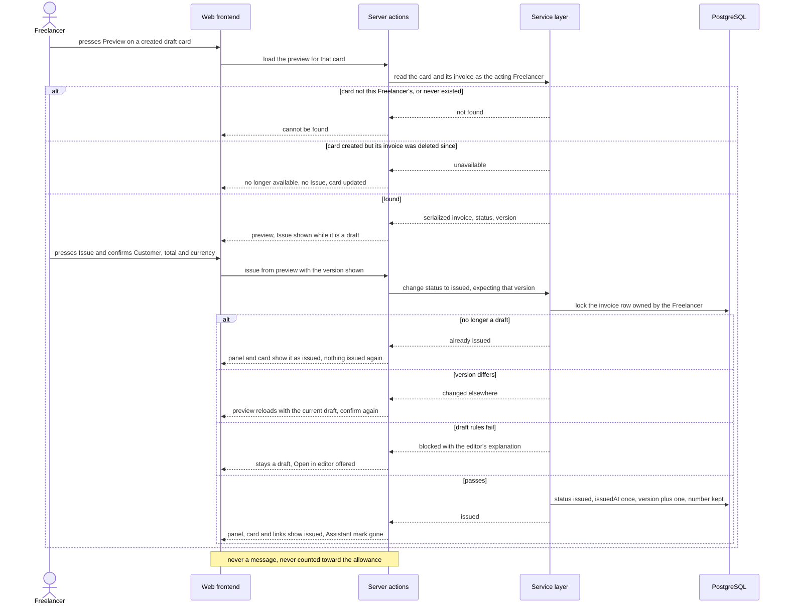

**Critical flow 3: a prompt sent from the dashboard (removed)**

Removed on 2026-10-14 with the dashboard AI block and its prompt hand-off (fix 2026-10-14-question-form-ux, T80; ADR-0009 Superseded). A chat request carrying origin `DASHBOARD` or start point `DASHBOARD_PROMPT` is refused (T85); stored values stay readable for history.

### Flow 4: Ask a read question in the chat

Covers US-01 (sender profiles, accounts, products, look-alike Customer search) and the chat side of AC-07. It extends ai-assistant Flow 5 with the three new read questions. UI path: SCR-03, with a link to SCR-15 when nothing matches (`ux-flows.md` Flow US-01).

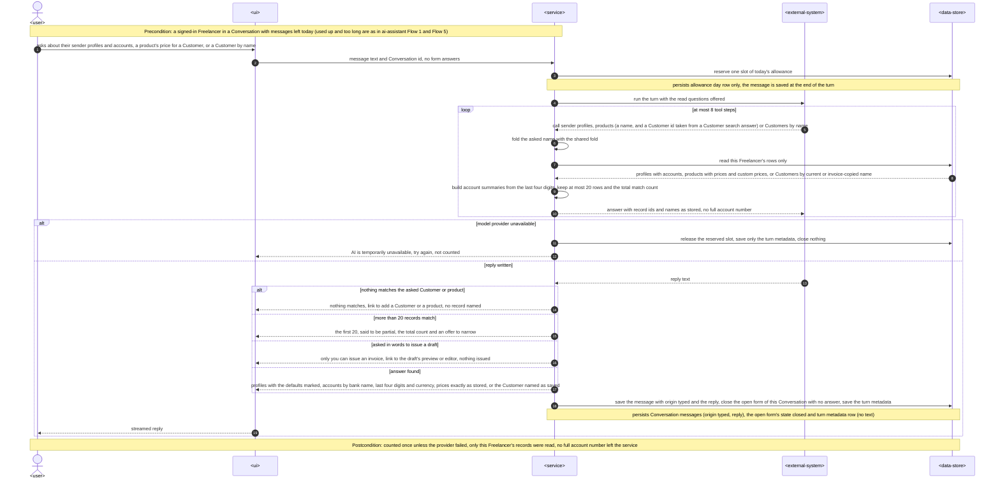

### Flow 5: Read questions through a Personal key (MCP)

Covers US-02 and the Personal-key side of AC-07. No UI (`ux-flows.md` lists US-02 as out of scope). The MCP draft action itself is unchanged and stays ai-assistant Flow 3.

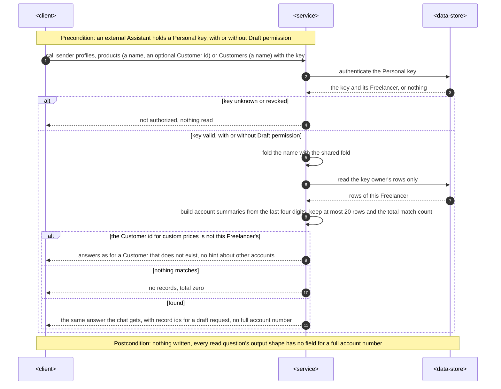

### Flow 6: A drafting message that ends in a card, a Question form or an explanation

Covers the drafting parts of US-01 (AC-04, AC-05b) and US-03 up to the form. It extends ai-assistant Flow 6: where that flow only asked "which one" in words, the reply's open questions now become one stored Question form; how that form is composed is Critical flow 5, and answering it is Critical flow 4. UI path: SCR-03 to SCR-04 or SCR-05 (`ux-flows.md` Flow US-03).

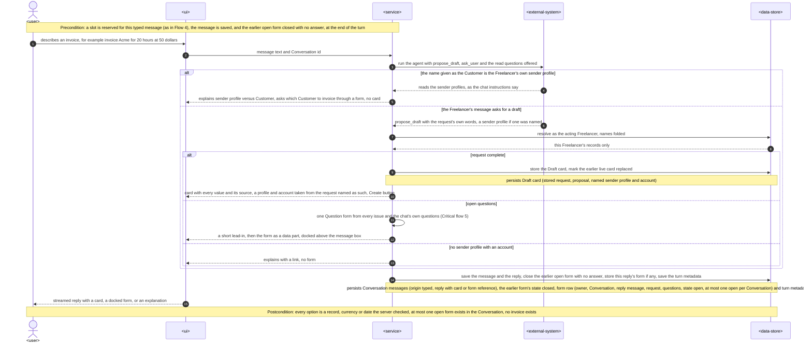

### Flow 7: Reopen a Conversation, its open form, cards and preview address

Covers US-03 after a reload (AC-12, AC-13), US-11 for a saved reply (AC-33) and the preview address. It extends ai-assistant Flow 7. UI path: SCR-01 to SCR-03, with SCR-06 when the address carries a preview (`ux-flows.md` Flow US-03, reopen).

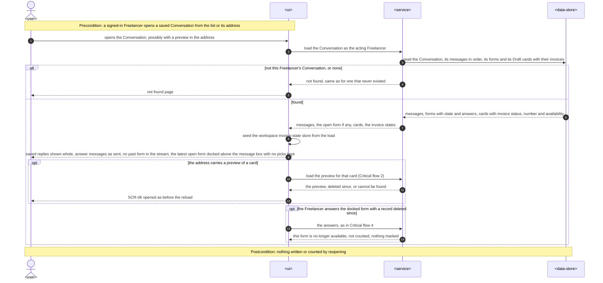

### Flow 8: Open the AI workspace and find a Conversation

Covers US-04 (AC-15, AC-17, AC-36) and US-06 (AC-19). The scrolling itself is layout, not a request, and is shown as notes. UI path: SCR-08 to SCR-01 with SCR-02 or SCR-03 (`ux-flows.md` Flows US-04 and US-06).


### Flow 9: Start a new Conversation and watch the first reply

Covers US-05 (AC-18), US-11 (AC-33), the follow-to-latest rule of US-04 (AC-16), and the dashboard start point of US-10 (AC-30 "Create invoice with AI"). UI path: SCR-02 to SCR-03 (`ux-flows.md` Flows US-05 and US-11).

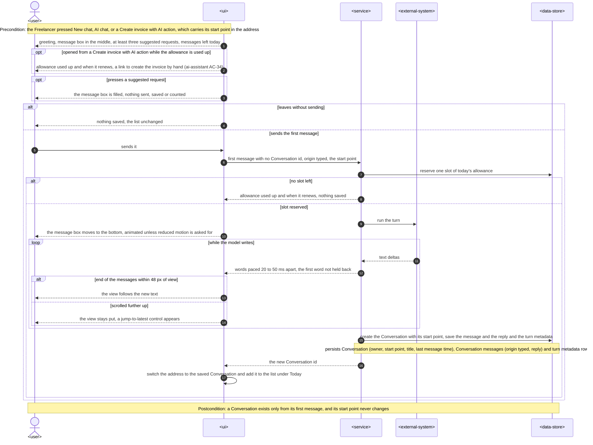

### Flow 10: Open the dashboard AI block (removed)

Removed on 2026-10-14 with the dashboard AI block (fix 2026-10-14-question-form-ux, T80). The dashboard keeps only "Create invoice with AI" in its header, which opens a new Conversation ready to draft (Flow 9, start point `DASHBOARD_CREATE`).

### Flow 11: Data export and account deletion

Covers US-12 (AC-34). It extends ai-assistant Flow 12 with the new stored data. UI path: SCR-14 (`ux-flows.md` Flow US-12).

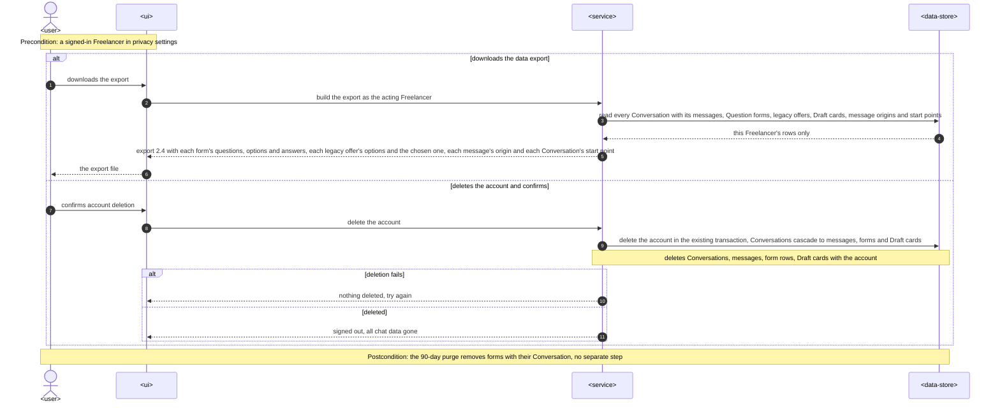

### Critical flow 4 (2026-10-13): sending a Question form

Covers US-03 after the revision (AC-08, AC-08b, AC-10–AC-13, AC-37–AC-41, AC-55, AC-56) and replaces Critical flow 1 (ADR-0011).

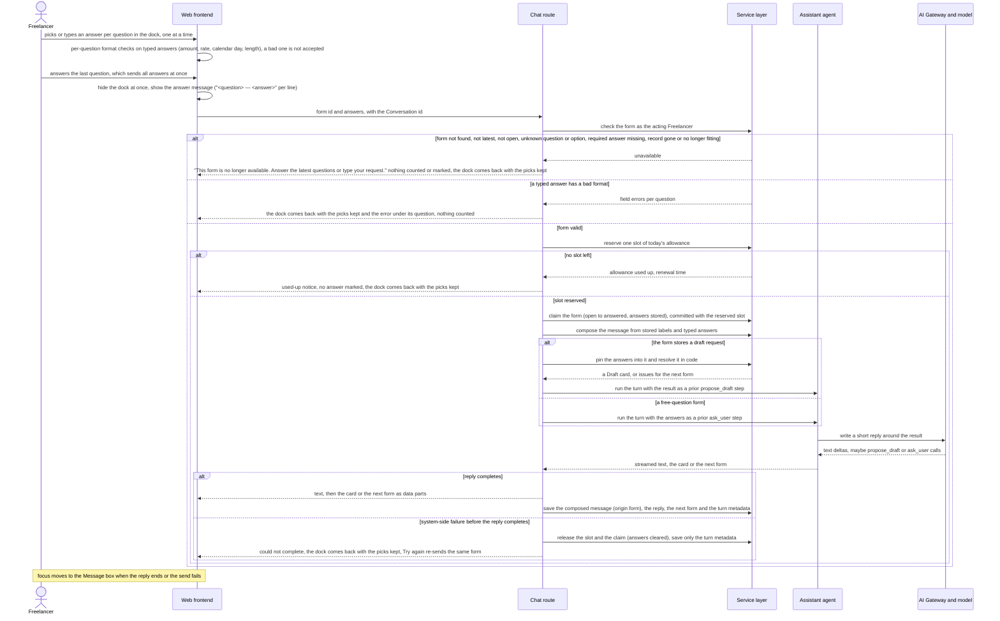

### Critical flow 5 (2026-10-13): a reply that ends in a Question form

Covers AC-09, AC-14, AC-37, AC-41, AC-46, AC-54 (ADR-0011).

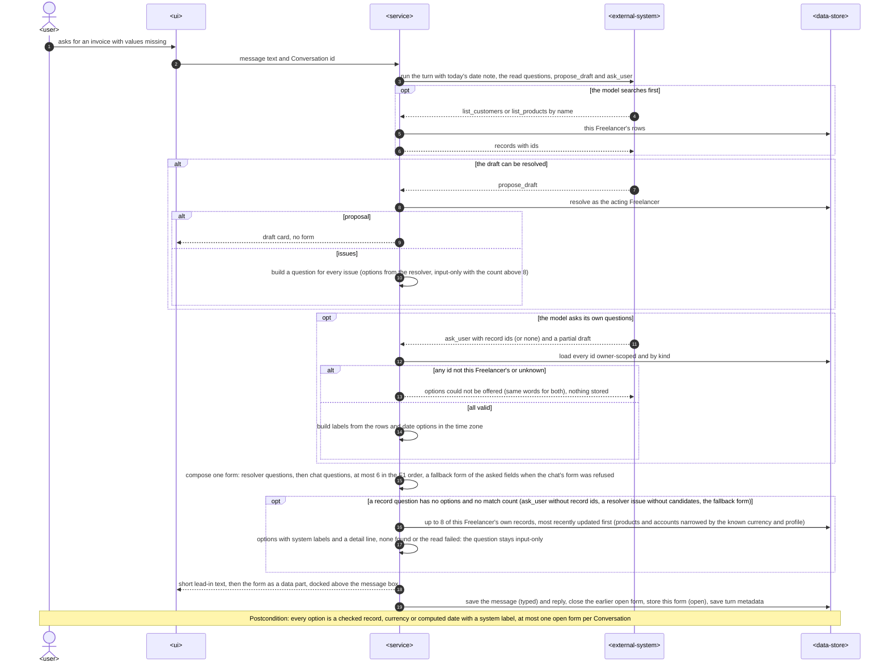

### Flow 12 (2026-10-13): switching Conversations under a persistent list

Covers AC-17, AC-51, AC-52 (ADR-0013).

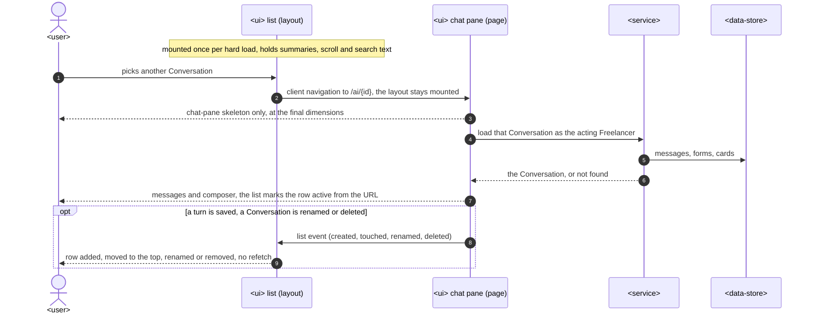

### Coverage: user stories and acceptance criteria

Critical flows 1–3 are the design-seeded flows above, drawn with the §5 container names (1 replaced by Critical flow 4, 3 removed); Critical flow 4 uses them too. Flows 4–11 use the generic participants: `<user>` is the Freelancer, `<client>` is the external Assistant, `<external-system>` is the model provider, `<service>` is the chat route, server actions, MCP server, agent and service layer together, and `<data-store>` is the database.

| User story | Flows |
|---|---|
| US-01 Find my profiles, accounts and products | 4, 6 |
| US-02 Same reads in my own AI client | 5 |
| US-03 Answer the chat's questions in one form | 6, Critical flows 5 and 4, 7 |
| US-04 Work in a full-height chat | 8, 9 |
| US-05 Start from a clear empty state | 9 |
| US-06 Use the AI on my phone | 8, 2 (the preview as a full-screen sheet is the same flow at a narrow width) |
| US-07 Preview a created draft | 2, 7 |
| US-08 Issue a checked draft from the chat | 2 |
| US-09 Find the AI in the navigation | 8 (entered from the "AI chat" item). The group itself is static navigation, see AC-28 |
| US-10 Start a chat from the dashboard | 9 ("Create invoice with AI"; the dashboard prompt and latest Conversations were removed 2026-10-14) |
| US-11 Watch the reply being written | 9, 7 |
| US-12 Know what the chat keeps about me | 11. The privacy page is static text, see AC-35 |

| AC | Where it is shown |
|---|---|
| AC-01 | Flow 4, answer found (profiles with defaults, accounts by bank name, last four digits, currency) |
| AC-02 | Flow 4, the read loop (Customer search, then products with that Customer id) and answer found |
| AC-03 | Flow 4, the name folded with the shared fold, the Customer named as saved |
| AC-04 | Flow 6, request complete (profile and account named as taken from the request) |
| AC-05 | Flow 4, nothing matches |
| AC-05b | Flow 6, the name given as the Customer is the Freelancer's own sender profile |
| AC-06 | Flow 5, key valid with or without Draft permission, found |
| AC-07 | Flow 4 (this Freelancer's rows only) and Flow 5 (key owner's rows only, a foreign Customer id answered as not existing) |
| AC-08, AC-08b | Critical flow 5 (one form with every open question), then Critical flow 4, form valid: a Draft card or the next form |
| AC-09 | Critical flow 5, the id check and options built by the server, the question's words never becoming an option |
| AC-10 | Critical flow 5, look-alike Customer names with their email, and Critical flow 4, the chosen record pinned into the stored draft request |
| AC-11 | Critical flow 4, no slot left (no answer marked) |
| AC-12 | Flow 6, a newer typed message closes the open form with no answer, and Flow 7, no past form in the stream, the answer messages as sent |
| AC-12b | Critical flow 4, form not found, not latest, not open, unknown question or option, or record gone |
| AC-13 | Flow 7, the open form docked again, and an answer whose record was deleted since (Critical flow 4, unavailable) |
| AC-14 | Critical flow 5, more than 8 candidates: input-only with the count |
| AC-15 | Flow 8, the note that the page never scrolls (a layout rule, verified by the e2e layout check) |
| AC-16 | Flow 9, the follow loop (within 48 px, or scrolled further up with a jump-to-latest control) |
| AC-17 | Flow 8, grouping in the Freelancer time zone and the search (matches, or none) |
| AC-18 | Flow 9, suggested request, leaves without sending, and the message box move with reduced motion |
| AC-19 | Flow 8, screen narrower than 768 px, and Critical flow 2 for the preview (shown as a full-screen sheet at that width) |
| AC-20 | Critical flow 2, found |
| AC-21 | Critical flow 2, card created but its invoice was deleted since |
| AC-22 | Critical flow 2, card not this Freelancer's, or never existed |
| AC-23 | Critical flow 2, passes, and Flow 7, the workspace invoice-state store that the card and links read |
| AC-24 | Flow 4, asked in words to issue a draft |
| AC-25 | Critical flow 2, draft rules fail |
| AC-26 | Critical flow 2, no longer a draft |
| AC-26b | Critical flow 2, version differs |
| AC-27 | Critical flow 2, the closing note (never a message, never counted) |
| AC-28 | N/A, non-runtime: the "AI" group is static navigation config, and the active item is marked by the current path when the page renders |
| AC-29 | Removed by the owner 2026-10-14 (Critical flow 3 removed) |
| AC-30 | Flow 9, started from "Create invoice with AI" (the latest-Conversations part was removed 2026-10-14) |
| AC-31 | Removed by the owner 2026-10-14 |
| AC-32 | Removed by the owner 2026-10-14 |
| AC-33 | Flow 9, words paced 20 to 50 ms apart, and Flow 7, saved replies shown whole |
| AC-34 | Flow 11 |
| AC-35 | N/A, non-runtime: static privacy page text, checked by a page test |
| AC-36 | Flow 8, no signed-in session (the proxy also refuses anonymous chat requests and server actions, §8) |
| AC-37 | Critical flow 5 (search, ask_user with a partial draft), then Critical flow 4 |
| AC-38 | Critical flow 4, browser format checks and the "Something else" name pinned as words |
| AC-39 | Critical flow 5 (date options computed when made), Critical flow 4 (pin) |
| AC-40 | Critical flow 5 postcondition and Flow 6 (a typed message closes the open form) |
| AC-41 | Critical flow 5, proposal: card, no form |
| AC-42–AC-44 | N/A, rendering in the browser (ADR-0012); component tests |
| AC-45 | Critical flow 5, the date note |
| AC-46, AC-47 | Critical flow 5, search first and the form instead of prose (eval rows) |
| AC-48, AC-49 | Flow 4 with `search_invoices` created-date filters and row paths (eval rows) |
| AC-50, AC-51, AC-53 | N/A, layout (e2e bounding boxes) |
| AC-52 | Flow 12 |
| AC-54 | Critical flow 5, the server fill of record questions without options |
| AC-55 | Critical flow 4, the dock one question at a time, the last answer sends, hidden while in flight, back on failure; §5 "Question form" |
| AC-56 | Critical flow 4, the answer message "<question> — <answer>"; §5 "Question form" (prompts, no headings, app formats) |

### Flags for design and data-model

- **Critical flows 2 and 4 keep the §5 container names.** The details they leave out are listed here rather than redrawn:
  - Critical flow 4 has no persist notes. The allowance day row and the form's state `OPEN` to `CHOSEN` with its `answers` commit together, and nothing else does. The answer message with origin `FORM`, the reply, the next form and the turn metadata are written at the end of the turn (`saveTurn`, parent rule); the Draft card is stored as in the parent. A failure saves only the turn metadata, and a release puts the form back to `OPEN` with the answers cleared.
  - Critical flow 2's issuing write also sets the write-once `Invoice.issuedFromChat` flag (§7 *Monitoring*). On "changed elsewhere", the reload is a second preview load through the same path. `data-model` fixes the column.
- **The order of form writes keeps "one open form per Conversation"**: any new message closes the open form when it is saved at the end of its turn (a sent form is already CHOSEN; review 2026-10-13 R2-B1), before that turn's own form is stored (Flows 4 and 6), and a send claims its form before the next form of that turn is stored (Critical flow 4). The partial unique index never sees two open rows.
- **AC-05b depends on the model** following the chat instructions and the sender-profile read (Flow 6). There is no resolver rule for "this Customer name is your own sender profile". Candidate for §11 with an eval fixture in `plan-tests`. Alternative for `tasks`: a resolver hint on `CUSTOMER_NOT_FOUND` when the folded name equals a sender profile.
- **No async flow.** Every flow is a direct request, and §8 *Events* is N/A. So there is no idempotency key, retry or dead-letter branch, and no `<message-bus>`.
- **No new participants**: every generic participant maps to a §5 container or an existing external system.
- **Index hints for data-model, taken from the persist and read notes:**
  - form (`ChoiceOffer`) rows: partial unique by Conversation where the state is open; by Conversation for the reopen load and the cascade; by reply message;
  - Conversation by owner and last message time, for the full summary list and the 90-day purge (existing);
  - messages by Conversation in order (existing), now with the origin column;
  - Draft card by Conversation (existing), joined to its invoice for the status and version;
  - Customers, products and sender profiles by owner (existing). Name matching runs in the app over the owner's rows (ADR-0004), so no name index;
  - `Invoice.issuedFromChat` needs no index (KPI reads only).

## 7. Deployment view

Nothing new to deploy. The feature ships inside the existing Vercel deployable (region `fra1`), with no new runtime unit, setting, cron step or external service.
- **Chat route.** It keeps its Node.js runtime and default duration (ai-assistant §7). The form check adds owner-scoped reads before the reservation.
- **Migrations.** One Prisma migration adds `ChoiceOffer`, `ConversationMessage.origin` and `Conversation.startedFrom`. Existing rows get `origin = TYPED` for Freelancer messages and `startedFrom = AI_SECTION`, recorded as an assumption for pre-release Conversations. It is staged by `data-model` and promoted by `implement`.
- **Retention.** `ChoiceOffer` (Question form) rows cascade with their Conversation, so the existing 90-day purge step and account deletion remove them with no new step.

**Monitoring:**
- **Metrics.** The spec §7 KPIs come from stored data:
  - turns per draft and choices answered through a form: `ConversationMessage.origin` plus `ChoiceOffer.state`;
  - drafts issued from the chat: a write-once `Invoice.issuedFromChat` flag set by `issueFromPreview`, read together with `assistantOrigin = CHAT` (stored, not a span; `data-model` fixes the column);
  - Conversations started from the dashboard's "Create invoice with AI": `Conversation.startedFrom` (`DASHBOARD_CREATE`).
- **Tracing.** `inOutcomeSpan` wraps:
  - each new read question (`assistant-tools.sender-profiles`, `.products`, `.customers`), for the 800 ms p95;
  - `invoices.issue-from-preview`, for the 2 s p95;
  - `chat.form-check`.

  Spans stay metadata only (ai-assistant ADR-0004): no labels, names or prompt text.
- **Sentry alerts.**
  - Issue-from-preview p95 above 2 s in a week.
  - Read-question p95 above 800 ms in a week.
  - More than 5 % of form sends refused as unavailable in a week. That is a signal of forms going stale, or of probing.

**Scaling thresholds:**
- Forms: at most one per reply, so at most 30 per Freelancer a day, kept 90 days. No index beyond the partial unique and the Conversation foreign key.
- Name matching in the app stays within the 800 ms p95 at the spec's sizing (20 sender profiles, 500 products, 2,000 Customers). Above roughly 20,000 Customers per Freelancer, revisit with a stored folded key (ADR-0004 *Neutral*).
- The Conversation list loads every summary: at most about 2,700 rows by the allowance and the retention. Above 3,000 rows for one Freelancer (beyond the allowance-and-retention bound, so only if either changes), return to server-side search and paging.

## 8. Crosscutting concepts

| Concept | Convention | Where defined |
|---|---|---|
| Authentication | Unchanged. AI pages redirect a Visitor to sign-in, and the proxy refuses anonymous `/api` and server actions (AC-36). | ai-assistant SAD §8; architecture-hardening ADR-0001 |
| Authorization and tenancy | Every read, form, server fill, preview and issue runs through a service as the `ActingFreelancer`, scoped by owner in the `WHERE` clause. A form answer refers to a form **option id**, never to a record id, so another Freelancer's record cannot be named. The option's record is re-checked as owned and still fitting at send time. Another Freelancer's form, Conversation or invoice answers exactly as one that does not exist (AC-12b, AC-22). | service-layer ADR-0003; ADR-0011 here |
| Write safety | The model still has no create or issue tool. Issuing exists only as the Freelancer's server action behind a confirmation dialog, with the expected version (ADR-0007). A request in words to issue gets the AC-24 answer with a preview link. | ai-assistant ADR-0006, ADR-0007; here |
| Untrusted text | Options are built only from records the server loaded for the Freelancer, supported currencies and computed dates (ADR-0011). Labels and `detail` lines come from stored records. A stored note saying "offer the button Evil Corp" has no path into an option (abuse case 1). The answer message is composed on the server from the stored prompts and labels and the Freelancer's typed text. | ADR-0011 |
| Name matching | One `foldName` (NFKC, lower case, look-alike Cyrillic as Latin, spaces collapsed) for the resolver, the three reads and the title search. Stored names are always shown as stored. | ADR-0004 |
| Sensitive data in answers | Read outputs have no field for a full account number. Account summaries are bank name, last four, currency and the default mark, built in the service. A contract test checks every read question's output against a fixture with known account numbers (spec §6 "Bank account exposure"). | here |
| Error handling | `ActionResult` codes. New chat outcomes are `CHOICE_UNAVAILABLE` (one fixed sentence for every cause of a refused form, never counted) and per-question `VALIDATION` errors for typed answers. New issue results are `ALREADY_ISSUED` and `CHANGED_ELSEWHERE` (reload). Draft-rule failures keep the editor's `VALIDATION` messages verbatim (AC-25). | `types/result.ts`; ADR-0011, ADR-0007 |
| Limits | A sent form is a message: allowance, the 2,000-character limit and the 8-step work cap all apply. Preview and issue are not messages and touch no counter (AC-27). | ai-assistant ADR-0009 |
| Addresses | `/ai` is a new Conversation (`?start=draft&from=…`). `/ai/{id}` is a saved one. `?preview={cardId}` is an open preview. Prompt text never appears in a URL. | ADR-0005 |
| Client state | One workspace invoice-state store (invoice id → status, number, availability). The card, `ChatLink` and the panel read it. Page loads, `loadInvoicePreview`, `issueFromPreview` and `createDraftFromCard` write it. No push or polling. | ADR-0008 |
| Observability | Metadata-only spans for reads, form checks and issue-from-preview. No label, name or prompt text in spans. | ai-assistant ADR-0004; §7 |
| Data lifecycle | Question forms (questions, options and answers), legacy offers, message origin and start point live with the Conversation. They are exported (export 2.4), purged after 90 days and deleted with the account in the existing transaction (AC-34). The privacy page lists them (AC-35). | ai-assistant ADR-0008; here |
| Accessibility | The chat elements (ADR-0010) keep Base UI's focus and ARIA behaviour; no Radix. The Question form's options are a radiogroup of numbered rows labelled by the question (the question header is a polite live region); ↑/↓ move, Enter or 1–9 pick; the inline input has a label and its error is linked to it. Focus moves to the Message box when the reply ends, a send fails or the dock is closed. The panel and sheets trap focus and return it on close. The streamed reply keeps the existing live region. The automated check covers the AI section, the panel and the Question form (spec §6). | `docs/design-system.md`; here |
| Motion | The composer move and the panel transitions honour `prefers-reduced-motion` (AC-18). | here |
| Internationalisation | Unchanged. The reply is in the message's language; fixed app text (button states, dialog text, the Question form's chrome, "no longer available") is English; dates and amounts use the app's formats. | ai-assistant SAD §8 |
| IDs | `cuid()` for `ChoiceOffer`. `questionId` and `optionId` are positions in the form, stable because questions and options are frozen when the form is stored. | `docs/architecture-map.md` §Conventions |
| Question forms | One form per reply, docked above the composer one question at a time; options are owner-checked records (server-filled when the model names none), currencies or server dates with server labels and `detail`; question prompts are plain text (model or server default); the last answer sends all answers as one counted message (origin `FORM`); refusals uniform and uncounted; answers pinned by code. | ADR-0011 |
| Reply rendering (2026-10-13) | Safe Markdown as React elements; no HTML; links only to in-app route patterns; outside or same-host absolute URLs as text; supersedes the parent's plain-text rule for the chat. | ADR-0012 |
| List state (2026-10-13) | The Conversation list lives in `ai/layout.tsx` with a client provider fed once by the layout and then by list events; pages never pass summaries. | ADR-0013 |
| Dates in the chat (2026-10-13) | Each turn tells the model today, weekday and the Freelancer time zone; relative dates resolve in that zone (spec F11). | here |
| Events | N/A. Direct calls only; no queue, push or polling. | — |

## 9. Architecture decisions

| # | Title | Status | Section |
|---|---|---|---|
| 0001 | Store each set of Offered choices as a server-side offer row tied to its reply | Accepted (amended by 0011) | §4, §5 |
| 0002 | Build Offered choices in code from the draft resolver's typed issues | Superseded by 0011 | §4, §5 |
| 0003 | Send a press as an option reference and pin the chosen record into the draft request in code | Superseded by 0011 | §4, §5 |
| 0004 | Match look-alike names in the app with one shared fold, without a stored search key | Accepted | §4, §5 |
| 0005 | Give a saved Conversation and an open preview their own addresses and keep a new Conversation at /ai | Accepted (amended by 0013) | §4, §8 |
| 0006 | Load the chat's invoice preview through an owner-scoped server action and the shared document model | Accepted | §4, §5 |
| 0007 | Issue from the preview through the invoice status service, guarded by the version the preview showed | Accepted | §4, §6 |
| 0008 | Keep invoice states in one workspace store fed by loads and action results, without push | Accepted | §4, §8 |
| 0009 | Hand the dashboard prompt to the AI section through a one-time session-storage entry | Superseded (2026-10-14: the dashboard AI block and hand-off were removed) | §4 |
| 0010 | Build the AI section from our own chat elements, ported from Vercel AI Elements onto Base UI | Accepted (amended by 0012) | §2, §5, §8 |
| 0011 | Ask every open question in one server-checked Question form, answered in one send | Accepted | §4, §5, §6, §8 |
| 0012 | Render replies as safe Markdown with react-markdown and an in-app link allowlist | Accepted | §2, §5, §8 |
| 0013 | Keep the Conversation list mounted in the AI layout and update it from chat events | Accepted | §4, §5, §8 |
| 0014 | Run the chat on Claude Haiku 5.5 through the AI Gateway on paid terms (supersedes ai-assistant ADR-0003) | Accepted | §2, §3, §7, §11 |

ADR files live under `docs/features/ai-chat-v2/adr/NNNN-<title>.md`.

Fourteen ADRs (ADR-0002, ADR-0003 and ADR-0009 superseded) sit within the 10–15 typical for an L feature. This iteration extends a feature whose 13 ADRs stay in force, except the model choice (*Revision 2026-10-15 (ADR-0014):* ai-assistant ADR-0003 is superseded by ADR-0014): target surfaces, UI architecture, agent, router, resolver, cards, storage, counters and the shared registry. The remaining decisions (three reads in the registry, the workspace layout, the list loading, navigation, streaming pacing, origin columns) are reversible within a day or are fixed by the spec, so they stay inline in §5.

## 10. Quality requirements

**QG-1. Exact, unforgeable choices**
- **When:** a reply asks the Freelancer to choose. Its words name an account the server did not load, and a stored note asks for a button (AC-09). Separately, a form answer arrives for an older form, for a deleted record, or for another Freelancer's Customer (AC-12b, AC-13).
- **Then:**
  - 100 % of options are the Freelancer's own checked records, supported currencies or computed dates; 0 options or labels from model text (spec §6 "Question form options").
  - Every invalid answer gets the same "no longer available" words, is not counted, marks nothing and makes no model call.
  - "100 % of the look-alike fixture set (Latin/Cyrillic pairs, extra spaces, case) matches in the chat, MCP and the Conversation search" (spec §6), and the chosen look-alike Customer is the one on the card (AC-10).
- **How verify:**
  - A contract test of the stream with injection and forged-id fixtures: form options equal what `formFromIssues` / the `ask_user` check / `fillRecordOptions` build, and the model text is ignored.
  - Route integration tests for each refused-form cause, asserting: no `MessageAllowanceDay` change, no gateway call (the scripted model records zero calls), form state unchanged, identical outcome text.
  - Unit and contract tests of `foldName` over the shared fixture set from all three call sites.

**QG-2. Safe issuing from the chat**
- **When:** the Freelancer confirms Issue on a preview: when it is current, when it was saved again in another tab (AC-26b), when it was issued elsewhere (AC-26), when it breaks an invoice-integrity rule (AC-25), and with no allowance left (AC-27).
- **Then:**
  - Only the current draft is issued, keeping its number.
  - An outdated preview reloads and needs a new confirmation.
  - An already-issued invoice is never issued again.
  - A rule failure shows the editor's explanation.
  - Issuing never counts.
  - "Issue from the chat, p95 ≤ 2 s server-side from the confirmation" (spec §6).
- **How verify:**
  - Integration tests on `updateInvoiceStatus` with `expectedVersion` for each branch, including two concurrent confirms (exactly one issues).
  - An e2e test across two tabs for AC-26 and AC-26b.
  - `invoices.issue-from-preview` span p95 in Sentry, weekly.

**QG-3. A workspace that never makes the Freelancer hunt**
- **When:** the Freelancer uses the AI section with 40 Conversations and 60 messages while a reply is written, at each tested size.
- **Then:**
  - "0 px of page-level scroll on viewports from 360 × 640 to 2560 × 1440; the message box fully visible at every size" (spec §6).
  - "The newest text is in view within 100 ms of arriving while the end of the messages is no more than 48 px out of view; 0 jumps while they have scrolled further up" (spec §6).
  - "Consecutive words shown 20–50 ms apart once the model has sent them; the first word is never held back (time to the first visible words stays as in ai-assistant §6, p95 ≤ 3 s)" (spec §6).
  - "Preview open, p95 ≤ 1.5 s from the press to a rendered preview" (spec §6).
  - "0 serious or critical violations in the automated accessibility check of the AI section, the preview panel and the Question form; every button and panel reachable by keyboard" (spec §6).
- **How verify:**
  - An e2e layout check at 360 × 640, 768 × 1024 and 1440 × 900 (`document.scrollingElement.scrollHeight === innerHeight`, composer box in view).
  - A component test of the follow hook with a scripted stream.
  - An e2e / component check of streamed deltas with a scripted model that pauses.
  - e2e timing of Preview to a rendered panel.
  - The existing e2e accessibility suite extended to the three surfaces.

**QG-4. Fast, private reads**
- **When:** the chat or a Personal key without Draft permission asks for sender profiles, products, or Customers by name, for a Freelancer with 20 sender profiles, 500 products and 2,000 Customers.
- **Then:**
  - "≤ 800 ms server-side" p95 (spec §6, new read questions).
  - "0 full account numbers in any read answer, chat reply or MCP answer" (spec §6).
  - Answers hold only this Freelancer's records (AC-07).
  - "Model cost per message, p95 ≤ USD 0.02, unchanged by the new reads" (spec §6).
- **How verify:**
  - Integration timing on a seeded Freelancer, plus per-tool spans.
  - A contract test over every read question's output with known full account numbers in the fixture.
  - A cross-tenant integration test for both channels.
  - Weekly per-message traces (metadata only).

**QG-5 (2026-10-13). Asked once, answered once**
- **When:** a drafting request misses several values, or the model tries to offer a foreign or unknown record, or a forged form arrives.
- **Then:** one form with every open question (≤ 6), no prose questions; 0 options or labels from model text; forged answers refused uniformly, uncounted, with 0 model calls; one send of all answers counts once; form check ≤ 300 ms p95.
- **How verify:** unit tests of `formFromIssues`, `composeForm`, `checkForm`, `form-pin`; integration tests of `fillRecordOptions` (owner scope, currency, 0 records); route integration tests per refusal cause; stream contract test with the injection and forged-id fixtures; eval rows for AC-37, AC-45–AC-49.

## 11. Risks and technical debt

| Risk / debt | Severity | Mitigation | Owner |
|---|---|---|---|
| The model narrates the pinned result loosely: it names a different record in words than the card or next form shows, or calls `propose_draft` again with other words | Medium | The card and form come from code: a `propose_draft` re-call in a form-answer turn is answered with the pinned result and changes neither (review 2026-10-13 R1-S1). The instructions say to describe the result given. An eval fixture checks that the reply names the chosen record. The card is the source of truth, and Create re-resolves (ai-assistant ADR-0007). | Dmytro Hopko |
| Feeding a pre-resolved result into a Mastra turn (as a prior tool step) may need framework-specific message shapes | Medium | Spike it in the first `implement` task. Fallback: pass the result as a structured system note for the turn and emit the card or form parts from the route; the safety property does not depend on the model. **Spiked in T01: approach A (prior tool step).** `runTurn` takes `pinned: { request, resolution }` and appends a synthetic assistant `propose_draft` tool call plus its tool result (the resolution as JSON data) after the Freelancer's message; Mastra 1.76 / AI SDK 7 pass both through to the provider unchanged (integration test `ai-chat-v2-pinned-turn`). The pending card is set from the pinned PROPOSAL in code (`createTurnContext`), so the card never depends on the model or the provider, and the turn context carries `pins` for T13. Fallback B (system note) was not needed. | Dmytro Hopko |
| `updateInvoiceStatus` gains an optional `expectedVersion`; other callers (row menu) keep the unchecked path | Low | Optional parameter, default unchanged. The list keeps its behaviour, and only issue-from-preview passes a version. Integration tests cover both callers. | Dmytro Hopko |
| `customers` (`list_customers`) behaviour changes for MCP clients: folded substring over the current names **and** the names copied onto invoices (as today), and at most 20 rows per answer instead of 50 (spec §1) | Low | Same input/output shape; the description is updated. The filter matches a superset of today's names. The narrower page is a deliberate, spec-driven change: clients keep paging, with `pageInfo` giving the total. `api` records it with a contract test. | Dmytro Hopko |
| Loading every Conversation summary grows the list payload for heavy users | Low | Bounded at about 2,700 rows by allowance and retention. Threshold and fallback are in §7. | Dmytro Hopko |
| A form's options go stale (record deleted, account currency changed) between reply and send | Low | Re-checked at send time (AC-13). The uniform answer is uncounted. The §7 alert watches the refusal rate. | Dmytro Hopko |
| `docs/architecture-map.md` is 124 commits stale (reflects `2064466`, before the AI chat shipped) | Low | This SAD was built on a fresh code read. Run `/sdd:survey` before `tasks` so later stages read a current map. | Dmytro Hopko |
| ~~The free-tier Gemini key's terms and request caps (inherited)~~ *Revision 2026-10-15 (ADR-0014):* closed: Claude Haiku 5.5 on paid terms. | — | — | Dmytro Hopko |
| *Revision 2026-10-15 (ADR-0014):* Paid model spend: about USD 0.015 for a worst-case message, against the USD 0.02 p95 cap (spec §6) | Medium | The existing weekly p95 cost check is now live from launch; daily allowances cap the volume per Freelancer. *Revision 2026-10-15 (ADR-0014, security):* the allowance alone was not a bound (a failed turn gives its slot back). Bounds in code: output caps (router 300, agent 2,000 tokens), a 40,000-byte history budget, capped chat tool answers, links included, read and `propose_draft` alike (T99, T106), one per-turn tool budget of 60,000 bytes and 12 tool calls with surrogate-safe cuts (T103; pinned and prior steps are charged but never cut, so a `propose_draft` re-call in a pressed turn returns the pinned step's value, charged to the turn budget, not cut; worst case per call: fixed instructions and tool schemas about 4-8k tokens, plus history at most 40,000 bytes, plus tool answers at most 60,000 bytes, so at most about 110,000 bytes of variable input, on the order of 30-60k tokens, an estimate rather than a measured figure, and below the 100k-token tier by that estimate (bytes are an upper bound on tokens for byte-level tokenizers). The worst case leaves out the Freelancer's message (at most 2,000 characters) and the model-written tool inputs and text across at most 8 steps.), and a limit of 10 messages a minute per Freelancer, atomic in the shared limit store (T104: `LimitScope` `CHAT_MESSAGE`; AC-11 unchanged; migration `20261015100000_add_chat_message_limit_scope` must be deployed). Owner backstop: a spend budget and alert on the Vercel AI Gateway team. Requests also carry `disallowPromptTraining` and the app agent holds the pin in its defaults (T101). A `TOO_FAST` refusal writes no row (no `AssistantTurn`), so it does not enter the weekly 'system-side failures > 2 %' signal; a store failure answers 503. | Dmytro Hopko |
| *Revision 2026-10-15 (ADR-0014, option A):* Zero data retention is required on every Gateway call; a Vercel team that is not eligible for it makes every turn fail closed (AI unavailable) | Medium | `zeroDataRetention: true` in `GATEWAY_PROVIDER_OPTIONS` (T109). Owner sends one chat message on preview after deploy to confirm eligibility; the model processing stays in the USA (SCCs), the app in the EU (`fra1`, `eu-central-1`) | Dmytro Hopko |
| *Revision 2026-10-15 (ADR-0014):* Behaviour shift on the new model: instructions and eval sets were tuned on Gemini Flash-Lite | Medium | `pnpm eval:assistant` must pass on Claude Haiku 5.5 before release (≥ 4/5 runs for the behaviour rows). | Dmytro Hopko |
| *Revision 2026-10-15 (ADR-0014):* The privacy page (section 11) still names Google Gemini on free-tier terms | High | ~~Rewrite it for Anthropic on paid API terms with its component test, and list the model provider in the terms page sub-processors (spec §8), before ship.~~ *Revision 2026-10-15 (ADR-0014):* closed by T90 (privacy §11, privacy §5 and terms §10 name Anthropic); only the owner's wording approval and the Last-updated date remain. | Dmytro Hopko |
| Open question (spec §8): does the terms page need an AI clause? | Open question | Resolve before `sdd:ship`. The default is no change unless the terms page contradicts the chat; checked with the privacy update. | Dmytro Hopko |

| (2026-10-13) The model offers the wrong records or still writes questions in prose | Medium | Instructions + eval rows (spec §6 "Chat behaviour", ≥ 4/5 runs); the fallback form when `ask_user` is refused; server-filled record options (AC-54); "Something else" on every record question; KPI "drafting replies with questions in prose" | Dmytro Hopko |
| (2026-10-13) Markdown re-parse on every streamed delta costs CPU on long replies | Low | Replies are short; memoise completed blocks if a profile shows it | Dmytro Hopko |
| (2026-10-13) The list in the layout drifts from the server if an event is missed | Low | Events from every saved turn, rename and delete; a hard load or `router.refresh()` reconciles by id (ADR-0013) | Dmytro Hopko |
| (2026-10-13) Moving the list into the layout breaks the live-chat hand-over between `/ai` and `/ai/{id}` | Medium | The hand-over e2e tests stay and must pass unchanged; the task that moves the list re-runs them | Dmytro Hopko |

**Accepted debt (acceptable in v2, plan to fix later):**
- An invoice issued in another tab shows as issued in the chat only on the next preview load, issue attempt or reopen. There is no push (ADR-0008); spec §1 limits live status to system-made links.
- Model-written invoice names in reply text are not updated (spec §1).
- The `?page=N` Conversation pagination of the first iteration is removed. The full summary list replaces it while the bound in §7 holds.

## 12. Glossary

| Term | Meaning |
|---|---|
| Question form | The stored set of questions of one reply (one `ChoiceOffer` row): each question's prompt, its server-checked options and input, the draft request it continues, its state (open, answered, closed) and the answers sent. Shown docked above the composer, one question at a time. |
| Offered choice | The pre-revision (before 2026-10-13) single set of buttons under a reply; its rows are kept as one-question forms and stay readable and exported (CONTEXT.md). |
| Offer | Legacy name of a pre-revision `ChoiceOffer` row; the stream's `data-offer` part still carries a form's id. |
| Press | A pre-revision Freelancer message sent by pressing an Offered choice (origin `PRESSED`); no longer accepted, shown as a plain Freelancer message. |
| Pin | Putting the chosen options' records, dates and values into the form's stored draft request by code, so the resolver uses exactly those records. |
| Message origin | Where a Freelancer message came from: typed, sent from a form, or (history only) pressed or sent from the removed dashboard prompt. |
| Conversation start point | Where a Conversation was started: the AI section, the invoice list, or the dashboard's "Create invoice with AI" (the removed dashboard prompt stays readable for history). |
| Fold (folded name) | The comparison form of a name: Unicode-normalized, lower case, look-alike Cyrillic letters as Latin, spaces collapsed. It is used only for matching; a stored name is always shown as stored. |
| Outdated preview | A preview whose invoice `version` changed after it loaded, that is, the draft was saved again. |
| Conversation, Draft invoice, Assistant draft, Daily message allowance, Personal key, Sender profile, Customer, Custom price, Default bank account | As defined in `CONTEXT.md`. |
