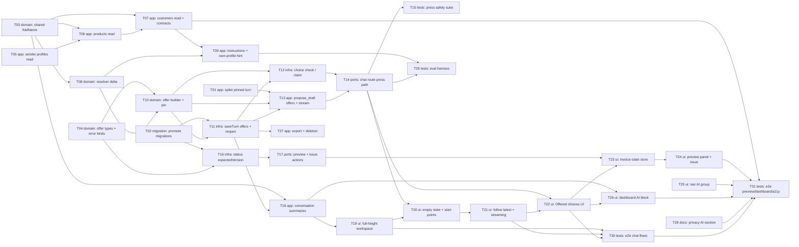

# Epic — ai-chat-v2

> **Spec:** [spec.md](../spec.md) · **Design:** [sad.md](../sad.md) · **Data model:** [data-model.md](../data-model.md) · **API:** [openapi.yaml](../contracts/openapi.yaml) + [server-actions.md](../contracts/server-actions.md) · **Screens:** [screens.md](../screens.md) · **Tests:** [test-plan.md](../test-plan.md) · **ADRs:** [adr/](../adr/)

## Goal

Ship the second iteration of the in-app AI chat without loosening any first-iteration rule (spec §2): the chat and MCP gain three reads (sender profiles with account summaries, products with Custom prices, a look-alike Customer search); every choice the draft action asks for becomes an Offered choice built in code and pressed as an exact, counted message; the AI section becomes a full-height workspace; a created draft can be previewed and issued from the chat under the editor's rules; and the AI is reachable from the navigation and the dashboard, with the privacy page and export covering what is stored.

## Scope

- **In:** `lib/assistant-tools` (3 reads), `lib/services/assistant-drafts` (resolver delta, offers, pins, own-profile hint), `lib/services/conversations` (origin, start point, offers, summaries), `lib/services/invoices` (expectedVersion, issuedFromChat), `lib/ai` (pinned turn, offers in `propose_draft`, instructions), `app/api/chat` (press path), `lib/actions/assistant-actions` (preview, issue), `components/ai` + `components/dashboard` + navigation config, privacy page, export, five staged migrations, eval harness, e2e.
- **Out (spec §3):** the AI issuing, sending, editing or deleting an invoice; editing a draft inside the chat panel; free-form buttons written by the model; full bank account numbers in any answer; rewriting the first iteration's documents.

## Execution order

Implementation runs **sequentially, in place, in id order** (T01 → T31; no worktrees). Every task's `deps` point only to smaller ids, so id order is a valid topological order. The `Wave` in each task file is the longest dependency chain, shown only to make the parallel branches visible (for example T25 and T28 have no dependency and could run any time).

## Task map

## Tasks

See [tracker.md](./tracker.md) for status. Machine contract: [tasks.json](../tasks.json).

| # | Task | Layer | Blocked by | DoD (short) |
|---|---|---|---|---|
| T01 | [Spike and build the run-turn seam that starts a chat turn from a pinned resolution](./t01-spike-pinned-turn-seam.md) | app | — | An integration test with the scripted model shows runTurn started from a pinned PROPOSAL returns that proposal as its pending card without a second … |
| T02 | [Promote staged migrations 01–05, apply the Prisma schema edits and extend the test factories](./t02-promote-migrations-and-factories.md) | migration | — | The five staged pairs are promoted in order into prisma/migrations, apply, backfill and revert cleanly on a throwaway testcontainers Postgres with no … |
| T03 | [Move foldName into an isomorphic shared helper with one look-alike fixture set](./t03-shared-fold-name.md) | domain | — | foldName lives in lib/helpers/fold-name.ts with no server-only import, every caller imports it from there, and a unit test over the shared look-alike … |
| T04 | [Add the offer, origin and start-point types and the CHOICE_UNAVAILABLE and ALREADY_ISSUED error details](./t04-shared-types-and-error-kinds.md) | domain | — | types/result.ts and types/assistant/types.ts export the new kinds and types, every exhaustive switch over ActionErrorDetails.kind handles … |
| T05 | [Add the list_sender_profiles read question for the chat and MCP, and fix the stale MCP read-only comment](./t05-sender-profiles-read.md) | app | — | list_sender_profiles is in READ_QUESTIONS for both channels, returns each profile with its default mark and account summaries (bank name, last four, … |
| T06 | [Add the list_products read question with prices per currency and a Customer's Custom prices](./t06-products-read.md) | app | T03, T05 | list_products answers a folded name filter with at most 20 rows plus the total, each figure exactly as stored, adds Custom prices only for a … |
| T07 | [Make list_customers look-alike aware with a 20-row page, and add the cross-read contract and timing tests](./t07-customers-read-folded-and-read-contracts.md) | app | T03, T06 | list_customers finds "Оohn  Doe" from "oohn doe" with its saved name, caps a page at 20 with pageInfo.total, a contract test walks every read … |
| T08 | [Extend the draft resolver: senderProfileId in the request and label fields on the issue candidates](./t08-resolver-request-and-candidate-delta.md) | domain | T03 | DraftRequest accepts senderProfileId (at most one of senderProfile and senderProfileId), Customer candidates carry email, bank-account candidates … |
| T09 | [Rewrite the chat instructions for the real reads and add the own-sender-profile hint on CUSTOMER_NOT_FOUND (AC-05b)](./t09-chat-instructions-and-own-profile-hint.md) | app | T07, T08 | The chat instructions name exactly the read questions in READ_QUESTIONS and state the sender-profile versus Customer rule, CUSTOMER_NOT_FOUND carries … |
| T10 | [Build Offered choices from resolver issues and pin a chosen option into a draft request](./t10-offer-builder-and-pin.md) | domain | T04, T08 | offerFromIssues maps issues to at most one offer in the order Customer, sender profile, currency, bank account, product, returns TOO_MANY above 8 and … |
| T11 | [Store a turn's offer, message origin and start point in saveTurn, close the open offer, and return offers on reopen](./t11-save-turn-offers-and-reopen.md) | infra | T02, T10 | saveTurn creates a Conversation with startedFrom on its first message, writes origin on the USER row and NULL on the reply, closes the open offer for … |
| T12 | [Check a pressed choice against the stored offer and claim or release it with the allowance slot](./t12-choice-check-claim-release.md) | infra | T10, T11 | checkChoice returns ok only for an OPEN offer of the acting Freelancer in that Conversation whose option exists and whose record still exists, is … |
| T13 | [Turn propose_draft issues into the reply's offer, apply the turn's pins, and stream the data-offer part](./t13-propose-draft-offers-and-stream-part.md) | app | T01, T10, T11 | A drafting turn whose resolver issue is offer-able returns a pending offer built by offerFromIssues, streams one data-offer part with only its … |
| T14 | [Accept choice, origin and startedFrom in the chat request and run the press path in the chat route](./t14-chat-route-press-path.md) | ports | T12, T13 | The chat route validates the new field combinations, refuses an invalid press with the one 409 CHOICE_UNAVAILABLE body before any reservation or … |
| T15 | [Prove the press safety properties: injection fixture, uniform refusals, concurrent claims, release on failure, metadata-only spans](./t15-press-safety-suite.md) | tests | T14 | A stream contract test with the injection fixture shows every data-offer equals the builder's output and no option comes from text, every … |
| T16 | [Guard updateInvoiceStatus with an optional expectedVersion and set issuedFromChat on that path](./t16-invoice-status-expected-version.md) | infra | T02, T04 | updateInvoiceStatus with expectedVersion returns CONFLICT ALREADY_ISSUED for a non-draft and CONFLICT CHANGED_ELSEWHERE for any version change under … |
| T17 | [Add the loadInvoicePreview and issueFromPreview server actions](./t17-preview-and-issue-actions.md) | ports | T16 | loadInvoicePreview returns AVAILABLE with the owner-scoped serialized invoice, version and state for a created card, UNAVAILABLE for a card whose … |
| T18 | [List every Conversation summary and the latest three, and add the grouping and title-search helpers](./t18-conversation-summaries-and-grouping.md) | app | T03, T11 | listConversationSummaries returns every owned Conversation newest first with the Freelancer time zone, listLatestConversations returns at most three, … |
| T19 | [Make the AI section a full-height workspace with a grouped, searchable Conversation list and phone sheets](./t19-full-height-workspace-and-list.md) | ui | T18 | The AI section renders in a viewport-height shell where only the list and the messages scroll, the list shows the four groups, the folded search, the … |
| T20 | [Redesign the empty Conversation start with suggested requests and the composer move, and send the start point](./t20-empty-state-and-start-points.md) | ui | T14, T19 | A new Conversation shows a centred greeting, the composer and at least four fixed suggested requests that only fill the box, the first send moves the … |
| T21 | [Follow new text within 48 px with a jump-to-latest control, and pin the word-by-word streaming](./t21-follow-latest-and-streamed-reply.md) | ui | T20 | A follow-to-latest hook treats an end no more than 48 px out of view as at the bottom, keeps the newest text in view within 100 ms of each delta … |
| T22 | [Render Offered choices under a reply and send a press from the chat island](./t22-offered-choices-ui.md) | ui | T14, T21 | OfferedChoices renders an OfferView's stored labels verbatim in a kind-labelled group with skeleton, pressable, pressing, chosen and inactive states, … |
| T23 | [Add the workspace invoice-state store and the Draft card Preview button](./t23-invoice-state-store-and-card-preview.md) | ui | T17, T22 | One InvoiceStateProvider seeded from the page load is applied by createDraftFromCard, loadInvoicePreview and issueFromPreview results, the created … |
| T24 | [Build the invoice preview panel and the issue confirmation for desktop and phone](./t24-invoice-preview-panel-and-issue-dialog.md) | ui | T23 | ?preview={cardId} opens InvoicePreviewPanel beside the messages from 768 px and as a full-screen sheet below, it renders every SCR-06 state from … |
| T25 | [Replace the single AI navigation item with an "AI" group holding AI chat and Connect your AI](./t25-navigation-ai-group.md) | ui | — | The navigation config holds an "AI" group between the main section and Management with "AI chat" (/ai) and "Connect your AI" (/settings/assistants), … |
| T26 | [Add the dashboard AI block with the prompt box hand-off, the latest Conversations and Create invoice with AI](./t26-dashboard-ai-block-and-handoff.md) | ui | T18, T22 | The dashboard shows the AI block with up to three latest Conversation links, All conversations, the prompt box validated by the chat message rule, … |
| T27 | [Cover offers, chosen options, message origins and start points in the data export and account deletion](./t27-export-and-account-deletion.md) | app | T11 | The export is version 2.3 and holds every Conversation's startedFrom, each message's origin and each reply's offer with its labels, state and chosen … |
| T28 | [Update the privacy page AI section for what the chat stores and shares, and check the terms page](./t28-privacy-page-ai-section.md) | docs | — | The privacy page's AI section states what is stored, the 90-day retention, the model provider through its gateway as the processor, and that reads … |
| T29 | [Extend the evaluation harness with explains and press fields, the own-profile-name setup and this feature's fixtures](./t29-eval-harness-extension.md) | tests | T09, T14 | The dataset type accepts optional explains and press fields and the own-profile-name setup, the harness replays a press through the route's press … |
| T30 | [Add e2e-through-UI tests for presses, reopen, full-height layout, empty start, phone sheets and streaming](./t30-e2e-chat-flows.md) | tests | T19, T21, T22 | Playwright tests against a throwaway database with the scripted model show a Customer press ending in the right card, a reopened Conversation with … |
| T31 | [Add e2e tests for preview and issue (two tabs), navigation, dashboard prompt, privacy, MCP reads and accessibility](./t31-e2e-preview-dashboard-nav-a11y.md) | tests | T07, T24, T25, T26, T28, T30 | Playwright and outside-caller tests show the preview opens beside the messages within 1.5 s, issuing updates panel, card and links, the two-tab … |

## Decisions

Taken at the tasks stage for the owner (autonomous run, 2026-10-13); the owner can veto any line.

- **D-1 — AC-05b: resolver hint plus eval fixture.** `CUSTOMER_NOT_FOUND` gains an optional `ownSenderProfile { senderProfileId, name }` when the folded written name equals one of the Freelancer's sender profile names; `issuesText` explains the difference and asks which Customer, and no "Add a Customer" link is added (T09). The eval rows from test-plan.md stay as the regression guard (T29). Why: sad.md §6 Flags names this alternative for `tasks`; the issue text is already deterministic code, so the explanation no longer depends on the model alone; the change is additive in `DraftIssueDelta` and matches the test plan's integration row (not found, no card, no offer).
- **D-2 — Spike first.** T01 de-risks sad.md §11 "pre-resolved result into a Mastra turn" before any press code, and leaves a real `runTurn({ pinned })` seam rather than throwaway code. Fallback B (structured system note, parts emitted from the route) is pre-approved; T01 records which approach was taken in sad.md §11.
- **D-3 — One migration task.** T02 promotes the five staged pairs in order into `prisma/migrations/<timestamp>_<name>/migration.sql` (timestamps after `20261010101000`), keeps the `.down.sql` files staged (repo precedent, ai-assistant T01), and rehearses up → backfill → down → up only on a testcontainers Postgres. No command runs against the `.env` / `.env.prod` databases.
- **D-4 — Shared union change as its own green task.** T04 adds `CHOICE_UNAVAILABLE` / `ALREADY_ISSUED` and updates every exhaustive switch in the same commit, so it compiles alone (server-actions.md asks `tasks` for "one task to find them").
- **D-5 — Stale MCP comment.** `lib/mcp/server.ts:78-80` ("read-only by construction … no write capability") is false since `create_draft_invoice`; it sits in the area T05 touches, so T05 rewords it.
- **D-6 — Design-system registration inside UI tasks.** T19, T20, T22, T23, T24 and T26 each update `docs/design-system.md` for the components they add or change (`OfferedChoices`, `InvoicePreviewPanel`, `IssueConfirmation`, `InvoiceStateProvider`, `DashboardAiBlock`, changed `AiWorkspace`, `ConversationList`, `StartPanel`, `ChatIsland`, `DraftCard`, `ChatLink`).
- **D-7 — Privacy wording reviewed by the owner.** T28 writes the AI section and checks the terms page (spec §8); the owner's review blocks `ship`, not `implement`.
- **D-8 — Load scenarios stay with ship.** The k6/Locust scenarios against a preview deployment are pre-release steps (test-plan.md §CI placement); per-PR read timing is in T07. No separate task.
- **D-9 — 31 tasks for an L feature.** Above the 8–20 guide because the feature has 40 acceptance criteria across two surfaces; the first iteration took 46. Each task is ≤ 1 day.

## Risks / Hard rules

- **Code builds every button; the model only words it.** Offers come only from `offerFromIssues(issue)`; no model text path into an offer (spec §6 "0 buttons from model text", ADR-0002).
- **An invalid press never reaches the model, is never counted, marks nothing, and gets one fixed sentence** "This option is no longer available. Choose again or type your request." (spec §1, AC-12b, openapi 409).
- **The model has no issuing tool.** Issuing exists only as the Freelancer's confirmed `issueFromPreview`, guarded by `expectedVersion` (ADR-0007, AC-24).
- **No full bank account number in any read answer** — output schemas have no field for it (spec §6.1).
- **Owner-scoped everything:** another Freelancer's offer, card, Conversation or record answers exactly as one that does not exist (sad.md §8).
- **Preview and issue are never messages** and touch no counter (AC-27).
- **Prompt text never appears in a URL** (ADR-0009).
- **No new runtime dependency** (sad.md §2).
- **Database safety:** integration and migration tests run only on throwaway containers; `.env` is dev, `.env.prod` is prod — never targeted.
- **e2e runs locally before ship** (no e2e in CI): check `docker info`, keep the machine awake, clean leaked testcontainers.
