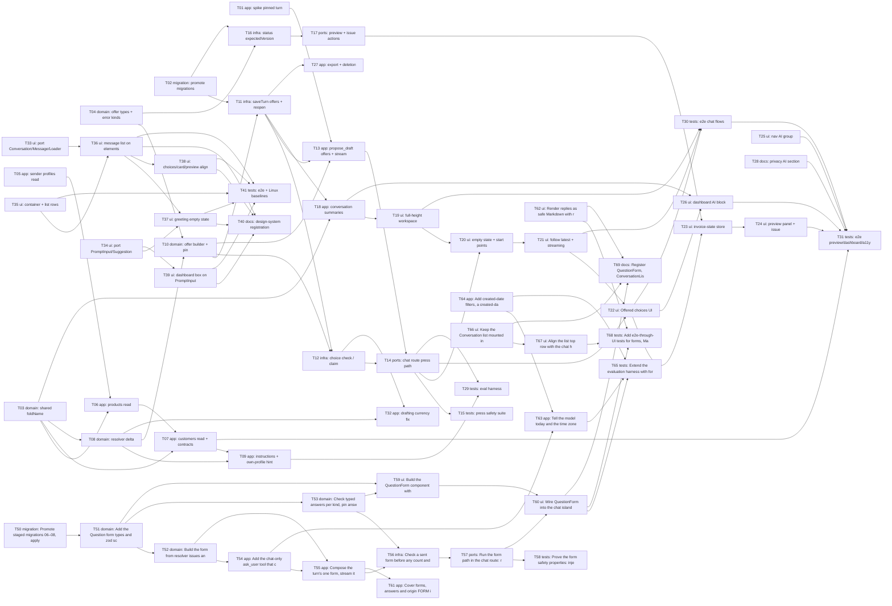

# Epic — ai-chat-v2

> **Spec:** [spec.md](../spec.md) · **Design:** [sad.md](../sad.md) · **Data model:** [data-model.md](../data-model.md) · **API:** [openapi.yaml](../contracts/openapi.yaml) + [server-actions.md](../contracts/server-actions.md) · **Screens:** [screens.md](../screens.md) · **Tests:** [test-plan.md](../test-plan.md) · **ADRs:** [adr/](../adr/)

## Goal

Ship the second iteration of the in-app AI chat without loosening any first-iteration rule (spec §2): the chat and MCP gain three reads (sender profiles with account summaries, products with Custom prices, a look-alike Customer search); every choice the draft action asks for becomes an Offered choice built in code and pressed as an exact, counted message; the AI section becomes a full-height workspace; a created draft can be previewed and issued from the chat under the editor's rules; and the AI is reachable from the navigation and the dashboard, with the privacy page and export covering what is stored.

## Scope

- **In:** `lib/assistant-tools` (3 reads), `lib/services/assistant-drafts` (resolver delta, offers, pins, own-profile hint), `lib/services/conversations` (origin, start point, offers, summaries), `lib/services/invoices` (expectedVersion, issuedFromChat), `lib/ai` (pinned turn, offers in `propose_draft`, instructions), `app/api/chat` (press path), `lib/actions/assistant-actions` (preview, issue), `components/ai` + `components/dashboard` + navigation config, privacy page, export, five staged migrations, eval harness, e2e.
- **In (presentation rewrite, T33–T41):** `components/ai-elements/` (Conversation, Message, PromptInput, Suggestion, Loader ported from Vercel AI Elements onto Base UI, Apache-2.0 LICENSE + NOTICE), the AI section's layout and components in `components/ai` and `components/dashboard/ai-block.tsx`, `docs/design-system.md`, the AI e2e selectors and Linux baselines. No behaviour, contract, schema or copy change beyond screens.md's presentation revision.
- **In (owner feedback revision, T50–T69, 2026-10-13):** the Question form (staged migrations 06–08, `lib/services/assistant-drafts/forms.ts` + `form-pin.ts`, the chat-only `ask_user` tool, the chat route form path, `components/ai/question-form.tsx`), safe Markdown replies (`react-markdown@10.1.0`, `remark-gfm@4.0.1`, `lib/ai/in-app-links.ts`), the per-turn date note, the chat instructions and router wording, `search_invoices` created-date filters, the Conversation list in `ai/layout.tsx`, header/skeleton/avatar fixes, export and privacy coverage, eval rows and e2e.
- **Out (spec §3):** the AI issuing, sending, editing or deleting an invoice; editing a draft inside the chat panel; free-form buttons written by the model; full bank account numbers in any answer; rewriting the first iteration's documents.

## Execution order

Implementation runs **sequentially, in place, in id order** (T01 → T31; no worktrees). The presentation rewrite (T33–T41, added 2026-10-13 after the owner rejected the built AI section UI; ADR-0010) follows the same rule: id order is a valid topological order, waves inside it are T33/T34/T35 → T36/T39 → T37/T38 → T40/T41. Every task's `deps` point only to smaller ids, so id order is a valid topological order. The `Wave` in each task file is the longest dependency chain, shown only to make the parallel branches visible (for example T25 and T28 have no dependency and could run any time).

The owner feedback revision (T50–T69) runs after T49 in id order; every dep points to a smaller id. Parallel branches inside it: the form chain T50 → T51 → T52/T53 → T54 → T55 → T56 → T57 → T58/T60; the independent T62 (Markdown), T64 (search) and T66 → T67 (workspace) can run any time; T61 after T55; T63 after T54/T64; T65, T68, T69 close it.

## Task map

## Tasks

See [tracker.md](./tracker.md) for status. Machine contract: [tasks.json](../tasks.json).

| # | Task | Layer | Blocked by | DoD (short) |
|---|---|---|---|---|
| T01 | [Spike and build the run-turn seam that starts a chat turn from a pinned resolution](./t01-spike-pinned-turn-seam.md) | app | — | An integration test with the scripted model shows runTurn started from a pinned PROPOSAL returns that proposal as its pending card without a second … |
| T02 | [Promote staged migrations 01–05, apply the Prisma schema edits and extend the test factories](./t02-promote-migrations-and-factories.md) | migration | — | The five staged pairs are promoted in order into prisma/migrations, apply, backfill and revert cleanly on a throwaway testcontainers Postgres with no … |
| T03 | [Move foldName into an isomorphic shared helper with one look-alike fixture set](./t03-shared-fold-name.md) | domain | — | foldName lives in lib/helpers/fold-name.ts with no server-only import, every caller imports it from there, and a unit test over the shared look-alike … |
| T04 | [Add the offer, origin and start-point types and the CHOICE_UNAVAILABLE and ALREADY_ISSUED error details](./t04-shared-types-and-error-kinds.md) | domain | — | types/result.ts and types/assistant/types.ts export the new kinds and types, every exhaustive switch over ActionErrorDetails.kind handles … |
| T05 | [Add the list_sender_profiles read question for the chat and MCP, and fix the stale MCP read-only comment](./t05-sender-profiles-read.md) | app | — | list_sender_profiles is in READ_QUESTIONS for both channels, returns each profile with its default mark and account summaries (bank name, last four, … |
| T06 | [Add the list_products read question with prices per currency and a Customer's Custom prices](./t06-products-read.md) | app | T03, T05 | list_products answers a folded name filter with at most 20 rows plus the total, each figure exactly as stored, adds Custom prices only for a … |
| T07 | [Make list_customers look-alike aware with a 20-row page, and add the cross-read contract and timing tests](./t07-customers-read-folded-and-read-contracts.md) | app | T03, T06 | list_customers finds "Оohn  Doe" from "oohn doe" with its saved name, caps a page at 20 with pageInfo.total, a contract test walks every read … |
| T08 | [Extend the draft resolver: senderProfileId in the request and label fields on the issue candidates](./t08-resolver-request-and-candidate-delta.md) | domain | T03 | DraftRequest accepts senderProfileId (at most one of senderProfile and senderProfileId), Customer candidates carry email, bank-account candidates … |
| T09 | [Rewrite the chat instructions for the real reads and add the own-sender-profile hint on CUSTOMER_NOT_FOUND (AC-05b)](./t09-chat-instructions-and-own-profile-hint.md) | app | T07, T08 | The chat instructions name exactly the read questions in READ_QUESTIONS and state the sender-profile versus Customer rule, CUSTOMER_NOT_FOUND carries … |
| T10 | [Build Offered choices from resolver issues and pin a chosen option into a draft request](./t10-offer-builder-and-pin.md) | domain | T04, T08 | offerFromIssues maps issues to at most one offer in the order Customer, sender profile, currency, bank account, product, returns TOO_MANY above 8 and … |
| T11 | [Store a turn's offer, message origin and start point in saveTurn, close the open offer, and return offers on reopen](./t11-save-turn-offers-and-reopen.md) | infra | T02, T10 | saveTurn creates a Conversation with startedFrom on its first message, writes origin on the USER row and NULL on the reply, closes the open offer for … |
| T12 | [Check a pressed choice against the stored offer and claim or release it with the allowance slot](./t12-choice-check-claim-release.md) | infra | T10, T11 | checkChoice returns ok only for an OPEN offer of the acting Freelancer in that Conversation whose option exists and whose record still exists, is … |
| T13 | [Turn propose_draft issues into the reply's offer, apply the turn's pins, and stream the data-offer part](./t13-propose-draft-offers-and-stream-part.md) | app | T01, T10, T11 | A drafting turn whose resolver issue is offer-able returns a pending offer built by offerFromIssues, streams one data-offer part with only its … |
| T14 | [Accept choice, origin and startedFrom in the chat request and run the press path in the chat route](./t14-chat-route-press-path.md) | ports | T12, T13 | The chat route validates the new field combinations, refuses an invalid press with the one 409 CHOICE_UNAVAILABLE body before any reservation or … |
| T15 | [Prove the press safety properties: injection fixture, uniform refusals, concurrent claims, release on failure, metadata-only spans](./t15-press-safety-suite.md) | tests | T14 | A stream contract test with the injection fixture shows every data-offer equals the builder's output and no option comes from text, every … |
| T16 | [Guard updateInvoiceStatus with an optional expectedVersion and set issuedFromChat on that path](./t16-invoice-status-expected-version.md) | infra | T02, T04 | updateInvoiceStatus with expectedVersion returns CONFLICT ALREADY_ISSUED for a non-draft and CONFLICT CHANGED_ELSEWHERE for any version change under … |
| T17 | [Add the loadInvoicePreview and issueFromPreview server actions](./t17-preview-and-issue-actions.md) | ports | T16 | loadInvoicePreview returns AVAILABLE with the owner-scoped serialized invoice, version and state for a created card, UNAVAILABLE for a card whose … |
| T18 | [List every Conversation summary and the latest three, and add the grouping and title-search helpers](./t18-conversation-summaries-and-grouping.md) | app | T03, T11 | listConversationSummaries returns every owned Conversation newest first with the Freelancer time zone, listLatestConversations returns at most three, … |
| T19 | [Make the AI section a full-height workspace with a grouped, searchable Conversation list and phone sheets](./t19-full-height-workspace-and-list.md) | ui | T18 | The AI section renders in a viewport-height shell where only the list and the messages scroll, the list shows the four groups, the folded search, the … |
| T20 | [Redesign the empty Conversation start with suggested requests and the composer move, and send the start point](./t20-empty-state-and-start-points.md) | ui | T14, T19 | A new Conversation shows a centred greeting, the composer and at least four fixed suggested requests that only fill the box, the first send moves the … |
| T21 | [Follow new text within 48 px with a jump-to-latest control, and pin the word-by-word streaming](./t21-follow-latest-and-streamed-reply.md) | ui | T20 | A follow-to-latest hook treats an end no more than 48 px out of view as at the bottom, keeps the newest text in view within 100 ms of each delta … |
| T22 | [Render Offered choices under a reply and send a press from the chat island](./t22-offered-choices-ui.md) | ui | T14, T21 | OfferedChoices renders an OfferView's stored labels verbatim in a kind-labelled group with skeleton, pressable, pressing, chosen and inactive states, … |
| T23 | [Add the workspace invoice-state store and the Draft card Preview button](./t23-invoice-state-store-and-card-preview.md) | ui | T17, T22 | One InvoiceStateProvider seeded from the page load is applied by createDraftFromCard, loadInvoicePreview and issueFromPreview results, the created … |
| T24 | [Build the invoice preview panel and the issue confirmation for desktop and phone](./t24-invoice-preview-panel-and-issue-dialog.md) | ui | T23 | ?preview={cardId} opens InvoicePreviewPanel beside the messages from 768 px and as a full-screen sheet below, it renders every SCR-06 state from … |
| T25 | [Replace the single AI navigation item with an "AI" group holding AI chat and Connect your AI](./t25-navigation-ai-group.md) | ui | — | The navigation config holds an "AI" group between the main section and Management with "AI chat" (/ai) and "Connect your AI" (/settings/assistants), … |
| T26 | [Add the dashboard AI block with the prompt box hand-off, the latest Conversations and Create invoice with AI](./t26-dashboard-ai-block-and-handoff.md) | ui | T18, T22 | The dashboard shows the AI block with up to three latest Conversation links, All conversations, the prompt box validated by the chat message rule, … |
| T27 | [Cover offers, chosen options, message origins and start points in the data export and account deletion](./t27-export-and-account-deletion.md) | app | T11 | The export is version 2.3 and holds every Conversation's startedFrom, each message's origin and each reply's offer with its labels, state and chosen … |
| T28 | [Update the privacy page AI section for what the chat stores and shares, and check the terms page](./t28-privacy-page-ai-section.md) | docs | — | The privacy page's AI section states what is stored, the 90-day retention, the model provider through its gateway as the processor, and that reads … |
| T29 | [Extend the evaluation harness with explains and press fields, the own-profile-name setup and this feature's fixtures](./t29-eval-harness-extension.md) | tests | T09, T14 | The dataset type accepts optional explains and press fields and the own-profile-name setup, the harness replays a press through the route's press … |
| T30 | [Add e2e-through-UI tests for presses, reopen, full-height layout, empty start, phone sheets and streaming](./t30-e2e-chat-flows.md) | tests | T19, T21, T22 | Playwright tests against a throwaway database with the scripted model show a Customer press ending in the right card, a reopened Conversation with … |
| T31 | [Add e2e tests for preview and issue (two tabs), navigation, dashboard prompt, privacy, MCP reads and accessibility](./t31-e2e-preview-dashboard-nav-a11y.md) | tests | T07, T24, T25, T26, T28, T30 | Playwright and outside-caller tests show the preview opens beside the messages within 1.5 s, issuing updates panel, card and links, the two-tab … |
| T32 | [Product candidates follow the drafting currency when only the Customer fails (review R14-1)](./t32-drafting-currency-on-customer-not-found.md) | app | T08, T12 | With a Customer not saved yet and no written currency, the resolver gives resolveLines the drafting currency … |
| T33 | [Port the Conversation, Message and Loader elements from Vercel AI Elements onto Base UI, with the licence files](./t33-port-conversation-and-message-elements.md) | ui | — | components/ai-elements/conversation.tsx, message.tsx and loader.tsx export the ADR-0010 anatomy built only on components/ui and @base-ui/react (no … |
| T34 | [Port the PromptInput and Suggestion elements onto Base UI](./t34-port-prompt-input-and-suggestion-elements.md) | ui | — | components/ai-elements/prompt-input.tsx and suggestion.tsx export the ADR-0010 anatomy on InputGroup, Textarea and Button with the attribution … |
| T35 | [Rebuild the workspace as a bordered container and the Conversation list as plain rows with a row menu for delete](./t35-workspace-container-and-conversation-list.md) | ui | — | At md and wider the AI section is one rounded bordered container in the content area with zero page scroll, the list pane shows the search row … |
| T36 | [Rebuild the message list and chat pane on the elements: centred column, bubbles, avatar, errors as assistant messages with Try again](./t36-message-list-and-chat-pane-on-elements.md) | ui | T33, T35 | SCR-03 renders through Conversation and Message in a centred max-w-3xl column with the composer docked at the same width, user messages as … |
| T37 | [Rebuild the empty state with the time-of-day greeting, the PromptInput composer and suggestion chips](./t37-empty-state-greeting-and-prompt-input-composer.md) | ui | T34, T36 | /ai shows the two-line greeting computed on the server in the Freelancer time zone with the first name and the accent span, a centred PromptInput … |
| T38 | [Align Offered choices, the Draft card and the preview panel with the message layout](./t38-offered-choices-card-and-preview-visual-alignment.md) | ui | T36 | Offered choices render as rounded-full chips inside the assistant MessageContent, the Draft card spans the centred column with the container … |
| T39 | [Build the dashboard AI block prompt box on the PromptInput element](./t39-dashboard-ai-block-on-prompt-input.md) | ui | T34 | The dashboard prompt box is a PromptInput card with the counter in its footer and a round submit labelled "Send to AI", empty and too-long prompts … |
| T40 | [Register the AI elements and the changed AI components in the design system](./t40-register-ai-elements-in-design-system.md) | docs | T36, T37, T38, T39 | docs/design-system.md lists Conversation, Message, PromptInput, Suggestion and Loader from components/ai-elements with their contracts, Base UI … |
| T41 | [Update e2e selectors, add layout checks for the new presentation and retake the Linux visual baselines](./t41-e2e-selectors-and-linux-baselines-retake.md) | tests | T35, T36, T37, T38, T39 | All AI e2e specs pass locally against the new presentation with selectors updated only where markup changed, new checks prove the centred column … |
| T50 | [Promote staged migrations 06–08, apply the Prisma schema edits for the Question form and extend the factories](./t50-promote-staged-migrations-06-08-apply-the.md) | migration | — | migrations apply, backfill and revert cleanly on a throwaway Postgres; no command against `.env` / `.env.prod` … |
| T51 | [Add the Question form types and zod schemas, swap choice for form in the chat request, and read legacy offers as one-question forms](./t51-add-the-question-form-types-and-zod.md) | domain | T50 | unit tests for the schemas and the legacy mapping pass … |
| T52 | [Build the form from resolver issues and compose one form per reply (order, cap 6, dedupe, input-only above 8, date options)](./t52-build-the-form-from-resolver-issues-and.md) | domain | T51 | unit tests pass, including the 9-question ordering and the date options with a fixed clock in Europe/Kyiv … |
| T53 | [Check typed answers per kind, pin answers into a stored draft request, and compose the answer message](./t53-check-typed-answers-per-kind-pin-answers.md) | domain | T51 | unit tests pass for every kind and the pin of every field … |
| T54 | [Add the chat-only ask_user tool that checks every named record owner-scoped and by kind and builds the labels](./t54-add-the-chat-only-ask-user-tool.md) | app | T52 | integration tests pass on a throwaway database with the scripted model … |
| T55 | [Compose the turn's one form, stream it, store it in saveTurn and return FormView on reopen](./t55-compose-the-turn-s-one-form-stream.md) | app | T52, T54 | integration tests (scripted model) pass for each edge … |
| T56 | [Check a sent form before any count and claim or release it with the allowance slot](./t56-check-a-sent-form-before-any-count.md) | infra | T53, T55 | integration tests pass; the T12 claim/release tests are rewritten for forms … |
| T57 | [Run the form path in the chat route: refuse before counting, compose the message, pin and resolve in code, origin FORM](./t57-run-the-form-path-in-the-chat.md) | ports | T56 | route integration tests with the scripted model pass (call counts asserted) … |
| T58 | [Prove the form safety properties: injection and forged-id fixtures, uniform refusals, concurrent sends, release, spans](./t58-prove-the-form-safety-properties-injection-and.md) | tests | T57 | suite green on a throwaway database … |
| T59 | [Build the QuestionForm component with every SCR-04 revision state](./t59-build-the-questionform-component-with-every-scr.md) | ui | T51, T53 | component tests pass for every state … |
| T60 | [Wire QuestionForm into the chat island, send forms, remove OfferedChoices](./t60-wire-questionform-into-the-chat-island-send.md) | ui | T57, T59 | component + island tests pass … |
| T61 | [Cover forms, answers and origin FORM in the data export, account deletion and the privacy page](./t61-cover-forms-answers-and-origin-form-in.md) | app | T55 | tests pass … |
| T62 | [Render replies as safe Markdown with react-markdown 10.1.0 and remark-gfm 4.0.1 and an in-app link allowlist](./t62-render-replies-as-safe-markdown-with-react.md) | ui | — | unit + component tests pass … |
| T63 | [Tell the model today and the time zone, and rewrite the chat instructions and router wording for forms, search-first and links](./t63-tell-the-model-today-and-the-time.md) | app | T54, T64 | unit tests pass … |
| T64 | [Add created-date filters, a created-date sort and in-app paths to search_invoices on both channels](./t64-add-created-date-filters-a-created-date.md) | app | — | integration + contract tests pass … |
| T65 | [Extend the evaluation harness with form, card-or-form, link and date checks and the owner-feedback rows](./t65-extend-the-evaluation-harness-with-form-card.md) | tests | T60, T63, T64 | harness unit tests pass … |
| T66 | [Keep the Conversation list mounted in the AI layout and update it from chat events](./t66-keep-the-conversation-list-mounted-in-the.md) | ui | — | component tests pass … |
| T67 | [Align the list top row with the chat header, size every skeleton to its content, and level the avatar with the first line](./t67-align-the-list-top-row-with-the.md) | ui | T66 | component tests pass … |
| T68 | [Add e2e-through-UI tests for forms, Markdown, aligned layout, stable skeletons and list-keeping switches, and retake Linux baselines](./t68-add-e2e-through-ui-tests-for-forms.md) | tests | T60, T62, T67 | full AI e2e suite green locally … |
| T69 | [Register QuestionForm, ConversationListProvider and the Markdown MessageResponse in the design system and update ux-flows for the form](./t69-register-questionform-conversationlistprovider-and-the-markdown-messageresponse.md) | docs | T60, T62, T66 | docs updated; links resolve … |

## Decisions

Taken at the tasks stage for the owner (autonomous run, 2026-10-13); the owner can veto any line.

- **D-1 — AC-05b: resolver hint plus eval fixture.** `CUSTOMER_NOT_FOUND` gains an optional `ownSenderProfile { senderProfileId, name }` when the folded written name equals one of the Freelancer's sender profile names; `issuesText` explains the difference and asks which Customer, and no "Add a Customer" link is added (T09). The eval rows from test-plan.md stay as the regression guard (T29). Why: sad.md §6 Flags names this alternative for `tasks`; the issue text is already deterministic code, so the explanation no longer depends on the model alone; the change is additive in `DraftIssueDelta` and matches the test plan's integration row (not found, no card, no offer).
- **D-2 — Spike first.** T01 de-risks sad.md §11 "pre-resolved result into a Mastra turn" before any press code, and leaves a real `runTurn({ pinned })` seam rather than throwaway code. Fallback B (structured system note, parts emitted from the route) is pre-approved; T01 records which approach was taken in sad.md §11.
- **D-3 — One migration task.** T02 promotes the five staged pairs in order into `prisma/migrations/<timestamp>_<name>/migration.sql` (timestamps after `20261010101000`), keeps the `.down.sql` files staged (repo precedent, ai-assistant T01), and rehearses up → backfill → down → up only on a testcontainers Postgres. No command runs against the `.env` / `.env.prod` databases.
- **D-4 — Shared union change as its own green task.** T04 adds `CHOICE_UNAVAILABLE` / `ALREADY_ISSUED` and updates every exhaustive switch in the same commit, so it compiles alone (server-actions.md asks `tasks` for "one task to find them").
- **D-5 — Stale MCP comment.** `lib/mcp/server.ts:78-80` ("read-only by construction … no write capability") is false since `create_draft_invoice`; it sits in the area T05 touches, so T05 rewords it.
- **D-6 — Design-system registration inside UI tasks.** T19, T20, T22, T23, T24 and T26 each update `docs/design-system.md` for the components they add or change (`OfferedChoices`, `InvoicePreviewPanel`, `IssueConfirmation`, `InvoiceStateProvider`, `DashboardAiBlock`, changed `AiWorkspace`, `ConversationList`, `StartPanel`, `ChatIsland`, `DraftCard`, `ChatLink`).
- **D-7 — Privacy wording reviewed by the owner.** T28 writes the AI section and checks the terms page (spec §8); the owner's review blocks `ship`, not `implement`.
- **D-8 — Load scenarios stay with ship.** The k6/Locust scenarios against a preview deployment are pre-release steps (test-plan.md §CI placement); per-PR read timing is in T07. No separate task.
- **D-9 — 31 tasks for an L feature** (41 with the T32 review follow-up and the T33–T41 presentation rewrite). Above the 8–20 guide because the feature has 40 acceptance criteria across two surfaces; the first iteration took 46. Each task is ≤ 1 day.

- **D-10 — Presentation rewrite as follow-up tasks T33–T41 (2026-10-13).** The owner rejected the built AI section UI (`ref/current-as-built-bad.png`) and chose our own chat elements ported from Vercel AI Elements onto Base UI (ADR-0010) with the layout of `ref/reference-empty-state.png`. Done tasks T19–T26, T30 and T31 are not reopened; the follow-ups change their presentation only, and every existing AC test must stay green without being weakened.
- **D-11 — No new dependency.** `use-stick-to-bottom` (fixed 70 px threshold vs the 48 px rule) and `streamdown` (Markdown vs ai-assistant AC-07's plain text) are not adopted; `motion` and `nanoid` are dropped with the parts that need them (ADR-0010).
- **D-12 — Spec-language group labels win over the reference.** The list keeps "Today / Yesterday / Previous 7 days / Older" (spec §1, AC-17), not the reference's "7 Days Ago".
- **D-13 — Registration as its own docs task.** Unlike D-6, the element set is registered in one place (T40) after all UI follow-ups, so the contracts are written once against the reviewed code.
- **D-14 — Baselines retaken in their own commit after a full local e2e run** (T41), with each diff inspected against the reference image.

- **D-15 — Owner feedback revision as T50–T69 (2026-10-13).** The owner's feedback (spec §1 F1–F13; screenshots `ref/feedback-2026-10-13-*.png`) is implemented as appended tasks; done tasks are not reopened. **Existing AC tests stay green and are never weakened; the tests of superseded ACs (AC-08–AC-14 and their T10–T15, T22, T30 tests) are rewritten for the Question form in the same files, never deleted silently.**
- **D-16 — The offer row becomes the form row.** No new table (ADR-0011); staged migrations 06–08 extend `ChoiceOffer` and backfill legacy offers into one-question forms; promoted by T50 after `20261013104000`.
- **D-17 — Origin `FORM`.** A sent form is saved with a new origin `FORM`; `PRESSED` is no longer written and stays for history (spec F5).
- **D-18 — Send is always pressed**, also for a one-question form (spec Clarifications 2026-10-13).
- **D-19 — Two new dependencies, exact pins:** `react-markdown@10.1.0` (2025-03-07) and `remark-gfm@4.0.1` (2025-02-10) for safe Markdown (ADR-0012); this supersedes D-11's "no new dependency" for rendering only.
- **D-20 — The list moves into the layout** (ADR-0013); T66 re-runs the existing hand-over e2e specs unchanged.

## Risks / Hard rules

- **Code builds every button; the model only words it.** Offers come only from `offerFromIssues(issue)`; no model text path into an offer (spec §6 "0 buttons from model text", ADR-0002).
- **An invalid press never reaches the model, is never counted, marks nothing, and gets one fixed sentence** "This option is no longer available. Choose again or type your request." (spec §1, AC-12b, openapi 409). *Since 2026-10-13 (T50+): a sent form follows the same rule with "This form is no longer available. Answer the latest questions or type your request." (spec F7).*
- **Every form option is one of the Freelancer's records checked by the server, a supported currency or a server-computed date, with a server label; never model text** (spec F3, ADR-0011).
- **The model has no issuing tool.** Issuing exists only as the Freelancer's confirmed `issueFromPreview`, guarded by `expectedVersion` (ADR-0007, AC-24).
- **No full bank account number in any read answer** — output schemas have no field for it (spec §6.1).
- **Owner-scoped everything:** another Freelancer's offer, card, Conversation or record answers exactly as one that does not exist (sad.md §8).
- **Preview and issue are never messages** and touch no counter (AC-27).
- **Prompt text never appears in a URL** (ADR-0009).
- **No new runtime dependency** (sad.md §2; ADR-0010 for the AI elements — no Radix, no `streamdown`, no `use-stick-to-bottom`). *Exception 2026-10-13: `react-markdown@10.1.0` + `remark-gfm@4.0.1`, exact pins (ADR-0012, D-19).*
- **Replies never render HTML; links only to in-app route patterns** (ADR-0012).
- **Presentation rewrite changes no behaviour** (T33–T41): every state, AC, address, hand-off, allowance notice, breakpoint, the 48 px follow and reduced motion stay as specified; replies stay plain text (superseded by T62, ADR-0012, for the in-app chat).
- **Database safety:** integration and migration tests run only on throwaway containers; `.env` is dev, `.env.prod` is prod — never targeted.
- **e2e runs locally before ship** (no e2e in CI): check `docker info`, keep the machine awake, clean leaked testcontainers.
