# UX flows — ai-chat-v2

> User flows for every UI-touching §4 user story of [`spec.md`](./spec.md), produced by `ux-flows` (after `clarify`, before `design`) and read by `design` (evidence for the target-surface + UI-architecture decisions), `sequences` (UI-driven flows align on SCR ids), `screens` (details every inventory row) and `plan-tests` (the e2e-through-UI paths). Flow altitude only: no components, layout or styling. The first iteration's flows in [`ai-assistant/ux-flows.md`](../ai-assistant/ux-flows.md) stay in force; the SCR ids below are this feature's own and do not continue that file's numbering.

## Platform decisions

- **Posture:** responsive-both. `docs/design-system.md` names no posture, so this follows the app and the first iteration. The spec fixes the widths (§1): below 768 px is the phone layout; from 768 to 1279 px the desktop layout, where opening the preview hides the Conversation list behind a toggle; from 1280 px the list, the messages and the preview sit side by side. The flows are the same at every width. Only where the list and the preview open differs, and the flows show it where it matters (US-06, US-07).
- **The AI section is one full-height workspace:** the page never scrolls. The Conversation list (SCR-01) and the messages (SCR-03) scroll on their own, and the message box is always visible. Switching Conversations, starting a new one and opening a preview all happen inside this workspace.
- **A new Conversation is a state, not a record:** New chat, "Create invoice with AI" and the dashboard prompt open SCR-02. A Conversation exists only once its first message is sent, so leaving SCR-02 without sending leaves nothing behind.
- **The Question form lives inline at the end of the reply** that asks it (SCR-04), one form per reply, replacing the first draft's one-choice buttons. It is answered with Send. Only the latest reply's form can be edited; older ones stay visible, read-only, with the answers given.
- **The Conversation list is persistent:** it stays mounted while the Freelancer switches Conversations, so only the chat pane loads (ADR-0013).
- **Replies are Markdown:** a reply's formatting (lists, tables, bold) shows while it is written and after reopening, and an in-app link in it opens that page (ADR-0012).
- **The preview is a panel, not a page:** a side panel on a desktop and a full-screen sheet on a phone (SCR-06). Editing is never done there. "Open in editor" leaves for the existing editor (SCR-10).
- **Issuing goes through one confirmation dialog** over the preview (SCR-07). Issuing from the editor keeps its own behaviour.
- **The dashboard hands off, it does not chat:** the dashboard AI block (SCR-09) only starts or reopens Conversations. Every reply is read in the AI section.
- **Navigation:** an "AI" group replaces the single "AI" item and holds "AI chat" and "Connect your AI" (SCR-08).
- **Design input (not decided here):** (1) how a form's Send reaches the server so that it is told apart from typed text and checked against the stored questions; (2) how the card and its links learn that the invoice was issued, so they can show it as issued (refresh, push or a local update after the press); (3) whether a new Conversation (SCR-02) and the open preview have their own addresses that survive a reload or a shared link; (4) how the dashboard prompt is handed to the AI section so that it is sent exactly once. `design` decides these.

## Screen inventory

| ID | Screen | Purpose | Entry | Exit |
|---|---|---|---|---|
| SCR-01 | Conversation list (pane on a desktop, sheet on a phone) | Past Conversations grouped Today / Yesterday / Previous 7 days / Older by last message, a title search and New chat; scrolls on its own; persistent, so it is not loaded again on a switch and keeps its scroll position and search text | Opening the AI section (SCR-08, SCR-09 "all Conversations"); the list toggle (768–1279 px with the preview open) or the list control on a phone | SCR-03 (pick a Conversation), SCR-02 (New chat) |
| SCR-02 | New Conversation (empty state) | Greeting, message box in the middle, at least three suggested requests, messages left today; nothing saved until the first message | New chat in SCR-01; "AI chat" in SCR-08; "Create invoice with AI" in SCR-09; the existing "Create with AI" on the invoice list | SCR-03 (first message sent); SCR-01 (another Conversation, nothing saved) |
| SCR-03 | Conversation | Messages that scroll on their own and follow new text, streamed replies, the message box at the bottom, used-up, refused and "no longer available" answers | SCR-02 after the first message; SCR-01; latest-Conversation links and the prompt in SCR-09 | SCR-04 and SCR-05 (inline), SCR-06, SCR-15, SCR-01 |
| SCR-04 | Question form (inline at the end of a reply in SCR-03) | Up to 6 questions with options, an "Other…" typed answer and Skip for optional ones, answered together with Send; states open / sent / closed | A reply in SCR-03 that needs details to draft | Send puts the answers as the Freelancer's message in SCR-03 |
| SCR-05 | Draft card (inline in SCR-03, existing, extended) | The first iteration's card; once created it gets Preview and shows the invoice's live status (draft, issued, no longer available) | A drafting reply in SCR-03 | SCR-06 (Preview), SCR-10 ("Open in editor" link) |
| SCR-06 | Invoice preview panel (side panel on a desktop, full-screen sheet on a phone) | The editor's preview of that invoice, "Open in editor" and, while it is a draft, Issue; states loading / draft / issued / blocked / no longer available / not found / reloaded | Preview on SCR-05 | SCR-07 (Issue), SCR-10 ("Open in editor"), back to SCR-03 (close) |
| SCR-07 | Issue confirmation dialog | Names the Customer, total and currency and says lines and amounts can no longer change once issued; Confirm / Cancel | Issue in SCR-06 | SCR-06 (issued, reloaded, blocked or already issued; or cancelled) |
| SCR-08 | Navigation "AI" group | "AI chat" and "Connect your AI", styled like "Management", the current page's item marked active | Every signed-in page | SCR-02 with SCR-01 (AI chat), SCR-11 (Connect your AI) |
| SCR-09 | Dashboard AI block (existing dashboard, extended) | Prompt box, the 3 latest Conversations or "none yet", a link to all Conversations, "Create invoice with AI" next to the existing invoice action; used-up and validation states | Dashboard | SCR-03 (prompt sent or a latest link), SCR-02 ("Create invoice with AI"), SCR-01 (all Conversations), SCR-10 (create by hand when used up) |
| SCR-10 | Invoice editor (existing) | Edit, fix or issue a draft the editor's way; the hand-made fallback | "Open in editor" (SCR-05, SCR-06); "create by hand" (SCR-09) | — |
| SCR-11 | Connect your AI page (existing) | Where Personal keys are managed | "Connect your AI" in SCR-08 | — |
| SCR-12 | Sign-in (existing) | Where a Visitor is sent | Any attempt to reach the AI section or the dashboard prompt while signed out | The AI section after sign-in |
| SCR-13 | Privacy page (existing, public, AI section updated) | Says which chat data is stored, how long, who processes message text and what the new reads share with a Personal-key client | Footer and legal links | — |
| SCR-14 | Privacy settings (existing) | Data export (now with Question forms, message origin and Conversation start point) and account deletion (now removing them) | Settings navigation | — |
| SCR-15 | Add Customer / Add product pages (existing) | Where a record the chat could not find is added | The link in a "nothing matches" reply in SCR-03 | — |

## Flows

### Flow: US-01 — Find my profiles, accounts and products

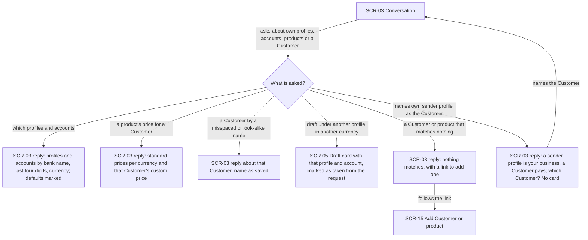

The Freelancer asks in the Conversation about their own records. Asking which sender profiles and bank accounts they have gets a list of profiles with their accounts, each account named by bank name, last four digits and currency, with the default profile and account marked and no full account number. Asking what a product costs for a Customer gets the standard prices per currency plus that Customer's custom price, each exactly as stored. Asking about a Customer with extra spaces, another case or look-alike Latin/Cyrillic letters finds it and shows its saved name. A drafting request under another sender profile in another currency produces a draft card with that profile and its account, marked as taken from the request. A Customer or product that matches nothing gets a plain "nothing matches" with a link to the page where one is added; no record is ever invented. Naming their own sender profile as if it were the Customer gets an explanation of the difference and a question about which Customer to invoice, with no card; the Freelancer answers and the Conversation goes on. Every answer holds only this Freelancer's records.

### Flow: US-03 — Answer a Question form

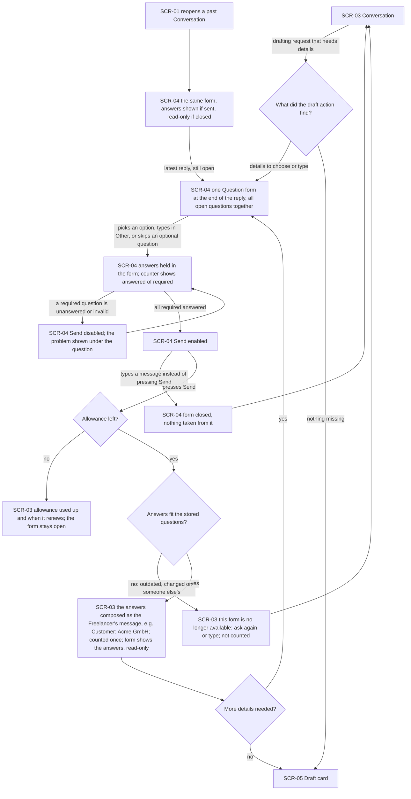

A drafting request that leaves details open gets one Question form at the end of the reply, holding every open question together: choosing a Customer, a bank account, a product or a currency, or typing a value such as an amount or a date. The options come from what the draft action found, never from the reply's words. Look-alike Customer names also show each Customer's email. An "Other…" choice reveals a typed answer, and an optional question can be skipped. More matches than the form can list get a count and a request to type a more exact name. Each answer is checked in the browser, and Send stays disabled until every required question has a valid answer. If the Freelancer sends a typed message instead of pressing Send, the form closes and nothing is taken from it. Pressing Send with no allowance left is refused like a typed message, saying when it renews, and the form stays open. A Send whose answers no longer fit the latest reply's stored questions gets one uniform "no longer available" answer, is not counted and never reaches the model. A valid Send composes the answers into the Freelancer's message, counts once, and shows the form read-only with the answers given. If more details are still needed, the next reply holds a new form. Otherwise the draft card shows exactly the chosen records. Reopening a past Conversation shows the same form with its answers, and an unsent latest form can still be filled and sent through the same checks.

### Flow: US-04 — Work in a full-height chat

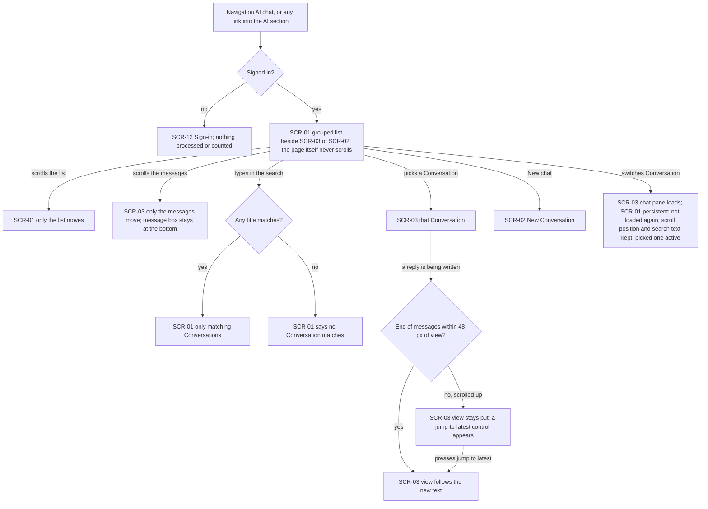

A Visitor who tries to reach the AI section is sent to sign in, and nothing is processed or counted. A signed-in Freelancer sees the Conversation list, grouped Today / Yesterday / Previous 7 days / Older by last message, beside the open or new Conversation. The page itself never scrolls: scrolling the list moves only the list, and scrolling the messages moves only the messages while the message box stays visible at the bottom. Typing in the search narrows the list to matching titles (ignoring case, extra spaces and look-alike letters) or says that none match. Picking a Conversation opens it, and New chat (at the bottom of the list) opens an empty one. The list is persistent: switching Conversations changes only the chat pane, which shows a loading state, while the list is not loaded again and keeps its scroll position, search text and rows, with the picked Conversation marked active. The list changes later only when a Conversation is created, renamed or deleted, or when a new message moves a Conversation to the top. While a reply is being written, the view follows the new text if the end of the messages is within 48 px of view. If the Freelancer has scrolled further up, the view stays where it is and a control appears that jumps back to the latest message.

### Flow: US-05 — Start from a clear empty state

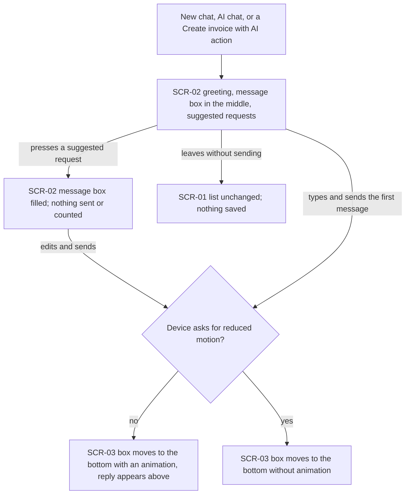

Every way into a new Conversation shows a greeting, the message box in the middle and at least three suggested requests (drafting an invoice and asking who owes money among them). Pressing a suggestion only fills the message box. Nothing is sent or counted until the Freelancer sends. Sending the first message saves the Conversation, and the message box moves to the bottom with an animation while the reply appears above it. On a device that asks for reduced motion it moves without the animation. Leaving without sending saves nothing, and the list never shows an empty Conversation.

### Flow: US-06 — Use the AI on my phone

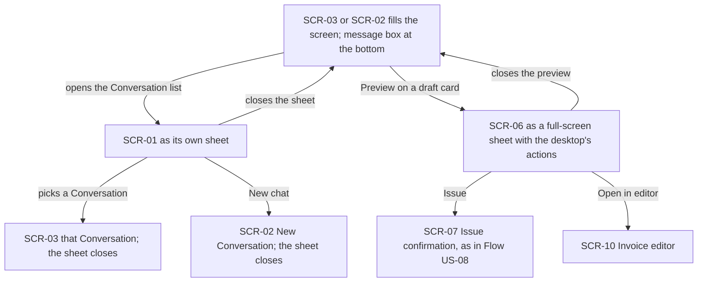

Below 768 px the chat fills the screen with the message box at the bottom. The Conversation list opens as its own sheet and closes when the Freelancer picks a Conversation, starts a new one or dismisses it. Preview on a draft card opens the preview as a full-screen sheet with the same actions as on a desktop: closing returns to the chat, Issue goes through the same confirmation as in US-08, and "Open in editor" leaves for the editor.

### Flow: US-07 — Preview a created draft

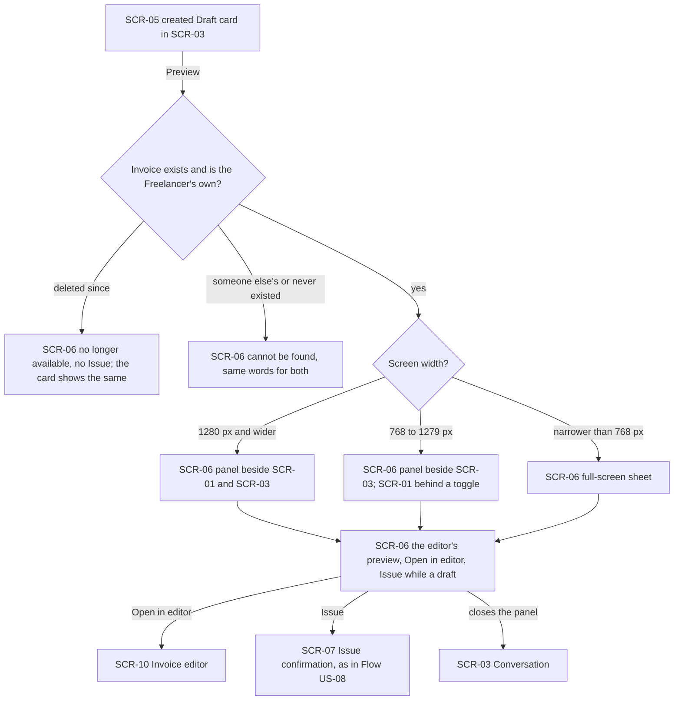

Pressing Preview on a created draft's card opens the preview panel. If the draft was deleted since, the panel says it is no longer available and offers no Issue, and the card shows the same. A draft that belongs to another Freelancer is answered "cannot be found", in the same words as one that never existed. Otherwise the panel shows the same preview the editor shows, an "Open in editor" link and, while the invoice is a draft, an Issue button. From 1280 px it sits beside the list and the messages. From 768 to 1279 px it sits beside the messages and the list goes behind a toggle. On a phone it is a full-screen sheet. On a desktop the messages stay visible throughout.

### Flow: US-08 — Issue a checked draft from the chat

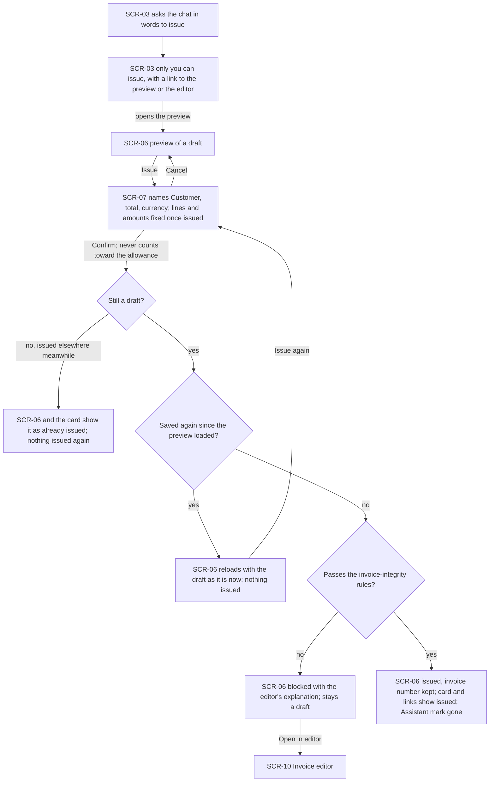

From an open preview, Issue opens a confirmation that names the Customer, the total and the currency and says the lines and amounts can no longer change once issued. Cancel returns to the preview. Confirming is never a message, so it works with the allowance used up. If the invoice was issued elsewhere in the meantime, nothing is issued again and the panel and card show it as already issued. If the draft was saved again after the preview loaded, nothing is issued. The preview reloads with the current draft, and the Freelancer has to press Issue and confirm again in a dialog with the current figures. If the draft breaks an invoice-integrity rule, issuing is blocked with the editor's own explanation, it stays a draft, and "Open in editor" leads to the fix. Otherwise it is issued through the editor's path with its number kept, and the preview, the card and every system-made link show it as issued, without the Assistant-draft mark. Asking the chat in words to issue gets "only you can issue" with a link to the preview or the editor. The chat never issues.

### Flow: US-09 — Find the AI in the navigation

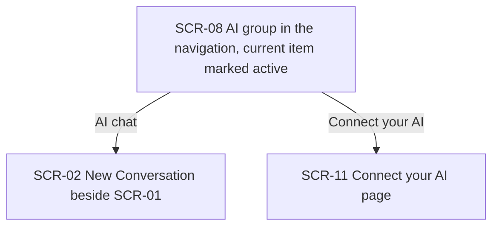

The navigation shows an "AI" group styled like "Management" in place of the old single "AI" item. "AI chat" opens the AI section on a new Conversation with the list beside it. "Connect your AI" opens the existing page where Personal keys are managed. The item of the current page is marked active.

### Flow: US-10 — Start a chat from the dashboard

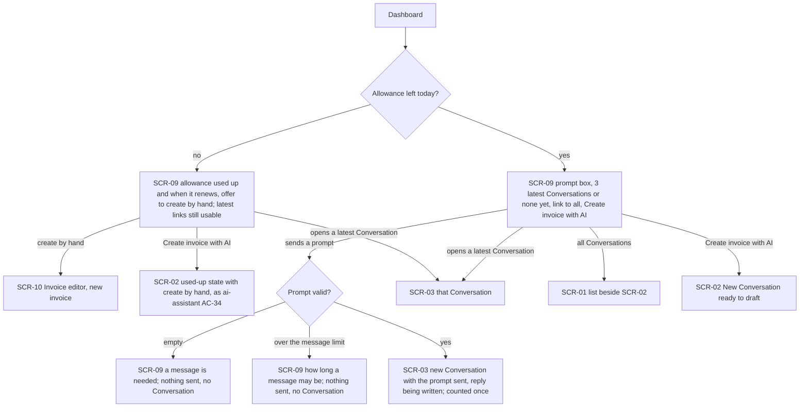

With messages left, the dashboard's AI block shows a prompt box, the three latest Conversations by last message (or a "none yet" line), a link to all Conversations, and "Create invoice with AI" next to the existing invoice action. Sending a valid prompt opens the AI section on a new Conversation in which the prompt is already sent and the reply is being written, counted once. An empty prompt or one over the message limit is not sent, no Conversation is created, and the prompt box says why. A latest-Conversation link reopens that Conversation. "All Conversations" opens the AI section. "Create invoice with AI" opens a new Conversation ready to draft. With the allowance used up, the prompt box says so and when it renews and offers creating the invoice by hand. Nothing is sent. The latest links still work, and "Create invoice with AI" behaves as in the first iteration (ai-assistant AC-34).

### Flow: US-11 — Watch the reply being written

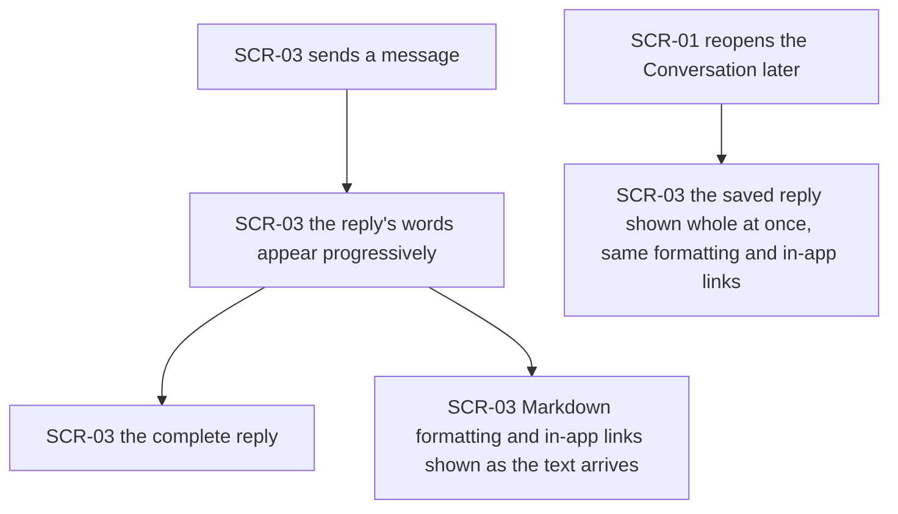

After a message is sent, the reply's words appear one after another as they are written. The text never shows up only once it is complete. Reopening the Conversation later shows the saved reply whole at once. Following the new text is shown in US-04.

The reply is Markdown: lists, tables and bold text show formatted while it is written and after reopening, raw HTML is shown as text, and an in-app link (for example an invoice number) opens that page in the app. Any other address stays plain text.

### Flow: US-12 — Know what the chat keeps about me

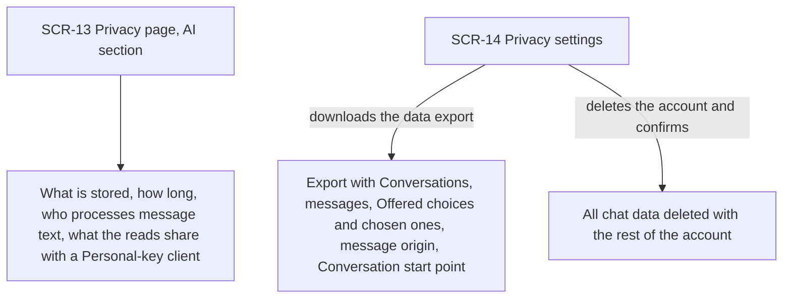

A Visitor or a Freelancer reading the privacy page finds, in its AI section, which chat data is stored, that it is kept 90 days after the last message or until deleted, who processes message text, and what the sender-profile and product reads share with a Personal-key client (bank name, last four digits, currency, never a full number). In privacy settings, the data export now includes every Conversation with its messages, the Offered choices and the ones chosen, whether each message was typed, pressed or sent from the dashboard, and where each Conversation was started. Deleting the account through the existing confirmation removes all of it.

### Out of scope

- **US-02 — Same reads in my own AI client.** The Freelancer's own AI client calls the reads through a Personal key. There is no screen in this app, so there is no flow. Its UI-visible parts (what the privacy page says the reads share, and the "Connect your AI" entry) are covered by US-12 and US-09.

## AC coverage

| AC | Shown by | Notes |
|---|---|---|
| AC-01 | Flow US-01 → "which profiles and accounts" branch | No full account number |
| AC-02 | Flow US-01 → "a product's price for a Customer" branch | Exact stored figures |
| AC-03 | Flow US-01 → look-alike name branch | Name shown as saved |
| AC-04 | Flow US-01 → "draft under another profile" → SCR-05 | First iteration's draft rules |
| AC-05 | Flow US-01 → "matches nothing" → SCR-15 | Never names a missing record |
| AC-05b | Flow US-01 → "names own sender profile as the Customer" branch | No card |
| AC-06 | N/A: Personal-key MCP answer, no UI (US-02 out of scope) | Contract-tested in `api` / `plan-tests` |
| AC-07 | Flow US-01 (chat side: answers hold own records only) | Personal-key side has no UI |
| AC-08 | Flow US-03 → Send → SCR-05 | Customer chosen in the form |
| AC-08b | Flow US-03 → "More details needed?" loop back to SCR-04 → SCR-05 | One form per reply, Send enabled when all required answered |
| AC-09 | Flow US-03 → SCR-04 (options only from the draft action's findings) | Invariant of SCR-04's content; injection fixture in `plan-tests` |
| AC-10 | Flow US-03 → SCR-04 (email on look-alike Customers) → Send → SCR-05 | Exact record chosen |
| AC-11 | Flow US-03 → "Allowance left? no" branch | Form stays open |
| AC-12 | Flow US-03 → typed message closes the form; read-only answers after Send; reopen → SCR-04 |  |
| AC-12b | Flow US-03 → "no: outdated, changed or someone else's" branch | Uniform words, not counted, never reaches the model |
| AC-13 | Flow US-03 → reopen (SCR-01 → SCR-04) → latest unsent form → Send |  |
| AC-14 | Flow US-03 → more matches than listed: type a more exact name |  |
| AC-15 | Flow US-04 → scroll branches (E, F) | Page never scrolls |
| AC-16 | Flow US-04 → "End of messages within 48 px of view?" decision | Jump-to-latest control |
| AC-17 | Flow US-04 → grouped list D, search branches H / I | New chat at the list's bottom |
| AC-18 | Flow US-05 (all branches) | Reduced motion; empty Conversation never saved |
| AC-19 | Flow US-06 (all branches) | Below 768 px |
| AC-20 | Flow US-07 → "yes" → width branches → I | Messages stay visible on a desktop |
| AC-21 | Flow US-07 → "deleted since" branch | Card shows the same |
| AC-22 | Flow US-07 → "someone else's or never existed" branch | Same words as never existed |
| AC-23 | Flow US-08 → happy path to J | Number kept, Assistant mark gone |
| AC-24 | Flow US-08 → "asks the chat in words to issue" branch (K, L) | ai-assistant AC-24 in force |
| AC-25 | Flow US-08 → "Passes the invoice-integrity rules? no" → SCR-10 | |
| AC-26 | Flow US-08 → "Still a draft? no" branch | |
| AC-26b | Flow US-08 → "Saved again since the preview loaded? yes" → reload → Issue again | |
| AC-27 | Flow US-08 → Confirm edge ("never counts toward the allowance") | |
| AC-28 | Flow US-09 (both branches) | Active item marked |
| AC-29 | Flow US-10 → valid prompt → SCR-03 | Counted once |
| AC-30 | Flow US-10 → SCR-09 latest links, all Conversations, Create invoice with AI | "None yet" state |
| AC-31 | Flow US-10 → empty / over-limit branches | No Conversation created |
| AC-32 | Flow US-10 → "Allowance left today? no" branch | Create by hand offered |
| AC-33 | Flow US-11 (both paths) | |
| AC-34 | Flow US-12 → export and account deletion branches | |
| AC-35 | Flow US-12 → SCR-13 | Visitor or Freelancer |
| AC-36 | Flow US-04 → "Signed in? no" → SCR-12 | Also covers the dashboard prompt (dashboard is signed-in only) |
| AC-42 | Flow US-11 (Markdown formatting and in-app links) | Same while written and after reopening |
| AC-52 | Flow US-04 → "switches Conversation" branch | Persistent list: not loaded again, scroll position and search text kept |
