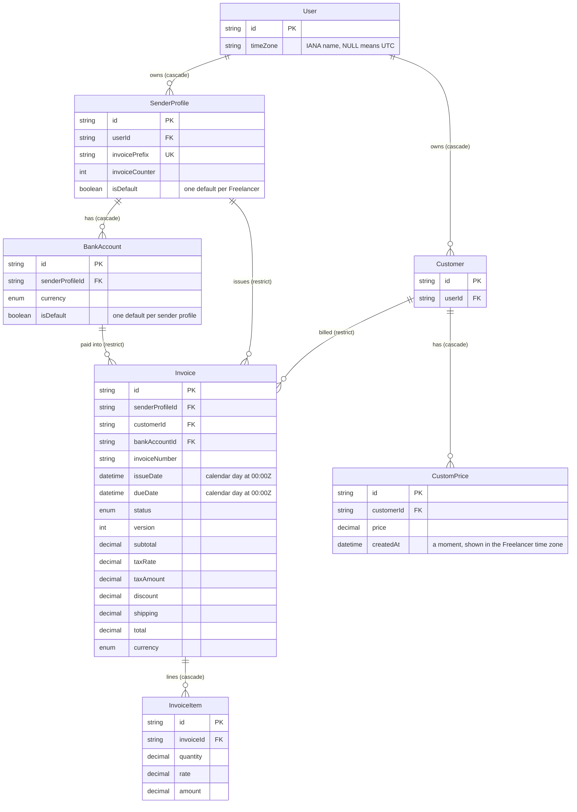

# Data model — editor-ux

> **Mode:** brownfield, **no schema change**. The spec adds no field and stores or sends nothing new (spec §6.1 "Personal data touched: none new"). The SAD rules out any schema or migration (SAD §2, §4 "adds no endpoint, server action, business function, schema or migration", §6 "No flow adds an entity, a column or an index", §7 "there is no migration"). This document therefore stages **zero** migrations. It records the existing entities the feature reads, the one write it keeps (the existing invoice save), and which existing index serves each read drawn in SAD §6.
> **Conventions (derived, not imposed):** `prisma migrate` with the split schema `prisma/schema/{base,auth,invoice}.prisma` (architecture-map §Migrations). Quoted PascalCase tables, camelCase columns, `TEXT` ids from `cuid()`, `DECIMAL(10,2)` money, `TIMESTAMP(3)` timestamps, Prisma index names (`<Model>_<cols>_idx` / `_key`). No `CHECK` constraints or triggers. This feature touches none of them.

## ER diagram

Only the entities this feature reads are shown, and only the columns it relies on. Every one of them is unchanged.

## Entities

**Aggregate roots.** `User` (the Freelancer) stays the root of the account. `Invoice` stays the root of its lines (`InvoiceItem`) and of its issued snapshot columns (sender, Customer and bank details). `SenderProfile` owns its `BankAccount`s and its number counter. `Customer` owns its `CustomPrice`s. The feature changes none of these boundaries. The editor store becoming a per-request factory (SAD §5, editor-ux ADR-0003) is browser state, not a persisted aggregate.

### `User` (unchanged)

| Column | Type | Constraints | Notes |
|---|---|---|---|
| `id` | TEXT | PK, `cuid()` | owner path root |
| `timeZone` | TEXT | NULL | the Freelancer time zone (mcp-server ADR-0006); `NULL` means UTC until saved. It decides "today" for a new invoice (AC-06) and how moments such as a custom price's creation date are shown (AC-08). It never shifts an issue or due date |

**Access patterns:** read by id with the session's user id (SAD §6 Flows 5 and 7) → `User_pkey`.

### `SenderProfile` / `BankAccount` (unchanged)

| Column | Type | Constraints | Notes |
|---|---|---|---|
| `SenderProfile.isDefault` | BOOLEAN | NOT NULL DEFAULT false; partial UNIQUE (`userId`) WHERE `isDefault` | the default sender profile shown on a new invoice's first display (AC-06) |
| `SenderProfile.invoicePrefix` / `invoiceCounter` | TEXT / INTEGER | UNIQUE / NOT NULL DEFAULT 0 | read for the proposed next number, which may arrive after the first display (AC-06) |
| `BankAccount.isDefault` | BOOLEAN | NOT NULL DEFAULT false; partial UNIQUE (`senderProfileId`) WHERE `isDefault` | the default bank account of the default sender profile (AC-06) |

**Access patterns:** defaults for a new invoice (Flow 5) → `SenderProfile_userId_isDefault_key`, `BankAccount_senderProfileId_isDefault_key`; next number (Flow 5) → `SenderProfile_pkey`.

### `Invoice` / `InvoiceItem` (unchanged)

| Column | Type | Constraints | Notes |
|---|---|---|---|
| `Invoice.issueDate` / `dueDate` | TIMESTAMP(3) | NOT NULL | calendar days stored at 00:00:00 UTC (migration `20261005100000_normalize_invoice_calendar_dates`). AC-08 shows them as their **UTC** calendar day everywhere, with no time-zone conversion. Legacy values of an owner with no saved zone are not yet at midnight and are also read as their UTC day, as that migration specifies |
| `Invoice.version` | INTEGER | NOT NULL DEFAULT 0 | the freshness check of invoice-integrity ADR-0004. The save command (editor-ux ADR-0005) sends it unchanged; "changed elsewhere" stays a server refusal (AC-05, AC-05d) |
| `Invoice.subtotal` / `taxAmount` / `total` | DECIMAL(10,2) | NOT NULL | the stored totals. The editor shows them only when nothing changed during the save. Otherwise it recomputes from the lines on screen with the shared decimal module, by the same rule (AC-04). They also reach the editor as `InvoiceEditorData.storedAmounts`, an additive field of `getInvoiceEditorData`'s result, so an issued invoice's preview and PDF print them (ADR-0002, AC-10) |
| `Invoice.taxRate` / `discount` / `shipping` | DECIMAL(5,2) / DECIMAL(10,2) | NOT NULL DEFAULT 0 | inputs to that same rule; the editor's numeric-keypad fields (AC-13) |
| `Invoice.currency` | `Currency` enum | NOT NULL | picks the money format: a symbol where one exists ("$1,234.50"), the code otherwise ("UAH 1,234.50") (AC-09) |
| `Invoice` snapshot columns (`sender*`, `customer*`, `bank*`, `accountName`) | TEXT | as today | the issued details the preview and the PDF both show (AC-10) |
| `InvoiceItem.quantity` / `rate` / `amount` | DECIMAL(10,2) | NOT NULL | the lines the totals add up (AC-03, AC-04) |

**Access patterns:** the editor's invoice, scoped to the Freelancer (Flows 5, 6) → `Invoice_pkey` plus the owner path through `SenderProfile.userId` (service-layer ADR-0003); its lines → `InvoiceItem_invoiceId_idx`. Lists, the dashboard and related invoices (Flow 7) → `Invoice_senderProfileId_idx`, `Invoice_customerId_idx` (unchanged queries; only their formatting changes). The save (Flows 2–4) → the existing invoice-integrity write path, unchanged.

### `CustomPrice` (unchanged)

| Column | Type | Constraints | Notes |
|---|---|---|---|
| `createdAt` | TIMESTAMP(3) | NOT NULL DEFAULT now() | a moment, shown as its day in the Freelancer time zone, UTC until one is saved (AC-08) |

**Access patterns:** a Customer's custom prices (Flow 7) → `CustomPrice_customerId_idx` (unchanged query).

## Indexes

No index is added. Each row below is an **existing** index that serves a read drawn in SAD §6.

| Index | Columns | Query it serves |
|---|---|---|
| `User_pkey` | `id` | the Freelancer time zone for "today" and for formatting moments (Flows 5, 7) |
| `Invoice_pkey` | `id` | the editor's invoice on its first display, and the "not found" check for another Freelancer's invoice (Flows 5, 6; AC-06, AC-07) |
| `SenderProfile_userId_idx` | `userId` | the owner path of every owner-scoped invoice read (Flows 5, 6, 7) |
| `InvoiceItem_invoiceId_idx` | `invoiceId` | the lines of the opened invoice (Flow 5) |
| `SenderProfile_userId_isDefault_key` | `userId` WHERE `isDefault` | the default sender profile of a new invoice (Flow 5; AC-06) |
| `BankAccount_senderProfileId_isDefault_key` | `senderProfileId` WHERE `isDefault` | the default bank account of a new invoice (Flow 5; AC-06) |
| `Invoice_senderProfileId_idx` | `senderProfileId` | the invoices list, the dashboard and a sender profile's related invoices (Flow 7; AC-08) |
| `Invoice_customerId_idx` | `customerId` | a Customer's related invoices (Flow 7; AC-08) |
| `CustomPrice_customerId_idx` | `customerId` | a Customer's custom prices with their creation dates (Flow 7; AC-08) |

## Test fixtures

No new factory is needed. The tests build data with the repo's existing helpers. Two **data shapes** are required by the test plan, both on existing columns:

- **Calendar-day fixtures (AC-08, NFR "Server/browser date agreement"):** invoices whose `issueDate` / `dueDate` sit at 00:00:00 UTC, owned by Freelancers with `timeZone` = `Pacific/Honolulu` (UTC−10), `NULL` (UTC) and `Pacific/Kiritimati` (UTC+14), plus one legacy value not at midnight for an owner with `timeZone` `NULL`.
- **PDF / preview parity set (AC-09, AC-10):** a draft and an issued invoice in `USD` and in `UAH`, with discount, tax and several lines. The issued one has sender, Customer and bank snapshot columns that differ from its current `SenderProfile`, `Customer` and `BankAccount`.
- PII guard: names `Test User`, emails `user-<id>@example.test`, no real-looking phone, IBAN or tax id.
