# Software Architecture Document — editor-ux

<!-- 12 Arc42 sections. Empty section → <!-- N/A: <one-line reason> -->. -->
<!-- C4 Context (L1) lives inline in §3. C4 Container (L2) lives inline in §5. -->
<!-- Numbers in §10 come VERBATIM from spec.md §6 NFR — no inventing, no rounding. -->

## 1. Introduction and goals

**Intent.** Make the invoice editor and the lists around it solid before the app is shown publicly, without changing a single business rule (spec §1, §2). Pages that never print stop loading the PDF toolkit, and only Download and Print fetch it on demand; the invoice preview is HTML built from the same document model and never fetches it. The editor always tells the truth: it shows the opened invoice from the first display, its totals add up the lines on screen, a change typed during a save is never lost or wrongly marked saved, and Retry behaves exactly like Save. Every list, the editor, the preview and the PDF show the same calendar day and the same money format, whatever the Freelancer time zone, the browser's zone or the device language. The editor works with a screen reader and opens in its phone layout on a phone. The repository loses its unused components and packages, keeps one theme switcher and gets a README that works as written. Everything `invoice-integrity` decided about saves, refusals and issued invoices stays as it is (spec §3). The people served are the Freelancer who uses the editor every day, the Customer who reads the PDF, and the Contributor who clones the repository.

**Top-3 quality goals (1-liners; full scenarios in §10):**

1. **Editor truthfulness** — no change is lost or marked saved by mistake, totals always equal the lines on screen, Retry reaches the same outcomes as Save, and nothing from another invoice or another signed-in visit ever appears in the editor.
2. **Document consistency** — the preview, the PDF, the editor and every list show the same calendar day and the same money format, so what the Freelancer checked is what the Customer reads.
3. **Page weight, stability and access** — no PDF toolkit on pages that don't print, no layout jump on phones, and no serious or critical accessibility violation on the editor, the invoices list and the dashboard.

**Stakeholders.**

| Role | Interest | Sign-off owner? |
|---|---|---|
| Freelancer | Creates, saves, issues and prints invoices in the editor; reads dates and amounts in the lists; may use a screen reader or a phone | No |
| Customer | Receives the PDF outside the app; needs it to match what the Freelancer reviewed | No |
| Visitor | Reaches a signed-out tab after a sign-out; must see none of the previous Freelancer's data (AC-07) | No |
| Contributor | Clones the repository, follows the README, runs the tests and changes the code (US-08) | No |
| Security Lead | Light review: per-session editor isolation (AC-07) and on-demand loading inside the content-security rules (spec §6.1) | Yes |
| Tech Lead | SAD approval | Yes |

<!-- Decision overrides (¶4) — populated by the critic resolution loop, empty otherwise. -->

## 2. Constraints

**Technical.**
- TypeScript 5 (strict) on Node.js, pnpm 10.
- Next.js 16.3.8 App Router (React Server Components, server actions, route handlers), React 19.2.3, next-auth 5.0.0-beta.32 (JWT sessions), zustand 5, react-hook-form 7 + zod 3, date-fns 4, `@react-pdf/renderer` 4.3 (the PDF toolkit, rendered in the browser with `pdf(doc).toBlob()`).
- PostgreSQL via Prisma 7.10 + `@prisma/adapter-pg`. This feature changes no schema and adds no migration (spec §6.1 "No field is added or stored"; the one value sent anywhere new is the browser's time-zone name in the `tz` cookie).
- Hosted on Vercel, region `fra1`; Sentry 10 (`@sentry/nextjs`, browser and server) and Vercel Speed Insights (`<SpeedInsights/>` in `app/layout.tsx`) are already mounted.
- Business logic only in `lib/services/*` behind `server-only` (service-layer ADR-0006), taking an `ActingFreelancer { userId, timeZone }` (service-layer ADR-0001) and returning `ActionResult<T>` (service-layer ADR-0002). This feature changes one service, the editor read `lib/services/invoices/editor-data.ts`: it also returns `storedAmounts` (AC-10), and for a new invoice it now returns a filled `initialData` — today and the due date (+30 days) in the Freelancer time zone (AC-06), plus the default sender profile, its default bank account and that account's currency — where it returned none before. It adds no service and keeps that shape. The private layouts also call the existing `getSavedTimeZone` read through `zoneCookieNeedsRefresh` (Flow 6, architecture-hardening ADR-0010 amendment).
- Amounts are computed by the one shared decimal module `lib/helpers/invoice-calculations.ts` (architecture-hardening ADR-0006), used by both the editor and the services.
- Issue and due dates are calendar days stored at `T00:00:00Z` (mcp-server ADR-0009), handled by `lib/helpers/calendar-day.ts`; the Freelancer time zone is saved on the account, UTC until saved (mcp-server ADR-0006).
- A save carries the invoice version and is refused when the invoice changed elsewhere (invoice-integrity ADR-0004); the outcomes `CHANGED_ELSEWHERE`, `TOTALS_CHANGED`, field errors and `FAILED` already exist (architecture-hardening ADR-0009).
- Content-Security-Policy in `next.config.ts`: `script-src 'self' 'unsafe-inline' 'wasm-unsafe-eval'` — same-origin chunks and the PDF toolkit's WASM layout engine are already allowed; `tests/unit/security-headers.test.ts` guards it.
- Tests: vitest 5 (unit, component; an integration config on throwaway PostgreSQL containers) and Playwright 1.63 for e2e. CI (`.github/workflows/test.yml`) runs install, `prisma generate`, audit, lint, `tsc`, unit and integration; e2e runs before each wave ships, not yet in CI (this feature adds a CI job for two e2e suites, §7). `playwright.config.ts` defines no browser projects. No accessibility checker is installed.

**Organisational.**
- No external deadline; the trigger is the public showing of the app (spec §1).
- Size M (`docs/features/editor-ux/.size`), route `standard`; delivered in the four waves of spec §1: (1) PDF toolkit on demand + repository hygiene, (2) one date and money format, PDF and preview in step, (3) editor save, Retry and first display, (4) accessibility and mobile.
- Team: one developer (Dmytro Hopko) working with AI agents through the SDD pipeline.

**Conventions.**
- `docs/architecture-map.md` §Conventions and §Frontend — stale (reflects `ded1be7`: it still says no tests exist and predates `lib/services`); the ADRs of `service-layer`, `security-patch`, `architecture-hardening`, `mcp-server` and `invoice-integrity` are authoritative where they differ.
- UI: shadcn/ui (base-vega) over `@base-ui/react`, Tailwind 4 tokens in `app/globals.css`, `cn()`; reuse-first per `docs/design-system.md` (code-only canon).
- Modals go through the typed registry `store/use-modal-store.ts` and are mounted by a per-area modal container (the editor's is `components/modals/invoice-editor/invoice-editor-modal-container.tsx`, mounted in `app/(invoice-editor)/layout.tsx`).
- Client state in zustand; server data through RSC pages and server actions.

**Regulatory / external.**
- No new personal data; data classification stays Confidential (spec §6.1).
- Security review: required, light — confirm the per-session editor isolation (AC-07) and that on-demand loading stays inside the content-security rules (spec §6.1).

## 3. Context and scope

Invoice Forge is the invoicing web app a Freelancer uses to bill Customers. This feature moves no boundary: the Freelancer still works in the browser, the Customer still only receives the PDF the Freelancer sends, and a Visitor still only reaches the public pages and sign-in. What changes is inside the browser-facing part of the app — how pages load the PDF toolkit, what the editor shows on its first display and after a save, how dates and money are formatted, what the editor announces to a screen reader — plus the repository a Contributor clones.

<!-- brownfield: Next.js 16 monolith on Vercel fra1. @react-pdf/renderer is statically imported by lib/helpers/invoice-pdf-helpers.tsx and components/invoice-editor/invoice-pdf-document.tsx and reached from invoice-row-actions, related-invoices-list, the PDF preview modal and the editor header; no dynamic import exists. The editor's zustand store is a module-level singleton initialized in a useEffect (blank form on the first render); Retry lives in the store's toast and skips the header's address change and dialogs; the HTML preview and the PDF document duplicate their wording and format money with toFixed(2) + code; useIsMobile starts undefined → desktop first; no bfcache handling and no Cache-Control on signed-in pages; two theme-toggle copies; 15 unused ui components (explorer scan at ed1e370; architecture-map.md reflects ded1be7 and is stale) -->

**External systems (in / out):**

| Actor or system | Type | Interaction |
|---|---|---|
| Freelancer | Person | Opens the dashboard, lists and editor; saves, retries, issues; downloads, prints and previews PDFs; may use a screen reader or a phone |
| Customer | Person (external) | Receives the PDF from the Freelancer outside Invoice Forge; never signs in |
| Visitor | Person (external) | Anyone without a session — here, whoever holds a tab after a Freelancer signed out (AC-07) |
| Contributor | Person (external) | Clones the repository, follows the README, runs the tests (US-08); never touches production |
| Sentry | System (external) | Error tracking — receives failed PDF generations (AC-02b) and render-mismatch errors (spec §7 KPI) |
| Vercel Speed Insights | System (external) | Real-user web vitals — the measurement source for phone-width layout shift (spec §6 NFR) |

External: no new third-party system — deliberate; the PDF toolkit is fetched from the app's own origin (spec §6.1) and the accessibility checker is test-only tooling.

**C4 Context (L1):**

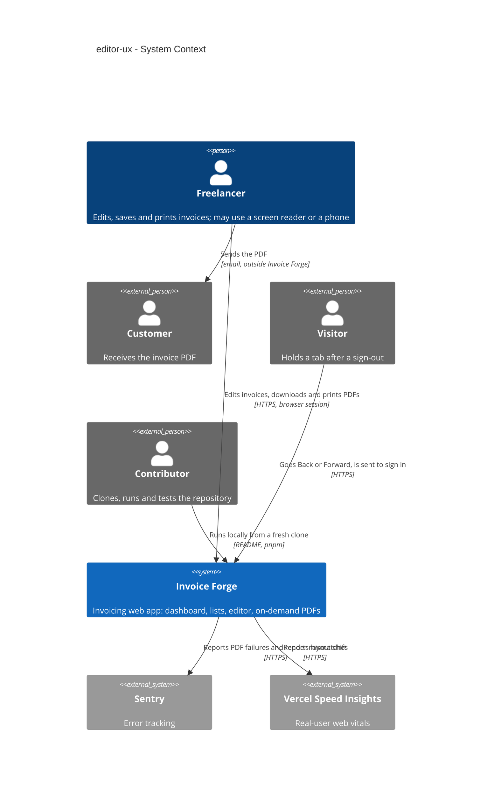

## 4. Solution strategy

**Target surfaces:** `web-frontend` only — the dashboard, the lists, the editor, the PDF preview dialog and the PDF itself, all inside the existing Next.js app. The feature adds no endpoint, server action, business function, schema or migration (spec §6.1 "no field is added or stored"). One server action result changes, additively: `getInvoiceEditorData` also returns `storedAmounts`, the subtotal, tax and total stored on the invoice, so an issued invoice's preview and PDF print them (ADR-0002, AC-10), and for a new invoice it returns a filled `initialData` (today and due date in the Freelancer time zone, the default sender profile, its default bank account and currency) instead of none (AC-06); both are recorded in invoice-integrity `contracts/server-actions.md`. Its server-side work stays inside the web app container: RSC pages hand the editor richer initial data, the private layouts read whether the account has a saved zone (Flow 6), and signed-in pages get response headers (§8). Inline, not an ADR: the gate scores 0 of 3 — a single surface, reversible, and no real alternative, since the result changes are additive and have only the two editor pages as callers. Downstream: no schema change, so `data-model` stages no migration and only records the result change; `api` has no endpoint to derive, and the additive result change is recorded in invoice-integrity `contracts/server-actions.md` and in `data-model.md`.

**Top strategic choices (the seeds for ADRs):**

1. **The PDF toolkit is a lazy module behind one hook** — `@react-pdf/renderer`, the react-pdf invoice document and the generate/download/print helpers move into one entry module that is only reached through a dynamic `import()`. Every PDF trigger (the invoices list's and related invoices' row actions, the dashboard's recent invoices, the PDF preview dialog, the editor header) calls one `usePdfAction` hook that fetches the module once per visit and owns the "preparing", "couldn't prepare — try again" and "newer version — reload" states. The editor's live preview is HTML (ADR-0002), so it needs no toolkit for its first display; it warms the module in the background once the page is idle (allowed by AC-01), so its Download and Print rarely wait. Serves quality goal 3 and spec §6 "PDF toolkit on non-printing pages" (ADR-0001).
2. **One document model, two layouts** — a pure `buildInvoiceDocument()` turns the editor form or an issued invoice into every label, line, formatted date and formatted amount the document shows; the HTML preview and the react-pdf document only lay that model out. Wording lives in one place, so a layout wording change reaches both or neither (AC-10). Serves quality goal 2 (ADR-0002).
3. **One editor store per opened editor, built from the server's data** — the module-level zustand singleton becomes a store factory provided through React context, created synchronously from the RSC page's data and keyed by the invoice and the signed-in Freelancer. The first server and browser render already show the opened invoice (AC-06), and no state survives into another invoice or another Freelancer's visit (AC-07). Serves quality goal 1 (ADR-0003).
4. **One save command owns every outcome** — Save, Save and issue, Retry and confirming changed totals all call one store command that reads the form when it is called, tags the save with the form's revision and resolves every outcome itself: saved, saved with later edits, issued with later edits, created (address change), changed elsewhere, totals changed, field errors, failed. Totals shown after a save are either the stored figures (no edit since the save began) or recomputed from the lines on screen by the shared decimal module (architecture-hardening ADR-0006). Serves quality goal 1 (ADR-0005).
5. **One format module with a fixed locale** — money, calendar days and moments are formatted by one module with the `en-US` locale on both the server and the browser: money as `Intl` currency (`$1,234.50`, `UAH 1,234.50`), calendar days read in UTC (mcp-server ADR-0009), moments in the Freelancer time zone the server supplies. The lists, the editor, the document model and the PDF all use it, so the server's HTML and the browser's first render agree and the device language changes nothing (AC-08, AC-09). Serves quality goal 2 (ADR-0006).

**UI architecture (web-frontend):** unchanged hybrid — Next.js App Router, React Server Components for data, client components for the editor, composed from the existing shadcn/ui primitives and tokens (`docs/design-system.md`). Within it, the editor's phone and desktop layouts become one DOM tree switched by CSS breakpoints only, with no JavaScript width check deciding what renders; the phone layout is in the server's first HTML, and rotating a tablet restyles the same elements, so focus and a half-typed "12." survive (AC-13, AC-14; ADR-0004). No ADR for the hybrid itself: the only alternative (a client-side SPA) contradicts the repo's established stack.

**Tactical choices recorded inline (gate below 2 of 3):**

- **"Today" comes from the server.** The new-invoice page computes today's calendar day in the Freelancer time zone (UTC until one is saved, mcp-server ADR-0006) and passes it, with the due date that follows from the payment terms, in the editor's initial data. The browser clock and the time-zone cookie of architecture-hardening ADR-0010 do not decide it — the glossary does (spec §1).
- **Edits during a save are detected by a form revision counter**, not by comparing values: every edit increments it, and a save remembers the revision it started from. AC-04 counts an edit that puts a value back as a change, which a value comparison would miss.
- **The proposed invoice number stays asynchronous.** Its field reserves its final size and shows a loading state until the hint arrives, so the layout does not move (AC-06).
- **Spec §8 open question "currencies sharing a symbol" (due before design) — closed with the spec's default.** The `Currency` enum is UAH, USD, EUR, GBP and PLN; only USD uses "$", so no two currencies share a symbol today. The app's existing money format stays, identical on screen and in the PDF. Revisit if a second dollar currency is added.

Each tactical decision in later sections should trace to one of these seeds. Tactical decisions that *contradict* a strategic choice are red flags — surface them in §11.

## 5. Building block view

The feature keeps the repo's layering — RSC pages and the proxy at the edge, server actions over the `lib/services` business layer, Prisma/PostgreSQL underneath — and adds no server layer: the server-side changes are inside the existing editor read in `lib/services/invoices/editor-data.ts` (`storedAmounts`, and a new invoice's pre-filled dates, sender profile, bank account and currency) and the private layouts' saved-zone check (`zoneCookieNeedsRefresh` over the existing `getSavedTimeZone`, Flow 6), with no schema change. All its building blocks live in the browser-facing part of the web app and in pure modules both sides import. Three small shared modules are added under `lib/` (the lazy PDF entry, the document model, the format module), the editor store becomes a factory with a provider, and the editor's dialogs move into its existing modal container. Pure modules stay framework-free so the server render, the browser and vitest run the same code (the pattern of architecture-hardening ADR-0006).

**Internal decomposition:**

```
lib/
├── format/                      NEW  formatMoney, formatDay, formatMoment — fixed en-US (ADR-0006)
├── invoice-document/            NEW  buildInvoiceDocument(source) + the document's wording (ADR-0002)
├── pdf/                         NEW  the only importer of @react-pdf/renderer (ADR-0001)
│   ├── invoice-pdf-kit.tsx           lazy entry: react-pdf document + generate / download / print
│   └── load-pdf-kit.ts               cached import() + failure classification (offline / new version)
└── helpers/
    ├── invoice-calculations.ts       unchanged — totals rule shared with the services (arch-hardening ADR-0006)
    ├── calendar-day.ts               unchanged — calendar-day storage rules (mcp-server ADR-0009)
    └── invoice-pdf-helpers.tsx       REMOVED — moved into lib/pdf/
hooks/
├── use-pdf-action.ts            NEW  preparing / try again / reload states for every PDF trigger
├── use-invoice-pdf.tsx               rewritten over use-pdf-action
└── use-editor-header-buttons.tsx     thinned — calls the store's save command (ADR-0005)
store/invoice-editor-store/
├── create-invoice-editor-store.ts    the old module-level store, as a factory (ADR-0003)
├── invoice-editor-provider.tsx  NEW  creates the store once per mount, keyed by Freelancer + invoice
├── save-command.ts              NEW  save(intent): revision tag + every outcome (ADR-0005)
└── selectors.ts                      useFormData, useSummary, … read the store from context
components/
├── invoice-editor/                   one DOM tree for both layouts (ADR-0004); HTML preview over the document model
├── invoices/ , dashboard/ , modals/  PDF triggers call use-pdf-action; dates and money via lib/format
├── modals/invoice-editor/            invoice-editor-modal-container hosts every editor dialog, the save confirmation included
├── session-restore-guard.tsx    NEW  pageshow guard in the signed-in layouts (ADR-0007)
├── theme-toggle.tsx                  the one theme switcher (replaces both teheme-toggle copies)
└── ui/                               15 unused primitives + toggle removed
proxy.ts                              adds Cache-Control: private, no-store on signed-in pages (ADR-0007)
app/(invoice-editor)/invoices/new     passes today and the due date in the Freelancer time zone
scripts/check-pdf-chunks.ts      NEW  CI build-output check: no toolkit in non-editor routes' initial chunks
tests/e2e/                            + accessibility checks, the date matrix, AC-07 isolation, first-PDF timing
playwright.config.ts                  + chromium and webkit projects (webkit for Safari's back/forward cache, AC-07)
.github/workflows/test.yml            + e2e job: production build, then the date-matrix and accessibility suites
README.md                             setup and test steps verified in a fresh clone (AC-15)
package.json                          - uuid, @types/uuid and the packages only the removed ui components use; + @axe-core/playwright (dev)
```

**C4 Container (L2):**

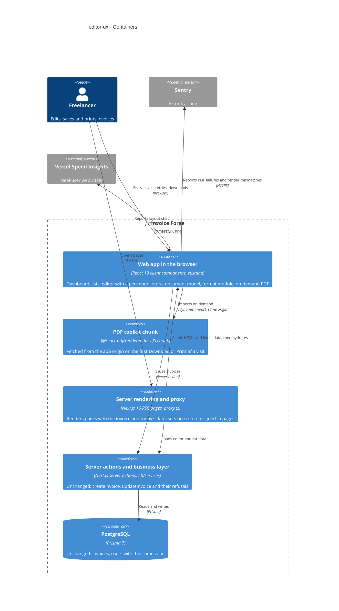

The web app in the browser is the feature's one surface (`web-frontend`). The PDF toolkit chunk is drawn apart because it now ships separately and is fetched only on demand. Server rendering, server actions and the database are existing containers, shown because the editor's first display and its saves cross them; their contracts change only additively — the `getInvoiceEditorData` result (§4) — and the private layouts make one existing read of the saved zone (Flow 6).

## 6. Runtime view

Two seed flows, one per feature risk; the `sequences` stage adds the rest (every §5 AC, including first display, sign-out and Back, dates, screen-reader and phone flows). Participants are the §5 containers; the editor store and the save command live inside the web app in the browser.

**Critical flow 1: a Save with an edit made while it runs, and a Retry (ADR-0003, ADR-0005)**

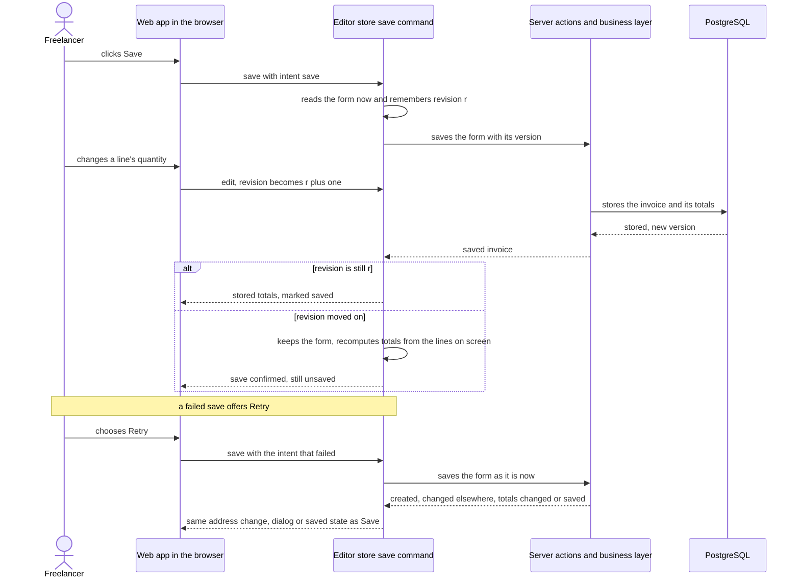

**Critical flow 2: a PDF on demand from a list (ADR-0001)**

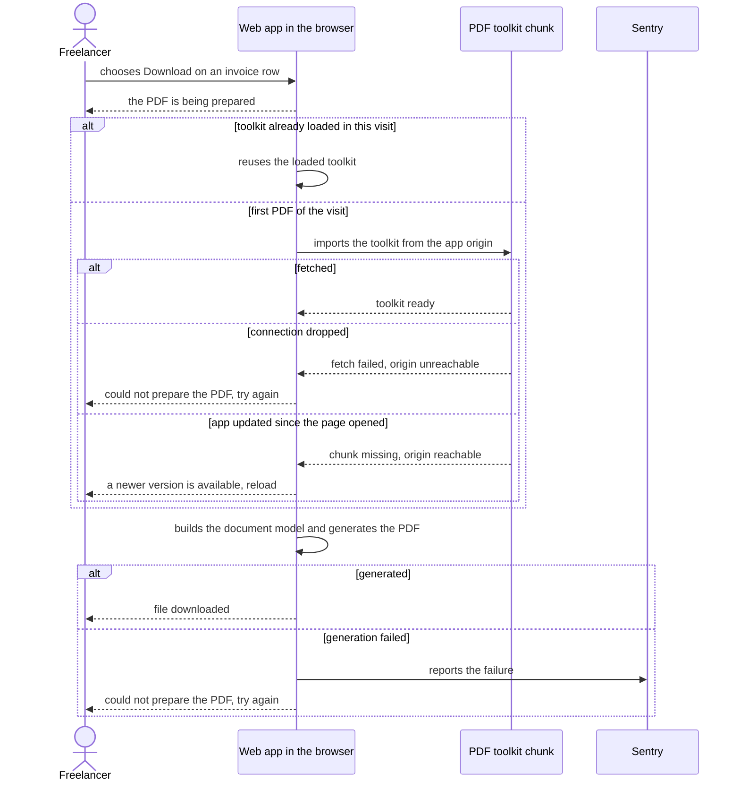

The flows below were added by `sequences`. They use the generic runtime vocabulary: **user** is the Freelancer, a Visitor or Freelancer B, as each flow names. **ui** is the web app in the browser, with the editor store, its save command, the document model and the format module. **service** is server rendering, the proxy, server actions and the business layer, which also serve the PDF toolkit chunk from the app origin. **data-store** is PostgreSQL. **external-system** is Sentry. No flow adds an entity, a column or an index: the only write is the existing invoice save.

### Flow 3: a refused save or a Save and issue while the Freelancer keeps typing (AC-04, AC-05, AC-05b)

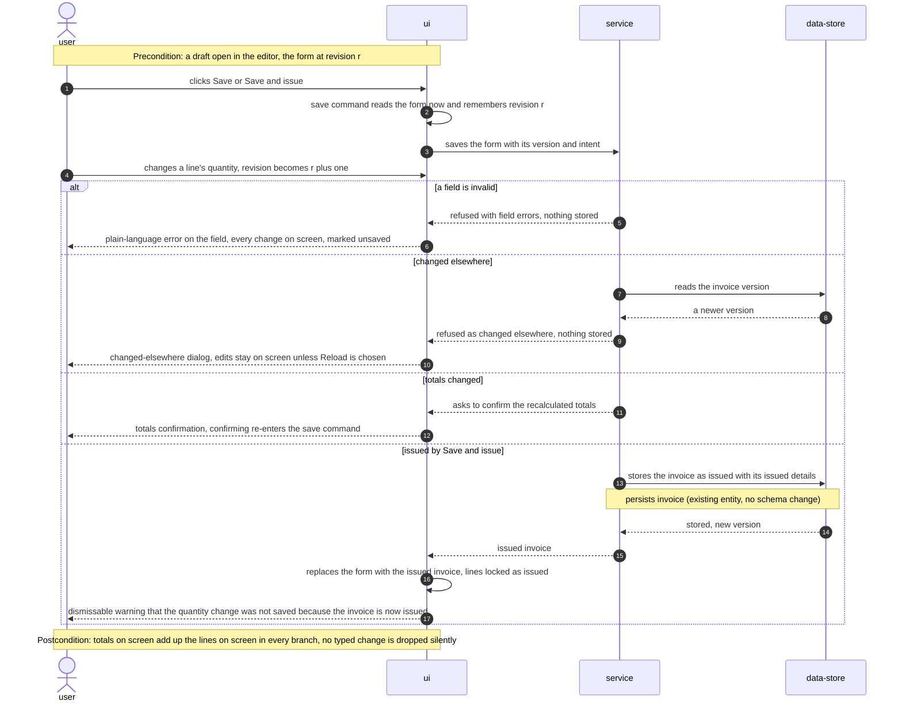

### Flow 4: Retry after a failed save (AC-05c, AC-05d)

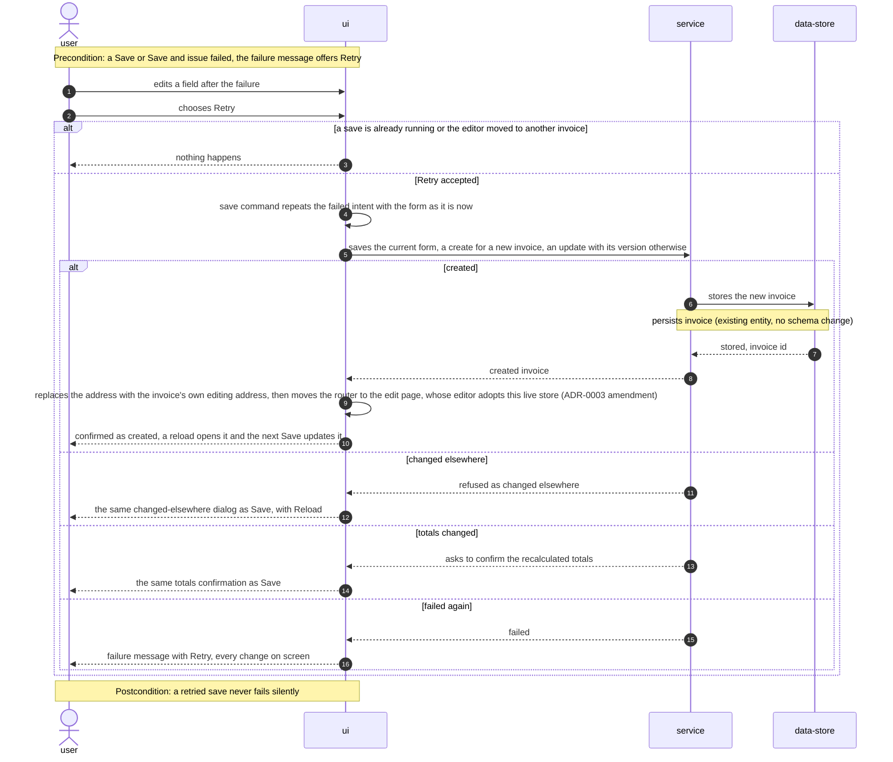

### Flow 5: the editor's first display (AC-06)

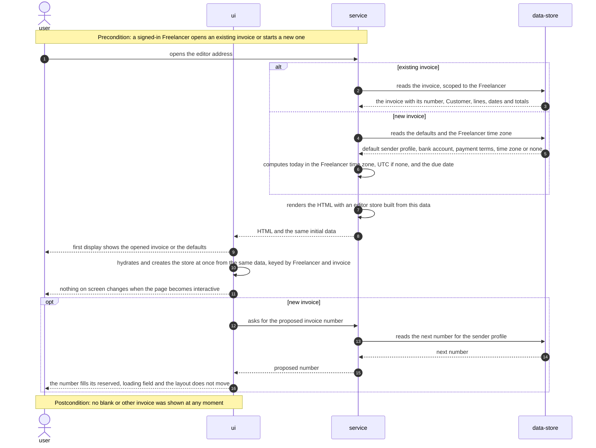

### Flow 6: sign-out, Back and Forward, and a second Freelancer in the same tab (AC-07)

```mermaid
sequenceDiagram
    autonumber
    actor U as user
    participant UI as ui
    participant S as service
    participant D as data-store

    Note over U,UI: Precondition: Freelancer A had an invoice open in this tab, then signed out
    Note over UI,S: signed-in pages are sent private and no-store, so the browser keeps no reusable copy
    U->>UI: a Visitor presses Back or Forward
    opt the browser restores a page from its back/forward cache
        UI->>UI: the restore guard hides the page before it shows and reloads it
    end
    UI->>S: requests the signed-in page again
    S-->>UI: no session, redirect to sign in
    UI-->>U: sign-in page, none of A's data
    Note over UI: the sign-in page writes the tz cookie (the browser's time zone), with no refresh (architecture-hardening ADR-0010, amendment T57)
    U->>S: Freelancer B signs in in the same tab
    S->>D: the private layout reads whether B's account has a saved zone
    opt no saved zone, and the tz cookie is missing or stale
        UI->>UI: writes the tz cookie and refreshes once, which seeds B's zone (ADR-0010, amendment T60)
    end
    U->>UI: B opens the editor, or goes Back and Forward
    UI->>S: requests the page, nothing reused from the browser cache
    alt the address of A's invoice
        S->>D: reads the invoice, scoped to B
        D-->>S: no such invoice for B
        S-->>UI: invoice not found
        UI-->>U: the same not-found result as any invoice that isn't B's
    else B's invoice or a new one
        S->>D: reads B's data
        D-->>S: B's invoice or defaults
        S-->>UI: HTML and initial data for B
        UI->>UI: creates a fresh editor store keyed by B and the invoice
        UI-->>U: only B's data
    end
    Note over U,UI: Within one visit, each invoice gets its own store, so Back and Forward between two invoices never mixes their lines, Customer or totals
```

### Flow 7: dates and money, the same on the server and in the browser (AC-08, AC-09)

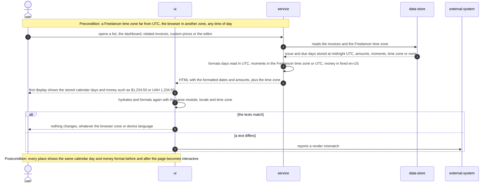

### Flow 8: the editor's preview and its PDF from one document model (AC-01, AC-09, AC-10)

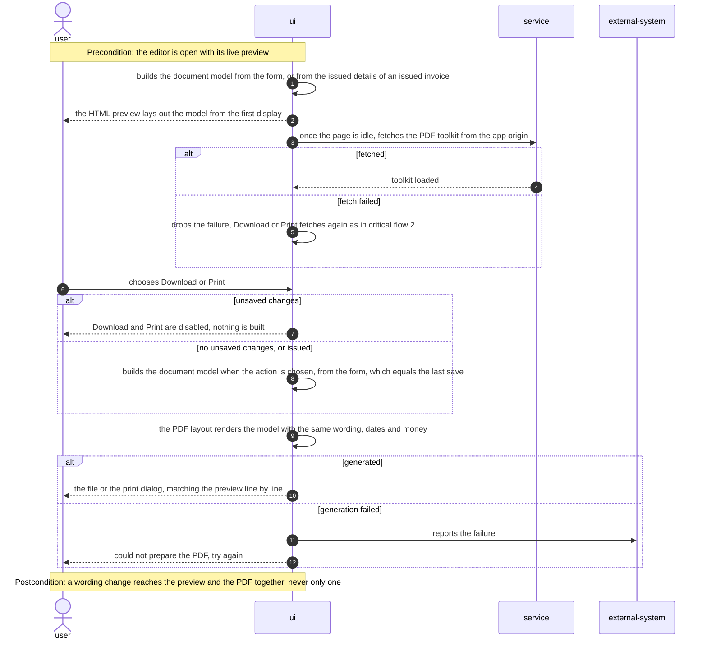

### Flow 9: a screen reader through the lines and a refused save (AC-11, AC-12)

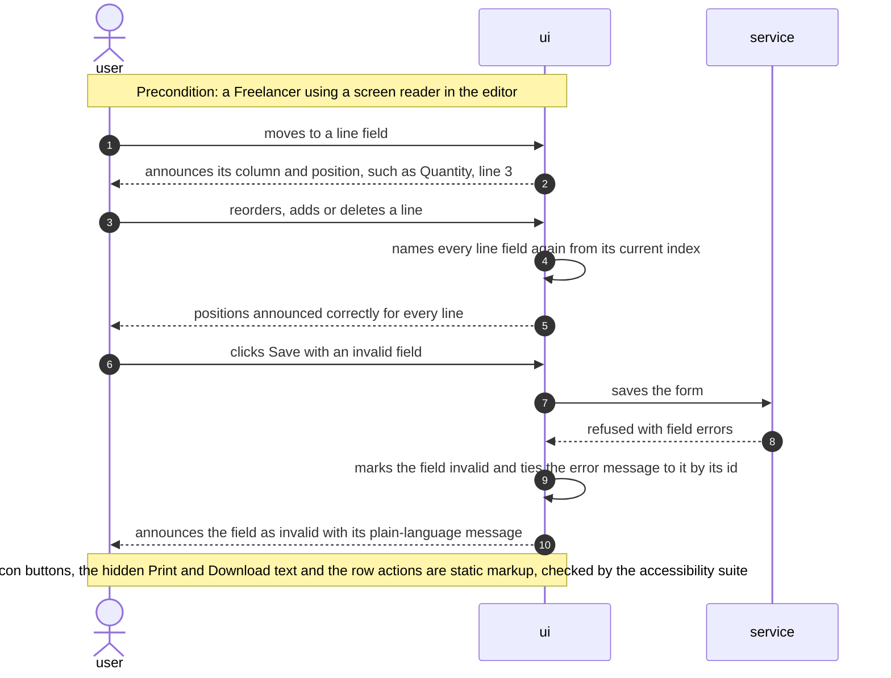

### Flow 10: the phone layout and a tablet rotation (AC-13, AC-14)

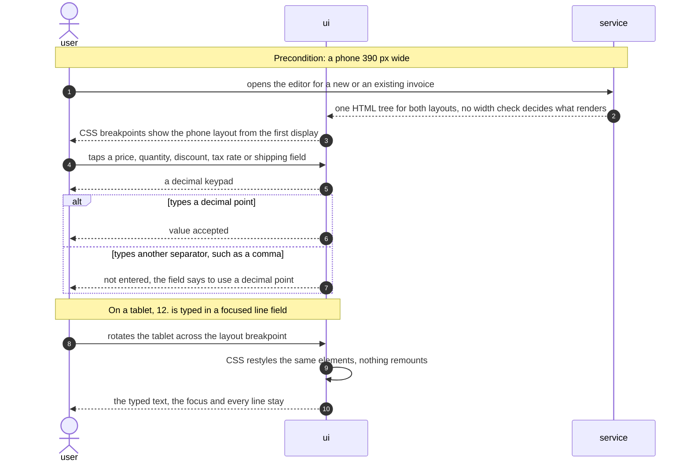

**Coverage (user stories and acceptance criteria to flows):**

| Item | Shown by |
|---|---|
| US-01 | Critical flow 2, Flow 8 |
| US-02 | Critical flow 1, Flow 3, Flow 4 |
| US-03 | Flow 5, Flow 6 |
| US-04 | Flow 7 |
| US-05 | Flow 8 |
| US-06 | Flow 9 |
| US-07 | Flow 10 |
| US-08 | N/A: the Contributor works with the README and the repository, with no runtime flow in the app (AC-15, AC-16) |
| AC-01 | Critical flow 2 (no fetch on open, reuse in the visit), Flow 8 (the editor warms the toolkit when idle) |
| AC-02 | Critical flow 2, branch "connection dropped" |
| AC-02b | Critical flow 2, branches "app updated since the page opened" and "generation failed" |
| AC-03 | Critical flow 1, branch "revision moved on" |
| AC-04 | Critical flow 1 (both branches), Flow 3 postcondition |
| AC-05 | Flow 3, branches "a field is invalid" and "changed elsewhere" |
| AC-05b | Flow 3, branch "issued by Save and issue" |
| AC-05c | Flow 4, branch "created" |
| AC-05d | Flow 4, branches "changed elsewhere", "totals changed" and "a save is already running or the editor moved to another invoice" |
| AC-06 | Flow 5 |
| AC-07 | Flow 6 |
| AC-08 | Flow 7 |
| AC-09 | Flow 7 (money format in lists and the editor), Flow 8 (preview and PDF, Download and Print only without unsaved changes) |
| AC-10 | Flow 8 (issued details, one model for both layouts) |
| AC-11 | Flow 9 (line positions after a reorder, add or delete). The static names are markup, checked by the accessibility suite |
| AC-12 | Flow 9, the refused save |
| AC-13 | Flow 10, the phone first display and the decimal keypad |
| AC-14 | Flow 10, the tablet rotation |
| AC-15 | N/A: not a runtime flow. Proven by following the README in a fresh clone |
| AC-16 | N/A: not a runtime flow. Proven by the build, lint and the test run, the editor's dialogs behave as today |

**Flagged by `sequences`:**
- No flow is asynchronous: there is no webhook, queue, scheduled job or third-party callback, so no idempotency key, retry policy or dead-letter step applies. The PDF toolkit fetch is a same-origin request that the Freelancer starts again from the page.
- No new participant: Sentry is already declared in §3 and §5. Critical flows 1 and 2 keep their container names, and Flows 3 to 10 use the generic vocabulary.
- No new entity, column or index. The only write is the existing invoice save, and the reads are the existing owner-scoped invoice, defaults, time-zone and next-number reads. `data-model` has no schema change to derive.
- No decision rises to a new ADR. Each flow realises ADR-0001 to ADR-0007 as accepted.

## 7. Deployment view

No infrastructure change: the feature ships inside the existing single Vercel deployment (region `fra1`), with no new function, cron, store or environment setting. The PDF toolkit becomes a separate static chunk served from the same origin under the same content-security rules. Releases follow the four waves of spec §1, each a normal deploy; there is no migration. Vercel Skew Protection stays off — a page opened before a deploy that then misses the toolkit chunk shows "a newer version is available, reload" (AC-02b), which the e2e suite exercises against a missing chunk.

**Monitoring:**
- **Layout shift** — Vercel Speed Insights CLS for the editor route at phone width; the spec §6 NFR target (≤ 0.1 at p75) is read 14 days after the wave-4 release.
- **Render mismatches** — Sentry issues from React hydration errors on the invoices list, dashboard and editor; baseline counted over the 14 days before release, target 0 within 14 days after (spec §7).
- **PDF failures** — Sentry events from `use-pdf-action` tagged `pdf.stage` = `fetch` / `version` / `generate`, so a rise in "newer version" failures after a deploy is visible separately from generation errors.
- **Tracing** — none added. The one new server-side call is the private layouts' saved-zone read (Flow 6), a primary-key lookup (`User_pkey`) inside the existing render; a failed lookup is logged and falls back to refreshing, as before (ADR-0010 amendment).

**Build and CI gates (added):**
- `scripts/check-pdf-chunks.ts` after `next build`: fails when any route other than the invoice editor lists a chunk containing `@react-pdf/renderer` among its initial chunks (spec §6 "PDF toolkit on non-printing pages").
- A new `e2e` job in `.github/workflows/test.yml` builds the app for production against a throwaway PostgreSQL container and runs two suites on every PR: the accessibility suite (`@axe-core/playwright` on the editor — new and existing invoice — the invoices list and the dashboard, failing on any serious or critical violation) and the server/browser date matrix (spec §6 "Server/browser date agreement", "Accessibility" — both measured in CI). The other e2e suites (AC-07 isolation, first-PDF timing, Retry outcomes) run before each wave ships and nightly, as `tests/README.md` places e2e today.
- Existing gates unchanged: lint, `tsc`, unit and integration, and every `invoice-integrity` acceptance test (spec §6 "No regressions").

**Scaling thresholds:** none — the feature removes browser weight and adds no server load. The toolkit chunk (~1.6 MB) is the only size to watch: if it grows past what downloads in 3 s at 10 Mbit/s (spec §6 "First PDF after page load"), revisit ADR-0001 option 2 (server rendering).

## 8. Crosscutting concepts

The repo's conventions are inherited unchanged (results, errors, IDs, auth guards, validation — §2). The rows below are the ones this feature adds or tightens.

| Concept | Convention | Where defined |
|---|---|---|
| Session isolation in the browser | Signed-in page responses carry `Cache-Control: private, no-store` (set in `proxy.ts`); `SessionRestoreGuard` in the signed-in layouts hides and reloads any page restored from the back/forward cache; the editor store is created per mount and keyed by Freelancer and invoice | ADR-0007, ADR-0003 |
| Display formatting | Money, calendar days and moments only through `lib/format` with the fixed `en-US` locale; calendar days read in UTC, moments in the Freelancer time zone passed from the server; lint forbids `toFixed(` and `toLocale*String(` in `components/` and `app/` | ADR-0006 |
| "Today" and time zone | Today's calendar day is computed on the server in the Freelancer time zone (UTC until saved) and passed to the page; the browser clock never decides it | §4 inline; mcp-server ADR-0006 |
| Document wording | Every label of the invoice document lives in `lib/invoice-document`; the preview and the PDF only lay out the model | ADR-0002 |
| On-demand code | `@react-pdf/renderer` is imported only by `lib/pdf/invoice-pdf-kit.tsx` (lint `no-restricted-imports`); every PDF trigger goes through `use-pdf-action`; fetched from the app's own origin under the existing CSP | ADR-0001 |
| Error handling (PDF) | A failed fetch is classified as offline (try again) or new version (reload) by probing the app origin; a generation failure is reported to Sentry with `pdf.stage` and shown as "could not prepare, try again"; the page stays usable | ADR-0001 |
| Error handling (save) | Unchanged server results (`ActionResult` with `CHANGED_ELSEWHERE`, `TOTALS_CHANGED`, field errors, `FAILED`); the store's save command is the only place that turns them into UI state, for Save and Retry alike | ADR-0005; architecture-hardening ADR-0009 |
| Accessibility | Every editor field uses the shadcn `Field`/`Label` pairing so its visible label is its name; field errors render with an id and the input carries `aria-invalid` + `aria-describedby`; line fields without a visible label get `aria-label` "{column}, line {n}" from the current index; icon-only buttons get `aria-label`; text hidden on narrow screens keeps an accessible name (`sr-only`); row action buttons name the action and the invoice number | here; `docs/design-system.md` |
| Responsive layout | One DOM tree per screen; breakpoints rearrange and hide (`hidden`), never a JavaScript width check that changes the structure | ADR-0004 |
| Amount inputs | One shared `AmountInput` (`inputMode="decimal"`, "." as the only decimal separator) for line price and quantity, discount, tax rate and shipping | here; §11 iOS keypad risk |
| Dialogs | Every editor dialog, the save confirmation included, goes through `store/use-modal-store.ts` and is mounted by `invoice-editor-modal-container.tsx` | repo convention (§2) |
| Observability | Sentry for PDF failures and hydration errors; Vercel Speed Insights for CLS; no new tracing | §7 |
| Logging | Unchanged; no new server logs | — |
| Authentication / authorization | Unchanged server checks (`proxy.ts` deny-by-default, `requireLiveUser` in the editor layout, owner-scoped services); "invoice not found" for another Freelancer's invoice as today | architecture-hardening ADR-0001, ADR-0002; service-layer ADR-0003 |
| ID strategy | Unchanged `cuid()` on the server; the editor's client-side line keys use `crypto.randomUUID()` instead of the `uuid` package | §2; repo hygiene |
| Internationalisation | None — English UI and a fixed `en-US` format | ADR-0006 |
| Events | N/A — no events or queues | — |

## 9. Architecture decisions

| # | Title | Status | Section |
|---|---|---|---|
| 0001 | Load the PDF toolkit on demand through one lazy module | Accepted | §4 |
| 0002 | Render the preview and the PDF from one invoice document model | Accepted | §4 |
| 0003 | Create one editor store per mounted editor from the server's data | Accepted | §4 |
| 0004 | Switch the editor's layouts with CSS only, in one DOM tree | Accepted | §4 |
| 0005 | Route every save and Retry through one store save command | Accepted | §4 |
| 0006 | Format money and dates in one module with a fixed en-US locale | Accepted | §4 |
| 0007 | Mark signed-in pages no-store and reload pages restored from the back/forward cache | Accepted | §8 |

ADR files live under `docs/features/editor-ux/adr/NNNN-<title>.md`.

## 10. Quality requirements

Each top-3 goal from §1 expanded into scenarios. Targets are quoted from spec §6 NFR.

**QG-1. Editor truthfulness** (ADR-0003, ADR-0005)
- **When:** a line is changed while a Save or Save and issue is running, in each of 50 runs, and every Save and Save-and-issue outcome (created, updated, issued, changed elsewhere, totals changed, field error) is also reached through Retry.
- **Then:** 0 changes lost or marked saved by mistake across 50 runs of an edit raced against a save; 100 % of sampled moments show subtotal, tax and total equal to the lines on screen, across the 50 race runs; 100 % of Save and Save-and-issue outcomes produce the same address, dialog and saved state when reached through Retry.
- **How verify:** vitest tests on the store's save command with a controllable fake server action (resolve after an injected edit; sample totals after every state change against `computeInvoiceAmounts` of the visible lines), plus one Playwright e2e per outcome that reaches it once by Save and once by Retry and compares address, dialog and unsaved flag.

**QG-2. Document consistency** (ADR-0002, ADR-0006)
- **When:** the invoices list, dashboard, related invoices and editor are rendered with the Freelancer time zone set to UTC−10, UTC and UTC+14 and the browser in a different zone, 5 minutes either side of midnight; and the preview and PDF are produced for the fixture set (draft, issued, USD, UAH, discount, tax, multiple lines).
- **Then:** 0 render-mismatch warnings and 0 differing dates on the invoices list, dashboard, related invoices and editor; 100 % identical text between preview and PDF over the fixture set.
- **How verify:** a Playwright matrix in CI (`timezoneId` per browser context, a fixed clock via `page.clock`, the account's time zone seeded per run) that fails on any hydration console error and compares each page's dates with the stored days; a vitest parity test that builds the document model per fixture, renders the PDF, extracts its text and compares it with the preview's rendered text.

**QG-3. Page weight, stability and access** (ADR-0001, ADR-0004, ADR-0007)
- **When:** a signed-in page other than the invoice editor loads; a Freelancer chooses Download or Print after page load; the editor, invoices list and dashboard are scanned; phone-width visitors use the editor after release.
- **Then:** 0 bytes of the PDF toolkit in the code every signed-in page except the invoice editor loads before any interaction; ≤ 3 s p95 from choosing Download or Print to the file or print dialog, on a 10 Mbit/s connection; 0 serious or critical violations reported by an automated accessibility checker on the editor (new and existing invoice), the invoices list and the dashboard; cumulative layout shift ≤ 0.1 at p75 on the editor for phone-width visits.
- **How verify:** `scripts/check-pdf-chunks.ts` against the per-page asset list after `next build` in CI; a Playwright test with network throttling to 10 Mbit/s, 20 runs, timing from the click to the download or print event; `@axe-core/playwright` on the four page states, failing on serious or critical; Vercel Speed Insights CLS for the editor at phone width, read 14 days after release.

**No regressions (all goals).** 100 % of existing automated tests pass, including every `invoice-integrity` acceptance test — the CI run on every wave, plus the e2e suite before each wave ships. The AC-07 isolation is proven by a Playwright test in the Chromium and WebKit projects: A signs out, a Visitor goes Back, B signs in and goes Back and Forward, and no frame shows A's invoice number.

## 11. Risks and technical debt

| Risk / debt | Severity | Mitigation | Owner |
|---|---|---|---|
| On iOS with a region that uses "," as the decimal separator, the `inputMode="decimal"` keypad may offer "," and no ".", so AC-13 ("a decimal point '.' can be typed", "the only decimal separator these fields accept") could not be met as written | Medium | Check on a real iPhone with a Ukrainian region early in wave 4; if "." is missing, take it to the spec owner (accept "," and normalise it, or change the keypad type) before building the remaining phone work | Dmytro Hopko |
| Moving from the module-level store to a per-mount store (ADR-0003) touches about 20 editor components and the header hook; a missed consumer breaks a save path covered by `invoice-integrity` | Medium | Ship it alone in wave 3; run the full `invoice-integrity` acceptance suite and the new store tests; a lint rule forbids importing the old module-level store | Dmytro Hopko |
| Replacing the desktop resizable panels with one CSS-only layout (ADR-0004) can change the desktop editor's look or resizing | Medium | Visual-regression snapshots of the desktop and phone editor before and after; keep the drag handle's behaviour | Dmytro Hopko |
| Back/forward-cache behaviour differs between browsers; the no-store header alone does not stop Safari (ADR-0007) | Medium | The `pageshow` guard covers it; the AC-07 e2e runs in both the Chromium and WebKit Playwright projects | Dmytro Hopko |
| Only the accessibility and date-matrix e2e suites run in CI; AC-07 isolation, first-PDF timing and the Retry-outcome e2e run before each wave ships and nightly (`tests/README.md`), so a regression there can merge between waves | Medium | Run them on every wave's release candidate; the new CI e2e job (§7) can take more suites later | Dmytro Hopko |
| KPI baselines are still TBD (render mismatches, phone-width CLS, accessibility violations — spec §7) | Medium | Measure all three before wave 1 starts: Sentry hydration issues and Speed Insights CLS over 14 days, one axe run on the three pages | Dmytro Hopko |
| The first PDF of a visit can exceed 3 s on connections slower than the NFR's 10 Mbit/s, since the 1.6 MB toolkit downloads first | Low | The editor warms the module when idle (§4); watch Sentry `pdf.stage` events; ADR-0001 option 2 (server rendering) stays the fallback if the chunk grows | Dmytro Hopko |
| The failed-fetch classification (offline vs new version) may misjudge a captive portal or a partial outage | Low | Both outcomes keep the page usable and offer a next step; the failure is reported to Sentry with its stage | Dmytro Hopko |
| `docs/architecture-map.md` reflects `ded1be7` and is stale (it still says there are no tests and predates `lib/services`) | Low | Run `/sdd:survey` after this feature ships | Dmytro Hopko |

**Accepted debt (acceptable in v1, plan to fix later):**
- Pages outside the editor keep `useIsMobile` and their JavaScript layout switch; only the editor guarantees the phone layout on first display.
- The accessibility guarantee and its automated check cover the editor, the invoices list and the dashboard only (spec §3); other pages get only the shared component fixes.
- Vercel Skew Protection stays off; a page opened before a deploy may ask the Freelancer to reload before printing (AC-02b).

## 12. Glossary

| Term | Meaning |
|---|---|
| Freelancer | A signed-in account holder who owns sender profiles, customers, products and invoices and sees only their own data (CONTEXT.md) |
| Customer | A party a Freelancer bills; receives the PDF and never signs in (CONTEXT.md) |
| Visitor | Anyone reaching the app without a signed-in session — here, whoever holds a tab after a sign-out (CONTEXT.md) |
| Contributor | A developer who clones the repository to run, test or change the app, following its README and tests (CONTEXT.md) |
| Freelancer time zone | The time zone saved on the Freelancer's account that decides "today" and how moments are shown; UTC until saved (CONTEXT.md) |
| Draft invoice / Issued invoice | An invoice still being prepared and fully editable / an invoice that left draft and was not cancelled, whose lines are locked (CONTEXT.md) |
| Issued details | The copy of sender profile, Customer and bank account details an issued invoice keeps and prints (CONTEXT.md) |
| Calendar day | An invoice's issue or due date: a day with no time and no zone, stored at `T00:00:00Z` and shown as stored (mcp-server ADR-0009) |
| Moment | A point in time, such as a custom price's creation, shown as a day in the Freelancer time zone |
| PDF toolkit | The library that builds the invoice PDF in the browser (`@react-pdf/renderer`), now fetched only on demand (ADR-0001) |
| Document model | The one description of what an invoice document says — labels, parties, lines, formatted dates and amounts — that both the preview and the PDF lay out (ADR-0002) |
| Save command | The editor store's single entry for Save, Save and issue, Retry and confirming totals, which resolves every save outcome (ADR-0005) |
| Form revision | A counter the editor increments on every edit; a save compares it with the revision it started from to tell whether the Freelancer changed something meanwhile |
| First display | What the page shows before the Freelancer interacts with it — the server's HTML and the browser's first render, which must agree (AC-06, AC-13) |
| Back/forward cache | The browser's in-memory copy of a recently left page, restored by Back or Forward without asking the server (ADR-0007) |

New terms not yet in `CONTEXT.md`: *first display* and *document model* are used across the spec and this SAD — candidates for `/sdd:glossary editor-ux`.
