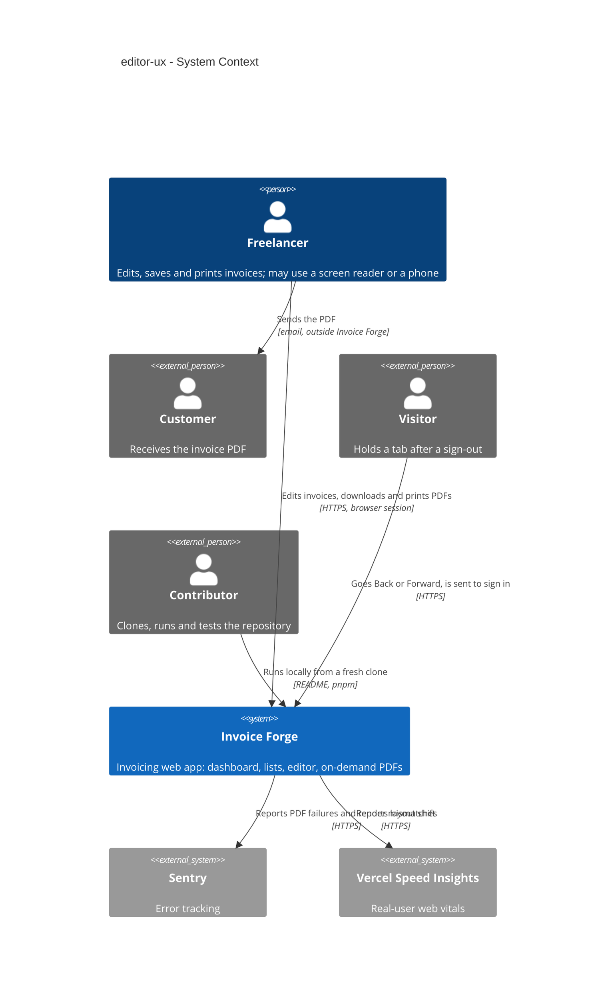
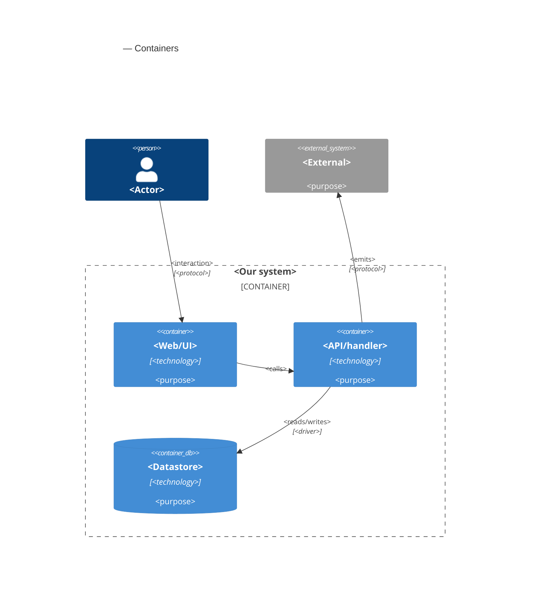

# Software Architecture Document — editor-ux

<!-- 12 Arc42 sections. Empty section → <!-- N/A: <one-line reason> -->. -->
<!-- C4 Context (L1) lives inline in §3. C4 Container (L2) lives inline in §5. -->
<!-- Numbers in §10 come VERBATIM from spec.md §6 NFR — no inventing, no rounding. -->

## 1. Introduction and goals

**Intent.** Make the invoice editor and the lists around it solid before the app is shown publicly, without changing a single business rule (spec §1, §2). Pages that never print stop loading the PDF toolkit, and Download, Print and the PDF preview fetch it on demand. The editor always tells the truth: it shows the opened invoice from the first display, its totals add up the lines on screen, a change typed during a save is never lost or wrongly marked saved, and Retry behaves exactly like Save. Every list, the editor, the preview and the PDF show the same calendar day and the same money format, whatever the Freelancer time zone, the browser's zone or the device language. The editor works with a screen reader and opens in its phone layout on a phone. The repository loses its unused components and packages, keeps one theme switcher and gets a README that works as written. Everything `invoice-integrity` decided about saves, refusals and issued invoices stays as it is (spec §3). The people served are the Freelancer who uses the editor every day, the Customer who reads the PDF, and the Contributor who clones the repository.

**Top-3 quality goals (1-liners; full scenarios in §10):**

1. **Editor truthfulness** — no change is lost or marked saved by mistake, totals always equal the lines on screen, Retry reaches the same outcomes as Save, and nothing from another invoice or another signed-in visit ever appears in the editor.
2. **Document consistency** — the preview, the PDF, the editor and every list show the same calendar day and the same money format, so what the Freelancer checked is what the Customer reads.
3. **Page weight, stability and access** — no PDF toolkit on pages that don't print, no layout jump on phones, and no serious or critical accessibility violation on the editor, the invoices list and the dashboard.

**Stakeholders.**

| Role | Interest | Sign-off owner? |
|---|---|---|
| Freelancer | Creates, saves, issues and prints invoices in the editor; reads dates and amounts in the lists; may use a screen reader or a phone | No |
| Customer | Receives the PDF outside the app; needs it to match what the Freelancer reviewed | No |
| Visitor | Reaches a signed-out tab after a sign-out; must see none of the previous Freelancer's data (AC-07) | No |
| Contributor | Clones the repository, follows the README, runs the tests and changes the code (US-08) | No |
| Security Lead | Light review: per-session editor isolation (AC-07) and on-demand loading inside the content-security rules (spec §6.1) | Yes |
| Tech Lead | SAD approval | Yes |

<!-- Decision overrides (¶4) — populated by the critic resolution loop, empty otherwise. -->

## 2. Constraints

**Technical.**
- TypeScript 5 (strict) on Node.js, pnpm 10.
- Next.js 16.3.8 App Router (React Server Components, server actions, route handlers), React 19.2.3, next-auth 5.0.0-beta.32 (JWT sessions), zustand 5, react-hook-form 7 + zod 3, date-fns 4, `@react-pdf/renderer` 4.3 (the PDF toolkit, rendered in the browser with `pdf(doc).toBlob()`).
- PostgreSQL via Prisma 7.10 + `@prisma/adapter-pg`. This feature changes no schema and adds no migration (spec §6.1 "no field is added, stored or sent anywhere new").
- Hosted on Vercel, region `fra1`; Sentry 10 (`@sentry/nextjs`, browser and server) and Vercel Speed Insights (`<SpeedInsights/>` in `app/layout.tsx`) are already mounted.
- Business logic only in `lib/services/*` behind `server-only` (service-layer ADR-0006), taking an `ActingFreelancer { userId, timeZone }` (service-layer ADR-0001) and returning `ActionResult<T>` (service-layer ADR-0002). This feature changes no service.
- Amounts are computed by the one shared decimal module `lib/helpers/invoice-calculations.ts` (architecture-hardening ADR-0006), used by both the editor and the services.
- Issue and due dates are calendar days stored at `T00:00:00Z` (mcp-server ADR-0009), handled by `lib/helpers/calendar-day.ts`; the Freelancer time zone is saved on the account, UTC until saved (mcp-server ADR-0006).
- A save carries the invoice version and is refused when the invoice changed elsewhere (invoice-integrity ADR-0004); the outcomes `CHANGED_ELSEWHERE`, `TOTALS_CHANGED`, field errors and `FAILED` already exist (architecture-hardening ADR-0009).
- Content-Security-Policy in `next.config.ts`: `script-src 'self' 'unsafe-inline' 'wasm-unsafe-eval'` — same-origin chunks and the PDF toolkit's WASM layout engine are already allowed; `tests/unit/security-headers.test.ts` guards it.
- Tests: vitest 5 (unit, component; an integration config on throwaway PostgreSQL containers) and Playwright 1.63 for e2e. CI (`.github/workflows/test.yml`) runs install, `prisma generate`, audit, lint, `tsc`, unit and integration; e2e runs before each wave ships, not yet in CI. No accessibility checker is installed.

**Organisational.**
- No external deadline; the trigger is the public showing of the app (spec §1).
- Size M (`docs/features/editor-ux/.size`), route `standard`; delivered in the four waves of spec §1: (1) PDF toolkit on demand + repository hygiene, (2) one date and money format, PDF and preview in step, (3) editor save, Retry and first display, (4) accessibility and mobile.
- Team: one developer (Dmytro Hopko) working with AI agents through the SDD pipeline.

**Conventions.**
- `docs/architecture-map.md` §Conventions and §Frontend — stale (reflects `ded1be7`: it still says no tests exist and predates `lib/services`); the ADRs of `service-layer`, `security-patch`, `architecture-hardening`, `mcp-server` and `invoice-integrity` are authoritative where they differ.
- UI: shadcn/ui (base-vega) over `@base-ui/react`, Tailwind 4 tokens in `app/globals.css`, `cn()`; reuse-first per `docs/design-system.md` (code-only canon).
- Modals go through the typed registry `store/use-modal-store.ts` and are mounted by a per-area modal container (the editor's is `components/modals/invoice-editor/invoice-editor-modal-container.tsx`, mounted in `app/(invoice-editor)/layout.tsx`).
- Client state in zustand; server data through RSC pages and server actions.

**Regulatory / external.**
- No new personal data; data classification stays Confidential (spec §6.1).
- Security review: required, light — confirm the per-session editor isolation (AC-07) and that on-demand loading stays inside the content-security rules (spec §6.1).

## 3. Context and scope

Invoice Forge is the invoicing web app a Freelancer uses to bill Customers. This feature moves no boundary: the Freelancer still works in the browser, the Customer still only receives the PDF the Freelancer sends, and a Visitor still only reaches the public pages and sign-in. What changes is inside the browser-facing part of the app — how pages load the PDF toolkit, what the editor shows on its first display and after a save, how dates and money are formatted, what the editor announces to a screen reader — plus the repository a Contributor clones.

<!-- brownfield: Next.js 16 monolith on Vercel fra1. @react-pdf/renderer is statically imported by lib/helpers/invoice-pdf-helpers.tsx and components/invoice-editor/invoice-pdf-document.tsx and reached from invoice-row-actions, related-invoices-list, the PDF preview modal and the editor header; no dynamic import exists. The editor's zustand store is a module-level singleton initialized in a useEffect (blank form on the first render); Retry lives in the store's toast and skips the header's address change and dialogs; the HTML preview and the PDF document duplicate their wording and format money with toFixed(2) + code; useIsMobile starts undefined → desktop first; no bfcache handling and no Cache-Control on signed-in pages; two theme-toggle copies; 15 unused ui components (explorer scan at ed1e370; architecture-map.md reflects ded1be7 and is stale) -->

**External systems (in / out):**

| Actor or system | Type | Interaction |
|---|---|---|
| Freelancer | Person | Opens the dashboard, lists and editor; saves, retries, issues; downloads, prints and previews PDFs; may use a screen reader or a phone |
| Customer | Person (external) | Receives the PDF from the Freelancer outside Invoice Forge; never signs in |
| Visitor | Person (external) | Anyone without a session — here, whoever holds a tab after a Freelancer signed out (AC-07) |
| Contributor | Person (external) | Clones the repository, follows the README, runs the tests (US-08); never touches production |
| Sentry | System (external) | Error tracking — receives failed PDF generations (AC-02b) and render-mismatch errors (spec §7 KPI) |
| Vercel Speed Insights | System (external) | Real-user web vitals — the measurement source for phone-width layout shift (spec §6 NFR) |

External: no new third-party system — deliberate; the PDF toolkit is fetched from the app's own origin (spec §6.1) and the accessibility checker is test-only tooling.

**C4 Context (L1):**



## 4. Solution strategy

**Target surfaces:** `web-frontend` only — the dashboard, the lists, the editor, the PDF preview dialog and the PDF itself, all inside the existing Next.js app. The feature adds no endpoint, server action, business function, schema or migration (spec §6.1 "no field is added, stored or sent anywhere new"). Its server-side work stays inside the web app container: RSC pages hand the editor richer initial data (today's date in the Freelancer time zone) and signed-in pages get response headers (§8). Inline, not an ADR: the gate scores 0 of 3 — a single surface, reversible, and no real alternative once no contract changes. Downstream: `data-model` and `api` have nothing to derive (no schema or contract change).

**Top strategic choices (the seeds for ADRs):**

1. **The PDF toolkit is a lazy module behind one hook** — `@react-pdf/renderer`, the react-pdf invoice document and the generate/download/print helpers move into one entry module that is only reached through a dynamic `import()`. Every PDF trigger (the invoices list's and related invoices' row actions, the dashboard's recent invoices, the PDF preview dialog, the editor header) calls one `usePdfAction` hook that fetches the module once per visit and owns the "preparing", "couldn't prepare — try again" and "newer version — reload" states. The editor's live preview is HTML (ADR-0002), so the editor too fetches the toolkit only on Download or Print. Serves quality goal 3 and spec §6 "PDF toolkit on non-printing pages" (ADR-0001).
2. **One document model, two layouts** — a pure `buildInvoiceDocument()` turns the editor form or an issued invoice into every label, line, formatted date and formatted amount the document shows; the HTML preview and the react-pdf document only lay that model out. Wording lives in one place, so a layout wording change reaches both or neither (AC-10). Serves quality goal 2 (ADR-0002).
3. **One editor store per opened editor, built from the server's data** — the module-level zustand singleton becomes a store factory provided through React context, created synchronously from the RSC page's data and keyed by the invoice and the signed-in Freelancer. The first server and browser render already show the opened invoice (AC-06), and no state survives into another invoice or another Freelancer's visit (AC-07). Serves quality goal 1 (ADR-0003).
4. **One save command owns every outcome** — Save, Save and issue, Retry and confirming changed totals all call one store command that reads the form when it is called, tags the save with the form's revision and resolves every outcome itself: saved, saved with later edits, issued with later edits, created (address change), changed elsewhere, totals changed, field errors, failed. Totals shown after a save are either the stored figures (no edit since the save began) or recomputed from the lines on screen by the shared decimal module (architecture-hardening ADR-0006). Serves quality goal 1 (ADR-0005).
5. **One format module with a fixed locale** — money, calendar days and moments are formatted by one module with the `en-US` locale on both the server and the browser: money as `Intl` currency (`$1,234.50`, `UAH 1,234.50`), calendar days read in UTC (mcp-server ADR-0009), moments in the Freelancer time zone the server supplies. The lists, the editor, the document model and the PDF all use it, so the server's HTML and the browser's first render agree and the device language changes nothing (AC-08, AC-09). Serves quality goal 2 (ADR-0006).

**UI architecture (web-frontend):** unchanged hybrid — Next.js App Router, React Server Components for data, client components for the editor, composed from the existing shadcn/ui primitives and tokens (`docs/design-system.md`). Within it, the editor's phone and desktop layouts become one DOM tree switched by CSS breakpoints only, with no JavaScript width check deciding what renders; the phone layout is in the server's first HTML, and rotating a tablet restyles the same elements, so focus and a half-typed "12." survive (AC-13, AC-14; ADR-0004). No ADR for the hybrid itself: the only alternative (a client-side SPA) contradicts the repo's established stack.

**Tactical choices recorded inline (gate below 2 of 3):**

- **"Today" comes from the server.** The new-invoice page computes today's calendar day in the Freelancer time zone (UTC until one is saved, mcp-server ADR-0006) and passes it, with the due date that follows from the payment terms, in the editor's initial data. The browser clock and the time-zone cookie of architecture-hardening ADR-0010 do not decide it — the glossary does (spec §1).
- **Edits during a save are detected by a form revision counter**, not by comparing values: every edit increments it, and a save remembers the revision it started from. AC-04 counts an edit that puts a value back as a change, which a value comparison would miss.
- **The proposed invoice number stays asynchronous.** Its field reserves its final size and shows a loading state until the hint arrives, so the layout does not move (AC-06).
- **Spec §8 open question "currencies sharing a symbol" (due before design) — closed with the spec's default.** The `Currency` enum is UAH, USD, EUR, GBP and PLN; only USD uses "$", so no two currencies share a symbol today. The app's existing money format stays, identical on screen and in the PDF. Revisit if a second dollar currency is added.

Each tactical decision in later sections should trace to one of these seeds. Tactical decisions that *contradict* a strategic choice are red flags — surface them in §11.

## 5. Building block view

<!-- 🎯 Why: INTERNAL DECOMPOSITION — modules, containers, datastores. The static topology: who
     may talk to whom. Without §5, §6 (the flows) has no vocabulary of participants.
     📋 Write: 1 ¶ on the style (layered / hexagonal / clean / event-driven) + a folder tree + a
     C4Container block.
     📌 Draw ONE Container per declared `target_surface` (frontmatter): a fullstack
     [backend-service, web-frontend] = a backend-API container + a web/SPA container; a
     [backend-service, mobile-app] = the API + the mobile app. The Container(web, …) line below is
     just one surface's container — swap/add per what was declared in §4. → _shared/surfaces.md
     📌 e.g. «web app, content API, media worker, datastore, object store, CDN». -->

<One paragraph: layered / hexagonal / clean / event-driven, and why.>

**Internal decomposition:**

```
<e.g. modules/<feature>/>
├── domain/       <entities + sentinel errors>
├── app/          <use cases / services>
├── infra/        <repository + integration impl>
├── ports/        <handlers, DTOs, error mapping>
└── wiring        <self-wiring entry point>
```

**C4 Container (L2):** <!-- syntax → references/c4-mermaid-syntax.md. Real names, no <placeholder> stubs. ONE Container per declared target_surface (frontmatter); the web container below is one example surface. -->



## 6. Runtime view

<!-- 🎯 Why: the RUNTIME FLOW of 1–2 critical scenarios — who talks to whom, when, in what order.
     Without §6, §5 is just boxes with no life.
     📋 Write: a Mermaid sequenceDiagram. Participants are names from §5 (don't invent new ones).
     Messages are semantic («saves a draft»), NO HTTP verbs / paths / status codes — endpoint-level
     sequences arrive at the `api` stage.
     📌 e.g. «author → web: composes draft → web → content API: save». Seed the primary flow(s) here;
     the `sequences` stage then covers every §5 AC (no cap). Never N/A for M+; XS/S keeps ≥1 happy-path flow. -->

**Critical flow 1: <flow name>**

```mermaid
sequenceDiagram
    actor Actor
    participant Web
    participant Service
    participant Store
    Actor->>Web: <action>
    Web->>Service: <call>
    Service->>Store: <write>
    Store-->>Service: ok
    Service-->>Web: result
    Web-->>Actor: confirmation
```

**Critical flow 2: <e.g. async event propagation>** — <if applicable, otherwise N/A>.

## 7. Deployment view

<!-- 🎯 Why: the TOPOLOGY DevOps must know without reading the deploy charts — how many replicas,
     where the background worker lives, AT WHAT NUMBERS we scale.
     📋 Write: 2–3 sentences on topology + monitoring + concrete threshold numbers.
     📌 e.g. «500 authors → partition by quarter» (not «we'll think about scale later»).
     🎯 N/A allowed for XS/S that reuses an existing deployment unit with no change.
     Deployment-diagram scaffold → templates/deployment.md. -->

<Topology in 2–3 sentences. Where it runs, replicas, scaling thresholds.>

**Monitoring:**
- <Metrics — e.g. `<metric_name>`>
- <Alerts — e.g. «worker lag > 10 min → page on-call»>
- <Tracing — e.g. spans on the request boundary>

**Scaling thresholds:**
- <e.g. comfortable in one table up to N rows/year>
- <e.g. partition by quarter above N rows/year>

<!-- For XS/S with no deployment change: <!-- N/A: reuses existing deployment unit, no infra change --> -->

## 8. Crosscutting concepts

<!-- 🎯 Why: CROSS-CUTTING PATTERNS spanning several modules: logging, errors, authorization, ID
     strategy, events, caching. ⭐ The second-densest section. A pattern inside one module is NOT
     here; a project-wide convention belongs in the convention file.
     📋 Write: a table — concept / convention / where defined. One row per concept.
     📌 e.g. «sortable time-based IDs generated in the app layer» as a default from the convention file. -->

| Concept | Convention | Where defined |
|---|---|---|
| Logging | <e.g. structured, fields `module=<name>`> | <convention file §X or here> |
| Authentication | <e.g. token-based via middleware> | <convention file §X> |
| Error handling | <e.g. domain sentinel → ports error mapping → JSON> | <convention file §X> |
| ID strategy | <e.g. sortable time-based ID in the app layer> | <convention file §X> |
| Internationalisation | <e.g. N/A, single language> | — |
| Observability | <e.g. tracing on the request boundary> | — |
| Events | <module-specific patterns, if any> | <here> |

## 9. Architecture decisions

<!-- 🎯 Why: the REVERSE INDEX onto the adr/ folder. `ls adr/` gives the files; §9 gives the
     semantics — why they exist, which SAD section they attach to, what status.
     📋 Write: a 4-column table, one row per ADR. Mixed status is fine.
     📌 e.g. «0001 | Store content as a table of typed blocks | Accepted | §4». -->

| # | Title | Status | Section |
|---|---|---|---|
| <NNNN> | <imperative — e.g. "Use a sliding-window counter for rate limiting"> | Accepted | §<N> |
| <NNNN> | <imperative — e.g. "Co-locate the worker in the API process"> | Accepted | §<N> |

ADR files live under `docs/features/<slug>/adr/NNNN-<title>.md`.

## 10. Quality requirements

<!-- 🎯 Why: the QUALITY TREE — take a goal from §1 and break it into concrete leaves: tests,
     metrics, configs, drills. ⭐ Without §10, §1 is a manifesto. With §10 each declaration maps
     to something PROVABLE.
     📋 Write: per §1 goal — When / Then / How-verify. Numbers from spec §6 NFR VERBATIM (don't
     round ≤250ms to ≤300ms — that's a critic F6 hit).
     📌 e.g. «p95 ≤ 500 ms on a block update, verified by a 100 req/s load test». -->

Each top-3 goal from §1 expanded into a full scenario:

**QG-1. <quality attribute>**
- **When:** <trigger condition>
- **Then:** <expected behaviour with numbers from spec §6 NFR>
- **How verify:** <test / chaos drill / load test / metric>

**QG-2. <quality attribute>**
- **When:** <trigger>
- **Then:** <expected>
- **How verify:** <how>

**QG-3. <quality attribute>**
- **When:** <trigger>
- **Then:** <expected>
- **How verify:** <how>

## 11. Risks and technical debt

<!-- 🎯 Why: ⭐ collects EVERYTHING that can break — not only the technical. Without §11 risks get
     discussed at standups and lost; debt lives only in the head of whoever accepted it.
     📋 Write: a risk/debt table — severity — mitigation — owner. Accepted debt in its own block.
     📌 The first risk is often a product risk, not a technical one. That's normal. -->

<!-- Severity literals: Low / Medium / High for regular risks; "Open question" for rows created by
     a Save-as-OQ resolution during the Socratic walk (see references/socratic.md). -->

| Risk / debt | Severity | Mitigation | Owner |
|---|---|---|---|
| <e.g. Worker lag may reach hours during a downstream outage> | Medium | <alert >10 min, on-call playbook, retry backoff> | <DevOps> |
| <e.g. No event-schema versioning in v1> | Medium | <ADR-NNNN planned for v2, tolerate unknown fields> | <Backend> |
| Open architectural decision: <decision-headline> | Open question | Resolve before <stage trigger or YYYY-MM-DD>; <inline rationale from the Save-as-OQ> | <owner> |

**Accepted debt (acceptable in v1, plan to fix later):**
- <e.g. the entity is immutable / unversioned — OK for v1, may need audit versioning in v2>

## 12. Glossary

<!-- 🎯 Why: ⭐ the DOMAIN GLOSSARY that ends arguments a year later («checkpoint — weekly or
     biweekly? quarter — calendar or fiscal?»).
     📋 Write: a term / meaning table. Business + technical terms mixed.
     📌 e.g. «Lesson | a unit inside a course made of blocks (text, video)». -->

| Term | Meaning |
|---|---|
| <e.g. domain object A> | <its meaning in this domain> |
| <e.g. domain object B> | <its meaning> |
| <e.g. domain invariant name> | <the rule, in plain language> |
