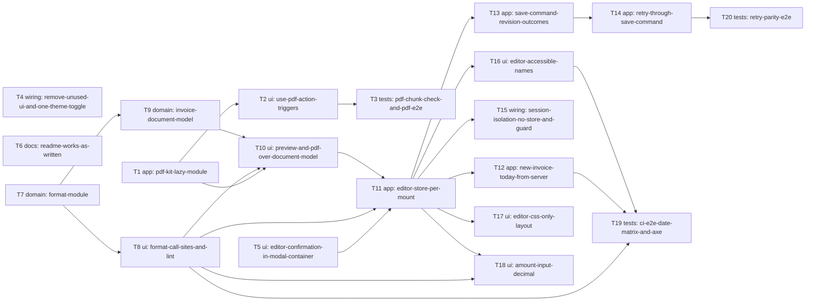

# Epic — editor-ux

> **Spec:** [spec.md](../spec.md) · **Design:** [sad.md](../sad.md) · **Data model:** [data-model.md](../data-model.md) (no schema change) · **API:** none — no contract change (sad §4) · **UX flows:** [ux-flows.md](../ux-flows.md) · **ADRs:** [adr/](../adr/)

## Goal

Make the invoice editor and the lists around it solid before the public showing, without changing a business rule (spec §2): no PDF toolkit on pages that don't print, an editor whose display, totals, saves and Retry always tell the truth, one date and money format everywhere with the PDF matching the preview, a screen-reader- and phone-ready editor, and a clean repository with a README that works as written.

## Scope

- **In:** the `web-frontend` surface only (sad frontmatter `target_surfaces: [web-frontend]`) — `lib/pdf`, `lib/format`, `lib/invoice-document`, the editor store and its save command, editor/list/dashboard components, `proxy.ts` response headers, CI checks and e2e suites, README and package cleanup.
- **Out:** invoice rules, a visual redesign or new editor features, server-side paging/search, formatting the whole repository, accessibility beyond the editor, invoices list and dashboard (spec §3). No schema, migration or API change.

## Task map

Delivery follows the four waves of spec §1 (wave 1: T1–T6, wave 2: T7–T10, wave 3: T11–T15 + T20, wave 4: T16–T19); the graph below is the technical dependency DAG that `implement` sorts. T1, T4, T5, T6 and T7 can start in parallel.

## Tasks

See [tracker.md](./tracker.md) for status. Machine contract: [tasks.json](../tasks.json).

| # | Task | Layer | Blocked by | DoD (short) |
|---|---|---|---|---|
| [T1](./T1-pdf-kit-lazy-module.md) | Move the PDF toolkit into one lazy lib/pdf module with a cached, classifying loader | app | — | loadPdfKit() imports lib/pdf/invoice-pdf-kit once per visit and classifies a failed import as offline or new-v |
| [T2](./T2-use-pdf-action-triggers.md) | Route every PDF trigger through usePdfAction and warm the toolkit in the editor when idle | ui | T1 | Every PDF trigger calls usePdfAction, which shows preparing / try again / reload states and reports generation |
| [T3](./T3-pdf-chunk-check-and-pdf-e2e.md) | Add the build-output PDF chunk check to CI and e2e tests for first PDF, offline and new-version | tests | T2 | scripts/check-pdf-chunks.ts fails the CI build when a non-editor route's initial chunks contain @react-pdf/ren |
| [T4](./T4-remove-unused-ui-and-one-theme-toggle.md) | Remove the unused UI components and their packages, drop uuid, and keep one theme switcher | wiring | — | components/ui holds no unused component, package.json drops the packages only they used plus uuid and @types/u |
| [T5](./T5-editor-confirmation-in-modal-container.md) | Mount the editor's confirmation dialog in the invoice-editor modal container | ui | — | The editor's ConfirmationModal is rendered only by InvoiceEditorModalContainer, the F-47 onClose behaviour is  |
| [T6](./T6-readme-works-as-written.md) | Rewrite the README setup and test steps and verify them in a fresh clone | docs | — | Following README.md word for word in a fresh clone against an empty PostgreSQL database completes every comman |
| [T7](./T7-format-module.md) | Create the lib/format module for money, calendar days and moments with a fixed en-US locale | domain | — | formatMoney, formatDay and formatMoment are pure, use en-US regardless of the runtime locale and zone |
| [T8](./T8-format-call-sites-and-lint.md) | Route every displayed date and amount through lib/format and forbid ad-hoc formatting by lint | ui | T7 | Every list, dashboard, related-invoices, custom-price and editor display of a date or amount uses lib/format,  |
| [T9](./T9-invoice-document-model.md) | Build the pure invoice document model with its wording in lib/invoice-document | domain | T7 | buildInvoiceDocument(source) returns every label, party, line, formatted date and amount for a draft form and  |
| [T10](./T10-preview-and-pdf-over-document-model.md) | Lay out the HTML preview and the PDF from the document model and add the parity test | ui | T1, T8, T9 | The HTML preview and the react-pdf document render only InvoiceDocument fields, a draft with unsaved changes p |
| [T11](./T11-editor-store-per-mount.md) | Turn the editor store into a per-mount factory provided by context and built from server data | app | T5, T8, T10 | Each editor mount gets its own store created synchronously from the RSC data and keyed by Freelancer and invoi |
| [T12](./T12-new-invoice-today-from-server.md) | Compute a new invoice's today and due date on the server and reserve the invoice-number field | app | T11 | The new-invoice page passes today in the Freelancer time zone (UTC until saved) and the payment-terms due date |
| [T13](./T13-save-command-revision-outcomes.md) | Add the store save command with a form revision and resolve every save outcome in it | app | T11 | save(intent) reads the form when called, tags it with the form revision and resolves saved, saved-with-edits ( |
| [T14](./T14-retry-through-save-command.md) | Route Retry, the created-address change and the save dialogs through the save command | app | T13 | Retry calls save(lastFailedIntent) with the current form |
| [T15](./T15-session-isolation-no-store-and-guard.md) | Send signed-in pages no-store, reload back/forward-cache restores, and prove AC-07 in Chromium and WebKit | wiring | T11 | Signed-in page responses carry Cache-Control: private, no-store, SessionRestoreGuard hides and reloads a persi |
| [T16](./T16-editor-accessible-names.md) | Give every editor field, line field, icon button and row action an announced name and tie errors to fields | ui | T11 | Every editor field has its visible label as its name, line fields announce «{column}, line {n}» from the curre |
| [T17](./T17-editor-css-only-layout.md) | Render the editor's phone and desktop layouts from one DOM tree switched by CSS only | ui | T11 | The editor no longer uses useIsMobile to choose what renders, the server HTML at 390 px shows the phone layout |
| [T18](./T18-amount-input-decimal.md) | Add the shared AmountInput with a decimal keypad and use it for line, discount, tax and shipping fields | ui | T8, T11 | AmountInput (inputMode=decimal, '.' the only accepted decimal separator) is used for line price and quantity,  |
| [T19](./T19-ci-e2e-date-matrix-and-axe.md) | Add the CI e2e job with the server/browser date matrix and the accessibility suite | tests | T8, T12, T16 | A CI e2e job builds the app for production against throwaway PostgreSQL and runs the date matrix (zones UTC−10 |
| [T20](./T20-retry-parity-e2e.md) | Add e2e tests that reach every save outcome by Save and by Retry and compare the results | tests | T14 | For created, updated, issued, changed elsewhere, totals changed and field error, the e2e reaches the outcome o |

## Risks / Hard rules

- **No business-rule change:** every `invoice-integrity` acceptance test keeps passing (spec §3, §6 «No regressions»).
- **`@react-pdf/renderer` only under `lib/pdf/`** (lint), every PDF trigger through `use-pdf-action` (ADR-0001).
- **Display formatting only through `lib/format`**; lint forbids `toFixed(` / `toLocale*String(` in `components/` and `app/` (ADR-0006).
- **Post-save behaviour only inside the store save command** (ADR-0005); **no import of the old module-level store** (ADR-0003, lint).
- **One DOM tree for the editor's layouts**, no JS width check deciding structure (ADR-0004).
- **sad §11 risks to watch:** iOS decimal keypad (check first in T18), per-mount store blast radius (T11 ships alone), desktop look after the CSS-only layout (T17 snapshots), Safari bfcache (T15 WebKit project), KPI baselines still TBD — measure Sentry hydration issues, Speed Insights CLS and one axe run **before wave 1 starts**.
