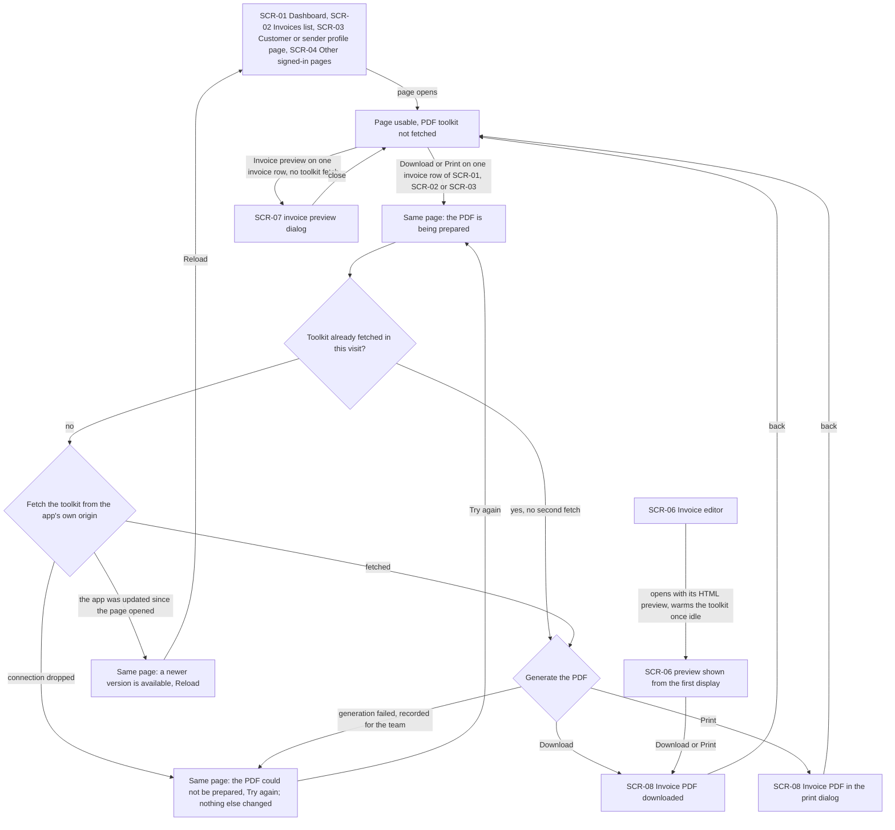
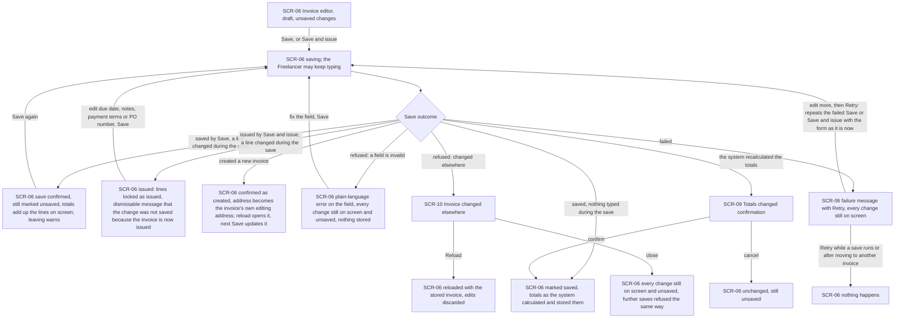
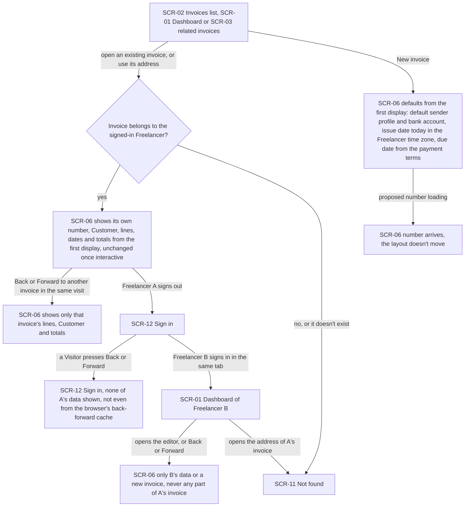
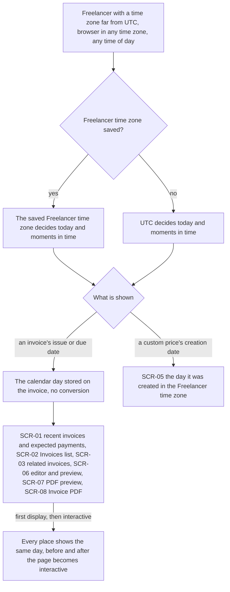
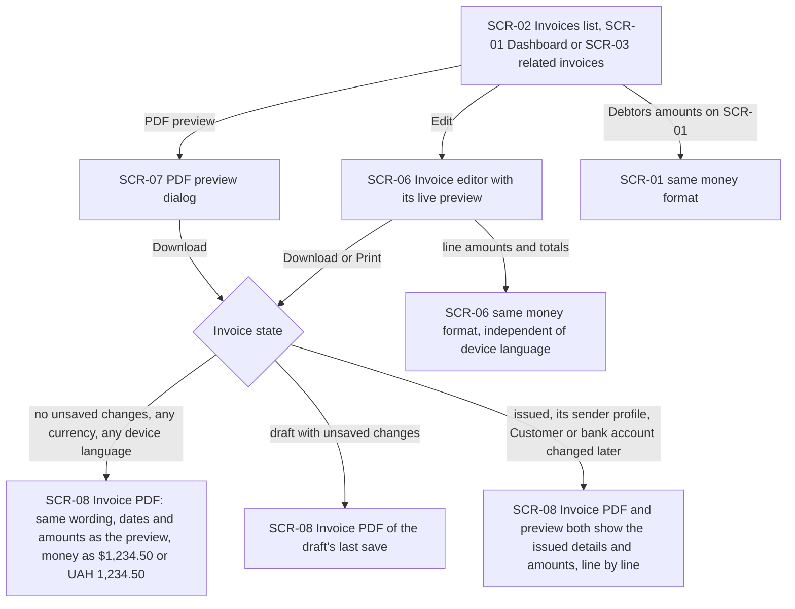
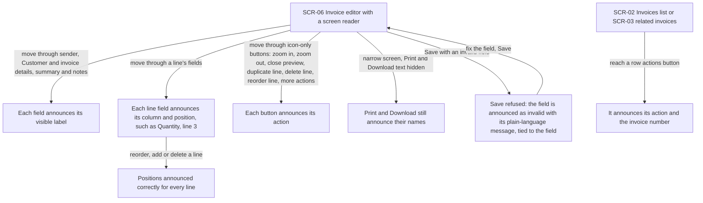
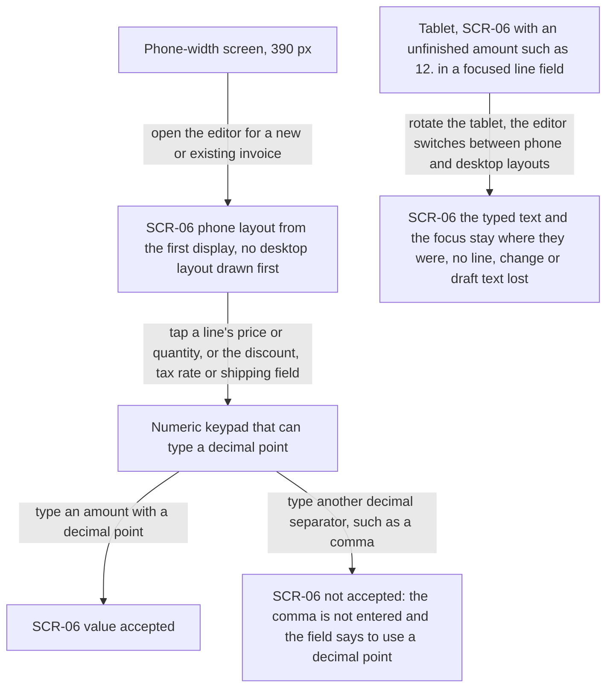

# UX flows — editor-ux

> User flows for every UI-touching §4 user story, produced by `ux-flows` (after `clarify`, before
> `design`) and read by `design` (evidence for the target-surface + UI-architecture decisions),
> `sequences` (UI-driven flows align on SCR ids), `screens` (details every inventory row) and
> `plan-tests` (the e2e-through-UI paths). **Always markdown + mermaid `flowchart`**, whatever the
> design tool — this artifact is flow-altitude, not visual design.

## Platform decisions

- **Posture:** responsive-both — the app's current behaviour, as in the invoice-integrity, mcp-server, security-patch and architecture-hardening flows. `docs/design-system.md` is code-only and doesn't state a posture. US-07 doesn't change the posture. It requires the editor's phone layout to be the first thing a phone sees (AC-13) and the switch between layouts to keep what was typed (AC-14).
- **No new pages and no new dialogs.** Every screen below exists today. This feature changes what they show on first display, how they load the PDF toolkit, how a save and its Retry end, and what they announce. The spec's non-goal "no visual redesign" holds: the flows add states and branches, not places.
- **PDF actions stay where they are.** Download, Print and the PDF preview stay in the dashboard's recent invoices, the invoices list, the related invoices of a Customer or sender profile, and the editor. "Preparing the PDF", "couldn't prepare, try again" and "newer version, reload" are states of the page the Freelancer is on, never a separate page. `screens` decides how they look.
- **The editor's preview is HTML built from the document model, so it needs no PDF toolkit** (AC-01). The editor only warms the toolkit once the page is idle, so its Download and Print rarely wait.
- **Retry is Save again, not a separate path.** A failed save's message offers Retry. Retry repeats the action that failed (Save or Save and issue) with the form as it is now, and re-enters the same outcome branch as Save: the same address change, dialogs and saved state (AC-05c, AC-05d). The flows draw Retry as a loop back into the save, so every save outcome is reachable through it.
- **"Your change was not saved, the invoice is now issued" is a dismissable message in the editor** (AC-05b), shown in the issued editor. Whether it is inline or a toast is a `screens` choice. It is not a confirmation: the invoice is already issued.
- **First-display correctness is drawn as an outcome, not a mechanism.** The flows state what the first display shows (the right invoice, the phone layout, the right calendar day, no data from another session). How the server and the browser agree on it is design input (AC-06, AC-07, AC-08, AC-13).
- **Signing out and signing in are drawn only where they matter here** (AC-07): the same browser tab passed from Freelancer A to Freelancer B or to a Visitor, including Back and Forward.
- **Screen-reader use is drawn as a walk through the editor** (US-06), because what changes is what each stop announces, not where the Freelancer goes.
- **The save-failure message is a state of the editor.** It is today's notification with a Retry action. It is not an inventory row.

## Screen inventory

| ID | Screen | Purpose | Entry | Exit |
|---|---|---|---|---|
| SCR-01 | Dashboard | Recent invoices with their row actions (Download, Print, PDF preview), expected payments with due dates, Debtors amounts | Signing in, app navigation | SCR-02, SCR-06, SCR-07, SCR-08 |
| SCR-02 | Invoices list | All invoices with issue and due dates, amounts and row actions (Download, Print, PDF preview, Edit). The row actions button announces its action and the invoice number | App navigation, dashboard | SCR-06 (edit or new), SCR-07, SCR-08 |
| SCR-03 | Customer or sender profile page | One Customer's or sender profile's details and their related invoices with dates and the same row actions | Customers or sender profiles list | SCR-06, SCR-07, SCR-08 |
| SCR-04 | Other signed-in pages | Customers, products and sender profiles lists and settings: pages with no PDF action that must not load the PDF toolkit | App navigation | Any signed-in page |
| SCR-05 | Product custom prices | One product's custom prices, each with the day it was created in the Freelancer time zone | Product page | Product page, app navigation |
| SCR-06 | Invoice editor | Create or edit an invoice, with its live preview, Save, Save and issue, Download and Print. Phone and desktop layouts. Shows the opened invoice from the first display | New invoice action, Edit or opening a row on SCR-01, SCR-02 or SCR-03, a direct address, Back or Forward | SCR-02 (back), SCR-08, SCR-09, SCR-10, SCR-11 |
| SCR-07 | PDF preview dialog | The invoice's PDF as the Customer will receive it, opened from a list row | PDF preview on SCR-01, SCR-02 or SCR-03 | Back to the page it was opened from |
| SCR-08 | Invoice PDF | The downloaded file or the print dialog: the document the Customer receives, with the same wording, dates and money format as the preview | Download or Print on SCR-01, SCR-02, SCR-03 or SCR-06 | Back to the page it was started from; the file goes to the Customer outside the app |
| SCR-09 | Totals changed confirmation | Existing dialog asking the Freelancer to confirm totals the server recalculated, reached the same way through Save and through Retry | A save or a retried save from SCR-06 | SCR-06 saved (confirm) or unchanged (cancel) |
| SCR-10 | Invoice changed elsewhere | Existing dialog saying the save was refused because the invoice changed after it was opened, with Reload | A save or a retried save from SCR-06 on an outdated invoice | SCR-06 reloaded (edits discarded) or SCR-06 with the edits still on screen (closed) |
| SCR-11 | Not found | Existing "invoice not found" result for an invoice that doesn't exist or isn't the signed-in Freelancer's | The address of such an invoice | App navigation |
| SCR-12 | Sign in | Existing sign-in page | Signing out, or Back or Forward to a signed-in page while signed out | SCR-01 after signing in |

## Flows

Out of scope for drawing (no human-facing movement in the app):

- **US-08 — A repository that works as written.** The actor is a Contributor working with the repository, its README and its packages, not a user of the app. AC-15 and AC-16 are proven by following the README in a fresh clone and by the build, lint and test run. The two user-visible parts of AC-16 (one theme switcher, the editor's save confirmation placed with its other dialogs) must behave exactly as today, so they add no movement. The save confirmation is still drawn as SCR-09 in US-02.

### Flow: US-01 — Lists open without printing tools

<!-- changed 2026-10-10 by review-2026-10-10 D9: the invoice preview is HTML from the document model (ADR-0002) and never fetches the toolkit. -->

The Freelancer opens the dashboard, the invoices list, a Customer's or sender profile's page, or any other signed-in page except the editor. The page opens and is usable without fetching the PDF toolkit. When they choose the invoice preview on a row, the preview dialog shows the invoice from its document model without fetching the toolkit. When they choose Download or Print on an invoice row, that page shows that the PDF is being prepared. If the toolkit hasn't been fetched yet in this visit, it is fetched now, only from the app's own origin. A later PDF action in the same visit skips the fetch. Once the PDF is generated, Download saves the file and Print opens the print dialog, and the Freelancer returns to the same page. There are three failure branches, and each keeps the page usable and changes nothing else on it. If the connection dropped before the toolkit arrived, a plain message says the PDF couldn't be prepared and offers Try again. Trying again once the connection is back produces the PDF. If generating the PDF fails, the same message appears and the failure is recorded for the team. If the toolkit can't be fetched because the app was updated after the page opened, the message says a newer version is available and offers Reload instead of a Try again that would keep failing. The editor is the exception: its preview is HTML built from the document model and needs no toolkit, and the editor only warms the toolkit once the page is idle after it has opened, so its Download and Print rarely wait.

### Flow: US-02 — Nothing typed during a save is lost

The Freelancer clicks Save or Save and issue in the editor and may keep typing while the save runs. When the save ends, the editor takes one of several branches, and Retry leads back into the same ones. If nothing was typed during the save, the invoice is marked saved and shows the totals the system calculated and stored. If a line changed during a Save, the save is confirmed but the invoice stays marked unsaved. The totals add up the lines as they are on screen, using the same rounding and order of discount and tax as the stored totals. Leaving the page warns, and the next Save stores the change. If a line changed during Save and issue, the editor switches to the issued invoice with its lines locked as issued and shows a dismissable message that the change was not saved because the invoice is now issued. Due date, notes, payment terms and PO number can still be changed and saved. A new invoice that is created moves the browser's address to its own editing address, so reloading opens it and the next Save updates it instead of creating a second one. The editor on that address is the same live editor: what was typed, the focused field and its caret stay as they were. Refusals keep every typed change on screen, marked unsaved, and store nothing. An invalid field gets its plain-language error. A changed-elsewhere refusal opens the "changed elsewhere" dialog: Reload discards the edits and shows the stored invoice, and closing keeps the edits on screen while further saves keep being refused. If the system recalculated the totals, the totals confirmation opens: confirming saves, cancelling leaves the editor unchanged. If the save fails, the failure message offers Retry. Retry repeats the action that failed with the form as it is at that moment, including anything typed after the failure, and leads to exactly the same outcomes, address change and dialogs as Save. Retry while a save is running, or after the editor moved to another invoice, does nothing.

### Flow: US-03 — The editor opens on the right invoice

The Freelancer opens an existing invoice from the invoices list, the dashboard or a related-invoices list, or by its address. If the invoice is theirs, the editor shows its own number, Customer, lines, dates and totals from the very first display, and nothing changes when the page becomes interactive. No blank or other invoice appears first. If it isn't theirs or doesn't exist, they see the "invoice not found" result. A new invoice shows its defaults from the first display: the default sender profile, its default bank account, today's date in the Freelancer time zone (UTC until one is saved) and the due date that follows from the payment terms. Only the proposed invoice number may arrive later. Until then its field shows that it is loading, and the layout doesn't move when it arrives. Moving Back and Forward between two invoices in one visit always shows each invoice's own lines, Customer and totals. When Freelancer A signs out, the tab goes to sign-in. A Visitor pressing Back or Forward sees none of A's data, even a page the browser kept in its back-forward cache, and stays at sign-in. When Freelancer B signs in in the same tab, the editor and Back and Forward show only B's data, never any part of A's invoice. Opening the address of A's invoice gives B the same "not found" result as any invoice that isn't theirs.

### Flow: US-04 — Dates agree everywhere

The Freelancer's time zone can be far from UTC and their browser can be set to any other zone, at any time of day. If the Freelancer has saved a time zone, it decides what "today" is and how moments in time are shown. Until one is saved, UTC does. An invoice's issue and due dates are calendar days and are never converted: the dashboard's recent invoices and expected payments, the invoices list, related invoices, the editor and its preview, the PDF preview and the PDF all show the day stored on the invoice. Each place shows the same day on the first display and after the page becomes interactive. A custom price's creation date is a moment in time, so the custom prices page shows the day it was created in the Freelancer time zone.

### Flow: US-05 — The PDF matches what I see

The Freelancer previews an invoice from a list row or in the editor, then downloads or prints it. For an invoice without unsaved changes, in a currency with a symbol (US dollars) or without one (hryvnia), and on a device set to any language, the PDF shows exactly the preview's wording, dates and amounts. Money uses the app's one format, such as "$1,234.50" and "UAH 1,234.50", with the same separators and two decimal places. A draft with unsaved changes prints its last save, as `invoice-integrity` already requires. An issued invoice whose sender profile, Customer or bank account changed afterwards shows the details and amounts it was issued with in both the preview and the PDF, matching line by line. A wording change to the invoice layout reaches both or neither. The editor's line amounts and totals, and the dashboard's Debtors amounts, use the same money format, whatever the device language.

### Flow: US-06 — The editor works with a screen reader

A Freelancer using a screen reader moves through the editor. Every field in the sender, Customer, invoice details, summary and notes sections announces its visible label. A line field without a visible label announces its column and the line's position, such as "Quantity, line 3", and the positions stay right after lines are reordered, added or deleted. Every icon-only button announces its action: zoom in, zoom out, close preview, duplicate, delete and reorder a line, and more actions. On narrow screens, where Print and Download hide their text, they still announce their names. When a save is refused because a field is invalid, the screen reader announces that field as invalid together with its plain-language message, because the message is tied to the field and not only shown next to it. In the invoices list and a Customer's or sender profile's related invoices, the row actions button announces its action and the invoice number.

### Flow: US-07 — The editor works on a phone

On a phone-width screen (390 px), the editor opens in its phone layout from the first display for a new or existing invoice, without first drawing the desktop layout. Tapping a line's price or quantity, or the summary's discount, tax rate or shipping field, opens a numeric keypad on which a decimal point can be typed. The decimal point is the only decimal separator these fields accept. Another separator, such as a comma, is not accepted: it is not entered, and the field says, also to a screen reader, to use a decimal point. On a tablet, a Freelancer who has typed an unfinished amount like "12." in a focused line field can rotate the device so the editor switches between its phone and desktop layouts. The typed text and the focus stay where they were, and no line, change or draft text is lost.

## AC coverage

| AC | Shown by | Notes |
|---|---|---|
| AC-01 | Flow US-01 → A0 → A1 (no fetch on open), A2 → A3 → A4 → A5 → A8 / A9 / A10, A3 "yes, no second fetch", E0 → E1 (editor may fetch at open) | Covers every non-editor signed-in page through SCR-04 |
| AC-02 | Flow US-01 → A4 "connection dropped" → A6 → "Try again" → A2 | Page stays usable, nothing else changes |
| AC-02b | Flow US-01 → A4 "app updated" → A7 → "Reload" → A0; A5 "generation failed, recorded for the team" → A6 | Reload replaces a Try again that would keep failing |
| AC-03 | Flow US-02 → B2 "saved by Save, a line changed during the save" → B4 → "Save again" → B1 | Leaving warns while unsaved |
| AC-04 | Flow US-02 → B3 (nothing typed: stored totals, marked saved) and B4 (totals add up the lines on screen) | The calculation rule itself is proven by tests, not by movement |
| AC-05 | Flow US-02 → B7 (field invalid) and B8 → B9 / B10 (changed elsewhere) | Every typed change stays on screen and unsaved |
| AC-05b | Flow US-02 → B2 "issued by Save and issue" → B5 → allowed fields → B1 | Dismissable message; modality is a `screens` choice |
| AC-05c | Flow US-02 → B12 → Retry → B1 → B2 "created a new invoice" → B6 | Retry uses the form as it is when chosen |
| AC-05d | Flow US-02 → B12 → Retry → B1 → B2 → B8 (SCR-10) or B11 (SCR-09); B12 → B13 (Retry ignored) | Same dialogs as Save |
| AC-06 | Flow US-03 → C1 "yes" → C2; C0 "New invoice" → C4 → C5 | Number may arrive later without moving the layout |
| AC-07 | Flow US-03 → C2 → C7 → C8 (Visitor), C7 → C9 → C10 / C3 (Freelancer B), C2 → C6 (same visit Back and Forward) | Mechanism is design input |
| AC-08 | Flow US-04 → D1 → D2 / D3 → D4 → D5 → D7 → D8, D4 → D6 (custom price) | |
| AC-09 | Flow US-05 → F3 "no unsaved changes" → F4, F3 "draft with unsaved changes" → F5, F2 → F7, F0 → F8 | |
| AC-10 | Flow US-05 → F3 "issued, details changed later" → F6 | Layout wording reaching only one of preview and PDF is proven by the parity test |
| AC-11 | Flow US-06 → G1, G2 → G3, G4, G5, H0 → H1 | |
| AC-12 | Flow US-06 → G6 | Also the field-error branch B7 in Flow US-02 |
| AC-13 | Flow US-07 → K0 → K1 → K2 → K3 / K4 | |
| AC-14 | Flow US-07 → M0 → M1 | |
| AC-15 | N/A: US-08 is the Contributor's README and repository, no app screen | Proven by following the README in a fresh clone |
| AC-16 | N/A: repository hygiene with no change in movement | One theme switcher and the editor's dialog placement must behave as today. SCR-09 is reached in Flow US-02 unchanged. Proven by build, lint and tests |
