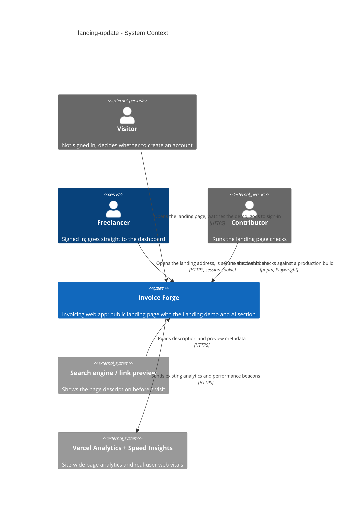
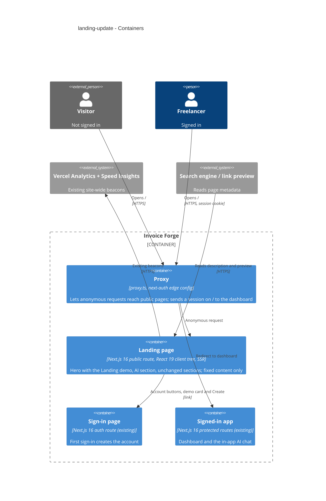
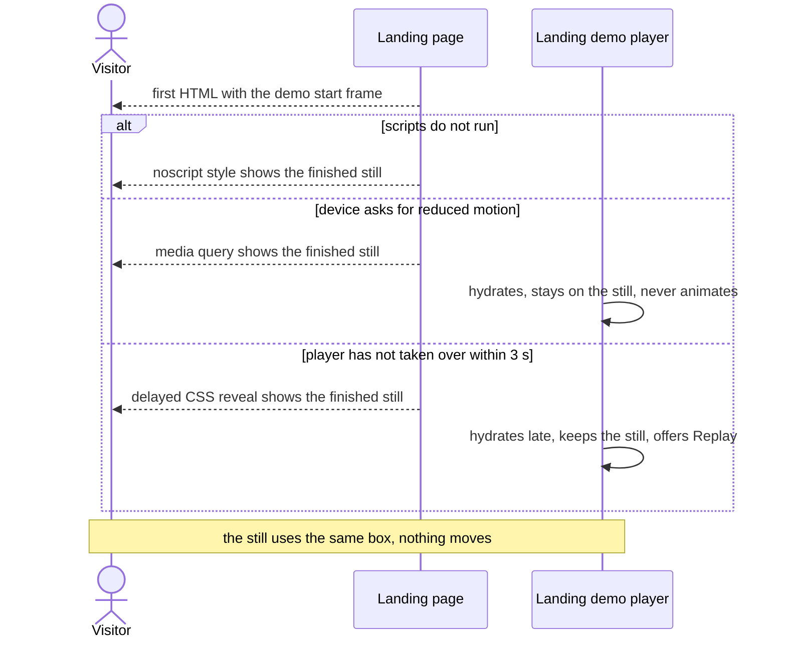

# Software Architecture Document — landing-update

<!-- 12 Arc42 sections. Empty section → <!-- N/A: <one-line reason> -->. -->
<!-- C4 Context (L1) lives inline in §3. C4 Container (L2) lives inline in §5. -->
<!-- Numbers in §10 come VERBATIM from spec.md §6 NFR — no inventing, no rounding. -->

> **Inputs:** [spec](./spec.md) · [ux-flows](./ux-flows.md) · [CONTEXT](./CONTEXT.md) (Landing demo) + repo-root [CONTEXT](../../../CONTEXT.md) · [architecture map](../../architecture-map.md) (reflects `735ab32`, 3 commits behind HEAD `7de6135f`, none touching the landing page) · [design canon](../../design-system.md).
> Design run at **easy** depth (route `quick`): reversible choices were decided by the architect and accepted by the owner as one assumptions batch (2026-10-16); the two ADR-worthy choices were asked.

## 1. Introduction and goals

**Intent.** Rewrite the public landing page's first screen around one promise — an invoice from one sentence — and prove it with the Landing demo: a scripted, play-once animation of a fixed example sentence turning into a sample draft proposal card, with no model call and no data behind it. Add one AI section below it that tells a Visitor in plain words what the in-app AI does and does not do, and that the same works from the AI tools they already use. The rest of the landing page stays, except text the AI makes untrue. It is a temporary bridge: public-redesign replaces the first screen and the demo later, so the design takes the simplest credible path and does not build for reuse.

**Top-3 quality goals (1-liners; full scenarios in §10):**

1. **Fast, still first screen** — the headline renders in the first HTML and the demo never moves the page while it loads, plays or falls back (LCP ≤ 2.5 s, CLS ≤ 0.1, ≤ 30 KB added).
2. **Zero data or model reach** — nothing a Visitor does on the landing page reaches the AI chat, a model, or stored data; every AI claim on the page is true today.
3. **Works for every Visitor** — keyboard, screen reader, reduced motion, scripts off or broken, and a 360 px phone all get the same message and a working account button.

**Stakeholders.**

| Role | Interest | Sign-off owner? |
|---|---|---|
| Visitor | Understands the one-sentence promise and the AI's limits from the first screen, reaches account creation in one press | No |
| Freelancer | Keeps being sent straight to the dashboard when signed in; never sees the new screen | No |
| Contributor | Automated checks that fail when the promise, demo, AI section or account button disappears | No |
| Product owner (Dmytro Hopko) | Copy, the example sentence and draft, the headline (spec §8) | Yes |
| Tech Lead | SAD approval | Yes |

<!-- Decision overrides (¶4) — populated by the critic resolution loop, empty otherwise. -->

## 2. Constraints

**Technical.**
- TypeScript 5 (strict) on Node `>=22.18 <23`, pnpm 10.25.
- Next.js 16.3.8 App Router + React 19.2.3 (exact pins); Tailwind 4 + shadcn/ui (`base-vega`, neutral) with OKLCH tokens in `app/globals.css`; `next-themes` light/dark.
- The landing page is one client tree today: `app/(public)/page.tsx` (server, metadata) renders `app/(public)/landing-page.tsx` (`'use client'`), server-rendered by Next; its sections use `framer-motion` 12 (already a dependency).
- CSP from `next.config.ts:8-9` allows `'self' 'unsafe-inline'` scripts and styles — inline `<noscript><style>` and CSS modules need no CSP change.
- No datastore, no route handler, no server action is added or called by this feature.

**Organisational.**
- Size S, route `quick`; no outside deadline — the trigger is that ai-assistant + ai-chat-v2 shipped (spec §1).
- Temporary bridge: public-redesign replaces the first screen and the demo (owner, 2026-10-16) — no reuse investment.
- Two copy decisions stay open with the owner (spec §8): the demo's example sentence/draft (due before `sdd:tasks`) and the final headline (due before `sdd:implement`).

**Conventions.**
- [architecture map](../../architecture-map.md) §Conventions and §Frontend; the design canon `docs/design-system.md` (compose from `components/ui/` primitives and tokens, never re-declare them).
- Public copy lives in `landingContent` (`constants/public-pages-content.ts:40`), rendered by `components/landing/*`.
- Proxy allowlist: `/` is already a public route (`config/routes.config.ts:4`); signed-in users are redirected to the dashboard (`proxy.ts:73-74`).
- Tests: vitest (`*.test.ts(x)`) and Playwright (`*.spec.ts`) per `tests/README.md`; Playwright baselines are Linux-named; **e2e is not in CI** — the full e2e suite runs locally before ship.

**Regulatory / external.**
- Consumer-protection / truthful-advertising: every AI claim must match the ai-assistant / ai-chat-v2 specs and the privacy page; only AI tools that connect today (Claude Desktop, Claude Code, Cursor) may be named (spec §1, §6.1).
- Privacy, terms and sign-in pages are not changed (spec §3) — including the terms page's own "Unlimited" wording.

## 3. Context and scope

Invoice Forge is the invoicing web app a Freelancer uses to bill Customers; its public landing page is where a Visitor decides whether to create an account. This feature moves no boundary: the landing page stays public, accepts no input, calls no model and reads no stored data; every way forward still ends at the existing sign-in page, and a signed-in Freelancer is still sent to the dashboard before the page renders.

<!-- brownfield: architecture-map.md (reflects 735ab32; the 3 newer commits are docs + ai-chat merge, none touch components/landing). Scan at 7de6135f: landing-page.tsx is 'use client'; LandingHero wraps the h1 in framer-motion initial opacity 0 and shows three stats; nav links are in-page anchors (#features/#pricing/#how-it-works) from landingContent.navigation.links; root layout sets openGraph/twitter description site-wide, the landing route overrides only description; components/ai/draft-card.tsx imports the createDraftFromCard server action, chat contexts, sonner and next/navigation; no Playwright baselines or axe check cover '/' today; e2e runs against a production build (tests/e2e/support/start-app-server.mjs). -->

**External systems (in / out):**

| Actor or system | Type | Interaction |
|---|---|---|
| Visitor | Person | Opens the landing page, watches or replays the Landing demo, reads the AI section, presses an account button |
| Freelancer | Person | Opens the landing address while signed in and is sent to the dashboard (AC-10) |
| Contributor | Person | Runs the landing page's automated checks locally (US-08, AC-11) |
| Search engine / link-preview service | System (external) | Reads the landing page's description and preview text (AC-12) |
| Vercel Analytics + Speed Insights | System (external) | Receives the site-wide page-analytics and performance beacons every page already sends — the measurement source for LCP and CLS |

External: no new third-party system — deliberate. The demo is fixed content shipped with the page; the AI Gateway and the database are never reached from the landing page.

**C4 Context (L1):**



## 4. Solution strategy

**Top strategic choices (the seeds for ADRs):**

1. **Target surface: `[web-frontend]` only.** The audience is a Visitor in a browser (spec §1, §4); ux-flows confirms one page and no new screens (SCR-01, SCR-02 on the existing landing page; SCR-03…05 existing). No backend, contract or worker surface is added — the landing page makes no new request. Single surface, nothing irreversible → inline, no ADR.
2. **UI architecture: keep the landing page's existing rendering.** The page stays one client tree server-rendered by Next (`landing-page.tsx`), extended in place; converting it to server components with client islands would cut JavaScript but rewrites every landing component for a page public-redesign will replace. The two first-screen qualities are protected instead by local rules: the new hero has no entrance animation that starts the headline at `opacity: 0`, so the headline is in the first paint (QG-1), and the demo adds only its own small player. Borderline (one real alternative, fully reversible) → inline.
3. **The demo card is a standalone presentational replica** of the chat's draft proposal card, built in `components/landing/` from the same `components/ui/` primitives and tokens; the chat's `DraftCard` is not imported or refactored → [ADR-0001](./adr/0001-render-the-landing-demo-card-as-a-standalone-replica-of-the-chat-draft-card.md).
4. **The demo's first HTML is its start frame, and CSS alone shows the finished still** whenever the player cannot run — scripts off (`<noscript><style>`), reduced motion (media query), or no player takeover within 3 s (a delayed CSS reveal the player cancels on hydration); the hydrated player plays once when ≥ 50 % of the demo is visible, and both states occupy one fixed-size box → [ADR-0002](./adr/0002-server-render-the-demo-start-frame-and-show-the-finished-still-through-css-only-fallbacks.md).

Supporting choices, decided inline (owner accepted the batch, 2026-10-16):

- **Animation engine:** CSS transitions keyed by a `data-phase` attribute (`idle → typing → thinking → card → done`, plus `still`) that a small client state machine advances on timers; no new dependency and no `framer-motion` in the demo. The phase attribute is also the test hook (AC-02 timing, AC-11 finished card).
- **Copy and sample content** live in `landingContent` (`constants/public-pages-content.ts`): new hero copy, the AI section, the new navigation link, the demo's fixed sample, and the narrowed beta wording ("unlimited" kept only for invoices and clients, AC-05). The terms page text is not touched.
- **Metadata:** the landing route overrides `description`, `openGraph` and `twitter` with the one-sentence promise (AC-12); the site-wide description in `config/site.config.ts` stays, so other pages' previews do not change.
- **Navigation:** one new in-page link `#ai` added to `landingContent.navigation.links` (shown on tablet and desktop by the existing `LandingNav`); the footer is unchanged.
- **Signed-in redirect** needs no change — `proxy.ts:73-74` already sends a session on `/` to the dashboard (AC-10).

Each tactical decision in later sections traces to one of these seeds. Tactical decisions that *contradict* a strategic choice are red flags — surface them in §11.

## 5. Building block view

Component composition inside the existing Next.js public route, no new layer: the server page module owns metadata, the client landing tree owns layout, `components/landing/*` own presentation, and `landingContent` owns every word. The Landing demo is one self-contained folder — a client player, a presentational card replica, and a CSS module holding the phase styles and the CSS-only fallbacks — so public-redesign can delete it in one move.

**Internal decomposition:**

```
app/(public)/
├── page.tsx                      metadata: description + openGraph + twitter carry the one-sentence promise (AC-12)
└── landing-page.tsx              inserts <AiSection> right after the hero, before <FeatureGrid> (client tree, unchanged rendering)
components/landing/
├── landing-hero.tsx              rewritten: badge kept, headline (first h1) + supporting line + account button + <LandingDemo>; no stats row, no opacity-0 entrance
├── landing-demo/
│   ├── landing-demo.tsx          'use client' player: phase state machine, IntersectionObserver (≥ 0.5), play-once per page view, Replay, takeover class that cancels the CSS reveal
│   ├── demo-draft-card.tsx       presentational replica of the chat draft proposal card (Customer, line, total + currency, unpressed Create, "Example" label); card and Create are links to sign-in
│   └── landing-demo.module.css   fixed-size box, per-phase rules, <noscript>/reduced-motion/3 s still fallbacks
├── ai-section.tsx                new section id="ai": what the AI does / doesn't, own AI tools (3 named), privacy link, own account button
└── landing-nav.tsx               unchanged code; renders the new #ai link from content
constants/public-pages-content.ts landingContent: hero, demo sample, ai section, nav link, narrowed beta wording
tests/
├── unit/landing-claims.test.ts           truth guard over landingContent (AC-05, AC-07)
├── component/landing-demo.test.tsx       phases, play-once, Replay, reduced motion, links, no fetch (AC-02…AC-04)
└── e2e/landing.spec.ts (+ -snapshots/)   first screen, timing, requests, axe, 360 px, JS size, Linux baselines (AC-01…AC-12)
```

**C4 Container (L2):**



The Landing page container has no relation to the route handlers, the chat agent or the database — that absence is the AC-03 boundary.

## 6. Runtime view

**Critical flow 1: Visitor watches the demo and goes to sign-in (AC-01, AC-02, AC-03, AC-08)**

```mermaid
sequenceDiagram
    actor Visitor
    participant Proxy
    participant LandingPage as Landing page
    participant Demo as Landing demo player
    participant SignIn as Sign-in page
    Visitor->>Proxy: opens the landing address
    Proxy->>Proxy: no session, public route
    Proxy->>LandingPage: anonymous request
    LandingPage-->>Visitor: first HTML: headline, account button, demo start frame
    Note over Visitor,LandingPage: CSS reveal timer runs; fallback rules wait
    LandingPage->>Demo: hydrates
    Demo->>Demo: takes over, cancels the CSS reveal
    Demo->>Demo: waits until at least half of the demo is visible
    Demo->>Demo: plays once: typing, thinking, card, done
    Demo-->>Visitor: finished proposal card, Create unpressed, Replay shown
    alt Visitor presses Replay
        Demo->>Demo: restarts from the start frame, same fixed content
    else Visitor presses the card or Create
        Visitor->>SignIn: follows the link
    else Visitor scrolls away and back
        Demo->>Demo: stays on done, no restart
    end
```

**Critical flow 2: the demo cannot animate (AC-04)**



Flow 3 (signed-in Freelancer → dashboard, AC-10) is the existing proxy redirect and is unchanged; `sequences` may draw it for completeness.

## 7. Deployment view

<!-- N/A: reuses the existing Vercel deployment unit with no infra change — the landing page ships as part of the same Next.js build; no new route, env setting, migration or external system. -->

Monitoring stays on what already exists: Vercel Speed Insights real-user LCP and CLS for `/` are the production measurement of QG-1 (spec §6); Sentry keeps reporting client errors as today. There are no scaling thresholds — the page is static content with no per-request data.

## 8. Crosscutting concepts

| Concept | Convention | Where defined |
|---|---|---|
| Content / copy | Every visible word and the demo's fixed sample come from `landingContent`; components take props, hold no copy | `constants/public-pages-content.ts`; here |
| Claim truthfulness | A unit test over `landingContent` pins the claims: exactly Claude Desktop, Claude Code and Cursor are named; "MCP" appears at most once and never in a heading; "unlimited" only for invoices and clients; no link to developer documentation; the daily message limit and "not used to train AI models" are stated | `tests/unit/landing-claims.test.ts`; spec §1, AC-05, AC-07 |
| Motion | Demo motion is CSS transitions keyed by `data-phase`; `prefers-reduced-motion: reduce` always yields the still; nothing loops; existing `animate-gradient-shift` text effects stop under reduced motion as today | `landing-demo.module.css`; ADR-0002 |
| Layout stability | The demo box has a fixed size per breakpoint from the start frame; the still and the animation share it, so no phase changes the page height | `landing-demo.module.css`; ADR-0002 |
| Accessibility | Headline is the page's first `h1`; the demo's animated layer is `aria-hidden` and a visually hidden text equivalent reads the example sentence and the draft summary; card, Create, Replay and account button are native links/buttons with visible focus and no focus trap; phase changes are not announced | `landing-demo.tsx`; AC-09 |
| Navigation targets | Every new action is a plain link to `authRoutes.signIn` (account buttons, demo card, Create) or an in-page anchor (`#ai`); Replay is the only button and only replays | `config/routes.config.ts`; AC-03, AC-08 |
| Authentication | Unchanged — `/` is public; the proxy redirects a session to the dashboard | `proxy.ts:73-74` |
| Data access | None: the landing page imports no server action, route handler or service; no request beyond the site-wide beacons | AC-03; enforced by the e2e request recording |
| Metadata | The landing route overrides `description`, `openGraph`, `twitter`; site-wide defaults stay | `app/(public)/page.tsx` |
| Theming | Light and dark from existing tokens; the replica card uses the same primitives as the chat card | `app/globals.css`; ADR-0001 |
| Internationalisation | N/A — English only, as the rest of the public pages | — |
| Observability | Existing Vercel Speed Insights / Analytics beacons and Sentry; nothing new | `app/layout.tsx:123-124` |

## 9. Architecture decisions

| # | Title | Status | Section |
|---|---|---|---|
| 0001 | Render the Landing demo card as a standalone replica of the chat draft card | Accepted | §4, §5 |
| 0002 | Server-render the demo start frame and show the finished still through CSS-only fallbacks | Accepted | §4, §6 |

ADR files live under `docs/features/landing-update/adr/NNNN-<title>.md`.

## 10. Quality requirements

**QG-1. Fast, still first screen**
- **When:** a Visitor on a phone opens the landing page in production, and the demo loads, plays, replays or falls back.
- **Then:** first screen ready (largest content shown), p75, phones ≤ 2.5 s; layout shift on the landing page, p75 ≤ 0.1; code added to the landing page's first load by the demo ≤ 30 KB compressed; demo length, start to finished card ≤ 8 s, plays once, no automatic loop; sideways scrolling at 360 px width: none.
- **How verify:** production real-user performance data for the landing page (Core Web Vitals, LCP and CLS, from Vercel Speed Insights); first-load size measured as the compressed JavaScript the landing page transfers on load from the production build, before vs after (Next 16's build output no longer prints first-load size); automated browser checks in `tests/e2e/landing.spec.ts` for the time from demo visible to `data-phase="done"`, no restart on scroll-back, and no horizontal overflow at 360 px.

**QG-2. Zero data or model reach**
- **When:** a Visitor watches, replays or presses anything in the demo, or reads the AI section.
- **Then:** model calls, or requests that read stored app data, caused by the landing page: 0 (the site-wide page-analytics and performance beacons are excluded); the demo shows identical fixed content on every play; card and Create lead to sign-in; every AI claim matches spec §1.
- **How verify:** automated browser check recording the landing page's requests while the demo plays and replays (fails on any request to `/api/*` or a server action); component test asserting the player performs no fetch; `tests/unit/landing-claims.test.ts` over `landingContent`.

**QG-3. Works for every Visitor**
- **When:** a Visitor uses a keyboard, a screen reader, reduced motion, a browser without scripts, or a 360×640 phone.
- **Then:** accessibility violations on the landing page (serious or critical): 0; the still replaces the animation in the same space (AC-04); the headline is the first heading, the demo has a text equivalent, focus is visible and never trapped (AC-09).
- **How verify:** the existing automated accessibility check (axe) extended to `/` at phone and desktop width; e2e runs with `reducedMotion: 'reduce'`, `javaScriptEnabled: false`, and every script request aborted while scripts stay enabled (the 3 s path), each asserting the still is visible and the demo box height is unchanged; Linux visual baselines of the finished state in light and dark at 360×640 and 1280×800 (AC-11).

## 11. Risks and technical debt

| Risk / debt | Severity | Mitigation | Owner |
|---|---|---|---|
| The demo looks fake or overpromises (product risk from the idea brief) | Medium | Card replicates the chat's real draft proposal card; "Example" label; Create shown but never pressed; claims pinned by the truth-guard test | Dmytro Hopko |
| The replica card drifts from the real chat card as the chat evolves (ADR-0001) | Low | Same primitives and tokens; public-redesign replaces the demo; reviewers compare against the `ai-draft-card-live` baseline when the chat card changes | Dmytro Hopko |
| AC-11's "checks fail" holds only when someone runs e2e — e2e is not in CI | Medium | Full e2e (incl. `landing.spec.ts`) runs locally before ship, per the repo's ship rule; unit truth guard and component test do run in CI | Dmytro Hopko |
| On a slow phone the player hydrates after 3 s and the Visitor sees only the still (ADR-0002) | Low | Accepted by AC-04; Replay still plays the animation once hydrated; the still conveys the same promise | Dmytro Hopko |
| The 30 KB budget has no build-output number in Next 16 | Low | Measured as transferred compressed JS on `/` from the production build in e2e, against a baseline recorded before the change | Dmytro Hopko |
| Existing hero/section `framer-motion` entrance animations on the rest of the page can still affect LCP if the largest element is below them | Low | New hero drops its opacity-0 entrance; Speed Insights LCP p75 is watched after release | Dmytro Hopko |
| Open question: the demo's example sentence and draft (spec §8) | Open question | Resolve before `sdd:tasks`; default "Invoice Acme for 20 hours of design at $50" → Acme Corp, Design — 20 h × $50.00, $1,000.00 USD | Dmytro Hopko |
| Open question: the final headline and supporting line (spec §8) | Open question | Resolve before `sdd:implement`; default "Your next invoice is one sentence away" / "Type what you billed. The AI prepares a draft — you review it before anything is sent." | Dmytro Hopko |

**Accepted debt (acceptable in v1, plan to fix later):**
- The landing page stays one client tree server-rendered by Next instead of server components with islands — public-redesign is the place to change its rendering.
- The demo card duplicates the chat card's look instead of sharing a component (ADR-0001).

## 12. Glossary

| Term | Meaning |
|---|---|
| Visitor | Anyone reaching the app without a signed-in session (repo-root CONTEXT); this feature's audience is the freelancer or small business among them that has not signed up |
| Freelancer | A signed-in account holder (repo-root CONTEXT); opening the landing address takes them to the dashboard |
| Contributor | A developer who clones the repository to run, test or change the app (repo-root CONTEXT); here, runs the landing page checks |
| Landing demo | The scripted, play-once animation on the first screen in which one fixed example sentence turns into a sample draft proposal card with Create shown but never pressed; it calls no model and reads or stores no data (feature CONTEXT) |
| Draft proposal card | The card the in-app chat shows before the Freelancer presses Create; the demo replicates its look with fixed sample content |
| Start frame | The demo's first state — an empty chat box — which is what the server-rendered HTML shows |
| Finished still | The demo's final state (the example sentence plus the finished proposal card with the Example label) shown without animation; the fallback for reduced motion, no scripts, or no player takeover within 3 s |
| Player takeover | The moment the hydrated demo player marks the demo as its own, cancelling the CSS reveal that would otherwise show the finished still |
| AI section | The new landing section (`#ai`) directly after the first screen explaining what the in-app AI does and does not do and which AI tools connect today |
| Daily message allowance | The per-Freelancer daily cap on in-app chat messages (repo-root CONTEXT); the AI section mentions it, the landing page never uses it |
