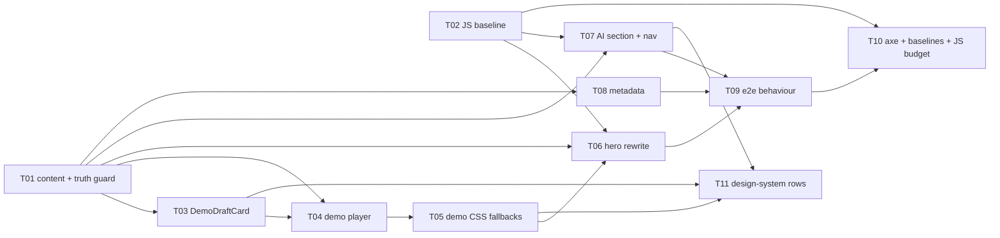

# Epic — landing-update

> **Spec:** [spec.md](../spec.md) · **Design:** [sad.md](../sad.md) · **Screens:** [screens.md](../screens.md) · **Data model:** none (no schema change) · **API:** none (the landing page makes no request) · **ADRs:** [adr/](../adr/)

## Goal

Ship the public landing page's new first screen around one promise — an invoice from one sentence — proven by the scripted Landing demo, plus one AI section that says plainly what the in-app AI does and does not do and which AI tools connect today (spec §2). A Visitor reaches account creation in one press, and nothing on the page promises more than the product does. Temporary bridge until public-redesign.

## Scope

- **In:** `landingContent` copy, the new `components/landing/landing-demo/` folder (player, card replica, CSS fallbacks), rewritten `LandingHero`, new `AiSection` + `#ai` nav link, landing route metadata, unit/component/e2e checks with Linux visual references, design-system inventory rows.
- **Out:** full public redesign, a live or interactive AI demo, in-app announcements, connection set-up material, any change to privacy / terms / sign-in pages (spec §3); no DB, API, server action or route handler.

## Task map

**Waves:** 1 — T01 ∥ T02 · 2 — T03 ∥ T07 ∥ T08 · 3 — T04 · 4 — T05 · 5 — T06 ∥ T11 · 6 — T09 · 7 — T10.
**Serialized lanes (overlapping `files_hint`):** T01 → T07 → T06 (`constants/public-pages-content.ts`, `landing-page.tsx`); T04 → T05 (`landing-demo/`); T09 → T10 (`tests/e2e/landing.spec.ts`).

## Tasks

See [tracker.md](./tracker.md) for status. Machine contract: [tasks.json](../tasks.json).

| # | Task | Layer | Blocked by | DoD (short) |
|---|---|---|---|---|
| T01 | Add the new landing copy and demo sample to landingContent + truth-guard test | domain | — | `landing-claims.test.ts` green, fails on any broken claim |
| T02 | Record the landing first-load compressed JS baseline | tests | — | baseline JSON committed from pre-change HEAD |
| T03 | Build DemoDraftCard replica | ui | T01 | card component test green, no `components/ai/` import |
| T04 | Build the LandingDemo player | ui | T01, T03 | demo component test: play-once, ≤ 8 s, Replay, links, no fetch |
| T05 | Add CSS-only still fallbacks + armed/visible reveal | ui | T04 | AC-04 branches green, box size unchanged |
| T06 | Rewrite LandingHero, drop stats | ui | T01, T02, T05 | hero component test green, build succeeds |
| T07 | Build AiSection + `#ai` nav link | ui | T01, T02 | AI section component test green |
| T08 | Override landing metadata | wiring | T01 | metadata unit test green |
| T09 | Landing e2e behaviour spec | tests | T06, T07, T08 | `landing.spec.ts` green locally (prod build) |
| T10 | axe + Linux visual references + 30 KB budget | tests | T02, T09 | 0 serious/critical, 4 baselines, Δ ≤ 30 KB |
| T11 | Register new components in design-system | docs | T03, T05, T07 | inventory rows exist (docs-only) |

## Risks / Hard rules

- **Every claim true today** (spec §1, AC-05, AC-07): only Claude Desktop, Claude Code and Cursor named; "MCP" at most once, never a heading; "unlimited" only for invoices and clients; the AI never issues/sends — pinned by T01's truth guard.
- **Zero data or model reach** (spec §6.1, QG-2): the landing page imports nothing from `components/ai/`, no server action, route handler or fetch (ADR-0001; T03/T04 tests, T09 request recording).
- **Fast, still first screen** (spec §6): LCP p75 ≤ 2.5 s, CLS p75 ≤ 0.1, ≤ 30 KB added JS, demo ≤ 8 s, no sideways scroll at 360 px; the headline has no opacity-0 entrance; the demo box never changes size (ADR-0002).
- **T02 must run before T06/T07** — the baseline is meaningless once the landing bundle changes.
- **e2e is not in CI** (sad §11): T09/T10 run locally before ship; Linux-named baselines are generated in the container.
- **Open copy questions** (spec §8): example sentence/draft (was due before `tasks` — tasks use the default) and final headline (due before `implement`); words live only in `landingContent`, so a change touches T01's file only.
