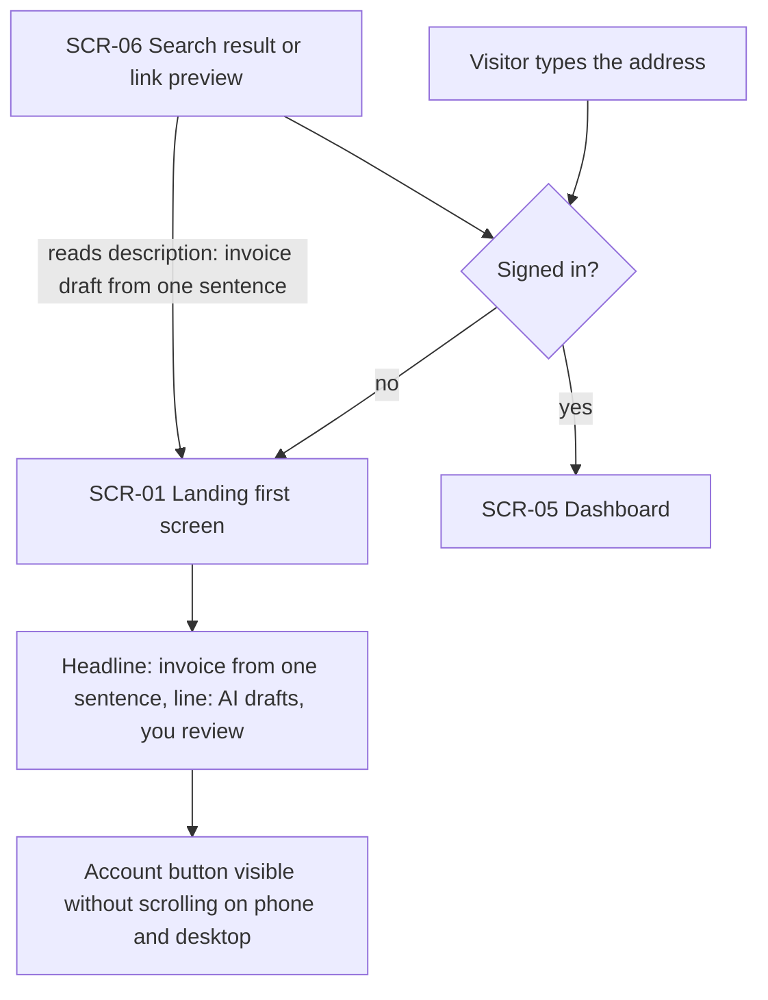
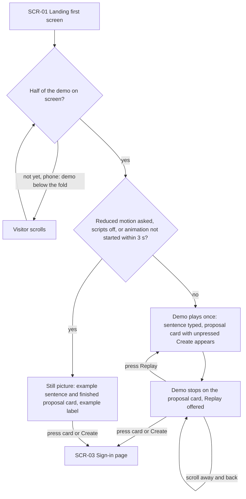
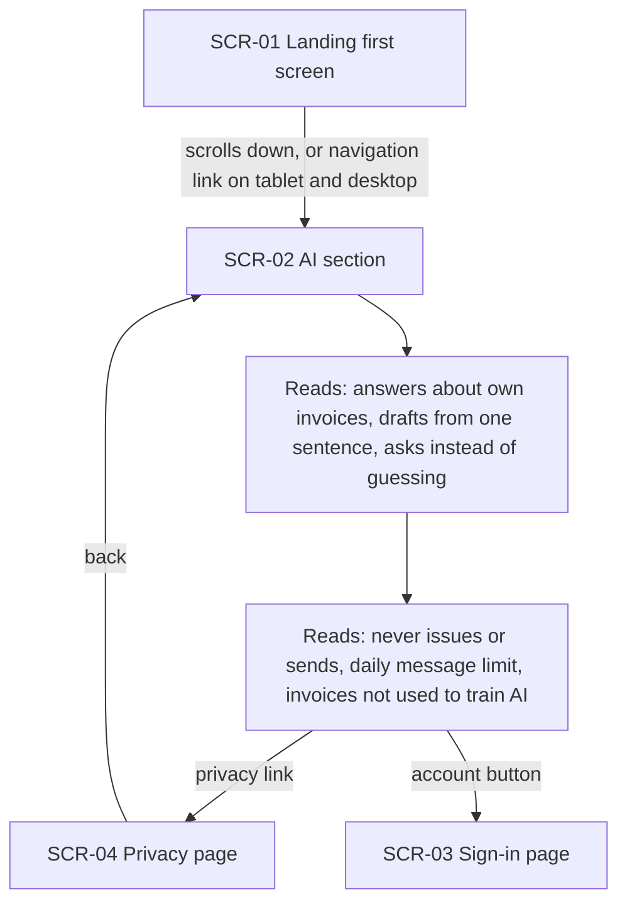
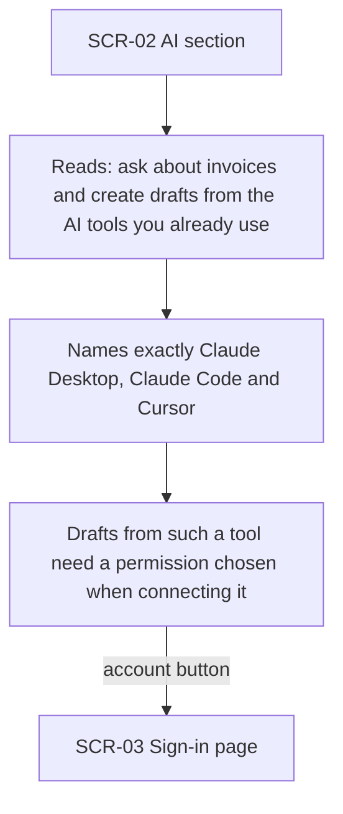
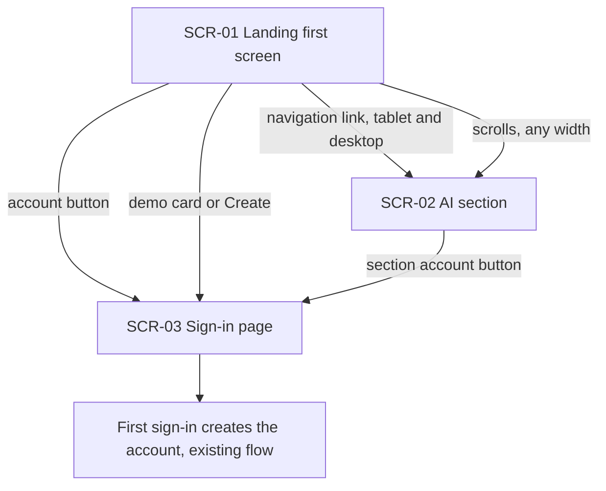
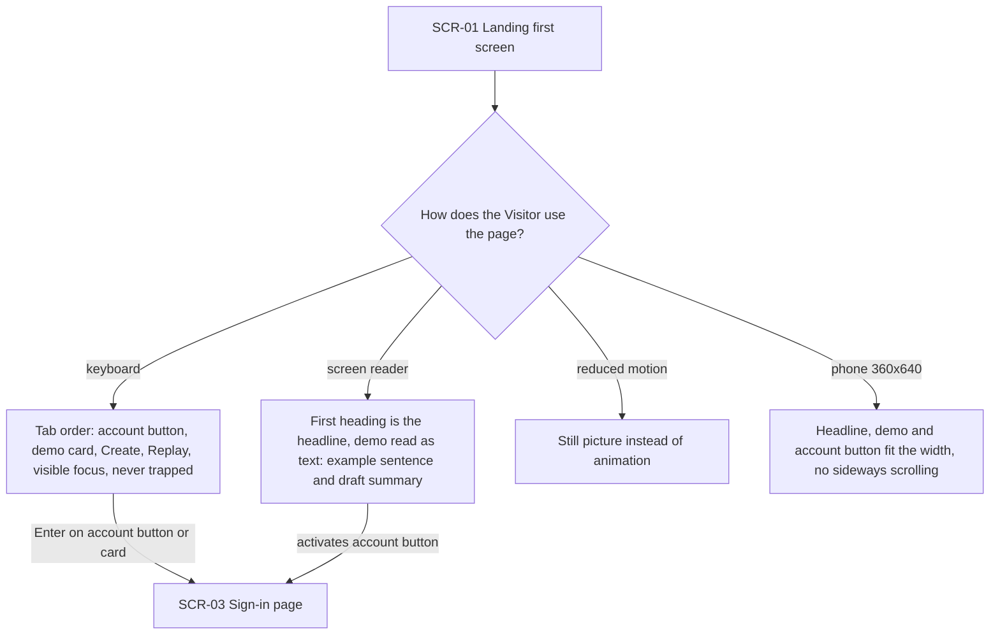
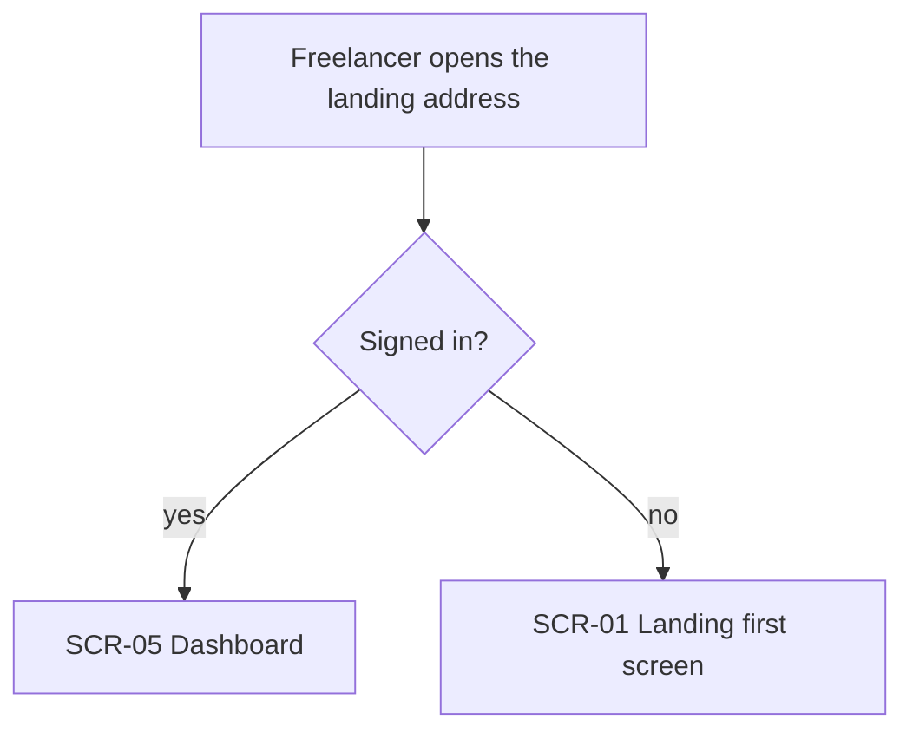

# UX flows — landing-update

> User flows for every UI-touching §4 user story of [spec.md](./spec.md), produced by `ux-flows`
> (after `clarify`, before `design`) and read by `design` (evidence for the target-surface and
> UI-architecture decisions), `screens` (details every inventory row) and `plan-tests` (the
> e2e-through-UI paths). Markdown + mermaid only; this is flow altitude, not visual design.

## Platform decisions

- **Posture:** responsive-both — `docs/design-system.md` names no posture; phone and desktop are equal, with the reference screens fixed by the spec (phone 360×640, desktop 1280×800).
- **One page, no new screens.** Everything new lives on the existing landing page: the first screen (headline + Landing demo) and the new AI section directly below it. Every exit leaves to a page that already exists (sign-in, privacy) or, for a signed-in Freelancer, to the dashboard.
- **Navigation shape by width.** On tablet and desktop the top navigation carries the new link that jumps within the page to the AI section; on a phone the navigation shows only the account button, as today, so the AI section is reached by scrolling.
- **Demo start is visibility-driven, not load-driven.** On a phone the demo can sit below the first screen; it starts only when at least half of it is on screen, once per page view (spec AC-02).
- **No dialogs, no in-page forms.** The Visitor never types anything; every action is a press that either replays the demo, scrolls within the page, or leaves for sign-in or privacy.
- **Design input flagged (not decided here):** whether the still picture is what the page first shows before the animation takes over, and how the 3-second fallback is timed, is an implementation choice for `design`; the flows only require that the still and the animation occupy the same space (AC-04).

## Screen inventory

| ID | Screen | Purpose | Entry | Exit |
|---|---|---|---|---|
| SCR-01 | Landing — first screen | One-sentence promise, the Landing demo (animated or still), Replay, account button | Typing the address, a search result or link preview (SCR-06), any public page's brand link | SCR-02 by scrolling or the navigation link (tablet/desktop); SCR-03 via the account button, the demo card or its Create button |
| SCR-02 | Landing — AI section | Plain-words account of the in-app AI and of using Invoice Forge from the Visitor's own AI tools; its own account button | Scrolling down from SCR-01; the new navigation link (tablet/desktop) | SCR-03 via its account button; SCR-04 via the privacy link; further down the unchanged landing sections |
| SCR-03 | Sign-in page (existing) | Where a first sign-in creates the account | Any account button, the demo card, the demo's Create button | Out of this feature (existing sign-in flow) |
| SCR-04 | Privacy page (existing) | How AI messages are processed | Privacy link in SCR-02 | Back to SCR-02 |
| SCR-05 | Dashboard (existing) | Where a signed-in Freelancer lands | A signed-in Freelancer opening the landing address | Out of this feature |
| SCR-06 | Search result / link preview (outside the app) | Shows the landing page's description before the visit | A search engine or a shared link | SCR-01 |

## Flows

Backend-only / non-UI stories, considered and not drawn: **US-08** (Contributor — automated checks of the landing page) touches no screen a person moves through; its AC-11 is covered by `plan-tests`.

### Flow: US-01 — See the one-sentence promise first

A Visitor arrives either from a search result or link preview, whose description already mentions getting an invoice draft from one sentence (AC-12), or by typing the address. A Visitor who is not signed in lands on the first screen, sees the headline and the line under it, and finds the account button without scrolling on both reference screens (AC-01). A signed-in Freelancer takes the other branch to the dashboard (detailed in US-07).

### Flow: US-02 — Watch a sentence become a draft

On the first screen the demo waits until at least half of it is visible; on a phone that may mean the Visitor scrolls first (AC-02). If the device asks for reduced motion, scripts do not run, or the animation has not started within 3 seconds, the Visitor sees the still picture of the finished proposal card in the same space, so nothing moves (AC-04). Otherwise the demo plays once: the example sentence is typed and the proposal card appears with a Create button it never presses, all labelled as an example and identical on every play (AC-02, AC-03, AC-05). It stops on that card; Replay plays it again from the start, scrolling away and back does not restart it, and pressing the card or its Create button — at any moment, or on the still — goes to the sign-in page, never to an invoice and never to the AI chat (AC-03).

### Flow: US-03 — Know what the AI will and won't do

From the first screen the Visitor scrolls down, or on tablet and desktop uses the new navigation link, and reaches the AI section directly below (AC-06). There they read what the AI does — answers about their own invoices, drafts from one sentence, asks when something is missing — and what it does not do: it never issues or sends an invoice, the chat has a daily message limit, and invoices are not used to train AI models (AC-05, AC-06). A privacy link takes them to the privacy page and back; the section's own account button leads to sign-in. No link leads to developer documentation (AC-06).

### Flow: US-04 — Learn I can use it from my AI tool

Inside the AI section the Visitor reads the part about their own AI tools: they can ask about invoices and create drafts from tools they already use, the three tools that connect today are named exactly, and drafting from such a tool needs a permission chosen when connecting it; the connection's technical name appears at most once in small print (AC-07). Setting up the connection is not on the landing page; the only way on is the account button.

### Flow: US-05 — Go from the promise to an account

Every new way forward ends on the existing sign-in page, where a first sign-in creates the account exactly as the landing page's existing buttons do (AC-08): the first screen's account button, the demo card or its Create button, and the AI section's own account button — reached by scrolling at any width or by the navigation link on tablet and desktop.

### Flow: US-06 — Use the first screen my way

A keyboard user reaches, in page order, the account button, the demo card, Create and the Replay control with visible focus, and focus never gets stuck in the demo; a screen-reader user hears the headline as the page's first heading and the demo as text — the example sentence and a summary of the proposed draft (AC-09). A Visitor who asks for reduced motion gets the still picture (AC-04), and on a 360×640 phone everything fits the width without sideways scrolling (AC-09). Each path can continue to sign-in the same way as a mouse user.

### Flow: US-07 — Keep going straight to my dashboard

A signed-in Freelancer who opens the landing address goes straight to the dashboard, as today, and never sees the new first screen or AI section; only someone not signed in reaches the landing page (AC-10).

## AC coverage

| AC | Shown by | Notes |
|---|---|---|
| AC-01 | Flow US-01 → headline and account-button nodes | Both reference screens |
| AC-02 | Flow US-02 → visibility check, play-once, stop with Replay | Scroll-away-and-back loop shows no restart |
| AC-03 | Flow US-02 → card / Create to SCR-03; Replay loop | No path from the demo reaches the AI chat or an invoice |
| AC-04 | Flow US-02 → still-picture branch; Flow US-06 → reduced motion | Same space as the animation |
| AC-05 | Flow US-02 → unpressed Create; Flow US-03 → "never issues or sends, daily message limit" | Claim content; checked on the page text |
| AC-06 | Flow US-03 → SCR-02 reading nodes, privacy link, own account button | No documentation link anywhere in the flow |
| AC-07 | Flow US-04 → tool-naming and permission nodes | |
| AC-08 | Flow US-05 → every edge into SCR-03 | Navigation link only on tablet and desktop |
| AC-09 | Flow US-06 → keyboard, screen-reader and phone branches | |
| AC-10 | Flow US-07 → signed-in branch to SCR-05; Flow US-01 → same branch | |
| AC-11 | N/A: automated checks are not a path a person takes through the UI | Covered by `plan-tests` / implementation |
| AC-12 | Flow US-01 → SCR-06 entry | Content of the description, not a screen of the app |
